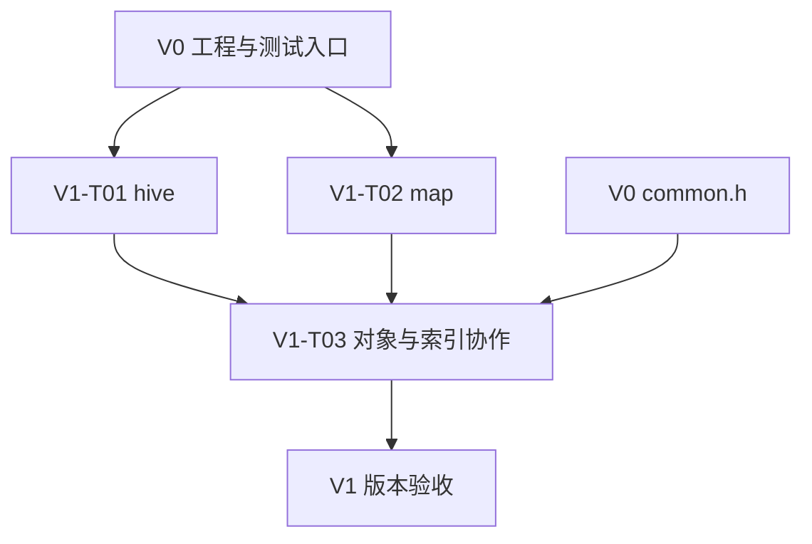

# Implementation Plan（实现计划）

> 项目：`qlib`｜目标版本：**V1 — 对象存储与键值索引**｜文档版本：v0.3  
> 日期：2026-10-14｜对应任务：V1-T01、V1-T02、V1-T03｜执行状态：未开始  
> 文件名：`Implementation_Plan.md`（V1；本次按请求更新原 `Implementation_Pl.md` 的名称）。

这份计划说明怎样把 V1 的设计写成代码，并怎样检查代码是否正确。它承接 `Sprint_Backlog.md` 中的三个任务：先实现保存对象的 `hive`，再实现按键查找的 `map`，最后验证两者怎样配合。前两项可以独立开发，组合任务需要两者都可用。

全文沿用模板的 7 章，第 3 章按三个技术模块展开。每个类说明要保存哪些数据、函数如何改变这些数据、资源何时释放；重要函数保留模板要求的 11 项说明。同一条实现路径上的多个重载放在一组解释，重载指函数名相同、接收参数不同的多个函数。

本文保留原 V1 方案的技术内容，按新增的“全文写作要求”逐段改写。前面生成的 V1 文档名为 `Implementation_Pl.md`；其他文档若仍按该名称引用 V1，所指的就是本计划。V0、V2、V3、V4 的实施计划各自保留。本次只更新文档，以下步骤、伪代码和验证命令均待执行，不表示已经完成实现或通过测试。

## 1. Implementation Overview（实现概述）

### 1.1 本次实现目标与范围

V1 解决三个相连的问题：对象存在哪里，怎样按编号找到它，不再需要时怎样安全删除它。

`hive<T>` 负责保存和销毁对象，`T` 表示对象类型。只要某个对象仍然存活，插入或删除其他对象不会改变它的地址。`map<Key,T,Hash,KeyEqual>` 保存“键→值”的对应关系；键是查找用的唯一标识，例如订单 ID。其中 `Key` 是键类型，`T` 是值类型，`Hash` 把键计算为整数供容器确定查找起点，`KeyEqual` 判断两个键是否应视为同一个键。组合时，`hive` 保存订单对象，`map` 保存“订单 ID→订单地址”，调用方就能按 ID 找到订单。

| 任务 | 本次交付 | 主要验收依据 |
| --- | --- | --- |
| V1-T01 | 完整 `hive` 接口、分块存储、删除位置的复用、遍历工具，以及对象创建和销毁的测试与说明。分块存储指空间不够时另加一块存储，已有对象留在原处。 | FR-05、AC-05；Spec §4.2。 |
| V1-T02 | 完整 `map` 接口，查找位置、处理冲突、标记删除和扩大容量的方法，以及遍历、失败情况的测试与说明。冲突指不同键被分配到相同的查找起点。 | FR-08—FR-10、AC-08—AC-10；Spec §4.3。 |
| V1-T03 | 一个可运行的组合场景：创建对象、建立 ID 索引、查找、处理重复、清理失败后新建的对象，以及正常移除。索引只帮助按 ID 找到对象。 | UC-01；Spec §2.5、§5.6、§6.3 的对象/索引部分。 |

本版不实现资源池、SPSC 队列、事件流水线、订单簿业务、网络服务或性能基准程序。SPSC 指一个生产线程写入、一个消费线程取出的队列模式，属于后续版本。每个 V1 任务包含自身测试和头文件接入检查；完整六个公共头的独立项目接入，以及 `map` 性能对比，仍由 V4 承担。内部函数的编码步骤不另设新的迭代任务编号。

### 1.2 参考的 Requirement 与 Spec

Requirement 是需求文档，说明调用方应看到什么结果；Spec 是规格文档，说明接口和设计；本文件进一步说明实现顺序与验证方法。下表保留原编号，方便读者回查。

| 基线 | 本计划使用的内容 |
| --- | --- |
| `requirement.md` v0.3 | §4.2.1、§4.3、UC-01、BR-06/07/10/12、AC-05/08/09/10；FR-14/15 的本阶段接入和测试；NFR-01/02/06/07/08，以及 NFR-04 中与本版有关的操作成本说明。 |
| `specs.md` v0.3 | §4.2、§4.3 的接口与结构；§4.7 的构建和测试；§5.1/5.2/5.3/5.5/5.6 的失败处理、线程、成本和限制；§6 的相关验收；SPEC-OI-01/02/03/08。 |
| `Sprint_Backlog.md` v0.2 | §3.2 的 V1 三项任务及版本验收，§4.1 的技术依赖，以及 §1.6 的全局完成标准。 |
| `AGENTS.md` | C++23 头文件组织、英文标识符与中文注释、CMake/GoogleTest、验证方法和工作区规则。 |
| 所提供 qlib v0.5.1 源码 | 用来核对字段、存储状态、空位置的管理，以及函数怎样调用。参考源码完整，不代表本次从零开发已完成。 |

FR 表示功能需求，BR 表示业务规则，AC 表示验收标准，NFR 表示质量要求，UC 表示使用场景，SPEC-OI 表示规格中的待确认问题。§ 后的数字是章节号，例如 §4.2 表示第 4.2 节。`requirement.md`、`specs.md` 和 `Sprint_Backlog.md` 的 v0.2 已改用通俗表达，原有 V1 范围和技术要求保持不变。

如果编码时发现文档对同一接口的说明冲突，要记录受影响的函数和要求，并同步修订文档。不能为了方便实现，悄悄改变返回值、支持的类型或验收标准。

### 1.3 现有代码与可复用组件

**实际开始 V1 前，必须确认 V0-T01 已完成，并能查到真实验证记录。** V0 提供公共数据、构建和测试入口；若它还没有完成，应先完成原 V0 任务。参考源码、已写好的计划以及文档示例，都不能代替这项前置条件。

| 来源 | 可复用内容 | 实施时处理 |
| --- | --- | --- |
| V0-T01 的目标成果 | `common.h`、`qlib::qlib`、测试开关、GoogleTest/CTest 入口、README 和忽略规则。 | 先确认它们实际存在且可以使用，保留已有公共数据和测试。`qlib::qlib` 是调用项目接入库的 CMake 目标名。 |
| C++ 标准库 | 在指定位置创建和销毁对象、按所需地址边界分配内存、检查类型特征、`std::pair`、`std::reverse_iterator`、哈希、比较和异常处理。 | 每个公共头自己包含所需标准头。类型特征用于在编译时判断一种类型具有什么性质；`std::pair` 保存键和值两个成员；`std::reverse_iterator` 把双向遍历改为反向遍历；哈希先把键算成整数，`map` 再据此确定查找起点。不能假定其他头会顺带引入所需声明。 |
| V1-T03 开始前应已完成的组件 | V1-T01 的 `hive` 和 V1-T02 的 `map`。 | 组合任务直接调用公开 API，即提供给使用者的接口，不复制容器实现，也不增加另一套负责销毁对象的机制。 |
| 参考源码及测试 | 理解算法和目标接口的依据。 | 理解后按本计划实现和验证；旧代码或旧测试结果不能作为本次通过记录。 |

### 1.4 开发环境、依赖与工具链

目标环境为 Linux x86-64，也可通过 WSL2 使用这一环境；WSL2 是在 Windows 上运行 Linux 环境的方式。使用支持 C++23 的 GCC 或 Clang 编译器、CMake ≥3.28、Git 和本地构建工具。CMake 负责组织编译，Git 用于记录和查看代码改动。

测试沿用 V0 配置的 GoogleTest v1.17.0。GoogleTest 提供测试断言，CTest 负责发现和统一运行已经登记的测试。只有开启测试时才获取测试依赖，qlib 运行时仍只依赖 C++ 标准库。

启动时在实际开发仓库根目录执行以下检查，并记录输出：

1. 执行 `c++ --version`，确认实际使用的 C++ 编译器及版本。
2. 执行 `cmake --version`，确认 CMake 版本满足要求。
3. 执行 `git status --short`，查看已有改动，避免覆盖无关工作。
4. 核实 GoogleTest 能否从现有缓存或依赖获取方式中取得，再使用 §5 的构建命令。

这些是未来启动实现时的检查步骤。本次编写文档所处的环境不能代表用户的开发机，也不能据此填写工具已可用或测试已通过。

### 1.5 实现约束与完成条件

- `include/qlib/hive.h` 和 `include/qlib/map.h` 同时放声明与模板实现，让调用方包含头文件后即可编译使用。保持纯头文件形式，不增加运行时 `.cpp`、内部锁、日志框架或服务入口。按 `AGENTS.md` 使用 2 空格缩进、英文命名和中文解释性注释。
- 实现规格已选定的公开接口。容器禁止复制，移动能力按各类原有约定提供；移动指把资源交给另一个对象，而不是复制一份。函数的参数、返回类型和 `noexcept` 不随意改变；`noexcept` 表示函数承诺不会把异常抛给调用方。
- 本版用明确的文档前置条件规定可支持的类型：`hive` 中对象的析构不能抛异常；`map` 元素的搬迁、析构及实际调用的策略操作不能抛异常。析构是对象结束生命时执行清理。允许按规格测试“新对象构造失败”的路径，但不据此承诺任意操作失败后都能恢复原状。
- 保留已有的静态结构断言，也就是在编译时检查结构要求的 `static_assert`。不新增统一的 `is_nothrow_invocable` 限制来拒绝所有无法由该类型特征判定为不抛异常的调用。具体支持条件按接口文档和适用类型测试落实。
- 容量计算必须能由所用整数类型表示，调用方必须提供仍有效的指针或遍历位置。迭代器就是容器提供的遍历位置工具。本版不增加每次扫描整个容器的合法性检查、可识别过期对象的世代句柄，或任意异常下的完整回滚。`max_size()` 给出容量上界信息，不代表每次算术都已有防溢出检查；新增检查须先明确接口影响并记录变更。
- 对象、数量和空闲位置的记录必须一致。例如，对象创建失败不能把数量加一。规格允许失败前已经扩大容量，或 `map` 已经重新安排了旧元素的位置；不能把这些情况写成“所有状态都不变”。
- 每个任务同时交付测试、使用规则注释、README 和实际验证记录。V1 完成需要三个任务及版本验收全部通过，并重新运行 V0 已有测试，确认没有破坏原有行为。DoD（Definition of Done）就是任务可以标记完成前必须满足的条件；没有实际运行的验证仍写“未执行”。
- 本次只改写实施计划，未修改实现代码、运行构建或进行提交推送。未来 Git 操作按有效用户授权进行；自动推送不是任务完成条件。

## 2. Implementation Structure（实现结构）

### 2.1 技术模块与代码文件的对应关系

下表把“要完成什么”对应到“修改哪里”。所有路径都相对于未来实际开发仓库的根目录。

| 模块 / 任务 | 实现文件 | 验证与说明 | 改动边界 |
| --- | --- | --- | --- |
| 地址稳定存储 / V1-T01 | `include/qlib/hive.h` | `tests/hive_test.cpp`、README | 实现完整容器；沿用 V0 的测试登记方式。 |
| 键值索引 / V1-T02 | `include/qlib/map.h` | `tests/map_test.cpp`、README | 实现完整映射；该头文件能够单独包含使用。 |
| 对象/索引协作 / V1-T03 | 无新增运行时模块文件 | 在 `tests/map_test.cpp` 增加独立的 `HiveIndexIntegration` 测试组，并补 README 示例。 | 组合现有公开接口；若发现不符合已承诺行为的问题，在对应组件中修复。 |
| 构建与验收支撑 | 既有根目录及 `tests/CMakeLists.txt` | 测试注册、实际日志和验证记录。 | 加入已实现的 hive/map 测试，不提前登记 V2/V3/V4 尚不存在的源文件。 |

### 2.2 各模块需要实现的类与组件

`hive<T>` 把空间分成多个块，每个块有若干槽位，一个槽位最多保存一个对象。对象删除后留下的空位置称为空洞，连续空洞组成洞段。`skipfield` 是记录如何跨过洞段的数组；空闲链把可复用的洞段连接起来。迭代器依照这些记录找到前一个或后一个存活对象，具体成员和操作在 §3.1 展开。

`map` 为键值对预留原始槽位，只有真正放入一项时才在其中创建 `std::pair` 对象。另一个控制字节数组记录每个槽位是未用、已占用还是已删除。查找从哈希算出的起点开始，逐个检查后面的位置，这叫线性探测；删除时留下的标记称为墓碑，提醒查找继续向后。它的前向迭代器只访问当前存活项。具体成员和操作在 §3.2 展开。

这些内部类型和数组只服务各自的容器，不扩为新的公共模块。组合验证在测试中创建 `hive<qlib::order>` 和 `map<std::int64_t,qlib::order*>` 两个局部对象：前者保存订单，后者把 64 位整数 ID 对应到订单指针。指针是对象的内存地址；保存这个地址不等于负责销毁对象。测试可增加记录创建和销毁次数的辅助类型，不新增 `OrderBook`、`IndexManager` 或事务类。

### 2.3 类与源文件、头文件的对应关系

| 类或组件 | 定义位置 | 对外可见性 |
| --- | --- | --- |
| `qlib::hive<T>`、其迭代器及块/槽/空洞辅助类型 | `include/qlib/hive.h` | 调用方使用容器和公开类型别名；存储怎样组织由私有实现负责。类型别名是给一种类型另起便于使用的名称。 |
| `qlib::map<Key,T,Hash,KeyEqual>`、其迭代器 | `include/qlib/map.h` | 容器和类型别名公开；控制字节、槽数组和查找辅助函数为私有实现。 |
| `qlib::order` 等公共类型 | 复用 `include/qlib/common.h` | 沿用同一份定义，不复制或改变字段含义。 |
| 计数对象、冲突哈希器、可抛构造对象、集成辅助函数 | 对应 `tests/*_test.cpp` 的测试局部作用域 | 只供测试使用。计数对象记录生死次数；冲突哈希器故意让不同键从同一位置查找；可抛构造对象用来模拟创建失败。它们不成为公共头文件，也不加入实际使用时经常执行的操作路径。 |

### 2.4 模块与类之间的实现依赖



箭头表示后面的工作需要先具备前面的结果。`hive` 和 `map` 各自只依赖标准库，不需要包含对方的头；两者都需要 V0 的工程和测试入口。公共订单类型来自 `common.h`，在组合验证时使用。V1 不依赖资源池或队列。

在容器内部，迭代器只负责找到对象，不负责对象的生死。`hive` 迭代器依靠块链和 `skipfield` 的状态规则，`map` 迭代器依靠控制字节和容量。某些规则在每次操作完成后都必须成立，这些规则称为“不变量”；例如存活数量应与实际对象数量一致。先明确这些规则，才能正确实现遍历和修改操作。

### 2.5 整体编码顺序及其原因

1. 先核实 V0 工程与测试入口可用，使后续每一步都有编译和验证途径。
2. 建议先实现 `hive`，理解对象由谁保存和销毁，以及为什么增长时地址不变。组件内部先完成存储的取得和释放，再逐步加入访问、修改与边界处理。
3. 再实现 `map`，理解怎样按 ID 找到值，以及删除和扩容怎样影响查找。它不依赖 `hive`，有并行开发条件时可独立推进。
4. 两个组件完成后，编写 V1-T03 的组合测试，验证重复 ID、建立索引失败和正常移除时的对象清理顺序。
5. 运行各任务及 V1 版本验收，核对使用说明与实际结果一致，再更新完成状态。

组件内部可以先形成较小的可运行结果，再补齐其他接口和边界。阶段检查通过只说明当时检查的行为正确；整个任务满足 DoD 后才能标记完成，内部步骤不新增 Backlog 任务编号。

## 3. Module Implementation（模块实现方案）

本章按 V1 的三个模块分别说明实现方案。读函数时先看它要改变什么，再看具体步骤；表中的输入条件、失败结果、复杂度和验证方法同样属于实现要求。

### 3.1 地址稳定存储模块（V1-T01）

#### 3.1.1 模块实现概述

这个模块让调用方把对象交给 `hive<T>` 保存，并在以后继续通过原地址找到仍然存活的对象。例如，调用方保存了订单 A 的地址，随后新增订单 B、删除订单 C，只要 A 没被删除，A 就留在原处。这里的“存活”表示对象已经构造成功，而且还没有被析构。

| 模板字段 | 本次实现安排 |
| --- | --- |
| 模块实现目标 | 完成 V1-T01：保存对象且保持存活地址稳定；支持移动插入、直接在目标位置构造对象、单项和范围删除、向前和向后遍历、只读遍历、从有效地址找到遍历位置、查询容量、移动容器、交换和清空。测试还要检查对象何时创建和销毁，以及构造失败后能否继续使用。以下内容都是待执行方案。 |
| 对应的 Spec 章节 | 遵循 `specs.md` §4.2、§5.1—§5.3、§5.5—§5.6、§6.1—§6.2；对应 FR-05、AC-05 和 `Sprint_Backlog.md` V1-T01。 |
| 需要实现的类与文件 | 在 `include/qlib/hive.h` 实现 `hive<T>` 及其内部使用的 `iterator_impl`、`slot_type`、`block_type`、`free_node`。在 `tests/hive_test.cpp` 验证行为，在 `tests/CMakeLists.txt` 注册测试，在 `README.md` 说明调用方应遵守的条件。模板代码全部放在头文件，不新增 `hive.cpp`。 |
| 依赖与复用组件 | 先具备 V0-T01 的 C++23 工程和测试入口。实现复用标准库的对齐分配、placement-new、类型特征和迭代器工具：对齐分配让地址符合 `T` 的要求；placement-new 在已经取得的内存中构造对象；类型特征用于检查类型能力；迭代器用于逐个访问对象。参考已提供的 `include/qlib/hive.h` 数据布局和算法。本模块不依赖 `map`、`common.h` 或 V2/V3 组件。 |

#### 3.1.2 Class Implementation（类实现）

##### 3.1.2.1 `qlib::hive<T>`

###### 3.1.2.1.1 类的实现目标

`hive<T>` 统一负责申请内存、构造对象、销毁对象和释放内存，这就是它对对象的“所有权”。内存按“块”申请，每块分成若干“槽”，一个槽最多保存一个 `T`。空间不够时，容器追加新块；删除对象时，容器只销毁指定对象，把空出的槽留作以后使用，因此不会搬动其他存活对象。

连续的空槽称为“洞段”。容器通过 `skipfield` 数组记录洞段首尾的长度，遍历时可以一次跳过整段空槽；`free_node` 则把各个洞段的起点连起来，方便插入时直接找到可复用位置。`block_type` 记录一块内存的布局和数量，`iterator_impl` 记录当前访问的是哪个容器、哪一块、哪一个槽。

公开声明、重载和别名必须与 Spec §4.2.2.8 一致。本次不增加 `reserve`、随机下标访问、复制容器，也不增加扫描所有槽来判断任意位置是否有效的功能。

###### 3.1.2.1.2 类的声明与文件组织

在 `<qlib/hive.h>` 的 `namespace qlib` 内定义 `template <typename T> class hive`，让调用方用 `qlib::hive<Order>` 这样的写法选择保存的对象类型。按下面顺序组织头文件，避免后面的声明引用尚未定义的内部类型：

1. 声明内部记录和迭代器类型。
2. 声明调用方可见的类型别名和方法。
3. 定义存储辅助函数和容器成员变量。
4. 在类后定义自由函数 `swap(hive<T>&, hive<T>&) noexcept`。

头文件要直接包含自己使用的标准库头文件。一个程序只包含 `hive.h` 时，也应能编译，不能碰巧依靠别的头文件带入所需声明。

###### 3.1.2.1.3 成员变量的具体实现

下面的“链”表示用前后位置把多个记录连接起来；沿 `next` 能找到后一个，沿 `prev` 能找到前一个。“不变量”是每次公开操作完成后都必须成立的状态规则。

| 字段 / 常量 | 数据类型与容器 | 初始化与生命周期 | 所有权与资源管理 | 状态约束与不变量 |
| --- | --- | --- | --- | --- |
| `head_`、`tail_` | `block_type*`，分别指向全部块链的首块和尾块 | 初始为 `nullptr`；追加或释放块时更新；清空后归空 | `hive` 独占这些块，前后指针只表示连接关系，不重复拥有内存 | 非空链首块的 `prev=nullptr`，尾块的 `next=nullptr`；相邻块的前后指针必须互相对应。 |
| `erased_head_` | `block_type*`，指向“还有洞可用”的块链首项 | 初始为空；一个块首次出现洞时加入此链，所有洞填完时退出 | 此链只引用全部块链中已有的块，不再申请一份块 | 每个 `free_head != npos` 的块在此链中恰好出现一次。 |
| `size_`、`capacity_` | `size_type=std::size_t`，分别记录活对象数和已申请槽数 | 初始为零；构造成功后才增加 `size_`；分配和释放块时调整 `capacity_` | 两个字段只是计数，不单独申请内存 | `size_` 等于各块 `active` 的总和；`capacity_` 等于各块容量的总和。 |
| `skip_t`、`npos` | `std::uint16_t`、`0xFFFF` | 编译时确定 | 不管理资源 | `npos` 是“没有这个位置”的特殊值，即哨兵值；洞段长度和洞段起点索引都必须小于它。 |
| 块容量界限 | `min_block_capacity=8`、`max_block_capacity=8192` | 编译时确定 | 控制一次申请的槽数 | 保留 `static_assert(max_block_capacity < npos)`，在编译时确认合法容量不会撞上哨兵值。 |
| `block_align` | `max(alignof(block_type),alignof(slot_type))` | 编译时计算 | 申请和释放块都使用同一个对齐要求 | 槽数组起点相对块起点的偏移，向 `alignof(slot_type)` 的整数倍上取整；总字节数必须能用相应整数类型表示。 |

块内还会用到三个计数：`capacity` 是这块一共能放多少个槽，`high_water` 是尾部已使用区域的结束位置，`active` 是当前活对象数。例如一块有 8 个槽，曾在前 5 个槽成功构造对象，随后删除 2 个，则三者分别是 8、5、3；删除留下的洞不让 `high_water` 倒退。

取得原始内存不等于已经有了 `T` 对象。本方案先在块内显式构造空的 `slot_type` 数组，为槽本身建立 C++ 对象生命周期，之后才逐项构造 `T`。这里不会默认构造整块 `T`，也不新增公开功能。这一内部初始化安排依据原计划所列的 [对象模型](https://eel.is/c++draft/intro.object) 和 [new 表达式](https://eel.is/c++draft/expr.new)。

可可靠使用的 `T` 必须满足 Spec 的条件：析构函数不抛异常，调用方使用的构造表达式有效。直接在槽中构造对象不要求 `T` 能复制或移动。测试应覆盖这些类型条件。若用户自己的构造函数修改了外部变量后再抛出异常，`hive` 不负责撤销那些外部修改。

###### 3.1.2.1.4 成员函数的具体实现

下文用 N 表示活对象数、B 表示块数、C 表示本次新块容量、K 表示范围删除的对象数。O(1) 表示管理步骤不会随着这些数量增加，O(N) 等表示工作量随对应数量增长。对象自身的构造、析构，以及系统申请和释放内存的耗时另行计算；O(1) 不代表每次调用有固定延迟。所有步骤和伪代码都是待实现方案。

**3.1.2.1.4.1 插入：`emplace` 与 `insert`**

这两个入口都要把一个新对象放进容器。`emplace` 直接用参数在目标槽中构造对象；`insert` 接收一个可移动的现有对象，再把工作交给 `emplace`。

| 字段 | 实现方案 |
| --- | --- |
| 函数声明与职责 | `template<class... Args> iterator emplace(Args&&... args)`；`iterator insert(T&& value)`。`emplace` 处理复用洞、使用尾部未用槽、申请新块这三条路径；`insert` 只调用 `emplace(std::move(value))`。 |
| 输入、输出与契约 | 参数必须能构造 `T`。成功后返回指向新对象的迭代器，并把 `size_` 加一；其他存活对象保持原地址。构造失败时，容器不能把尚未完成的对象计入存活项。 |
| 核心算法与数据结构操作 | 优先选择 `erased_head_->free_head` 指出的洞段起点；没有洞才用尾块未用槽；两者都不可用才申请新块。填入洞段起点后，容器把洞段起点移到下一个槽，或移除已经填完的洞段。 |
| 具体执行步骤或伪代码 | 按下方两条路径的有序步骤实现。关键顺序是先尝试构造 `T`，成功后才提交洞标记和对象计数。 |
| 成员变量的读取与修改 | 读取有洞块链首项、尾块容量和 `high_water`；按需要修改洞段首尾、`free_head`、相邻空闲节点、有洞块链和计数。只有新块路径增加 `capacity_`；复用洞不增加 `high_water`。 |
| 对其他函数的调用 | 需要新块时调用 `next_block_capacity()`、`allocate_block()`；填完一个块的全部洞时调用 `unlink_erased()`；最后用迭代器的私有构造函数表示新对象位置。 |
| 边界情况与错误处理 | 首次插入申请 8 个槽。洞段长度为 1 时移除整段，大于 1 时把起点移到 `idx+1`。一个洞段填完但块内还有其他洞时，该块仍留在有洞块链中。旧对象被删除后，即使新对象使用了同一地址，也不能重新使用旧对象的指针或迭代器凭据。 |
| 异常安全与状态一致性 | 复用洞时若构造抛出异常，恢复 `links=ln` 后继续向外抛出；洞段长度和计数此时尚未提交。尾部未用槽构造失败时，`high_water`、`active`、`size_` 都不增加。新块先接到块链再构造对象，因此失败可以留下 `active=high_water=0` 的空尾块，`capacity_` 也可以增加；后续插入、遍历和清空都必须处理这个状态。 |
| 时间复杂度与空间复杂度 | 不申请新块时，管理工作和额外栈空间都是 O(1)。新块初始化需要 O(C) 工作和 O(C) 新存储。连续增长并逐步填满新块时，平均到这批插入的管理工作可为 O(1)，即摊销 O(1)；若反复删空并重建块，应对每次新块初始化按 O(C) 计，C≤8192。含内存分配的单次操作不承诺固定延迟。 |
| 并发、同步与线程安全 | 调用方必须独占这次写入过程，不能让其他线程同时读写、移动或销毁容器。本函数不添加锁、原子变量或后台任务；用户构造函数涉及的共享状态也由调用方安排同步。 |
| 单元测试与验证方法 | 测试空表插入、跨多个块增长、只能移动的类型、不能移动但能直接在槽内构造的类型，并确认原有活对象地址不变。用能够按指定次数抛异常的测试类型，分别让洞复用、已有尾部未用槽、新块路径失败；核对数量和独立维护的存活集合，再继续插入和清空。 |

有洞可复用时，按以下顺序执行：

1. 取得洞段起点 `idx`，保存 `ln=links` 和 `run=skipfield[idx]`。保存链接是因为构造 `T` 将覆盖同一槽中的空闲记录。
2. 用 placement-new 在该槽尝试构造 `T`；失败就恢复 `links=ln` 并继续抛出异常。
3. 成功后写 `sf[idx]=0`，表示该槽现在是活对象；按 `run` 缩短洞段或把已填完的洞段从链中移除。
4. 增加该块的 `active` 和容器的 `size_`，返回新对象位置。

没有洞时，按以下顺序执行：

1. 检查尾块是否还有未用槽；没有时先申请新块，并接到全部块链尾部。
2. 在 `high_water` 对应的槽构造 `T`。例如 `high_water=5` 时，下一个未用槽就是索引 5。
3. 仅在构造成功后增加 `high_water`、`active`、`size_`，再返回新对象位置。失败则保留原计数；若刚申请过新块，允许这个空块留在尾部。

**3.1.2.1.4.2 删除：单项与范围 `erase`**

删除要结束指定对象的生命周期，同时让其余对象仍可正常查找和遍历。例如删除 B 后，调用方可以直接用返回位置继续访问原本位于 B 后面的 C。

| 字段 | 实现方案 |
| --- | --- |
| 函数声明与职责 | `iterator erase(const_iterator pos)`；`iterator erase(const_iterator first, const_iterator last)`。单项版本销毁对象并更新空槽记录；范围版本反复调用单项版本。 |
| 输入、输出与契约 | `pos` 必须是本容器中仍存活的对象位置；范围必须能从 `first` 向前走到 `last`，允许二者相等的空范围。返回原后继或范围终点。只删除指定对象，不搬动其余对象。 |
| 核心算法与数据结构操作 | 删除前先求后继，再析构对象并减计数。若整块已无活对象，就从两条块链摘除并释放；否则根据左、右邻居是否为空槽，更新洞段，四种情况见 §3.1.4。 |
| 具体执行步骤或伪代码 | 单项按下方 1—4 步执行。范围版本保持 `while(first!=last) first=erase(first); return iterator(this,last.blk_,last.idx_)`：每次用单项删除返回的位置继续，直到到达终点。 |
| 成员变量的读取与修改 | 读取目标位置、块前后关系和左右 `skipfield`；修改 `active`、`size_`、洞段首尾和空闲链。整块删空时还要修改 `head_`、`tail_`、有洞块链和 `capacity_`。 |
| 对其他函数的调用 | 用迭代器 `operator++` 求后继；按需要调用 `unlink_erased`、`deallocate_block`；非空块调用 `push_free`、`move_free_node` 或 `remove_free_node`。范围版本调用单项重载。 |
| 边界情况与错误处理 | 覆盖首项、末项、唯一项、块首尾、连续范围、中间整块和跨块范围。`erase(end())`、传入其他容器的位置、重复删除同一位置都违反调用条件；实现不增加扫描检测，也不测试它们是否返回错误码。 |
| 异常安全与状态一致性 | `T` 的析构必须不抛异常。先保存后继，防止释放块后再读取它；在支持的类型条件下，后续链更新不申请内存、也不抛异常。范围删除逐项生效，不把 K 次删除包装成可整体回滚的事务，也不承诺恢复抛异常的用户析构函数。 |
| 时间复杂度与空间复杂度 | 单项管理工作 O(1)，删除 K 项为 O(K)，额外空间 O(1)；对象析构和空块释放成本另计。 |
| 并发、同步与线程安全 | 调用方必须独占容器，并先解除应用中指向目标对象的外部引用。单线程可用返回迭代器继续删除；其他线程不能同时遍历。 |
| 单元测试与验证方法 | 保留两端用作参照的对象，依次制造无邻洞、只有左洞、只有右洞、两侧都有洞四种情况。核对剩余集合、正反遍历、返回后继、保留对象地址和析构次数；再测空范围、全范围、跨块范围，以及删空头块、中间块、尾块。 |

单项删除按以下顺序执行：

1. 用 `next=iterator(this,b,idx); ++next` 先保存目标的后继。这样即使稍后释放目标所在块，也不必再读它来寻找下一项。
2. 执行 `destroy(T); --active; --size`，销毁目标并减少对应计数。
3. 若 `active` 已为零，从有洞块链和全部块链中摘下该块，释放它，然后返回保存的 `next`。
4. 若块内还有对象，读取左、右洞段长度 L/R，按 §3.1.4 合并或新建洞段，再返回 `next`。

**3.1.2.1.4.3 块存储：增长、分配和释放**

这组私有函数只解决“取得和归还一块存储”。它们不决定块接到哪里，也不代替公开操作销毁块内对象。

| 字段 | 实现方案 |
| --- | --- |
| 函数声明与职责 | 私有 `std::size_t next_block_capacity() const noexcept`、`block_type* allocate_block(std::size_t cap)`、`void deallocate_block(block_type* b) noexcept`。分配函数不把新块接入链；释放函数不逐项析构 `T`。 |
| 输入、输出与契约 | `cap` 必须是支持的块容量；分配成功返回初始化好的块。释放函数只接收本容器拥有、且其中所有 `T` 都已销毁的块；调用方必须先移除所有指向该块的链连接。 |
| 核心算法与数据结构操作 | 一次对齐分配同时容纳块头、槽数组和 `skipfield`。下一块容量依据当前总容量计算，并限制在 `[8,8192]`，不依据当前活对象数计算。 |
| 具体执行步骤或伪代码 | 按下方步骤计算布局、初始化和释放。总字节公式为 `off+cap*(sizeof(slot_type)+sizeof(skip_t))`；空槽数组初始化只建立空 union，不构造 `T`。union 是让多个成员共用同一段内存的类型，这里同一槽轮流保存 `T` 或空闲链接。 |
| 成员变量的读取与修改 | 容量策略读取 `capacity_`；分配或释放成功时增加或减少 `capacity_`。新块的链指针、`free_head`、`active`、`high_water` 使用记录默认值；这组函数不修改 `head_`、`tail_`。 |
| 对其他函数的调用 | 使用对齐形式的 `::operator new/delete`、块头构造和析构、`::new (slot_region) slot_type[cap]`、`std::memset`。`slot_region` 是已对齐的 `void*`；这里的全局非分配 placement array new 只使用现成内存，不再申请数组存储。不调用 `T` 构造、公共 `clear` 或自有队列。 |
| 边界情况与错误处理 | 首块为 8 槽；持续增长时块大小依次是 8、8、16、32……，到 8192 后不再增加。若 `T` 要求更高地址对齐，`slot_type` 和 `block_align` 必须把这个要求传递到块分配。字节计算超出整数可表示范围的配置不属于 V1 合法输入；`max_size()` 的返回值不能代替容量校验。 |
| 异常安全与状态一致性 | `operator new` 抛出异常前，不修改容器计数。其后的块头初始化、空槽初始化和清零都不抛异常；释放也不抛异常。分配成功后，由 `emplace` 负责接链，并处理构造对象失败后留下空尾块的情况。 |
| 时间复杂度与空间复杂度 | 计算下一块容量 O(1)；初始化新块 O(C)，存储大小为 `off+C*(sizeof(slot_type)+sizeof(skip_t))`。释放的管理步骤 O(1)，系统分配器耗时另计。 |
| 并发、同步与线程安全 | 只从调用方已经独占容器的路径调用；块计数不是原子变量。即使系统分配器内部有同步，也不意味着整个容器支持并发写入。 |
| 单元测试与验证方法 | 通过插入跨越容量边界，核对公开容量变化；用 `alignas(64)` 或要求更高对齐的对象检查地址；删空块和 `clear` 后检查容量及对象生命周期。若无法受控地让分配失败，记录这一未覆盖场景，不通过耗尽宿主内存来制造失败。 |

分配一块内存按以下顺序执行：

1. 计算 `off=round_up(sizeof(block_type),alignof(slot_type))`，让块头之后的槽数组从符合对齐要求的地址开始。
2. 申请 `off+cap*(sizeof(slot_type)+sizeof(skip_t))` 字节，在开头用 placement-new 构造块头，再确定槽数组和 `skipfield` 的起点。
3. 用全局非分配形式 `::new (slot_region) slot_type[cap]` 显式构造空槽数组。这里只让槽本身存在，不创建任何 `T`。
4. 把 `skipfield` 清零，记录块容量 `cap`，增加容器 `capacity_`，返回新块。

释放时，调用方先销毁所有活对象并把块摘链；`deallocate_block` 再减少 `capacity_`、析构块头，最后用匹配的对齐 delete 归还整块内存。

**3.1.2.1.4.4 清空与析构：`clear`**

`clear` 要把对象和底层块一起释放。例如容器有 3 个活对象和若干删除留下的洞，清空时只能析构这 3 个对象，不能把洞当成对象再析构一次。

| 字段 | 实现方案 |
| --- | --- |
| 函数声明与职责 | `void clear() noexcept`；`~hive()` 调用它。销毁所有活对象，并释放所有块。 |
| 输入、输出与契约 | 无参数、无返回值；容器必须有效且没有其他访问者。完成后 `head_`、`tail_`、`erased_head_` 为空，`size_` 和 `capacity_` 为零。 |
| 核心算法与数据结构操作 | 沿全部块链逐块处理；每块从索引 0 遍历到 `high_water`。遇到活槽就析构，遇到洞段起点就按记录长度跳过，不读取洞段中间留下的旧标记。 |
| 具体执行步骤或伪代码 | 按下方 1—4 步释放。块内判断保持为：`sf[i]==0` 时析构并 `++i`；否则 `i+=sf[i]`。 |
| 成员变量的读取与修改 | 读取块的 `next`、`high_water` 和 `skipfield`；`deallocate_block` 逐块扣减 `capacity_`；最后重置全部链入口和 `size_`。 |
| 对其他函数的调用 | 调用 `T` 的析构和 `deallocate_block`。不逐个调用 `erase`，因为即将整块丢弃，不必为每个对象重新维护空闲链。 |
| 边界情况与错误处理 | 支持本来就为空、所有元素已删、含多个洞段、构造异常留下空尾块，以及重复清空。释放块前必须保存 `next`，不能释放后再读下一块地址。 |
| 异常安全与状态一致性 | 依赖 `T` 不抛异常的析构；违反这一条件不提供恢复。每个成功构造且仍存活的对象析构一次；从未构造的槽和已删除的洞不析构。 |
| 时间复杂度与空间复杂度 | O(N+B)，另计对象析构和块释放耗时；额外空间 O(1)。完成后不保留块存储。 |
| 并发、同步与线程安全 | 调用方先结束所有访问并完成必要同步，再按应用顺序解除外部索引。`clear` 不会替调用方等待线程结束，也不会自动执行 `join`。 |
| 单元测试与验证方法 | 用记录构造、析构次数的类型，覆盖全存活、活对象与洞混合、异常空尾块。检查显式 `clear` 和离开作用域时的析构都无泄漏、无重复析构；清空后再次插入，确认容器可继续使用。 |

1. 保存当前块的 `next`，并令槽索引 `i=0`。
2. 在 `i<high_water` 时检查 `sf[i]`：值为零就析构该对象并前进一槽，否则按该洞段长度一次跳过。
3. 本块处理完后调用 `deallocate_block`，再转到事先保存的 `next`。
4. 所有块处理完后，清空三个链头/尾字段和 `size_`；`capacity_` 已在逐块释放时减到零。

**3.1.2.1.4.5 所有权转移：移动、`swap` 与 `steal`**

移动或交换容器时，只改变“由哪个容器负责这些块”，不逐个搬动 `T`。例如把 A 移动到 B 后，原来由 A 保存的活对象地址不变，今后由 B 负责销毁它们。

| 字段 | 实现方案 |
| --- | --- |
| 函数声明与职责 | `hive(hive&&) noexcept`、`hive& operator=(hive&&) noexcept`、`void swap(hive&) noexcept`、私有 `void steal(hive&) noexcept`，以及自由 `swap`。这些操作转移或交换块的所有权，不搬迁 `T`。 |
| 输入、输出与契约 | 源和目标容器必须有效；移动赋值返回 `*this`，`swap` 和 `steal` 无返回值。移动后源容器为空且不持有分配，可再次插入。复制构造和复制赋值保持 `=delete`，即明确禁止复制。 |
| 核心算法与数据结构操作 | `steal` 用 `std::exchange` 取得源的三个指针、两个计数，并同时把源这些字段清空；`swap` 成对交换同样五个字段。 |
| 具体执行步骤或伪代码 | 按下方步骤区分移动构造、移动赋值和交换；移动赋值保持 `if(this!=&other){clear();steal(other);}`。 |
| 成员变量的读取与修改 | 读取和修改源、目标的 `head_`、`tail_`、`erased_head_`、`size_`、`capacity_`；不改变块内槽地址和已有元素内容。 |
| 对其他函数的调用 | 调用 `clear()`、`steal()`、`std::exchange`、`std::swap`；不调用 `T` 的移动构造函数。 |
| 边界情况与错误处理 | 支持空与非空互换、自移动、自交换。移动赋值先销毁目标原有对象。移动或交换后必须重新取得正向和反向迭代器，因为旧迭代器的 `owner_` 仍指向原容器。 |
| 异常安全与状态一致性 | 指针和整数的转移、交换不抛异常；清理移动赋值的目标时仍要求 `T` 析构不抛异常。五个成员必须成组处理，不能漏掉容量或有洞块链。 |
| 时间复杂度与空间复杂度 | 移动构造、`steal`、`swap` 都为 O(1)。移动赋值需要先清理目标，成本 O(目标原 N+B)。额外空间 O(1)，不申请新块。 |
| 并发、同步与线程安全 | 两个容器都必须排除其他访问者。应用若另有索引，还需同步更新“索引属于哪个容器”的关系。 |
| 单元测试与验证方法 | 操作前保存有效对象地址，操作后用新的所属容器重新定位。检查源为空且可再插入、目标旧对象已析构、洞仍能复用；在编译时确认容器不可复制。 |

1. 移动构造先把目标初始化为空，再调用 `steal` 接管源的五个字段。
2. 移动赋值先检查 `this!=&other`；不是自移动时，先 `clear()` 目标原有内容，再 `steal(other)`。
3. 成员 `swap` 成对交换五个字段；自由 `swap` 调用成员版本。完成后，调用方重新取得迭代器。

**3.1.2.1.4.6 地址定位：`locate` 与 `get_iterator`**

这组函数把一个有效对象地址转换成可继续遍历或删除的位置。例如调用方保存了订单 A 的准确地址，可以让所属 `hive` 返回指向 A 的迭代器。它不负责判断任意旧指针是否安全。

| 字段 | 实现方案 |
| --- | --- |
| 函数声明与职责 | 私有 `std::pair<block_type*,std::size_t> locate(const_pointer p) const noexcept`；公开 `iterator get_iterator(const_pointer) noexcept` 及其 const 重载。前者找块和槽，后者把结果包装成迭代器。 |
| 输入、输出与契约 | 正式保证只适用于本容器当前存活对象的准确起始地址，返回该对象位置。参考实现对不在任何已使用块范围内的地址返回 `end`，但不承诺任意旧地址、对象内部地址或假造地址都能安全失败。 |
| 核心算法与数据结构操作 | 逐块读取地址范围，用 `uintptr_t` 把地址表示为整数后筛选 `[slots,slots+high_water)`；命中后计算槽索引并检查 `skipfield`。不另外建立一张按地址查找的哈希表。 |
| 具体执行步骤或伪代码 | 按下方 1—3 步执行。索引计算保持 `(reinterpret_cast<const slot_type*>(p)-b->slots)`，命中返回 `{b,idx}`，未找到返回 `{nullptr,0}`。 |
| 成员变量的读取与修改 | 只读取 `head_`、各块的 `next`、`slots`、`high_water`、`skipfield`，不修改容量、对象或链。 |
| 对其他函数的调用 | `locate` 不调用其他外部组件；公开包装函数调用 `locate`、`end` 和迭代器私有构造函数。 |
| 边界情况与错误处理 | 覆盖空容器、首块和末块的有效地址、只读容器调用。失效地址和对象内部地址不作为正常输入测试。洞段中间可能残留值为零的旧标记，因此该算法不能充当可靠的“对象是否仍活着”检测器。 |
| 异常安全与状态一致性 | 对合法指针不申请内存、不改状态，并保持 `noexcept`。本次不增加恢复码、记录复用次数的代际表，也不扫描全表检查每个槽；不能宣称已经处理参考实现的非法输入风险。 |
| 时间复杂度与空间复杂度 | 最多查看 B 个块，时间 O(B)，额外空间 O(1)。 |
| 并发、同步与线程安全 | 读取期间不得有并发写入。删除、移动、交换可能改变对象有效性或所属容器，不能与定位同时执行。 |
| 单元测试与验证方法 | 遍历并保存所有活对象的准确地址，分别从可写、只读容器恢复位置，核对还是同一个对象；跨块增长和删除其他对象后再检查。不要求过期地址一定返回 `end`。 |

1. 沿块链比较地址 `p` 是否位于各块已使用区域。
2. 命中后计算槽索引；该槽标记为零时返回 `{b,idx}`，否则返回 `{nullptr,0}`。遍历全部块仍未命中也返回空结果。
3. `get_iterator` 看到有块就构造对应迭代器，没有块就返回 `end`。

**3.1.2.1.4.7 空洞链辅助函数**

这些函数让删除和插入共用同一套链更新规则。例如删除对象后出现一个新洞段，`push_free` 把它加入本块的可复用列表；洞段起点移动时，`move_free_node` 同时修正邻居保存的位置。

| 字段 | 实现方案 |
| --- | --- |
| 函数声明与职责 | 私有 `push_free(block_type*,std::size_t) noexcept`、`move_free_node(block_type*,std::size_t from,std::size_t to) noexcept`、`remove_free_node(block_type*,std::size_t) noexcept`、`link_erased(block_type*) noexcept`、`unlink_erased(block_type*) noexcept`。 |
| 输入、输出与契约 | 输入块和槽索引必须属于对应的链，函数无返回值。`push_free` 只加入新洞段起点；`move_free_node` 处理右洞段起点向左移动；`remove_free_node` 在合并时移除右洞段记录。洞段长度由调用这些函数的操作维护。 |
| 核心算法与数据结构操作 | 同一块里的洞段用 `skip_t` 索引连接；不同块之间的有洞块链用指针连接。每次只修改当前节点和直接相邻节点，不扫描整条链。 |
| 具体执行步骤或伪代码 | 按下方列表实现加入、搬动、移除三种块内更新，以及加入和移出有洞块链两种跨块更新。 |
| 成员变量的读取与修改 | 修改块的 `free_head`、洞段起点 `slots[idx].links`、容器 `erased_head_`、块的 `next_erased/prev_erased`；不增减 `size_`、`active`、`high_water`。 |
| 对其他函数的调用 | `push_free` 在块第一次出现洞时调用 `link_erased`；其余辅助函数由 `erase/emplace` 调用。需要时用 placement-new 建立空槽和链接记录的生命周期，不调用公开插入接口。 |
| 边界情况与错误处理 | 处理单洞、链首、链中、链尾，以及右洞紧邻左洞。合并时即使移除了右洞段，左洞段仍存在，不能把块误删出有洞块链；最后一个洞填完时由 `emplace` 明确调用 `unlink_erased`。 |
| 异常安全与状态一致性 | 先保存旧 `links`，再覆盖槽；这些记录操作不抛异常。不能覆盖仍活着的 `T`，也不能到洞段中间不承担链接作用的槽读取链接。 |
| 时间复杂度与空间复杂度 | 每个辅助操作都是 O(1) 时间、O(1) 额外空间；链接放在空槽中，不另行申请链节点。 |
| 并发、同步与线程安全 | 只供已经由调用方做好同步的修改路径使用，不对外单独开放。 |
| 单元测试与验证方法 | 用四种删除情况和反复填洞间接验证。让多个块分别有多个洞，填完某一块的洞后继续插入；复用已有洞不应增加容量。通过存活集合、地址和计数发现链更新错误，不在正式运行路径增加全链扫描。 |

1. `push_free` 在槽内建立空槽及 `links` 表示，写入 `{npos,old_head}`；修正旧头的 `prev`。若这是块内第一个洞，就调用 `link_erased`，最后更新 `free_head`。
2. `move_free_node` 先复制旧 `links`，再写入新起点；让前、后邻居指向新索引，必要时更新 `free_head`。
3. `remove_free_node` 让前后邻居直接连接；移除的是头节点时更新 `free_head`。
4. `link_erased` 把块放到有洞块链首部；`unlink_erased` 接通该块前后邻居，再清空该块的 `next_erased/prev_erased`。

**3.1.2.1.4.8 遍历入口与容量查询**

调用方通过这组入口开始遍历或了解容器规模。`size` 回答“还有几个对象”，`capacity` 回答“当前申请的块一共提供几个槽”，两者在存在洞或未用槽时可以不同。

| 字段 | 实现方案 |
| --- | --- |
| 函数声明与职责 | 按 Spec 实现 `begin/end` 的 const/non-const 重载、`cbegin/cend`、`rbegin/rend` 的两种重载，以及 `empty/size/capacity/max_size`。保留原声明的 `noexcept` 和 `empty` 的 `nodiscard`；后者提醒调用方不要无意丢弃查询结果。 |
| 输入、输出与契约 | 无参数，返回相应迭代器或计数；空表的首尾位置相等。`max_size` 只返回参考上界 `size_type(-1)/sizeof(T)`，不保证实际能申请到这么多内存。 |
| 核心算法与数据结构操作 | `begin` 通过首块的 `skipfield[0]` 找第一个活槽，必要时跳过异常留下的空尾块；`end` 表示为 `{this,nullptr,0}`。反向入口使用标准库 `std::reverse_iterator` 包装正向位置；数量查询直接读成员。 |
| 具体执行步骤或伪代码 | 按下方 1—3 步构造入口：首槽索引采用 `i=b->skipfield[0]`，`i<high_water` 才能作为活位置返回。 |
| 成员变量的读取与修改 | 读取 `head_`、块的 `high_water/skipfield` 和容器计数，不修改成员。 |
| 对其他函数的调用 | 调用迭代器私有构造函数、`begin/end` 包装函数和标准 `reverse_iterator` 构造函数。 |
| 边界情况与错误处理 | 即使没有活对象但仍保留构造失败留下的空尾块，也应满足 `begin==end`。任何修改后都重新取得反向迭代器，不能把正向位置的稳定性承诺直接套到反向位置。 |
| 异常安全与状态一致性 | 不申请内存、不构造 `T`、不抛异常。没有元素时不能解引用位置；可以读取仍然分配着的异常空尾块记录，再跳过它。 |
| 时间复杂度与空间复杂度 | 在约定的块状态规则下，入口和数量查询都是 O(1)，额外空间 O(1)；完整遍历的成本另见迭代器说明。 |
| 并发、同步与线程安全 | 没有写入时允许并发只读。通过可写迭代器得到引用后，若要修改对象，调用方仍须安排同步。 |
| 单元测试与验证方法 | 检查默认空容器、清空后的容器、构造失败留下空尾块的容器；核对 const 类型约束、首尾关系、正反遍历访问相同集合，以及 `empty/size/capacity/max_size` 四项查询。 |

1. `begin` 从 `head_` 开始，读取 `i=b->skipfield[0]`；若 `i<high_water` 就返回该位置，否则转到 `next` 继续，全部块都无活对象时返回 `end`。
2. `cbegin/cend` 转发到只读版本的入口。
3. `rbegin` 用 `end` 构造反向迭代器，`rend` 用 `begin` 构造。反向包装器会借助正向迭代器后退来访问对象。

###### 3.1.2.1.5 构造、初始化与资源释放

默认构造只把五个成员设为空或零，不申请内存。申请块时只建立槽存储，不批量创建 `T`；每次成功的 `emplace` 才开始一个 `T` 的生命周期，`erase`、`clear` 或容器析构负责结束它。

先完成 `clear` 和块释放路径，再接入移动与交换，确保临时开发阶段也有完整的资源清理办法。容器析构不会检查应用的外部索引；应用必须按 V1-T03 的顺序，先解除指向对象的引用，再销毁对象。

###### 3.1.2.1.6 类内部的关键实现流程

插入时，容器先选槽，再构造对象，成功后才更新“这里已有活对象”的记录。删除时，容器先保存后继，再析构对象，最后更新洞段或释放空块。这个顺序使失败的构造不会被误记为活对象，也使删除不会在释放块后继续读取该块。

全部块链、有洞块链和块内洞段链分别交给限定的辅助函数维护，公开入口调用它们，不重复写多套连接逻辑。测试的期望内容直接来自独立测试数据。例如预先记录应剩下 A、C、E，再比较遍历结果；不能复制一遍 `skipfield` 算法来生成“正确答案”。

###### 3.1.2.1.7 类的实现顺序与依赖关系

1. 确定内部记录和块布局，让后续函数知道各字段和存储区域在哪里。
2. 实现迭代器的基本定位、向前和向后移动，供遍历及删除求后继使用。
3. 完成 `clear` 和所有权转移，使现有资源有明确的释放与接管路径。
4. 接入尾部 `emplace`，再实现删除的四种分支，随后接上洞复用和有效地址定位。
5. 补齐只读入口、反向入口和查询包装，完成整组测试。

这些步骤都属于 V1-T01 内部的编码安排，不另拆版本或独立验收任务。

##### 3.1.2.2 `iterator_impl<IsConst>`

###### 3.1.2.2.1 类的实现目标

迭代器相当于访问位置记录：它保存 `(容器,块,槽)`，让调用方访问当前对象，并前进或后退到相邻活对象。它不拥有对象，因此复制或销毁迭代器不会创建、销毁 `T`。

`IsConst` 决定访问是否只读。可写位置可以转成只读位置，只读位置不能反过来变成可写位置。此计划用 `IsConst` 作为私有模板参数名，对应参考源码的 `Const`；这只是内部命名差别，公开 `iterator/const_iterator` 别名及类型行为不变。

###### 3.1.2.2.2 类的声明与文件组织

把迭代器声明为 `hive` 的私有嵌套模板。通过必要的 `friend` 声明，让 `hive` 和不同 const 特化能访问转换所需的位置字段；`friend` 在这里表示明确允许这些相关类型访问私有成员。

声明双向 `iterator_category`、`value_type`、`difference_type`，让标准库知道它能前后移动、访问哪种元素、用哪种类型表达距离；`pointer/reference` 按 `IsConst` 选择可写或只读类型。接收三个位置参数的构造函数保持私有，只允许容器创建合法位置。默认构造以及从非 const 到 const 的转换公开。

###### 3.1.2.2.3 成员变量的具体实现

| 字段 | 数据类型与容器 | 初始化与生命周期 | 所有权与资源管理 | 状态约束与不变量 |
| --- | --- | --- | --- | --- |
| `owner_` | `const hive*`，记录所属容器 | 默认 `nullptr`；容器创建合法位置时填入 | 只借用容器，不延长它的生命周期 | 从 `end` 后退时靠它找到 `tail_`；移动或交换容器后要重新获取迭代器。 |
| `blk_` | `block_type*`，记录当前块 | 默认 `nullptr` | 只借用块，所在块被删除后位置可能失效 | 非空时配合 `idx_` 指向活槽；`nullptr` 表示 `end`。 |
| `idx_` | `std::size_t`，记录块内槽索引 | 默认 0；前进或后退时修改 | 不拥有资源 | `end` 固定为 0；普通位置必须小于该块 `high_water`，不能落入洞段。 |

###### 3.1.2.2.4 成员函数的具体实现

**3.1.2.2.4.1 前后移动：`operator++` 与 `operator--`**

这组操作必须跳过已删除对象。例如某块的索引 1、2、3 已空，迭代器从索引 0 前进时应直接到索引 4；从索引 4 后退时也应直接到索引 0。

| 字段 | 实现方案 |
| --- | --- |
| 函数声明与职责 | `iterator_impl& operator++() noexcept`、`iterator_impl operator++(int) noexcept`，以及同形 `operator--`。前置形式先修改位置再返回自身；后置形式先保存旧位置，再调用前置形式，最后返回旧副本。 |
| 输入、输出与契约 | `++` 前必须指向活对象；`--` 前必须存在前驱，非空容器的 `end` 可以后退。结果是相邻活位置或合法的尾后位置。不能对 `begin` 后退、对 `end` 前进，或对空容器的 `end` 后退。 |
| 核心算法与数据结构操作 | 向前读洞段起点的长度，向后读洞段终点的长度；需要跨块时走 `next/prev`。整段洞一次跳过，不逐槽扫描。 |
| 具体执行步骤或伪代码 | 前进和后退分别按下方步骤实现。只有找到最终位置后才提交相应的 `blk_`、`idx_`；前进到末尾写 `{blk=nullptr,idx=0}`。 |
| 成员变量的读取与修改 | 读取 `owner_` 的 `tail_`、块的 `next/prev/high_water/skipfield`；只修改当前迭代器的 `blk_`、`idx_`，不修改容器或对象。 |
| 对其他函数的调用 | 后置形式调用前置形式；前置形式直接处理位置，不调用 `erase`、`locate` 或分配器。`std::reverse_iterator` 借助这些操作取得反向访问位置。 |
| 边界情况与错误处理 | 处理块首或块尾有洞、跨块、非空容器末尾有异常空块的情况；`--end` 必须能跳过空尾块。默认构造位置、越界增减和失效位置不提供可恢复检查。 |
| 异常安全与状态一致性 | 全部路径保持 `noexcept`；合法输入及正确洞段首尾记录下，只读取元数据，即描述位置和数量的辅助记录。移动或交换后，不能把旧 `owner_` 当成对象的新所有者。 |
| 时间复杂度与空间复杂度 | 正常块都非空、最多保留一个构造失败空尾块时，每步 O(1)，完整遍历 O(N+B)，额外空间 O(1)。工作量不随洞段内部槽数增加。 |
| 并发、同步与线程安全 | 遍历期间不得有容器写入。多个线程各用自己的迭代器可以并发只读；多个线程共同修改同一个迭代器时仍需外部同步。 |
| 单元测试与验证方法 | 将实际正向结果复制到测试数组并反转，再比较新取得的反向遍历结果。覆盖四种洞段布局、块首尾、跨块、删除中间整块、异常空尾块；分别检查前置和后置返回的位置。不执行契约禁止的越界增减。 |

前进 `++` 按以下顺序执行：

1. 先 `++idx`。若仍在本块已使用区域内，执行 `idx+=sf[idx]`；活槽的标记为零，洞段起点的标记则让位置跳过整段洞。
2. 若索引已经越过本块区域，就转到下一块，取 `idx=sf[0]`，尝试找到该块第一个活对象；继续跳过没有活对象的块。
3. 找到活位置就保存块和索引；全部块都走完则写 `{blk=nullptr,idx=0}`。

后退 `--` 按以下顺序执行：

1. 若当前是 `end`，从 `owner_` 的尾块和该块 `high_water` 开始；否则从当前位置开始。
2. 若 `i` 为零，转到前一块并取其 `high_water`。先 `--i`，再读当前位置的洞标记。
3. 标记为零时已找到活对象；若 `skip>i`，说明洞一直延伸到块首，回到块首继续向前一块找；否则执行 `i-=skip`，到达洞前的活对象。
4. 将最终块和索引提交给 `blk_`、`idx_`。

**3.1.2.2.4.2 构造、转换、解引用与比较**

这些操作让迭代器能记录位置、变成只读位置、访问目标对象和比较位置。“解引用”就是通过 `*it` 或 `it->字段` 访问迭代器所指的对象。

| 字段 | 实现方案 |
| --- | --- |
| 函数声明与职责 | 默认构造；`template<bool C> requires(IsConst && !C) iterator_impl(const iterator_impl<C>&) noexcept`；`reference operator*() const noexcept`、`pointer operator->() const noexcept`、`bool operator==(const iterator_impl&) const noexcept`；私有三参数定位构造。 |
| 输入、输出与契约 | 只允许可写到只读的转换。解引用必须指向活对象，返回相应 const 性质的 `T` 引用或指针；比较返回位置是否相等。默认构造的位置尚未绑定对象，不能解引用。 |
| 核心算法与数据结构操作 | 定位构造和 const 转换复制三个位置字段；`*` 访问 `blk_->slots[idx_].value`；`->` 用 `std::addressof` 取得对象地址；相等比较只检查块和索引。 |
| 具体执行步骤或伪代码 | 按下方 1—3 步建立和使用位置。相等判断保持 `blk_==other.blk_ && idx_==other.idx_`，不扫描容器。 |
| 成员变量的读取与修改 | 构造时写入 `owner_`、`blk_`、`idx_`；访问和比较只读取位置及目标对象。 |
| 对其他函数的调用 | `operator->` 调用 `std::addressof`。不调用 `get_iterator`，避免每次访问都重新扫描块链。 |
| 边界情况与错误处理 | `end`、默认位置和已删除位置均不可解引用。不同容器的位置不在比较契约内；即使它们的 `end` 内部字段相同，也不能据此判断它们属于同一容器。 |
| 异常安全与状态一致性 | 指针、整数复制及合法解引用不抛异常。迭代器不拥有资源，复制或销毁它不会改变元素生命周期。 |
| 时间复杂度与空间复杂度 | 每项操作时间 O(1)；迭代器只保存三个字段，额外空间 O(1)。 |
| 并发、同步与线程安全 | 访问期间位置和对象必须保持有效。返回可写引用只是允许调用方修改对象，不表示库给后续修改自动加了锁。 |
| 单元测试与验证方法 | 检查双向迭代器类型要求；确认可写转只读成立、反向转换不成立。检查同一对象的 `*` 和 `->` 得到相同地址、合法位置复制后相等、比较不改变 `size`。 |

1. 默认构造把三个字段设为空或零；容器需要真实位置时，用私有构造函数填入所属容器、块和索引。
2. 从可写位置转成只读位置时复制这三个字段，不复制对象，也不延长对象寿命。
3. 合法位置通过 `*` 或 `->` 直接访问目标，通过块和索引比较位置；这些操作不改变容器内容。

###### 3.1.2.2.5 构造、初始化与资源释放

默认位置的三个字段为空或零；容器负责把合法位置绑定到所属容器、块和槽。const 转换只复制位置，不会让已经该销毁的容器或对象继续存在。

迭代器使用默认析构，不释放块或 `T`。反向访问交给标准库包装器，不另写一个拥有数据的反向迭代器类。

###### 3.1.2.2.6 类内部的关键实现流程

块内跳洞和跨块查找全部放在前置 `++/--`；后置形式只保存旧副本，再调用前置形式。这样两种写法共用同一套移动规则。

从 `end` 反向移动会读取 `owner_`。文档和测试因此都要遵守两条规则：容器移动或交换后重新取得所有迭代器；容器发生修改后重新取得反向迭代器。

###### 3.1.2.2.7 类的实现顺序与依赖关系

1. 先具备 `slot_type`、`block_type` 的字段定义，再实现私有定位构造、类型别名、const 转换和解引用。
2. 完成 `++/--`，让位置确实能走过所有活对象。
3. 接入容器 `begin/end`，再连接标准库 `reverse_iterator`。

不能用“遍历只返回第一项”的临时实现推进删除测试，否则测试无法发现后续对象丢失或链连接错误。

##### 3.1.2.3 私有联合体 `slot_type`

| 模板字段 | 实现安排 |
| --- | --- |
| 3.1.2.3.1 类的实现目标 | 让一个槽在对象存活时保存 `T`，在需要记录洞段起点时保存 `free_node`。两者复用同一段内存，不为洞节点另行分配空间。 |
| 3.1.2.3.2 类的声明与文件组织 | 在 `hive` 内声明私有 `union slot_type { T value; free_node links; ... };`，放在 `block_type` 和迭代器定义之前，供它们描述槽存储。 |
| 3.1.2.3.3 成员变量的具体实现 | `T value` 和 `free_node links` 占用重叠内存。默认构造不创建 `T`，由 `hive` 决定何时开始和结束各成员的生命周期；槽不独立拥有资源。`T` 仍存活时，不能同时把同一内存当成 `links` 读取。 |
| 3.1.2.3.4 成员函数的具体实现 | 定义空的 `slot_type() noexcept` 和 `~slot_type()`，阻止编译器自动构造、销毁 `T`。真正的 `T` 用 placement-new 创建，用显式析构销毁。没有其他方法或公开 API。 |
| 3.1.2.3.5 构造、初始化与资源释放 | 分配块时先显式构造空槽数组；`emplace` 再开始具体 `T` 的生命周期；`erase` 先析构 `T`，再按需要建立空闲记录。整块释放前，所有活 `T` 都已销毁。空的槽析构不负责资源清理，释放原始存储会结束槽的生命周期；不能对块内这片区域调用 `delete[]`。 |
| 3.1.2.3.6 类内部的关键实现流程 | `hive` 决定当前应读 `value` 还是 `links`。复用洞时，先保存链接，再在同处构造 `T`；若构造失败，恢复已保存的链接。 |
| 3.1.2.3.7 类的实现顺序与依赖关系 | 先定义 `free_node`，再定义本类型，随后用于块布局和 placement-new 路径。通过对齐、构造异常和生命周期测试检查其行为，不另设业务测试入口。 |

例如某洞段从槽 2 开始，槽 2 先保存“前一个洞段、后一个洞段”的链接。插入新对象时，要先备份这些链接，再把槽 2 改为保存 `T`；不能让两种表示同时生效。

##### 3.1.2.4 私有记录 `block_type`

| 模板字段 | 实现安排 |
| --- | --- |
| 3.1.2.4.1 类的实现目标 | 记录一次分配得到的存储区域、其中活对象数量，以及该块在全部块链和有洞块链中的前后关系，让 `hive` 能找到、遍历和释放整块。 |
| 3.1.2.4.2 类的声明与文件组织 | 在 `hive` 内声明私有 struct，只放数据字段和默认初始化，不另建对外开放的块管理器。 |
| 3.1.2.4.3 成员变量的具体实现 | 四个 `block_type*`：`next/prev/next_erased/prev_erased`；两个区域指针 `slots/skipfield`；`skip_t free_head`；三个 `size_t`：`capacity/high_water/active`。指针初始为空，计数为零，`free_head=npos`。各区域都属于同一次块分配，不能分别释放指针。始终满足 `active<=high_water<=capacity`；正常链中的块都有活对象，构造失败留下的空尾块是允许的例外。 |
| 3.1.2.4.4 成员函数的具体实现 | 不添加业务方法。由 `hive` 的 `allocate_block/deallocate_block`、链辅助函数、`emplace/erase` 统一修改这些字段，避免块和容器各维护一套相同状态。 |
| 3.1.2.4.5 构造、初始化与资源释放 | `allocate_block` 用 placement-new 构造 `block_type{}`，再填区域地址和容量；所有 `T` 销毁后，`deallocate_block` 析构块头并一次释放整块内存。 |
| 3.1.2.4.6 类内部的关键实现流程 | 只有在未用尾部成功构造对象后，才增加 `high_water`；`active` 随成功构造和析构增减。删除导致块变空时先摘链再释放；构造失败留下的空尾块则允许暂时保留，遍历必须跳过它。 |
| 3.1.2.4.7 类的实现顺序与依赖关系 | 依赖 `slot_type` 和 `skip_t`。先确定布局，再写分配和迭代；用跨块、删空块释放、异常空尾块这三类场景验证。 |

##### 3.1.2.5 私有记录 `free_node`

| 模板字段 | 实现安排 |
| --- | --- |
| 3.1.2.5.1 类的实现目标 | 用两个较小的槽索引，连接同一块中各个洞段的起点，让容器不用扫描就能找到和更新空闲段。 |
| 3.1.2.5.2 类的声明与文件组织 | 在 `hive` 内声明私有 `struct free_node { skip_t prev; skip_t next; };`，放在 `slot_type` 之前。 |
| 3.1.2.5.3 成员变量的具体实现 | 两个 uint16 索引，不使用指针或动态容器。创建时明确写入 `{npos,old_head}` 或复制已有链接；本记录不拥有资源。索引不是 `npos` 时，必须指向本块某个洞段的起点，不能指向洞段中间。 |
| 3.1.2.5.4 成员函数的具体实现 | 没有自定义方法，使用直接复制、赋值即可。`push_free/move_free_node/remove_free_node` 三个辅助函数负责 O(1) 链更新，不为这份内部记录增加公开接口。 |
| 3.1.2.5.5 构造、初始化与资源释放 | 只在洞段起点的 `slot.links` 中生效。该槽改放 `T` 时，先保存链接，再迁移或移除对应节点；结束链接记录的生命周期不释放整块内存。 |
| 3.1.2.5.6 类内部的关键实现流程 | 相邻节点的前后索引要互相对应，头节点的 `prev=npos`。移动起点时，邻居也要改为指向新索引；合并两段洞时，移除右洞段的起点节点。 |
| 3.1.2.5.7 类的实现顺序与依赖关系 | 先定义 `skip_t/npos`，再定义本记录。通过多洞合并和反复填洞检查行为，不把这七项说明另外拆成开发任务。 |

#### 3.1.3 模块内部协作与调用流程

下表说明一次公开调用把工作交给谁，以及对象和内存最终由谁释放。外部索引只保存对象地址，不接管对象本身。

| 入口 | 调用与状态推进 | 负责释放的一方 |
| --- | --- | --- |
| `insert / emplace` | `insert` 转给 `emplace`；`emplace` 选择洞或尾槽，必要时申请并接入新块，构造 `T`；成功后更新洞记录和计数，返回迭代器。 | `hive` 负责对象和块的释放。 |
| `erase` | 先用迭代器保存后继，再析构 `T` 并减计数；随后更新洞段，或摘下并释放空块；最后返回后继。 | `hive` 负责释放；应用先从外部索引解除引用。 |
| `get_iterator` | `locate` 扫描块并确定地址所属槽，公开入口返回绑定当前容器的迭代器。 | 只查位置，不转移所有权。 |
| `clear / 析构` | 每块先保存下一块，再跳过洞并销毁活对象；调用 `deallocate_block` 释放块，最后重置容器成员。 | `hive` 统一释放所有块。 |
| `move / swap` | 仅移动赋值先清理目标；之后转移或交换五个成员；调用方重新获取迭代器。 | 移动后由目标接管，源归空；交换后双方分别拥有对方原有的块。 |

例如插入 A、B 后删除 A，`erase` 先保存 B 的位置，销毁 A，再把 A 原来的槽记为空闲；下一次 `emplace` 可以复用这个槽，同时 B 始终留在原地址。

#### 3.1.4 模块关键算法的实现方案

删除对象后，要把新空槽与左右已有洞段合并，防止遍历时一个槽一个槽地检查。因为索引 `idx` 原本是活对象，所以左邻非零标记一定是左洞段的终点，右邻非零标记一定是右洞段的起点。

1. 若本块已经没有活对象，直接走摘链和释放路径，不执行下面的洞段更新。
2. 若仍有活对象，读取 `L=idx>0 ? sf[idx-1] : 0` 和 `R=idx+1<high_water ? sf[idx+1] : 0`。L、R 分别是紧邻左、右洞段的长度；边界或邻居存活时取零。
3. 按下表更新洞段的起点和终点，再更新必要的空闲链连接。

| 相邻状态 | skipfield 写入 | 空闲链操作 |
| --- | --- | --- |
| L=0，R=0：两侧都没有洞 | `sf[idx]=1`，新洞段只有这一槽 | 调用 `push_free` 把新起点加入本块链头；若是本块第一个洞，再把块加入有洞块链。 |
| L>0，R=0：只有左洞 | `sf[idx-L]=sf[idx]=L+1`，把新空槽接到左洞末尾 | 左洞起点未变，不需要改链。 |
| L=0，R>0：只有右洞 | `sf[idx]=sf[idx+R]=R+1`，把新空槽接到右洞前面 | 调用 `move_free_node`，把右洞起点从 `idx+1` 移到 `idx`，并修正相邻节点。 |
| L>0，R>0：两侧都有洞 | `sf[idx-L]=sf[idx+R]=L+R+1`，合并成一整段 | 调用 `remove_free_node` 移除 `idx+1` 的右段节点，保留左段节点。 |

例如槽 1、2 已空，槽 3 仍活，槽 4、5 也已空；删除槽 3 时，L=2、R=2，容器把槽 1 和槽 5 的标记都写成 5，并移除原槽 4 的右洞段节点。以后正向走到槽 1 可以一次跳到槽 6，反向走到槽 5 可以一次退到槽 0。洞段内部旧标记不要求清零，算法只依赖正确的首尾标记。

复用洞时固定取有洞块链首块的首个洞段起点 `idx`，构造成功后按下面顺序更新：

1. 若原长度 `run>1`，把剩余洞段的起点移到 `idx+1`，在新起点和原终点写 `run-1`；复制旧 `links`，并修正下一节点的 `prev`。
2. 若 `run=1`，将 `free_head` 设为旧 `next`。还有洞时修正新头的 `prev`；没有洞时把该块移出有洞块链。
3. 把新活槽标记设为零，不扫描或清理剩余洞段内部字段。复用前的链接备份和构造异常恢复仍按插入小节执行。

两条跨块链要独立维护：追加新块只加入全部块链；首次出现洞才加入有洞块链；洞全部填完只退出有洞块链。删除导致整块为空时，按顺序先退出有洞块链（若在其中），再接通全部块链的前后邻居并修正 `head_/tail_`，最后释放内存。不能先释放，再读取该块的 `prev/next`。

#### 3.1.5 模块并发与同步实现（如适用）

V1 不在 `hive` 内加入 `mutex` 或 `atomic`。`mutex` 是调用方可用来让同一时间只有一个线程进入操作区间的互斥锁；`atomic` 是用于特定跨线程访问的原子变量。这里的容器成员都按普通单线程操作实现。

单线程拥有者可以直接调用。需要跨线程使用时，由调用方对完整读写区间安排外部同步；写入、清空、移动、交换和销毁期间，其他线程不能访问容器。只读并发要求每个线程使用各自的迭代器，而且 `T` 本身的读取也安全。拿到引用不表示后续访问已经受锁保护。本模块没有 SPSC（单生产者、单消费者队列）或无锁操作的验收项。

#### 3.1.6 模块错误处理与恢复方案

发生异常时，先检查容器承诺保留什么，再检查后续能否继续使用；不能把“仍可继续使用”误写成“所有状态都与调用前完全一样”。

| 情况 | 执行与恢复安排 |
| --- | --- |
| 洞槽构造失败 | 恢复被覆盖的 `free_node`，保留洞段首尾、全部计数和原有对象，然后继续向外抛出异常。再次插入，确认这段洞仍能复用。 |
| 尾部未用槽构造失败 | `high_water/active/size` 不增加；失败槽没有成功建立 `T`，因此不能按活 `T` 析构。下一次仍可在同一槽尝试构造。 |
| 新块对象构造失败 | 允许新块留在尾部，也允许 `capacity` 增加；`size` 不增加。遍历跳过空块，`clear` 负责释放它。这里不承诺强回滚，即不保证所有状态都恢复到调用前。 |
| 原始分配失败 | 分配器异常继续向外传播，计数和链不变。若没有受控失败注入办法，记录验证缺口，不为测试而修改公开分配 API。 |
| 用户构造副作用 | 用户构造函数若修改了外部状态，或通过实参别名修改了已有数据，容器不负责撤销；验证范围限于容器承诺维护的记录和对象生命周期。 |
| 非法位置或旧地址 | 这类输入由 Spec 排除。本次不在频繁执行的操作路径中增加全表扫描、所属容器检测或 generation（用复用次数区分新旧位置的标记）。文档写清输入限制，不能把“没有检测”写成“已经安全防护”。 |
| `T` 析构抛出、容量不可表示 | 不属于可靠使用范围。本任务不增加通用析构恢复或容量错误处理协议；需要支持时，先调整规格再扩展实现。 |

#### 3.1.7 模块实现顺序

1. 对照 Spec 列出所有公开别名和重载，定义内部记录、常量，并建立只包含 `hive.h` 的编译入口。
2. 实现块布局、分配、释放和清空；用记录构造、析构次数的基础对象检查内存能完整归还。
3. 实现基础迭代器、尾部插入、跨块遍历和容量查询，使新对象能够真正保存并被逐个访问。
4. 实现单项删除的四种洞段更新、空块摘除和范围删除，再接入洞复用；每完成一批行为，就补对应边界用例。
5. 补齐移动、交换、地址定位、只读和反向入口，验证应在何时重新取得位置。
6. 完成三条构造失败路径、生命周期、独立头文件使用及已有注册测试的回归；回归是重新运行已有测试，确认新改动没有破坏它们。同步 `README.md` 并记录证据后，按 V1-T01 条件判定，不提前标记 V1-T03 或整个 V1 完成。

#### 3.1.8 模块测试与完成条件

| 验证组 | 独立预期与完成要求 |
| --- | --- |
| 公开能力 | Spec 中所有别名、重载、禁止复制和自由 `swap` 都按约定生效。最小程序只包含 `hive.h` 就能编译，不依赖预先合并编译的其他头文件。 |
| 内容与稳定地址 | 测试用唯一值独立记录应该存活的对象集合。跨块增删后，遍历得到同一集合且无重复，保留项地址不变；不把原插入顺序当成容器保证。 |
| skipfield 与链 | 覆盖四种删除分支、多段洞、反复复用，以及跨块删空首块、中间块、尾块；核对内容、数量、容量变化和正反遍历。洞段内部字段不是对外稳定 API，不用它们替代可观察结果。 |
| 生命周期与异常 | 最终构造、析构次数对应一致；三种构造失败都没有把半成品计入活对象，随后仍可执行支持的操作；`clear` 和离开作用域的析构都能处理异常空尾块。 |
| 所有权及位置规则 | 移动后源可再次使用，目标和交换后的对象归属、地址正确。移动或交换后使用重新取得的迭代器，修改后使用重新取得的反向位置；不添加“旧地址一定会被检测出失效”这样的断言。 |
| 执行证据 | 编译、注册测试和所有当前已注册测试的回归，都记录实际命令、环境、代码版本和结果。按工具可用性说明 ASan（帮助发现越界、释放后访问等内存错误）和 UBSan（帮助发现部分未定义行为）的执行范围或未执行限制。本计划尚未执行这些检查。 |

只有上述能力、AC-05 和 V1-T01 的 Definition of Done（任务完成条件）都满足后，才把 V1-T01 标为完成。之后由 V1-T03 检查 `hive` 和只保存对象地址、不拥有对象的 ID 索引，能否按正确顺序完成组合操作和资源释放。

### 3.2 键值索引模块（V1-T02）

#### 3.2.1 模块实现概述

本模块要让调用方凭一个键找到对应的值。例如，调用方先保存“订单 ID 1001 → 订单地址”，之后就能用 1001 查询这个地址，而不必逐个检查所有订单。一个键只能对应一项；再次插入 1001 时，容器返回已有项，不覆盖原值。本任务实现这个索引容器；把它与订单存储组合使用，留给 V1-T03。

| 字段 | 实现计划 |
| --- | --- |
| 模块实现目标 | 实现唯一键映射的全部选定公开操作，满足 FR-08—FR-10、AC-08—AC-10。测试要覆盖不同键被分配到相近位置、删除后继续查找、容量增长以及对象何时创建和销毁。本节是编码计划，代码和测试是否完成仍须由实际执行记录证明。 |
| 对应的 Spec 章节 | 按 `specs.md` §4.3 实现类与接口；按 §5.1—5.3、§5.5—5.6 处理异常、线程间访问和性能限制；按 §6.1—6.2 验收。对应 Sprint Backlog 中的 V1-T02。 |
| 需要实现的类与文件 | 在 `include/qlib/map.h` 实现 `map<Key,T,Hash,KeyEqual>` 及其私有 `iterator_impl<IsConst>`。后者是记录遍历位置的迭代器，让调用方依次读取表内各项。在 `tests/map_test.cpp` 编写测试，并更新测试注册和 README。`IsConst` 对应参考源码中的参数名 `Const`，只是参数名称不同，不新增公开类型。 |
| 依赖与复用组件 | 使用 V0-T01 已建立的 C++23 工程、GoogleTest/CTest 测试入口及标准库；实现本身不依赖 hive 或两种池。沿用参考实现的控制字节、线性探测和单块分配：控制字节记录每个位置是否有元素；线性探测在位置被占用时逐个向后找；单块分配把元素存储区和状态记录放在同一块内存中。这些结构在下文展开。跨容器协作由 V1-T03 验证，性能基准由 V4-T02 完成。 |

#### 3.2.2 Class Implementation（类实现）

##### 3.2.2.1 `map<Key,T,Hash,KeyEqual>`

###### 3.2.2.1.1 类的实现目标

`map` 负责保存键值对象、记录各个位置的状态，并维护容量和数量。这里把能容纳一个键值对象的位置叫作“槽位”。槽位有三种状态：`full` 表示其中有已经构造好的对象；`empty` 表示查找走到这里就可以确认键不存在；`deleted`，也称 tombstone 或“墓碑”，表示该位置的对象已删除，但查找仍须继续，以免漏掉后面的元素。

所有插入函数都交给同一个内部函数检查重复键，并在新对象构造成功后把槽位标成 `full`；所有查询都使用同一套定位函数。这样，插入、查询和删除就会遵守相同规则，不会出现某个入口遇到墓碑就停止、另一个入口却继续查找的问题。

###### 3.2.2.1.2 类的声明与文件组织

在 `namespace qlib` 中声明类模板。`Key` 是键类型，`T` 是值类型；`Hash` 把键转换成用于选择槽位的整数，默认使用 `std::hash<Key>`；`KeyEqual` 判断两个键是否等价，默认使用 `std::equal_to<Key>`。`value_type` 保持为 `std::pair<Key,T>`，其中 `first` 保存键，`second` 保存值。

公共类型别名、函数重载、返回类型和 `noexcept` 声明均按 Spec §4.3.2.8 保留。`noexcept` 表示该函数不允许异常向外传播；如果内部操作违反此要求而抛出异常，程序会终止。全部模板函数体放在 `map.h`，不建立 `.cpp`，也不增加新的运行时公共类。

头文件直接包含 `<bit>`、`<cstddef>`、`<cstdint>`、`<cstring>`、`<functional>`、`<iterator>`、`<new>`、`<stdexcept>`、`<tuple>`、`<type_traits>`、`<utility>`。先声明私有迭代器模板，再声明使用它的公开别名。命名空间级 `swap` 放在类定义之后，只转调成员 `swap`。

**该类没有内部 union。** `union` 是让不同成员共用同一段存储的 C++ 联合体，本模块不需要它。这里先取得一片原始内存，只有插入或迁移元素时，才在相应槽位构造 `pair<Key,T>`。取得数组存储不等于其中每个 pair 都已构造，因此不能预先构造全部元素，也不能因此要求 Key 或 T 必须支持默认构造。控制字节负责说明哪些槽位确实有活对象。不要把 hive/pool 中的联合体、串联空闲位置的链或记录所属容器的 owner 指针移入本模块。

###### 3.2.2.1.3 成员变量的具体实现

| 成员或常量 | 数据类型与初始化 | 生命周期、所有权及约束 |
| --- | --- | --- |
| `slots_` | `value_type* = nullptr` | 指向整块内存的起点，只有 map 负责释放这块内存。内存必须满足 pair 的地址对齐要求；插入或迁移时才在目标槽构造 pair，成功后再标记 full。查询、遍历和清理只访问或析构标记为 full 的活对象。 |
| `ctrl_` | `std::uint8_t* = nullptr` | 指向同一块内存中、pair 槽区后面的控制字节区。它只是另一段区域的入口，不能单独释放。 |
| `capacity_` | `size_type = 0` | 记录槽位总数，只能是 0 或不小于 8 的二次幂，例如 8、16、32。为了保留空槽，实际允许保存的活元素数小于槽位总数。 |
| `size_` | `size_type = 0` | 记录 full 槽数，也就是活元素数。新 pair 完成构造后才能加一。 |
| `used_` | `size_type = 0` | 记录 full 与 tombstone 槽数之和。虽然墓碑内已没有对象，它仍占用查找路径，因此另算这一项；墓碑数为 `used_-size_`。 |
| `hash_`、`eq_` | `[[no_unique_address]] Hash`、`KeyEqual`，默认构造 | 保存计算哈希和判断等价键所需的策略对象。`[[no_unique_address]]` 允许编译器减少空策略对象占用的空间。移动或交换存储时，这两个对象也须一起转移，保证查询仍使用与表内容匹配的策略。 |
| `ctrl_empty`、`ctrl_deleted` | `std::uint8_t`，分别为 `0x80`、`0x81` | 两种状态的最高位都是 1，表示槽内没有活对象。`0x00..0x7F` 的最高位为 0，表示 full；这 7 位保存哈希整数的一小部分，称为“哈希片段”，用于先筛掉明显不匹配的槽位。 |
| `min_capacity`、`npos` | `size_type`，分别为 8、`static_cast<size_type>(-1)` | 前者是最小非零容量。后者表示“没有找到”，只是特殊返回标记，不能作为实际槽位下标使用。 |

容量为 C 时，一次申请 `C*sizeof(value_type)+C+1` 字节，并按 `alignof(value_type)` 对齐。前半部分供 C 个 pair 使用，后面保存 C 个控制字节和 1 个结束标记。把前 C 个控制字节设为 empty，再令 `ctrl_[C]=0`；最后这个字节叫作迭代哨兵，用来让顺序遍历停在末尾。哨兵没有对应的活 pair，不计入任何元素数量。

每次正常完成公开操作后，以下条件必须成立：`size_<=used_<=C-C/4`；每个 full 槽恰好有一个活 pair；等价键最多出现一次；沿着查找路径最终能遇到 empty。例如，C 为 8 时，full 与墓碑合计最多为 6，因此仍留有空槽供查找判断结束。

“重哈希”指重新申请一块存储，再为每个已有键计算槽位并搬迁对象，用于扩容或清除墓碑。内部先切换到新存储、再搬迁旧对象，期间会有尚未搬完的临时状态。其他线程不能访问这一过程，用户策略也不能在被调用时再次进入本表进行操作。

###### 3.2.2.1.4 成员函数的具体实现

以下 N 表示活元素数，C 表示槽位容量。复杂度描述只计算容器的工作量；用户提供的哈希、相等比较、构造和析构本身的成本另计。平均 O(1) 表示在哈希分布合理时，通常只需检查少量槽位；最坏 O(C) 表示可能检查与容量成正比的槽位数。

本版保持参考签名，并遵守 Spec 对 pair 迁移、析构及相关策略操作不抛异常的要求。下文的“受支持类型”指满足这些具体条件的类型，用类注释和测试类型把条件说清楚。不额外用严格的 `is_nothrow_invocable` 判断拒绝标准策略：该判断检查是否声明不抛异常，可能排除实际上不会抛出、但没有标注 `noexcept` 的操作。

**A. `allocate`、`rehash_to`：创建存储和搬迁**

`allocate` 负责取得新内存；`rehash_to` 负责把已有键值项搬进去，再释放旧内存。例如，表从 8 槽变成 16 槽时，已有键值内容保持不变，但它们的地址会改变，调用方须重新查询位置。

| 字段 | 具体实现方案 |
| --- | --- |
| 函数声明与职责 | 私有 `void allocate(size_type cap);` 申请并初始化新块；私有 `void rehash_to(size_type new_cap);` 保存旧块信息、迁移其中的元素并释放旧块。 |
| 输入、输出与契约 | `cap/new_cap` 必须是合法的二次幂，计算字节数不能超出整数类型可表示的范围。新容量要放得下 N 项并留有 empty 槽。两者无返回值；重哈希成功后，所有键值内容保留、墓碑消失，旧地址和位置失效。 |
| 核心算法与数据结构操作 | 一次申请满足 pair 对齐要求的“槽区＋控制区＋哨兵”。重哈希检查旧 full 槽，为每个键重新选择位置，并调用 pair 的移动构造；不能用 `memcpy` 代替非平凡 pair 所需的构造，也不能照搬旧控制区，因为新槽位可能不同。 |
| 具体执行步骤或伪代码 | 按本表后的有序步骤实现。先保留旧块信息，再创建新块；每搬好一项才标记它，最后释放旧块。 |
| 成员变量的读取与修改 | `allocate` 修改 `slots_/ctrl_/capacity_`，不修改活元素数，也不释放旧块。`rehash_to` 还把 `used_` 设成 `size_`，保持 `size_` 不变，并读取 `hash_` 和旧控制区来决定搬哪些项、搬到哪里。 |
| 对其他函数的调用 | `rehash_to` 调用 `allocate`、`mix(hash_(key))`、`free_slot`、`fragment`、pair 构造/析构及与分配方式匹配的对齐 delete。 |
| 边界情况与错误处理 | 空表首次创建 8 槽时没有旧元素可搬。同容量整理也会申请新块，不能假定地址保留。扫描只处理 `i<old_cap` 的槽，不搬迭代哨兵。申请失败产生的异常向调用方传播。 |
| 异常安全与状态一致性 | 新内存申请成功前不替换成员，因此申请失败仍保留旧表。申请成功后的搬迁要求 pair 移动、哈希和析构不抛异常。参考流程没有实现“搬到一半抛出”时的清理或恢复；对任意可抛移动类型，既不能承诺失败后完全不变，也不能承诺失败后仍完整可用。 |
| 时间复杂度与空间复杂度 | 初始化新块为 O(新 C)。重哈希平均 O(旧 C+新 C+N)；若大量键挤在相近位置，探测可能额外达到 O(N²)。搬迁时新旧块同时存在，峰值存储 O(旧 C+新 C)，除此之外只用 O(1) 个辅助变量。 |
| 并发、同步与线程安全 | 调用方必须保证整个过程由一个访问者独占；map 不加内部锁。其他访问者不能查询或遍历尚未搬完的表，用户策略也不能回头修改同一个 map。 |
| 单元测试与验证方法 | 用公开插入触发多次增长，用 reserve 和删除后留下的墓碑触发整理；核对全部键值、容量以及构造/析构计数。用对齐要求高于普通类型的 pair 检查地址。测试不注入受支持范围之外的迁移/哈希异常，也不为测试新增公开重哈希接口。 |

实现顺序如下：

1. `rehash_to` 先保存 `old_slots/old_ctrl/old_cap`，保证后续还能找到旧元素和释放旧块。
2. 调用 `allocate(new_cap)`。它先执行对齐 new；成功后才设置两个指针，用 memset 把 C 个控制字节设为 empty，写入哨兵并设置容量。
3. 设置 `used_=size_`。新表不保留墓碑，因此整理结束时这两个数量相等。
4. 扫描每个旧 full 槽，计算混合后的哈希，用 `free_slot(h)` 找到新空槽。在这段已分配的内存上用 placement-new 移动构造 pair；placement-new 的作用是“在指定地址开始对象生命周期”，本身不另申请一块内存。
5. 写入新槽的哈希片段，再析构旧槽中的 pair。对全部旧项重复这一步，最后用匹配的对齐 delete 释放旧块。

**B. `mix`、`fragment`、`locate`、`free_slot`：共同探测原语**

这组私有函数负责“从哪个位置开始找、接着检查哪里、什么时候停止”。这里的探测就是检查候选槽位；“原语”表示供查询和插入共用的小函数。例如，两个键的初始位置都是槽 6，且槽 6 已被占用，查找就继续检查槽 7，再绕回槽 0。

| 字段 | 具体实现方案 |
| --- | --- |
| 函数声明与职责 | 私有 `static std::uint64_t mix(std::size_t h) noexcept;`、`static std::uint8_t fragment(std::uint64_t h) noexcept;`、`size_type locate(const Key& key, std::uint64_t h, std::uint8_t h2, size_type* slot) const noexcept;`、`size_type free_slot(std::uint64_t h) const noexcept;`。分别整理哈希位分布、取哈希片段、查键并提供候选插入槽、在新表中找空槽。 |
| 输入、输出与契约 | `locate` 要求 C 非零，且 `slot` 指向可写的下标变量。找到键时返回其下标，不需要使用 `*slot`；找不到时返回 npos，并把可插入位置写入 `*slot`。`free_slot` 只用于没有墓碑的新表。 |
| 核心算法与数据结构操作 | 先算 `h=mix(hash_(key))`，从 `size_type(h)&(C-1)` 开始查找；这部分常称 H1，源码不单独保存 h1。取高 7 位得到 `h2=uint8_t(h>>57)`。只有控制字节与 h2 相同时，才继续用 `eq_` 比较完整的键。 |
| 具体执行步骤或伪代码 | `locate` 按本表后的步骤逐个检查槽位；`free_slot` 从初始位置按相同绕回规则一直检查到 empty，不比较键。 |
| 成员变量的读取与修改 | `locate` 读取 `capacity_/ctrl_/slots_/eq_`，不修改表，只可能写调用方传入的槽下标。`mix/fragment` 不读写成员状态。 |
| 对其他函数的调用 | `locate` 仅对 full 且哈希片段匹配的槽调用 `eq_`。`mix` 不需要其他容器，也不申请内存。 |
| 边界情况与错误处理 | 遇到墓碑须继续找，不能立刻插入，否则可能漏掉后面的同键项。绕回只检查 C 个实际槽位，不访问迭代哨兵。表中始终保留 empty，保证查找最终能停止；整数键 0 是普通合法键，不表示空槽。 |
| 异常安全与状态一致性 | 这组只读函数不修改表。`locate` 声明为 noexcept，因此比较策略抛出时会终止，属于不支持的用法。不能捕获错误后假装“键不存在”。 |
| 时间复杂度与空间复杂度 | `mix/fragment` 为 O(1)。一次查找平均 O(1)、最坏 O(C)，额外空间 O(1)。 |
| 并发、同步与线程安全 | 外层调用方须排除同时写表；`eq_` 自身也须能安全地被相关线程只读调用。每次探测使用自己的局部下标，不增加供不同调用共用的游标。 |
| 单元测试与验证方法 | 使用始终返回相同值、且不抛异常的哈希函数，让多个不同键从同一位置开始查找。验证墓碑后面的重复键仍能找到，并覆盖末尾绕回、首个墓碑复用和缺键。预期结果根据键值集合确定，不照抄实现算法来计算测试答案。 |

`locate` 的执行顺序如下：

1. 从初始槽开始。如果控制片段相同且 `eq_` 判断键等价，返回当前下标。
2. 如果遇到 empty，说明键不存在。若此前见过墓碑，把第一个墓碑下标写入 `*slot`；否则写入当前空槽下标，然后返回 npos。
3. 如果第一次遇到 deleted，记住这个下标，但继续检查后续槽位。若只是经过其他 full 槽或后续墓碑，也继续往后。
4. 用 `(idx+1)&mask` 进入下一槽，`mask=C-1`；走过最后一个槽时回到槽 0，再重复前面的判断。

例如，槽 6 保存键 A，槽 7 保存键 B，而 B 的查找也从 6 开始。删除 A 后若槽 6 留下墓碑，查询 B 仍须经过 6、继续到 7；再次插入 B 也必须先发现 7 中已有 B，不能在 6 再放一份。

`mix` 采用参考实现的 64 位 finalizer，即用移位、异或和乘法重新分散输入整数的各个位。具体顺序是：

1. 在 `std::uint64_t` 上执行 `x ^= x>>33`，再乘 `0xFF51AFD7ED558CCD`。
2. 再次异或右移 33 位的值，再乘 `0xC4CEB9FE1A85EC53`。
3. 最后再异或右移 33 位的值，得到混合结果。

这些运算改善槽位分布，不提供密码学安全或抵抗恶意碰撞的保证。

**C. `find_index`、`find`、`contains`、`at`：查询出口**

调用方可以选择取得位置、只问是否存在，或直接读取值。这几个入口共用 `find_index`，因此它们对“键是否存在”的判断一致，查询也不会顺便插入元素。

| 字段 | 具体实现方案 |
| --- | --- |
| 函数声明与职责 | 私有 `size_type find_index(const Key& key) const noexcept;` 返回下标。公开两种 `find(const Key&) noexcept` 返回位置，其中 const 版本返回 const_iterator；`bool contains(const Key&) const noexcept` 返回是否存在；`T& at(const Key&)` 与 `const T& at(const Key&) const` 返回值的引用。 |
| 输入、输出与契约 | 输入是有效的 const 键引用。缺键时，find 返回 end，contains 返回 false，at 抛 `std::out_of_range("qlib::map::at")`。这几个函数都不创建映射。 |
| 核心算法与数据结构操作 | `find_index` 完成定位，公开函数把返回下标转换成迭代器、布尔值或值 `T` 的引用；各入口不重复编写查找规则。 |
| 具体执行步骤或伪代码 | 按本表后的步骤处理空表、定位和返回结果。at 只有确认下标有效后，才能读取 `slots_[idx].second`。 |
| 成员变量的读取与修改 | 读取 `size_/hash_` 及定位所需成员，不修改表。若调用方拿到 `T&` 后写入该值，那是另一次写操作，不能视为只读查询的一部分。 |
| 对其他函数的调用 | 公开查询调用 `find_index`，后者调用 `mix/fragment/locate`。find 再使用 `make_iter/end`；at 缺键时构造 out_of_range 异常对象。 |
| 边界情况与错误处理 | 空表直接返回，不计算 `C-1`，也不调用哈希。默认构造后、clear 后以及内容已移走的源 map 都允许查询。const 重载只返回只读位置或引用。 |
| 异常安全与状态一致性 | at 的缺键异常不改变表。虽然 at 本身没有标 noexcept，内部的 `find_index` 却有；因此哈希或比较操作抛出时，不能按普通查询异常捕获恢复。 |
| 时间复杂度与空间复杂度 | 平均 O(1)、最坏 O(C)，额外空间 O(1)；at 创建缺键异常对象的开销另计。 |
| 并发、同步与线程安全 | 表没有并发修改、策略的只读调用也安全时，才能并发查询。通过返回的 `T&` 修改值，仍须另外同步。 |
| 单元测试与验证方法 | 覆盖空表、现有键、缺键、const 访问、删除形成的查找链，以及 clear/移动后的源表。检查查询前后 size 不变，并验证 at 的两种重载在缺键时都产生指定异常。 |

查询按以下顺序执行：

1. `find_index` 检查 `size_`；为 0 就返回 npos。
2. 否则计算 h，创建局部 unused 槽变量，并调用 `locate`。查询只需要命中下标，缺键时写入 unused 的候选槽不用继续处理。
3. find 把有效下标转换为当前位置，把 npos 转换为 end；contains 据此返回 true/false；at 检查 npos，找到后才返回 `slots_[idx].second`。

例如，查询不存在的订单 ID 1002 时，`contains` 返回 false，`find` 返回 end，`at` 抛出上述异常，但表内元素数量始终不变。

**D. `insert_key`：查重、准备槽位并提交新项**

这个函数是各个插入入口共用的核心：先检查键是否已经存在，再决定要不要整理或扩容，最后构造新对象。这里“提交新项”指在构造成功后写控制字节和计数，让之后的查询能够看到它。

| 字段 | 具体实现方案 |
| --- | --- |
| 函数声明与职责 | 私有 `template <typename Construct> std::pair<iterator,bool> insert_key(const Key& key, Construct construct);`。参考实现没有 `find_or_prepare`；这里由 locate 和 insert_key 共同完成查重与准备槽位，不另添重复辅助类或公开接口。 |
| 输入、输出与契约 | 查重期间 key 引用必须有效。construct 是接收 `value_type*` 的可调用对象，负责在给定原始槽位构造 pair。已有键返回 `{命中位置,false}`；新增成功返回 `{新增位置,true}`。 |
| 核心算法与数据结构操作 | 先计算 h/h2 并查重，再记下候选位置原来是 empty 还是 tombstone。只有“本次要占用 empty，且 used+1 超过阈值”时才重哈希。复用墓碑只增加活元素数，不增加 used。 |
| 具体执行步骤或伪代码 | 按本表后的有序步骤实现；最终顺序必须是先调用 construct，成功后再写 h2、增加 used/size 并返回位置。 |
| 成员变量的读取与修改 | 读取定位和计数所需的全部状态。重哈希可能替换内存块；最后提交只修改目标控制字节、size 和 used。构造完成前不能把目标标成 full。 |
| 对其他函数的调用 | 调用 `mix`、`fragment`、`locate`、`max_load`、`rehash_to`、`free_slot`、用户构造 lambda 及 `make_iter`。lambda 是调用方传来的小段构造逻辑，决定怎样把参数放进槽位。 |
| 边界情况与错误处理 | 初次插入时 max_load 为 0，因此会分配存储。full 与墓碑合计达到 3/4 容量时，只要本次可复用墓碑，仍能直接插入。只有 into_empty 为真才会走到重哈希，所以重哈希后仍用它决定 used 加一。 |
| 异常安全与状态一致性 | 新对象构造失败时不标 full、不增加计数。但若此前已完成重哈希，容量和已有对象地址已经改变，不能承诺整个 map 恢复为调用前的状态。旧对象迁移和策略调用仍须满足不抛异常要求。 |
| 时间复杂度与空间复杂度 | 不重哈希时平均 O(1)、最坏 O(C)，额外空间 O(1)；重哈希成本和峰值空间见 A。常规增长且哈希分布合理时，连续多次插入把偶尔搬迁的成本分摊后，平均摊销 O(1)。 |
| 并发、同步与线程安全 | 插入期间必须独占访问。construct 只构造目标对象，不得回头操作本表，也不得依赖已被本次重哈希搬走的表内地址。 |
| 单元测试与验证方法 | 覆盖首次插入、重复键、墓碑复用、超阈值扩容和同容量清墓碑。选用移动不抛、但指定构造可抛的值，分别验证未重哈希和已经重哈希后新项构造失败；失败后重新查询旧项，并继续使用表。 |

插入按以下顺序执行：

1. 计算 h/h2，初始化 `slot=0, into_empty=true`。C 非零时调用 locate；若找到已有键，立刻返回其位置和 false，不构造新对象。
2. 若键不存在且 C 非零，根据候选槽原来的状态设置 into_empty。C 为 0 时保持初始化的 `into_empty=true`，不读取尚未分配的控制字节。仅当 `into_empty` 为真且 `used_+1` 超过 max_load 时，进入下一步整理或扩容。
3. 决定新容量：C 为 0 时用 8；否则，`size_>=C/2` 时用 2C，活元素较少时用 C。调用重哈希后，用 `slot=free_slot(h)` 找新空槽。
4. 调用 construct 在 slot 构造 pair。成功后写 h2，执行 `used_+=into_empty`、`++size_`，最后返回新位置和 true。

例如，C=8、size=3、used=6 时，说明有 3 个活元素和 3 个墓碑。若新键的路径能复用墓碑，就直接插入，得到 size=4、used=6；若路径要占用一个新 empty，就重新申请同样的 8 槽清除墓碑后再插入，而不是立即扩大到 16。

**E. `insert/emplace/try_emplace/operator[]`：公开插入入口**

这些函数的差别主要是“调用方怎样提供键和值，以及何时构造对象”，实际查重和更新计数仍由 `insert_key` 完成。尤其要分清：insert/try_emplace 发现重复键时不移动传入实参，而 emplace 在查重前就会先构造一个临时 pair。

| 字段 | 具体实现方案 |
| --- | --- |
| 函数声明与职责 | `std::pair<iterator,bool> insert(value_type&& value);`；`template<class...Args> std::pair<iterator,bool> emplace(Args&&...);`；同样返回位置与布尔值的 `try_emplace(Key&&,Args&&...)`；以及 `T& operator[](Key&& key);`。try_emplace 和下标入口保持只接收右值键的接口。 |
| 输入、输出与契约 | 实参要能按对应方式构造 pair、Key 和 T。重复键不覆盖旧值；insert/try_emplace 的重复分支不移动实参。emplace 先构造临时 pair；[] 缺键时对 T 做值初始化，例如整数值初始化为 0。 |
| 核心算法与数据结构操作 | insert 把“将传入 pair 移到槽内”包装成 lambda。try_emplace 使用 piecewise_construct，把键和值各自所需的参数分别交给 pair 的两个成员。其他入口转调它们，共用查重和计数逻辑。 |
| 具体执行步骤或伪代码 | 本表后分别列出四个入口的调用顺序；外层只准备构造方式，不重新实现探测和容量判断。 |
| 成员变量的读取与修改 | 外层通过 insert_key 修改表，不直接修改控制字节或计数。[] 返回 T 的引用后，调用方可以赋值；后续赋值若出错，不属于这次插入能够一并撤销的操作。 |
| 对其他函数的调用 | 使用 `insert_key`、`insert`、`try_emplace`、`std::move/forward`、`std::forward_as_tuple` 及 placement-new pair。forward 按参数原来的传递方式继续转交；forward_as_tuple 把参数引用打包，供 pair 的成员分别构造。 |
| 边界情况与错误处理 | 对命名左值键，调用方要明确决定：复制成临时 Key 后传入，还是允许它被移动；不新增 const-Key 重载。进入函数前，实参表达式本身可能已经移动了外部对象，这不在重复键分支“不移动”的保证内。 |
| 异常安全与状态一致性 | emplace 的临时 pair 可能在查表前就构造失败。try_emplace 构造新 T 失败时不把槽标成 full，但不保证还原已被移动的外部 key 或参数。若参数引用了本表里的对象，本次增长可能把它搬走；调用方应先把所需值另存到有效临时对象，再执行插入。 |
| 时间复杂度与空间复杂度 | 容器成本同 D。emplace 额外使用一个临时 pair，并付出它的构造/析构成本；用户类型自己申请内存的成本另计。 |
| 并发、同步与线程安全 | 修改期间由调用方独占表；其他线程也不能同时使用正在被移动的外部参数。 |
| 单元测试与验证方法 | 用 `unique_ptr` 和长字符串检查重复 insert/try_emplace 后实参仍保留；用构造计数观察 emplace 会提前构造。覆盖新键和已有键的 []、显式改值、右值键及只能移动不能复制的类型。用中文注释明确禁止修改已存储 pair 的 first。 |

各入口的实现步骤如下：

1. insert 调用 `insert_key(value.first, 移动pair到slot的lambda)`；只有 insert_key 决定新增时，lambda 才把 pair 移到槽内。
2. emplace 先执行 `value_type(forward(args)...)` 创建临时 pair，再把它交给 insert。因此即使最后发现重复键，临时对象也已经构造过。
3. try_emplace 调用 `insert_key(key, piecewise_construct+两个forward_as_tuple的lambda)`，只在新增时分别构造 Key 和 T。
4. [] 调用 `try_emplace(std::move(key)).first->second`，拿到已有值或刚创建的默认值，再返回其引用。

例如，调用方用 `unique_ptr` 保存一份独占资源，并把它交给 try_emplace。如果键已存在，函数体不会把该资源移走；换成 emplace 时，提前构造临时 pair 的过程就可能已接收该资源，不能把两者当成相同保证。

**F. `erase(key)`、`erase(pos)`：销毁与维护探测链**

删除既要销毁目标 pair，也要让其他键仍能被查到。因此本模块不把删除位置一律改为空，而是检查右邻槽，再决定留下墓碑还是恢复 empty；它不搬动相邻对象来填补位置。

| 字段 | 具体实现方案 |
| --- | --- |
| 函数声明与职责 | `size_type erase(const Key& key) noexcept;` 按键删除，返回 0 或 1；`iterator erase(const_iterator pos) noexcept;` 按位置删除，返回顺序遍历中的下一项。 |
| 输入、输出与契约 | pos 必须指向本表中仍有效的 full 槽，不能是 end、其他表的位置或已删除位置。成功删除只使被删项的引用和迭代器失效，其他 pair 不移动。 |
| 核心算法与数据结构操作 | 若环形右邻的控制字节是 empty，目标也恢复为 empty，used 减一；否则目标写为 deleted，让后续查询继续向后。返回的后继按实际槽下标向后扫描，不按哈希探测路径绕回。 |
| 具体执行步骤或伪代码 | 按本表后的步骤定位、销毁、更新标记，再扫描后继。销毁 pair 后先减 size，再按右邻状态决定 used 是否减少。 |
| 成员变量的读取与修改 | 读取 ctrl、slots、capacity；结束目标对象的生命周期，更新 size，并按分支更新 used/ctrl。不把附近留下的其他墓碑批量改为空。 |
| 对其他函数的调用 | 调用 `find_index`、const_iterator 的私有位置构造、pair 析构和 `iterator::skip`。 |
| 边界情况与错误处理 | 缺键时不改表。删掉最后一项后，容量和墓碑可能仍保留；返回 end 是正常结果。删除 `idx=C-1` 时，右邻检查会绕回 0，但后继扫描停在尾哨兵。 |
| 异常安全与状态一致性 | 两个入口均为 noexcept，元素析构、哈希和比较须不抛异常。不额外增加把非法迭代器转换成正常失败结果的检查。 |
| 时间复杂度与空间复杂度 | 销毁与修改标记的容器管理工作为 O(1)，但找返回的后继可能扫描 O(C)。按键删除还要付出平均 O(1)、最坏 O(C) 的查找成本，整次最坏 O(C)；对只有少量活项的大容量表，不承诺平均常数时间。额外空间 O(1)。 |
| 并发、同步与线程安全 | 删除需要独占表。即使调用方握有另一个未删除元素的地址，也不能同时读取正在变化的容器结构。 |
| 单元测试与验证方法 | 覆盖碰撞链中间删除后仍能查到后面的键、右邻为空时恢复 empty、墓碑复用、末槽绕回、空表和缺键。循环执行 `it=erase(it)` 应恰好删完所有项；对稀疏大表只验证后继正确，不设置错误的常数时间门槛。 |

删除按以下顺序执行：

1. `erase(key)` 调用 find_index。返回 npos 时直接返回 0；否则创建目标 const_iterator，交给 erase(pos)，完成后返回 1。
2. `erase(pos)` 用 `pos.ctrl_-ctrl_` 得到 idx，析构对应 pair，并执行 size--。
3. 检查 `ctrl_[(idx+1)&(C-1)]`。若它为 empty，把目标也写为 empty 并减 used；否则把目标写为 deleted，used 不变。
4. 从 idx 建立 iterator，再调用 skip 跳过刚删除的位置和后续非活槽，返回下一活项或尾哨兵。

例如，槽 6、7 连着保存两个从同一位置开始查找的键。删除槽 6 时，槽 7 不是 empty，因此槽 6 要留下墓碑，查询才能继续找到槽 7。若删除的是最后一个槽，检查右邻时可以回到 0，但返回的遍历后继应是 end，不能回到表头。

**G. `reserve` 与容量/数量辅助函数**

`reserve(n)` 让调用方为“总共准备保存 n 项”预留容量。它还要考虑已有墓碑，因为这些位置虽已没有对象，仍计入查找路径的占用预算。

| 字段 | 具体实现方案 |
| --- | --- |
| 函数声明与职责 | `void reserve(size_type n);` 准备容量；私有 `size_type max_load() const noexcept;` 计算允许的最大 used；`static size_type capacity_for(size_type n) noexcept;` 计算容量。公开 `empty/size/capacity/max_size` 的声明保持 Spec 要求。 |
| 输入、输出与契约 | n 是预期总元素数，不是这次要新增的数量；所有计算都必须能用相应整数类型表示。预留后连续新增到 n 项的预算，不包括途中额外删除并产生新墓碑等操作。数量查询分别返回是否为空、活项数、槽数和参考实现的粗略上界。 |
| 核心算法与数据结构操作 | 最大 used 为 `C-C/4`。reserve 把已有墓碑加进预算，确实需要整理时用 `max(8,bit_ceil((4*n+2)/3))` 算新 C；bit_ceil 把数向上取到二次幂，使查找能按掩码绕回。 |
| 具体执行步骤或伪代码 | 按本表后的步骤比较预算，足够就直接返回，否则重哈希。查询直接读计数；max_size 返回 `size_type(-1)/sizeof(value_type)`。 |
| 成员变量的读取与修改 | 查询不改表。reserve 读取 size/used/capacity；必要时经 rehash_to 更换存储布局，并令 used=size。 |
| 对其他函数的调用 | reserve 调用 `max_load`、`capacity_for`、`rehash_to`；capacity_for 调用 `std::bit_ceil`。 |
| 边界情况与错误处理 | 空表 reserve(0) 不申请内存；n 小于 size 时先提高到 size。有墓碑时，reserve 可能同容量整理，也可能选择较小但足够的容量，不能承诺永不缩小。max_size 没算控制区等空间，只是粗略上界，不能当安全配置上限。 |
| 异常安全与状态一致性 | 分配失败保留旧表；满足不抛迁移要求时，分配成功后完成搬迁。`4*n+2`、加墓碑数、容量倍增和字节计算都不能溢出；参考实现没有防溢出检查，本任务不自行加入规格未约定的异常类型。 |
| 时间复杂度与空间复杂度 | 无需整理时以及所有数量查询均为 O(1)；发生重哈希时，时间和峰值空间同 A。 |
| 并发、同步与线程安全 | reserve 须独占表。数量查询虽只读，也不能与写入或销毁同时发生；读到 size 或 capacity 不能据此认为其他并发访问就安全。 |
| 单元测试与验证方法 | 检查 n 为 0、小于 size、恰好满足预算以及跨过阈值的情况；预留后连续插入应不增长容量。删除制造墓碑再 reserve，所有剩余映射须保留。测试采用合法的小数量，不把整数溢出的未定义结果当作防护测试。 |

容量判断按以下顺序执行：

1. 令 `n=max(n,size_)`，先保证现有项一定放得下。
2. 若 `n+(used_-size_)<=max_load()`，说明目标总量和已有墓碑仍在预算内，直接返回。
3. 否则执行 `rehash_to(capacity_for(n))`，根据目标总量重新计算容量，并在搬迁时清除墓碑。

例如，当前有 3 项，调用 `reserve(5)` 表示准备容纳总共 5 项；不能按“再加 5 项、总共 8 项”来解释。若途中只继续插入直到 5 项，可按预留预算检查容量不增长；途中又删除产生墓碑，就须重新按实际 used 判断。

**H. `clear` 与析构：释放所有资源**

clear 要销毁所有仍活着的 pair，并把 map 自己申请的整块内存还回去。它会同时把容量清零，因此 clear 后第一次插入需要重新申请空间。

| 字段 | 具体实现方案 |
| --- | --- |
| 函数声明与职责 | `void clear() noexcept;`、`~map();`。前者销毁全部存活 pair 并释放整块存储，后者调用前者完成相同清理。 |
| 输入、输出与契约 | 无参数、无返回值。调用前表有效、元素析构不抛，且所有其他访问已停止。clear 返回后仍可重新插入。 |
| 核心算法与数据结构操作 | 检查前 C 个控制字节，最高位为 0 时才析构相应 pair。释放整块存储时只对 slots 起点调用匹配的对齐 delete。 |
| 具体执行步骤或伪代码 | 按本表后的顺序先逐项析构，再释放块，最后把两指针和三计数清零。析构函数本身只调用 clear。 |
| 成员变量的读取与修改 | 读取 slots/ctrl/capacity；结束时清零 slots/ctrl/capacity/size/used。clear 不重置 hash/eq 策略；容器析构时，它们由自身成员析构处理。 |
| 对其他函数的调用 | 调用 pair 析构及匹配的对齐 delete；`~map` 调用 clear。 |
| 边界情况与错误处理 | 从未分配过的空表、只有墓碑的表以及重复 clear 都合法。empty、deleted 和哨兵没有活 pair，不能析构。T 如果是裸指针，销毁指针值不会自动 delete 它所指的外部对象。 |
| 异常安全与状态一致性 | noexcept 清理过程不支持抛异常的析构。在受支持类型范围内，每个活 pair 恰好析构一次，每个由库拥有的块恰好释放一次。 |
| 时间复杂度与空间复杂度 | 扫描 O(C)，另外执行 N 次析构；额外空间 O(1)。结束后表存储为 0。 |
| 并发、同步与线程安全 | 调用方须独占表，并停止使用旧引用。析构函数不会替调用方等待其他线程退出。 |
| 单元测试与验证方法 | 用活对象计数检查部分删除后 clear、以及仍有剩余项时析构；clear 后 size 和 capacity 均为 0，且可再次插入。用智能指针验证其拥有的值被销毁，用裸指针验证 map 不接管外部对象的释放责任。 |

释放顺序如下：

1. 遍历 `i` 的范围 `[0,C)`，仅对 full 槽调用 pair 析构。
2. 若 C 非零，对 slots 调用匹配的对齐 delete；不单独释放 ctrl。
3. 两个指针置 null，capacity/size/used 三个计数置 0，表恢复为可重新使用的空状态。

**I. 默认/移动构造、移动赋值、`steal` 与 `swap`**

移动和交换改变“哪个 map 负责这块存储”，不逐项搬动 pair。哈希和相等比较策略也须随存储一起转移，否则同一批键可能再也不能按原来的规则找到。

| 字段 | 具体实现方案 |
| --- | --- |
| 函数声明与职责 | `map() noexcept=default;`、`map(map&&) noexcept;`、`map& operator=(map&&) noexcept;`、私有 `void steal(map&) noexcept;`、`void swap(map&) noexcept;` 及命名空间级 swap。复制构造和复制赋值均删除，不允许用复制生成另一份 map。 |
| 输入、输出与契约 | 移动/交换的对象必须有效，相关策略操作不得抛异常。移动赋值返回 `*this`，其他操作无返回值。内容移走后，源 map 不再拥有分配块、size 为 0，并允许再次使用。 |
| 核心算法与数据结构操作 | 只转移指针、计数和策略对象，不扫描 pair；hash/eq 与存储成组转移，保持槽位布局与查找规则对应。 |
| 具体执行步骤或伪代码 | 按本表后的步骤实现：移动构造使用 steal；移动赋值先清理目标旧内容再 steal；swap 交换七个成员。 |
| 成员变量的读取与修改 | 操作两个对象的两指针、三计数及 hash/eq，共七个成员。自移动不改任何成员。源策略进入其类型规定的移动后状态，该状态仍须满足源 map 再次调用的约定。 |
| 对其他函数的调用 | 使用 `clear`、`steal`、`std::exchange/std::move/std::swap`。exchange 在取出源成员旧值的同时把它置为空值。 |
| 边界情况与错误处理 | 覆盖空对空、空对非空、覆盖非空目标、自移动和自交换。不新增接收 Hash 实例的构造器。移动/交换后，调用方重新取得迭代器。 |
| 异常安全与状态一致性 | 这些操作为 noexcept。默认/移动构造实际涉及的策略初始化、移动赋值和交换须不抛异常；若违反，可能终止程序，不承诺恢复到操作前状态。 |
| 时间复杂度与空间复杂度 | 默认构造、移动构造、steal、swap 的容器管理工作为 O(1)；移动赋值还需 O(旧 C) 清理目标旧表。额外空间 O(1)。 |
| 并发、同步与线程安全 | 调用方同时独占两个对象，其他线程不能继续用旧位置访问这些表。 |
| 单元测试与验证方法 | 编译期确认不可复制、可移动。运行空/非空移动、覆盖非空目标、自移动、成员/命名空间级 swap、移动后源表再次插入及生命周期计数测试。用不抛异常的策略验证策略状态确实跟随内容转移。 |

所有权转移按以下步骤实现：

1. 默认构造只保留空指针、零计数和默认策略。移动构造调用 steal，从源对象接收成员。
2. 移动赋值先检查 `this!=&other`。只有不同对象才先 clear 目标旧表，再调用 steal；自移动直接保留当前状态。
3. steal 对两指针和三计数执行 exchange，取得源值并把源置空，然后移动赋值 hash/eq。
4. 成员 swap 对上述七个成员逐一执行 `std::swap`；命名空间级 swap 只调用成员版本。

###### 3.2.2.1.5 构造、初始化与资源释放

默认构造不会申请槽位，只建立空成员和默认策略。首次插入、触发重哈希的后续插入，或需要整理墓碑或调整容量的 `reserve`，才会申请内存；同容量整理和缩容也可能申请新块。取得内存后，也只有 placement-new 成功构造的位置才有活 pair；erase、重哈希对旧项的析构、clear 或 map 析构会结束相应对象的生命周期。

重哈希时，同一个逻辑键值先后对应旧槽和新槽中的两个实例；分别按规则构造和析构它们，键值映射保持不变。整块内存始终只有 map 一个所有者，slots 和 ctrl 只是同一块内存中的两个入口，不能分别 delete。

###### 3.2.2.1.6 类内部的关键实现流程

查找与插入都调用 locate，保证对重复键、墓碑和停止位置使用同一规则。insert_key 统一负责最后的更新：构造成功后才把槽标成 full，并修改计数。

重哈希直接使用 free_slot 为已有 N 项选择新位置，不调用公开 insert；否则会重复检查容量，还可能把已有项误算成新增项而增加 size。erase 只销毁目标并修改标记，不挪动相邻对象。需要清除墓碑时，再由重哈希统一搬迁。

###### 3.2.2.1.7 类的实现顺序与依赖关系

1. 先写类型别名、成员和常量，让后续代码有明确的数据结构；再写能表示槽位和尾位置的最小迭代器支持。
2. 实现容量计算、哈希混合与探测；然后实现 allocate/clear，先解决内存怎样取得和归还。
3. 在分配、释放和定位可用后，实现 rehash_to，再实现 insert_key 与公开插入入口。
4. 补齐查询、erase、reserve，最后实现移动和交换。每增加一个行为，就加入对应测试。

这些是 V1-T02 内部的编码步骤，不另拆成 Sprint 任务；全部选定公开能力都完成后，V1-T02 才具备完成条件。

##### 3.2.2.2 `iterator_impl<IsConst>`

###### 3.2.2.2.1 类的实现目标

迭代器记录“现在走到哪一个槽”，让调用方用 `++it` 依次读取活元素。它保存两个一起前进的指针：一个看槽位状态，一个指向 pair；它不拥有元素或内存。可写与只读迭代器共用扫描规则，向公开接口提供当前元素位置和表示结束的尾位置，只支持向前遍历。

###### 3.2.2.2.2 类的声明与文件组织

把 iterator_impl 放在 map 私有区，再公开 `iterator=iterator_impl<false>`、`const_iterator=iterator_impl<true>`。保留 `forward_iterator_tag`，表示它支持前向迭代；保留 `value_type=pair<Key,T>`、`difference_type=ptrdiff_t`，以及根据 IsConst 选择的 pointer/reference 别名，让只读版本对外只能返回 const 指针和引用。

声明 `friend map`，并让不同布尔参数的 iterator_impl 互为友元，使 map 能建立位置、可写版本能转换成只读版本。不增加记录所属容器的 owner、记录代次的 generation，也不增加反向迭代或按下标随机跳转。

###### 3.2.2.2.3 成员变量的具体实现

| 成员 | 数据类型与初始化 | 生命周期、所有权及不变量 |
| --- | --- | --- |
| `ctrl_` | `std::uint8_t* = nullptr` | 指向当前位置的控制字节，不负责释放内存。有效元素位置上的 ctrl_ 与 slot_ 必须对应同一槽位。 |
| `slot_` | `std::pair<Key,T>* = nullptr` | 指向当前位置的 pair。只读实例内部仍保存这一指针类型，但对外的 pointer/reference 必须带 const，不能借此提供写入口。 |

默认构造的迭代器尚未绑定任何位置；map 使用私有位置构造器创建指向表内的迭代器。只有 full 槽可以用 `*it` 或 `it->` 读取。end 的两个指针分别指向控制哨兵和 pair 区尾后，表示遍历结束；哨兵处没有 pair，不能解引用。

销毁迭代器只结束这个位置记录本身，不销毁元素，也不释放 map 的内存。

###### 3.2.2.2.4 成员函数的具体实现

**J. 迭代器构造、转换、读取、递增、比较与 `skip`**

skip 负责跳过没有活对象的位置。例如槽 2 有元素，槽 3 是 empty，槽 4 是墓碑，槽 5 有元素，那么从槽 2 执行一次 `++it`，应跳过 3 和 4，最终停在 5。

| 字段 | 具体实现方案 |
| --- | --- |
| 函数声明与职责 | 默认构造为 noexcept；`template<bool C> requires(IsConst && !C) iterator_impl(const iterator_impl<C>&) noexcept;` 负责可写到只读的转换；`reference operator*() const noexcept; pointer operator->() const noexcept; iterator_impl& operator++() noexcept; iterator_impl operator++(int) noexcept; bool operator==(const iterator_impl&) const noexcept=default;` 分别负责读取、前后置递增和比较；另有私有位置构造及 `void skip() noexcept`。 |
| 输入、输出与契约 | 只允许 iterator 转成 const_iterator，不能反向取得写权限。* 和 -> 返回 pair 的引用或指针；前置 ++ 返回自身引用，后置 ++ 返回递增前的副本；比较检查两个位置成员是否都相等。递增前必须指向有效元素，不能是 end 或默认未绑定位置。 |
| 核心算法与数据结构操作 | ctrl_ 与 slot_ 同时前进。skip 持续跳过控制字节最高位为 1 的位置，遇 full 或值为 0 的哨兵就停下；过程不计算哈希，也不搬元素。 |
| 具体执行步骤或伪代码 | 按本表后的步骤实现转换和前后置递增；skip 的判断保持 `while (*ctrl_ & 0x80)`，每次同时推进两个指针。 |
| 成员变量的读取与修改 | 递增只修改当前迭代器的两个指针，读取但不修改控制区。* 和 -> 通过 slot_ 访问当前位置对象。 |
| 对其他函数的调用 | 后置 ++ 调用前置 ++；前置 ++ 调用 skip。不调用 map 查找，也不申请内存。 |
| 边界情况与错误处理 | 最后一个活元素之后，扫描停在尾哨兵，不绕回表头。禁止 ++end、解引用空/失效位置及把外表位置用于本表操作。没有 --，也没有随机跳转。 |
| 异常安全与状态一致性 | 这些操作均为 noexcept；合法遍历只改变本地位置，不改表。非法解引用不会变成 out_of_range 异常。可写迭代器允许改 second，但即使类型上能访问 first，也禁止修改已存储键，否则原查找位置会与键不匹配。 |
| 时间复杂度与空间复杂度 | 构造、转换、读取、比较为 O(1)。一次 ++ 最坏 O(C)，完整顺序扫描 O(C)。每个迭代器只有两个指针，额外空间 O(1)。 |
| 并发、同步与线程安全 | 表没有并发写入时，不同线程可以各自用本地迭代器只读遍历。迭代器指针不是原子变量，不能由多个线程同时递增同一个迭代器对象。 |
| 单元测试与验证方法 | 检查 iterator→const_iterator 转换、前后置 ++ 的返回值、* 与 ->、空表 begin==end。分别制造头部、中间、末尾的空槽和墓碑，确认遍历得到的键值无遗漏、无重复；不要求固定遍历顺序。 |

迭代器操作按以下顺序实现：

1. 转换构造复制两个指针，用 requires 限制只允许可写转只读。
2. 前置 ++ 执行 `++ctrl_; ++slot_; skip(); return *this`，先越过当前项，再找到下一项。
3. skip 在 `(*ctrl_ & 0x80)` 为真时同步推进两个指针；遇到 full 或尾哨兵就返回。
4. 后置 ++ 先保存旧副本，再执行前置 ++，最后返回旧副本。

**K. map 的 `make_iter/begin/end/cbegin/cend` 与迭代器接合**

map 知道整块存储从哪里开始、在哪里结束，因此由它建立起点和尾位置；迭代器只负责从给定位置向前跳过空槽和墓碑。

| 字段 | 具体实现方案 |
| --- | --- |
| 函数声明与职责 | 私有 `iterator make_iter(size_type idx) noexcept;` 把命中下标转换成位置。公开 `iterator begin() noexcept; const_iterator begin() const noexcept; const_iterator cbegin() const noexcept;` 返回首项，end/cend 保留对应重载，返回尾位置。 |
| 输入、输出与契约 | make_iter 的 idx 必须指向有效 full 槽。begin 返回第一活项，无活项时返回 end；end 只用于比较是否结束。const 入口只能返回 const_iterator。 |
| 核心算法与数据结构操作 | map 提供成对位置，iterator 跳过非 full 区。begin 先检查 size，避免空表中对 null 控制指针调用 skip。 |
| 具体执行步骤或伪代码 | 按本表后的顺序处理 begin/end、只读转发和 make_iter；未分配的空表要得到对应的空位置。 |
| 成员变量的读取与修改 | 只读取 size/capacity 和两个存储起点，不改 map；初始化返回的迭代器。 |
| 对其他函数的调用 | begin 调用 end，或使用私有位置构造再调用 skip。end/make_iter 使用位置构造；cbegin/cend 转调 const begin/end。 |
| 边界情况与错误处理 | clear 后和移动后的源表都返回空区间。有容量但没有活项时，begin 仍等于 end。capacity 对应哨兵下标，不能交给要求 full 槽的 make_iter。 |
| 异常安全与状态一致性 | 全部为 noexcept，不申请内存、不构造 pair。插入或重哈希之后，调用方按 Spec 的保守规则重新取得已有位置，避免继续使用可能失效的迭代器。 |
| 时间复杂度与空间复杂度 | make_iter/end/cend 为 O(1)；非空 begin/cbegin 最坏 O(C)，空表为 O(1)；额外空间 O(1)。 |
| 并发、同步与线程安全 | 没有并发写表时可以只读取得位置；取得位置后，到最后一次使用期间仍须遵守同步要求。 |
| 单元测试与验证方法 | 分别检查默认空表、reserve 后的空表、全部删除但留有墓碑的表、clear 后和移动后的源表，确保 begin/end 相等。用 const 容器验证只读别名，并结合 J 检查首项定位和完整遍历。 |

入口按以下顺序实现：

1. begin 先检查 size；为 0 就返回 end，否则从存储起点建立迭代器并调用 skip，停在第一活项。
2. end 建立 `(ctrl_+capacity_,slots_+capacity_)` 对应的尾位置；未分配空态对应空位置，不能对其调用 skip。
3. cbegin/cend 转调 const begin/end；make_iter 则把两个存储起点分别加上 idx，直接建立已经确认有效的命中位置。

###### 3.2.2.2.5 构造、初始化与资源释放

默认迭代器只把两个指针设为空。map 传入两个对应同一槽位的地址后，才建立表内位置。复制迭代器或转换成只读版本都只是复制位置，不会产生新的内存所有者，因此迭代器没有自定义资源释放过程。

位置能用多久由 map 的操作决定。即使迭代器变量仍在作用域内，它指向的元素也可能已被删除或搬迁；保留这个变量不会延长元素或内存块的寿命。

###### 3.2.2.2.6 类内部的关键实现流程

ctrl 与 slot 始终同步前进，skip 只根据控制字节最高位跳过非活槽，最后由哨兵让扫描停在尾后。查找和插入已经知道命中的 full 下标，直接创建位置，不再 skip。

按位置删除时，erase 先把目标写成 empty 或 deleted，再从同一下标调用 skip。它会跳过刚删除的位置，返回与普通顺序遍历相同的后继。

###### 3.2.2.2.7 类的实现顺序与依赖关系

1. 先实现别名、两个指针、私有位置构造和受限的 const 转换，确定位置如何表达、怎样提供只读访问。
2. 再实现读取和比较，随后实现 skip 及前后置递增，完成向前遍历。
3. 接入 map 的 begin/end 和 make_iter，供后续查询、插入返回值和位置删除使用。

这些步骤不依赖其他 qlib 模块。

#### 3.2.3 模块内部协作与调用流程

下表按调用方能看到的入口说明内部协作。“更新时机”指出什么时候对象已经准备好、可以修改控制字节和计数；查询入口没有这一步，因为它不改表。

| 调用入口 | 内部调用链 | 关键提交点 |
| --- | --- | --- |
| 查找/存在性/at | 公开入口调用 find_index；find_index 计算 mix/fragment，再用 locate 查槽。 | 只返回位置或结果，不更新表；at 缺键时抛指定异常。 |
| insert/try_emplace | 入口准备构造 lambda，交给 insert_key；它调用 locate，必要时调用 rehash_to/free_slot，最后调用 lambda。 | pair 成功构造后才更新 ctrl、size、used。 |
| emplace/[] | emplace 先创建临时 pair，再调用 insert；[] 调用 try_emplace。 | 外层处理各自的构造差别，实际写表仍由共用路径完成。 |
| 删除 | erase(key) 先 find_index，再调用 erase(pos)，最后通过 skip 找后继。 | 先析构目标 pair，再更新控制区与计数，避免标成可用时对象仍活着。 |
| reserve | 使用 max_load/capacity_for 判断所需容量，必要时调用 rehash_to。 | 新表全部布置好后才返回；搬迁期间不允许外部访问。 |
| 结束/转移所有权 | 析构调用 clear；移动赋值先 clear 再 steal；swap 交换全部成员。 | 旧目标资源先清理；存储和查询策略始终成组转移。 |

例如，try_emplace 收到新订单 ID 和地址后，先由 insert_key 确认没有重复键，再决定是否扩容；直到槽内 pair 构造成功，size 才加一。若检查时已存在该 ID，就在查重处返回已有位置，不执行后面的构造和计数更新。

#### 3.2.4 模块关键算法的实现方案

编码与复核都使用以下四条规则，不再并行实现另一套定位算法：

1. **查询与查重何时停止。** 只有遇到 empty 才能判断缺键；墓碑后面还可能有同键项，必须继续。哈希片段相同只表示“值得进一步检查”，最终须由 KeyEqual 比较完整键。
2. **怎样更新数量。** 阈值限制 used，即“活项加墓碑”，不只是 size。填 empty 时两者都加一；填 deleted 时只加 size。删除留下墓碑时 used 不变；恢复 empty 时 used 减一；重哈希结束后 used=size。
3. **什么时候扩大、什么时候整理。** 新占用会超预算时，若 size 至少是 C 的一半就翻倍，否则用相同容量重新分配并清墓碑。reserve 另按目标总项数计算容量。重哈希不能再调用公开插入，避免重复计算已有项。
4. **两种向后查找要分清。** 哈希探测走过末槽后按掩码回到槽 0；迭代和删除后的后继则按实际下标向后，到哨兵就结束。两者不能共用一段会绕回的循环。

#### 3.2.5 模块并发与同步实现（如适用）

map 内部不增加 mutex（用于互斥访问的锁）或 atomic（原子操作变量）。这里的“线程兼容”表示调用方可以用外部同步安排不同线程使用它；容器自身不负责把同时发生的修改排队。

允许多个线程只读查询时，表结构、正在读取的 T，以及 Hash/KeyEqual 自身都不能存在数据竞争，即不能一边读取共享数据、一边由其他线程无同步地改写它。结构修改、通过返回引用改值、移动、交换和销毁，都由调用方安排适当同步。V1-T02 不把多线程并发写入列为受支持测试，也不承诺无锁性质。

#### 3.2.6 模块错误处理与恢复方案

缺键通常是正常结果；只有 at 按接口约定抛出 out_of_range。申请新块失败时，异常传给调用方，旧表仍可用。满足前述类型条件时，新项构造失败不会把槽标成 full，也不会增加 size；调用方须重新查询旧项的位置，因为在失败前成功完成的重哈希已经可能改变容量和地址。构造过程中对外部实参造成的移动或其他副作用，map 不负责还原。

参考实现没有处理“迁移或重哈希中的哈希操作抛出后，怎样恢复全部对象”的流程，因此本版继续排除这类用法，不新增完整事务恢复框架。容量计算仍以不溢出为前提；若以后要增加检查和确定错误形式，须先同步规格，再改变实现。

无效迭代器、修改已存储键、以及参数引用的表内对象被增长搬走，都不会被转换成新错误码。实现不能捕获所有异常后统一返回 false，因为这会把未完成的操作或已破坏的状态伪装成普通“插入未发生”。

#### 3.2.7 模块实现顺序

1. 在 V0 工程中建立 map 头文件和实际可运行的测试目标，先对齐公开签名、允许使用的类型条件、三个计数以及单块内存布局。
2. 实现迭代位置、内存分配与释放、哈希和查找小函数；先验证空表与单个对象的创建和销毁，给后续搬迁建立基础。
3. 实现重哈希、共用插入逻辑和四个公开入口；验证重复不覆盖，分别检查参数是否被移动，以及增长后的键值是否保留。
4. 补齐查询、两种删除、reserve、移动和交换；重点检查碰撞链中的墓碑、删除返回的后继，以及 size/used 的变化。
5. 补齐受支持的新项构造失败、只移动值、const 接口、固定随机种子的差分测试及资源检查。差分测试把同一串操作分别交给本实现和独立参照，比较结果。最后核对单独包含本头文件能否使用、文档是否一致、当前全量测试是否通过，再更新 V1-T02 记录。

以上是后续编码时的执行顺序；本次只改写计划，没有启动实现或执行测试。

#### 3.2.8 模块测试与完成条件

| 验证组 | 计划验证的结果 |
| --- | --- |
| AC-08 插入与更新 | 新键成功插入，重复键不覆盖旧值。重复 insert/try_emplace 不在函数内部移走实参；emplace 的提前构造行为符合约定。[] 缺键产生默认值，已有键返回已有值；显式改值和只移动类型都按接口工作。 |
| AC-09 查询 | 现有键返回准确值，缺键不新增项。const 与非 const at 均抛出指定的缺键异常；即使多个键从同一槽起步、路径中留下墓碑，后面的键仍能找到。 |
| AC-10 删除/遍历/容量 | 按键删除缺键返回 0、命中返回 1，按位置删除返回正确后继。遍历活项无遗漏和重复；reserve、扩容、同容量整理及 clear 后，键值内容和相关计数正确。 |
| 生命周期与失败 | 核对构造/析构计数，包括 clear、移动覆盖旧目标和销毁。分别让 empty 槽、墓碑槽、已完成重哈希后的新对象构造失败，确认活项不增加且后续可用。不会把未支持的可抛迁移写成已有恢复保证。 |
| 独立预期与接口 | 用固定种子生成可重复的操作序列，比较 std::unordered_map 的逻辑结果。单独包含 map 头并编译代表性用法；确认不可复制、可移动、const 转换及实际重载符合接口。 |
| 证据与范围 | 执行当前已注册的相关测试及回归测试，后者用于确认已有功能没有被改坏；记录实际测试数、命令、工具链和结果。可用时运行 ASan/UBSan，分别检查内存误用和未定义行为，并把未执行的检查及限制另记清楚。map 性能基准仍留到 V4-T02，本任务不设置纳秒门槛。 |

只有公开能力、必要边界和文档都符合 Spec，且实际验证通过，才能按 Sprint 的 DoD（任务完成标准）把 V1-T02 标记为完成。V1-T03 还要单独验证 hive 与 ID 索引怎样配合，map 本身通过测试不能代替组合验收。

### 3.3 对象与 ID 索引协作模块（V1-T03）

#### 3.3.1 模块实现概述

本模块验证两个容器能否一起完成“保存订单，再按订单 ID 找到或删除它”。调用方把一份订单交给 `hive` 保存，取得这份订单的地址，再让 `map` 记住“订单 ID 对应哪个地址”。查找时，调用方先用 ID 查 `map`，再通过返回的地址访问 `hive` 中的订单。这样，保存对象和按 ID 查找各有明确的负责人。

| 项目 | 实现方案 |
| --- | --- |
| 模块实现目标 | 完成 UC-01 的组合验证：保存对象、建立唯一 ID 索引、按 ID 定位对象、处理重复 ID 或建立失败，最后先删索引再销毁对象。这里的索引就是从 ID 查到对象地址的对应表。 |
| 对应的 Spec 章节 | §2.5、§4.2.3、§4.3.3、§5.6、§6.3 的对象与索引部分。 |
| 需要实现的类与文件 | 不增加公共类。在 `tests/map_test.cpp` 中建立 `HiveIndexIntegration` 测试组和测试辅助函数，并在 README 中补充简明使用样例。 |
| 依赖与复用组件 | 复用 V1-T01 的 `hive`、V1-T02 的 `map`、V0 的 `common.h` 和测试入口；本阶段不依赖 queue 或两种 pool。 |

#### 3.3.2 Class Implementation（类实现）

这里直接组合已经实现的两个容器，不增加第三个运行时类。本节沿用模板中的“类实现”项目，说明测试需要保留哪些数据，以及辅助函数怎样调用两个容器。容器内部的成员和算法分别见 §3.1、§3.2。

##### 3.3.2.1 类的实现目标

`hive<qlib::order>` 负责保存订单，并在删除或清空时销毁订单；它是订单对象的唯一拥有者。`map<std::int64_t,qlib::order*>` 只保存“ID → 订单地址”。这里的订单指针是**非拥有指针**：它可以用来找到订单，但删除这个指针值不会销毁订单，也不会替订单延长存活时间。

例如，ID 为 `101` 的订单保存在 `objects` 中，`by_id` 只记录 `101 → 该订单的地址`。删除 `by_id` 中的 `101` 后，订单仍然存活；继续调用 `objects.erase`，才真正结束订单的生命周期。测试必须分别检查这两个结果。

##### 3.3.2.2 类的声明与文件组织

测试文件直接包含 `qlib/common.h`、`qlib/hive.h`、`qlib/map.h` 及自身需要的标准库头文件。两个容器都是测试作用域中的局部变量。辅助操作可以写成局部 lambda，也可以写成匿名命名空间中的函数，使其仅供测试使用。

下文的 `add_indexed`、`erase_by_id`、`clear_indexed` 是说明调用顺序的测试辅助名称，**不是要新增的 qlib 公共 API**。

##### 3.3.2.3 成员变量的具体实现

本模块没有新类，也没有新类成员。测试使用以下局部变量保存对象、索引和验证状态。“稳定检查点”指一次辅助操作已经返回，或失败后的清理已经完成，此时可以完整核对两个容器之间的关系。

| 数据类型与容器 | 初始化与生命周期 | 所有权与资源管理 | 状态约束与不变量 |
| --- | --- | --- | --- |
| `hive<qlib::order> objects` | 默认构造；先声明，因此退出作用域时后销毁。 | 拥有全部存活订单，负责其构造和销毁。 | 在稳定检查点，每个订单恰好有一条索引。创建新对象后、成功建立索引前，可以短暂存在尚无索引的新订单。 |
| `map<std::int64_t,qlib::order*> by_id` | 默认构造；在 `objects` 后声明，因此先销毁。 | 只拥有键和指针值，不负责销毁指针指向的订单。 | 每个 ID 与目标订单的 `order_id` 一致；指针指向仍存活的对象；同一 ID 只能有一项。 |
| 显式初始化的 `qlib::order input{}` | 测试写入 ID、品种、方向、动作、价格、数量及所需时间后，再调用辅助操作。 | 输入值由测试调用方持有；输入不引用可能因 `map` 扩容而失效的内部元素。 | 不靠猜测补齐缺失字段。本例不维护订单链，`prev/next` 明确保持空指针。 |
| 测试局部计数对象与失败开关 | 每个用例重新初始化。 | 计数对象记录构造和析构次数；失败开关用于检查索引尚未建立时的清理步骤。 | 不放入公共头文件，不改变容器中频繁执行的正常操作路径。 |

测试分两种进行：用真实 `qlib::order` 检查公共数据类型能否接入；另用带构造/析构计数的测试对象执行相同组合步骤，检查对象是否只销毁一次。后一种测试不修改公共 `order` 的字段布局或类型属性。

##### 3.3.2.4 成员函数的具体实现

下面三个测试辅助函数读写局部容器，用来落实模板要求的函数实现细节。它们不属于新的公共类。

**A. 建立对象与索引：`add_indexed`**

这个函数接收一份已填写好的订单，先保存订单，再尝试登记 ID。如果 ID 已存在，函数保留旧订单，并删除刚创建的那份订单；如果在索引建立前发生受支持的异常，也先删除新订单，再把异常交给测试调用方。

| 项目 | 具体实现 |
| --- | --- |
| 函数声明与职责 | 测试辅助 `add_indexed(input, before_index)` 返回“新增”或“重复”。异常可以继续传给测试调用方。`before_index` 是仅供测试使用的回调，在普通路径中不做任何事。 |
| 输入、输出与契约 | 输入对象已经初始化，且 `order_id` 明确。用 `std::int64_t{input.order_id}` 创建独立的临时键值，以匹配现有 `try_emplace` 重载。成功时同时保留一个新对象和一条新索引；重复时保留旧对象与旧映射，并回收新对象；受支持的异常发生时，回收尚未建立索引的新对象。 |
| 核心算法与数据结构操作 | 先调用 `hive::emplace` 构造对象并取得稳定地址，再调用 `map::try_emplace` 保存 ID 与该地址。最后根据插入结果决定保留还是删除刚创建的对象。 |
| 具体执行步骤或伪代码 | 按本表后的 1—5 步实现；异常捕获只覆盖索引建立前及建立索引的调用。 |
| 成员变量的读取与修改 | 只用公开接口修改 `objects` 和 `by_id`。插入完成前不修改输入或旧对象；`map` 增长后不继续使用它原有的引用或迭代器。 |
| 对其他函数的调用 | 调用 `hive` 的 `emplace/erase`、`map` 的 `try_emplace` 和 `std::addressof`。后者用于取得订单的实际地址。可选的 `before_index` 回调只存在于测试代码中。 |
| 边界情况与错误处理 | `hive` 构造失败时直接传播异常，此时没有新对象需要辅助函数删除。遇到重复 ID，只删除本次新建的对象，不删除 `map` 中已经登记的旧订单。 |
| 异常安全与状态一致性 | 删除和析构必须满足本版支持的“不抛异常”条件。索引建立成功后，不再把额外可能抛异常的步骤放入同一个 `try` 中，以免误删已经被索引引用的对象。`map` 建立新项失败时可能已经完成重哈希，即已把旧项重新安排到新存储中；因此要求原有订单和 ID 对应关系保持，不要求容量、旧引用或旧迭代器恢复原样。 |
| 时间复杂度与空间复杂度 | 没有增长时，常规管理步骤平均为常数成本。`hive` 新增存储块、`map` 处理冲突或增长的成本分别按 §3.1、§3.2 计算，不承诺每次操作耗时相同。函数额外暂存 O(1) 个状态；容器增长所需空间由两个容器各自承担。 |
| 并发、同步与线程安全 | V1 用例只在一个线程中执行。未来用于多线程时，调用方须保护整个组合操作；不能只分别保护单次容器调用，就认为其他线程看不到中间状态。 |
| 单元测试与验证方法 | 覆盖新 ID、同 ID 不同内容、增长后查询旧 ID、`hive` 构造抛异常、创建对象后且建立索引前主动抛异常。逐步核对对象数、索引数、旧值和构造/析构计数。 |

按以下顺序实现：

1. 执行 `pos = objects.emplace(input)`，让 `hive` 创建新对象。若这一步抛异常，直接传给调用方。
2. 进入 `try`，先调用测试局部的 `before_index()`，再执行 `by_id.try_emplace(std::int64_t{input.order_id}, std::addressof(*pos))`，保存返回结果中的 `inserted`。
3. 如果第 2 步抛异常，在 `catch` 中调用 `objects.erase(pos)`，删除尚未建立索引的新对象，然后重新抛出原异常。
4. 如果没有异常，但 `inserted` 为 `false`，说明 ID 已存在。调用 `objects.erase(pos)` 删除此次对象，再返回“重复”。
5. 如果 `inserted` 为 `true`，保留新对象和新索引，返回“新增”。

例如，原来已有 ID 为 `101` 的订单 A，再传入同 ID、数量不同的订单 B。第 1 步会先创建 B；第 2 步发现 `101` 已存在，不会覆盖 A 的索引；第 4 步删除 B。函数返回后，按 `101` 找到的仍是 A，对象数和索引数也与本次调用前一致。

**B. 按 ID 移除：`erase_by_id`**

这个函数先从 ID 找到订单地址，再先后删除索引和订单。先删索引，是为了避免索引还在，而它指向的订单已经被销毁。

| 项目 | 具体实现 |
| --- | --- |
| 函数声明与职责 | 测试辅助 `erase_by_id(id) -> bool`。ID 存在时，按“先删索引、后删对象”的顺序移除并返回 `true`；不存在时返回 `false`。 |
| 输入、输出与契约 | `id` 可以命中，也可以未命中。若命中，索引中的指针必须指向当前 `hive` 中仍存活的对象。返回 `true` 时，该索引和目标对象都已移除，其他订单及其 ID 对应关系保持。 |
| 核心算法与数据结构操作 | 查找 `map` 并复制订单地址，删除 `map` 项，再用仍有效的订单地址取得 `hive` 迭代器，最后删除订单。迭代器是容器用来标识某个元素位置的对象。 |
| 具体执行步骤或伪代码 | 按本表后的 1—7 步实现；删除索引前先复制指针，删除订单后不再使用其地址。 |
| 成员变量的读取与修改 | 两个容器各减少一个元素，并更新各自的存储结构。调用 `objects.get_iterator(p)` 时，`p` 仍指向存活订单。删除 `map` 项后不再解引用 `it`；删除订单后不再使用 `p` 或 `pos`。 |
| 对其他函数的调用 | 调用 `map::find/end/erase` 和 `hive::get_iterator/erase`。测试在函数返回后另行核对剩余订单与索引。 |
| 边界情况与错误处理 | ID 不存在时不改变状态；对同一 ID 删除两次，第二次返回 `false`；删除最后一个对象后检查两个容器为空。已失效的指针不是本流程支持的正常输入。 |
| 异常安全与状态一致性 | 本例的查找、删除和析构都须满足本版支持的“不抛异常”条件，不承诺任意哈希/比较策略或析构抛异常后能同时恢复两个容器。若调用方还保存其他非拥有关系，也须在订单销毁前解除；本例没有订单链。 |
| 时间复杂度与空间复杂度 | `map` 查找耗时取决于需要检查多少槽位；`map::erase(pos)` 为了返回后继位置，可能继续扫描，最坏需计入容量大小的扫描成本。`hive::get_iterator` 的地址定位为 O(B)，B 是存储块数。额外暂存空间为 O(1)。 |
| 并发、同步与线程安全 | 在单线程中执行，或由调用方保护整个过程。另一个线程不得在“索引已删除、订单尚未删除”的中间阶段读取或修改这些关系。 |
| 单元测试与验证方法 | 覆盖删除首个、中间、末个对象，删除不存在的 ID、重复删除，以及 `map` 中大量槽位为空的布局。检查剩余索引均指向预期的存活对象，目标对象恰好析构一次。 |

按以下顺序实现：

1. 执行 `it = by_id.find(id)`，查找订单索引。
2. 若 `it == by_id.end()`，直接返回 `false`，两个容器都不修改。
3. 执行 `p = it->second`，把订单地址复制到局部变量。
4. 执行 `by_id.erase(it)`，移除索引。从此不再使用这个 `map` 迭代器。
5. 执行 `pos = objects.get_iterator(p)`，用仍存活的订单地址取得它在 `hive` 中的位置。
6. 执行 `objects.erase(pos)`，销毁订单。从此不再使用 `p` 或 `pos`。
7. 返回 `true`。

**C. 清理全部关系：`clear_indexed`**

这个函数一次清理全部订单，仍遵循先删索引、后销毁订单的顺序。它不必逐个 ID 查找，因为两个容器都有清空全部元素的接口。

| 项目 | 具体实现 |
| --- | --- |
| 函数声明与职责 | 测试辅助 `clear_indexed() -> void`。先解除全部 ID 索引，再清空负责拥有订单的 `hive`。 |
| 输入、输出与契约 | 空容器和非空容器都可以调用。返回后，两个容器的元素数量与容量均为 0，之后仍可重新插入。 |
| 核心算法与数据结构操作 | `by_id.clear()` 销毁键、指针值并释放索引存储；随后 `objects.clear()` 才销毁订单并释放分块存储。 |
| 具体执行步骤或伪代码 | 按本表后的 1—5 步完成清理与验证；先确认其他访问已结束，再清空两个容器。 |
| 成员变量的读取与修改 | 通过公开 `clear` 接口清除两个容器各自拥有的内容，并将容量重置为 0；不逐项按 ID 查找。 |
| 对其他函数的调用 | 调用两种容器的 `clear/size/capacity/empty`。另外验证不显式清空、只退出作用域时，也会按声明的相反顺序先销毁索引。 |
| 边界情况与错误处理 | 覆盖空容器、重复清空、仍有对象时直接退出作用域。清空后不再解引用任何旧地址。 |
| 异常安全与状态一致性 | 对象析构不抛异常，释放内存使用与分配方式匹配的函数。清空索引后、清空订单前，会短暂出现“订单仍存活但没有索引”的状态；不能让其他线程在这时访问这些关系。 |
| 时间复杂度与空间复杂度 | 总成本等于 `map` 扫描控制数组的成本，加上 `hive` 遍历存活项、空洞段和存储块的成本，具体见两类的 `clear` 说明。遍历额外使用 O(1) 状态，并释放两个容器自身的全部存储。 |
| 并发、同步与线程安全 | 清理前，调用方必须结束其他访问并完成必要同步。销毁容器不会自动通知或停止仍在访问它的线程。 |
| 单元测试与验证方法 | 覆盖空/非空容器、连续两次 `clear`、清空后重新插入、只依靠退出作用域进行销毁。用计数对象确认每个实例只结束一次生命周期。 |

按以下顺序清理并验证：

1. 确认对两个容器的其他访问已经结束。
2. 调用 `by_id.clear()`，删除全部 ID 对应关系。
3. 调用 `objects.clear()`，销毁全部订单并释放其存储。
4. 检查两个容器的 `empty/size/capacity` 结果，以及测试对象的析构计数。
5. 在后续验证步骤中新建订单，确认两个容器清空后仍可重新使用。

##### 3.3.2.5 构造、初始化与资源释放

先声明并构造 `objects`，再声明并构造 `by_id`。C++ 在退出作用域时按相反顺序销毁局部变量，因此会先移除 ID 索引，再销毁订单。显式调用清理函数时也保持这一顺序。

创建测试订单时，要明确填写场景需要的字段。`qlib::order input{}` 能初始化内存中的值，但不能证明这些值在真实行情协议中有效；测试不能把零值自行解释成某种业务含义。

##### 3.3.2.6 类内部的关键实现流程

每次组合操作结束后，都应得到以下一种可检查的结果：

| 操作结果 | 两个容器应呈现的状态 |
| --- | --- |
| 新增成功 | `objects` 多一个订单，`by_id` 多一条指向它的索引。 |
| ID 重复，或建立索引前发生受支持的失败 | 新建订单已经回收，原有订单和 ID 对应关系保持；不能据此要求容量完全不变。 |
| 删除成功 | 目标索引和订单都已移除，两个容器的数量各减少 1。 |

创建订单后、成功建立索引前，可以短暂出现“有对象、无索引”。若本次新增不能完成，辅助函数必须在返回或继续抛出异常前删掉这个新对象，使调用方再次看到完整一致的关系。

##### 3.3.2.7 类的实现顺序与依赖关系

1. 先完成 `hive` 与 `map` 各自的独立验收，确保组合测试的基础接口可用。
2. 实现正常的建立、查找、删除用例，检查 ID 是否能找到正确对象。
3. 增加重复 ID 和主动触发的失败，检查新对象是否按计划回收。
4. 最后检查全部清理、作用域销毁和重新使用。

测试辅助函数只使用公开 API，不直接读取 `map` 私有槽位或 `hive` 私有存储块，使组合验证不依赖容器内部如何安排内存。

#### 3.3.3 模块内部协作与调用流程

以调用方新增并随后删除一份订单为例，数据按以下顺序流转：

1. 调用方填写订单，将它交给 `hive` 构造为一个存活对象。
2. 调用方取得订单地址，将 ID 与该地址交给 `map`，建立唯一对应关系。
3. 后续查找时，调用方用 ID 查询 `map`，取得非拥有指针，再通过它读取订单，或修改允许修改的非 ID 字段。
4. 需要删除时，调用方先移除 `map` 中的索引，再让 `hive` 销毁订单。

不能直接改掉索引中的键或订单的 ID 后，仍继续使用原来的对应关系。若业务需要改变 ID，调用方须按自己的规则重新建立索引；本版样例不增加修改 ID 的公共 API。

#### 3.3.4 模块关键算法的实现方案

这里的关键工作是检查“每份订单由谁保存，ID 是否仍能找到它”，不再实现一种新容器。测试先用固定 ID 集合写出独立的预期结果，再在每次操作后检查两个容器的数量和每个 ID 对应的订单值。

检查地址时，只与测试当时记录的、仍存活订单的实际地址比较。不能把地址大小排序当成业务顺序。`map` 扩容后，要重新调用 `find` 取得索引位置；同一存活订单在 `hive` 中的地址仍保持不变。

#### 3.3.5 模块并发与同步实现（如适用）

V1 只验证一个线程内的组合操作，不在两个容器中新增 `mutex`（互斥锁）或 `atomic`（原子变量）。未来多个线程共同访问时，调用方须保护整个组合操作，避免其他线程看到对象与索引暂时不匹配的状态。SPSC，即一个生产者线程向一个消费者线程交接数据，属于 V3/V4 的独立工作。

#### 3.3.6 模块错误处理与恢复方案

ID 重复是正常结果，根据 `try_emplace` 返回的插入标志处理。受支持的异常则由 `catch` 回收尚未建立索引的新对象，再继续向调用方传播，不能把异常一律转成“重复”。

测试在 `before_index` 回调中主动抛异常，只能证明“对象已经创建、索引尚未建立”时的清理顺序正确，不能证明所有系统内存耗尽情况都已覆盖。不得通过让 `Hash` 抛异常来测试本版不支持的行为，也不在公共 API 中增加故障注入参数。

#### 3.3.7 模块实现顺序

1. 先实现输入和预期结果都明确的正常场景。
2. 加入重复 ID，确认旧订单和旧映射保持。
3. 加入建立索引前的受控失败，确认新订单被回收且原异常继续传播。
4. 最后验证按 ID 删除、显式清空和退出作用域时的资源释放。

复用现有 `map_test` 目标，用独立的 `HiveIndexIntegration` 测试组标识这些用例，不新建业务库或多余的验证程序。

#### 3.3.8 模块测试与完成条件

完成 V1-T03 时，`HiveIndexIntegration` 用例与两个容器已有测试都须通过。验证记录应同时说明真实订单能否接入，以及计数对象是否按计划构造和销毁；README 须写明谁拥有订单，以及先删索引、后删对象的原因和调用顺序。

本节目前仍是待实施方案，相关代码和验证均未执行。真正完成 V1-T03 后，再更新任务记录，并执行整个 V1 的 Release Verification（版本验收）；样例运行成功不能替代两个容器的回归测试，即重新运行已有测试以确认改动没有破坏原有功能。

## 4. Implementation Sequence（编码顺序）

### 4.1 模块实现先后顺序

V1 要完成三件事：用 `hive` 保存对象，用 `map` 按键找到对象，再验证两者可以一起使用。开始前先确认 V0 的工程和测试确实能运行；完成三项任务后，再统一检查整个 V1。

| 顺序 | 实施内容 | 进入条件 | 可交付结果 |
| --- | --- | --- | --- |
| 前置检查 | 核对 V0-T01 是否完成，查看实际仓库、编译工具和对应文档。 | 准备开始 V1 实现。 | `common` 的测试能够实际运行，现有构建配置可以加入新测试；若未满足，先完成 V0。 |
| 1 | V1-T01：实现 `hive` 保存、插入、删除和遍历对象，以及构造、移动和销毁容器时的处理。 | V0-T01 完成。 | 可使用的 `hive`、准确的接口说明和通过的测试。 |
| 2 | V1-T02：实现 `map` 保存和查找键值对、处理冲突、插入和删除、遍历及调整容量。 | V0-T01 完成；技术上不需要等待 `hive`。 | 可使用的 `map`、准确的接口说明和通过的测试。 |
| 3 | V1-T03：把对象存储和 ID 索引一起使用，并处理“对象已建好，但索引未建成”的失败情况。 | V1-T01、V1-T02 完成。 | `HiveIndexIntegration` 集成测试和 README 中的使用场景。 |
| 4 | V1 Release Verification，即统一检查本版是否可以交付。 | 三项任务分别满足完成条件。 | 运行已有测试、检查本阶段接入方式、核对范围，并记录真实的版本验收结果。 |

### 4.2 类与关键函数的实现依赖

下面列出“写某部分之前，需要先解决什么”。例如，`map` 要把一个新键放进表里，必须先能判断键是否已存在，再确定是否需要扩容，最后才能构造新键值对。

| 实现节点 | 先具备的内容 | 依赖原因 |
| --- | --- | --- |
| `hive` 块申请/释放 | `block_type`、`slot_type`、`free_node`，对象所需的内存对齐方式，以及保存容量的类型。 | 必须先知道每块内存由谁管理、对象放在哪里，以及申请的内存应如何对应释放。 |
| `hive` 迭代器与清理 | 块之间的链接、`skipfield` 和 `high_water` 的规则。`skipfield` 记录需要跳过的空洞；`high_water` 标记块内已使用到的范围。 | 遍历和清理只能访问已经构造的对象，必须能够跳过已删除对象留下的空洞和没有存活对象的块。 |
| `hive::emplace` / `erase` | 保存对象的存储、管理空洞链的辅助函数、迭代器，以及构造和析构操作。 | 插入要等对象构造成功后才把它计为存活；删除要先找好后继位置，再修正空洞之间的链接。 |
| `map` 查找和迭代器 | 控制字节、槽位、容量/掩码和哈希混合。控制字节记录槽位是 `full`（有键值对）、`empty`（空位）还是 `deleted`（删除后留下的标记）。 | 查找和遍历必须区分三种状态，不能读取尚未构造或已销毁的 `pair`，也就是键和值组成的对象。 |
| `map::rehash_to`（重哈希） | 申请原始存储、`free_slot` 辅助函数，以及移动和析构 `pair` 的处理。 | `rehash_to` 负责重建表并迁移键值对；这一过程称为重哈希（rehash）。搬迁时不能再次调用可能触发扩容的公开插入函数，否则可能反复启动扩容。 |
| `map` 插入和 `reserve` | 查找、容量调整规则和 `rehash_to`。`reserve` 用于提前准备能容纳指定数量元素的空间。 | 先判断是否重复，再按规则准备空间；新键值对构造成功后，才把控制字节改成 `full`。 |
| `map::erase` / `clear` | 查找/迭代器、控制字节的状态，以及析构和释放操作。 | 删除一个键后，其他冲突键仍必须能找到；`clear` 则要销毁全部存活键值对并释放存储。 |
| 组合建立/移除 | 两个类在此场景中使用到的公开接口均已完成。 | 索引要指向 `hive` 中地址稳定的对象；同时仍须遵守 `map` 自身的引用和迭代器可能失效的规则。 |

编写类时可以先声明函数，再逐步补充函数体，不要求每完成一个私有辅助函数就单独验收。开始编码前，应把“容器为空”“增删对象”“移动或销毁容器”这几类状态都想清楚，确保已经插入的对象最终能被正确清理。

### 4.3 分阶段可运行结果

以下检查点帮助开发者确认当前已经能运行哪些行为。它们仍属于原有三项任务，不新增 Backlog ID，也不要求每个检查点单独提交代码。

| 检查点 | 可以真实运行的内容 | 尚不能据此宣称完成的内容 |
| --- | --- | --- |
| `hive` 基础路径 | 创建空容器，构造首批对象，遍历并清理；核对对象数量和地址。 | 还需完成空洞合并、跨块遍历、完整异常处理及移动场景。 |
| `hive` 完整路径 | 删除时四类空洞处理、空洞复用、跨块正反遍历、范围删除、移动/交换，以及构造失败后的处理。 | 尚未证明 `map` 或 UC-01 中的组合使用能够通过验收。 |
| `map` 基础路径 | 创建空表，插入不重复的键，查询存在和不存在的键，普通删除及清理。 | 还需覆盖大量删除标记、增长、全部选定接口重载及异常边界。 |
| `map` 完整路径 | 哈希冲突、查到数组尾部后回到开头、删除标记复用、`reserve` / `rehash`、重复插入时的实参处理、移动/交换及完整遍历。 | 尚未完成正式性能对比或对象与索引组合验收。 |
| 组合与版本验收 | 新增、重复 ID、索引未建成时清理新对象、移除、再次使用，以及运行全部已有测试。 | 不能据此宣称完成 V2/V3、V4 基准或整个 qlib 的最终交付。 |

### 4.4 实现中的主要风险与处理方案

本版容易出错的地方，主要是“某块内存现在存的是对象还是管理信息”和“容器修改后哪些位置还能使用”。实现时按下表处理，再用对应场景验证。

| 风险 | 实施处理 | 验证重点 |
| --- | --- | --- |
| 复用 `hive` 槽位时，混淆存活对象和空闲链接 | 空闲槽位可能保存下一个空位的位置。构造对象前先保存将被覆盖的链接；构造成功后更新容器状态，失败则恢复链接；只对存活的 `T` 调用析构。 | 用记录构造/析构次数的对象，检查构造抛出、连续复用，以及 ASan/UBSan 的检测结果。ASan 检查常见内存访问问题，UBSan 检查部分未定义行为。 |
| 空洞边界或空洞链更新错误 | 分别处理左右相邻位置都存活、只有左侧为空洞、只有右侧为空洞、两侧均为空洞这四种情况；按规则移动或删除空闲节点，不能把洞内部每个值都当成独立的占用标志。 | 四种处理完成后都再次插入，并检查正向、反向遍历。 |
| 新块中没有存活对象，却被迭代器当成有对象 | 新块第一个对象构造失败后，可能留下 `active=0` 的块。寻找首元素和推进迭代器时，都要找到真实存活对象，或正确返回 `end`。 | 在新块第一次构造失败后，继续遍历、清理和再次构造。 |
| 移动/交换后使用旧 `owner`，或修改后使用旧反向迭代器 `base` | `owner` 是迭代器记住的所属容器；反向迭代器的 `base` 是它依据的正向位置。文档要求相关操作后重新取得迭代器，不扩大旧位置的有效保证。 | 从操作后的正确容器重新取得位置，检查访问结果和对象地址；测试不继续使用文档已排除的旧位置。 |
| `map` 把 `deleted` 当成 `empty`，提前停止查找 | `deleted` 是“这里删过元素，但后面可能还有冲突键”的标记，也称墓碑。查找要跨过它，遇到 `empty` 才能判定缺键；插入可以记住墓碑供复用，但仍要完成重复键检查。 | 让所有键返回同一哈希值，删除查找路径中间的键，再插入重复键和新键。 |
| `rehash` 搬迁过程中抛出异常 | 继续采用规格对类型的限制：相关移动和策略操作不得抛出。先申请新存储再搬迁，不承诺任意类型抛出后都能恢复原表。 | 检查普通新项构造失败，以及已经完成重哈希后发生构造失败的状态；不以违反类型前提的抛出移动来要求恢复。 |
| 把容器自己的键或值直接作为可能触发增长的实参 | 增长可能搬走原位置，调用方应在插入前把所需键或值保存到容器外的变量。 | 使用外部变量检查右值和重复插入行为；文档说明本版不保护这类指向自身存储的输入。 |
| 误以为 `map` 中保存指针就负责销毁对象 | 对象由 `hive` 管理，`map` 只保存地址。索引插入重复或失败时，只清理本次新对象；移除时先删索引，再销毁对象。 | 检查旧对象保留、新对象被正确清理；正常删除遵守先索引后对象的顺序。 |
| 隐去极端容量或扫描开销 | 明确容量必须能由相关整数类型表示，并如实说明扩块、冲突查找、重哈希及寻找后继的成本。 | `max_size` 的返回值不能证明所有计算都已防止溢出；功能测试也不能用某个耗时阈值代替结果检查。 |

例如，`map` 中两个键落到同一起点，第二个键因冲突被放到后一个槽位。删除第一个键后，查找第二个键仍要经过该删除位置继续向后找，因此这里必须留下 `deleted`，不能直接改成让查找停止的 `empty`。

## 5. Verification（验证与验收）

### 5.1 单元测试

单元测试要回答“调用公开接口后，使用者看到的结果是否正确”。预期结果应由独立的方法得到，例如自己记录仍然存活的 ID 集合，或与标准库比较键值集合；不要把同一套查找或 `skipfield` 算法再写一遍当成标准答案。下表编号只是测试用例组，不是新增开发任务。

| 用例组 | 内容 | 独立预期 |
| --- | --- | --- |
| HV-01 | 空容器、数量/容量、构造与清空、移动构造/赋值、`swap`。 | 对象数量和身份正确；移出内容后的源容器仍可重新使用；`clear` 后容量释放。 |
| HV-02 | 记录存活对象地址，再插入对象、删除其他对象，或增长到更多块。 | 仍然存活的对象，其地址和值与预先记录的一致。 |
| HV-03 | 正向、反向、`const` 遍历；按有效对象地址定位；范围删除。 | 遍历结果与独立保存的存活集合一致，没有重复或遗漏；不要求按插入顺序排列。 |
| HV-04 | 孤立空洞、向左/右扩展空洞、合并两侧空洞、复用空洞、删除已空的块。 | 已删除项不会再被遍历，其他项仍正确；每个成功构造的对象最终都被正确析构。 |
| MP-01 | `insert` / `emplace` / `try_emplace` / 下标，以及右值重载。 | 每个键只有一份映射；重复插入保留旧值；分别核对各接口是否允许移动实参。 |
| MP-02 | `find` / `contains` / `at`，以及 `const` 查询。 | 查询缺键不增加数量；`at` 遇到缺键时抛出 `out_of_range`。 |
| MP-03 | 所有键使用同一哈希值、查找绕回数组开头、复用删除标记、连续插入和删除。 | 与 `std::unordered_map` 比较实际键值集合，不比较遍历顺序。 |
| MP-04 | `reserve` / 增长、移动/交换、`clear`、前向和 `const` 迭代。 | 全部存活值都能找到；位置失效后重新获取；`clear` 后容量为零。 |
| MP-05 | 按键/迭代器删除，在多数槽位为空的表中寻找后继，删除末项。 | 返回的删除数量或后继正确，其他映射没有丢失；不错误地要求每次删除耗时都为常数。 |

记录对象数量时，要区分普通构造、移动构造、析构和当前存活实例。例如，扩容把一个对象移动到新位置，会出现“新位置构造一次、旧位置析构一次”，即使表里的元素数量没有变化。因此不能简单要求“析构次数等于成功插入次数”，应检查每个真正构造出来的实例都得到匹配的销毁。

测试中的 `static_assert` 用来检查编译时就能确定的类型特征或接口要求；运行时结果用 GoogleTest 断言检查。不要只用普通 `assert`，因为 Release 构建可能禁用它。

完整 V1 源码和测试目标准备好后，在仓库根目录依次执行以下命令。第一行配置 Release 构建并开启测试；第二行编译；第三行列出 CTest 发现的测试；第四行真正执行测试，并在没有任何测试时报告错误。

```bash
cmake -S . -B build -DCMAKE_BUILD_TYPE=Release -DQLIB_BUILD_TESTS=ON
cmake --build build --parallel
ctest --test-dir build -N
ctest --test-dir build --output-on-failure --no-tests=error
```

开发 `hive` 时，可以先执行 `cmake --build build --target hive_test --parallel` 编译它的测试，再用 `./build/tests/hive_test` 运行。加入 `map` 和集成用例后，同样运行 `map_test`，最后重新运行全部已有测试，确认新改动没有破坏旧功能。

一个测试程序中可能包含很多测试用例，因此 CTest 发现的测试数量不等于可执行文件数量。应记录实际发现和运行的数量，不能因为有三个程序就填写“只有三个测试”。

### 5.2 集成测试

集成测试要确认两种容器一起使用时仍满足 UC-01：订单由 `hive` 保存，`map` 负责根据订单 ID 找到订单。`tests/map_test.cpp` 中的 `HiveIndexIntegration` 至少覆盖以下五类场景。

1. **正常建立索引。** 创建不同 ID 的订单，放进 `hive`，再在 `map` 中保存 ID 和订单地址。加入足够多的数据，让两个容器都经历增长；随后按 ID 查找，仍应得到原来那个存活对象。
2. **重复 ID。** 新建一个 ID 相同但字段不同的订单，并尝试加入索引。结果应保留旧映射和旧订单，清理本次新订单；操作结束后，两个容器的数量都与操作前相同。
3. **索引尚未建成时失败。** 在订单已经创建、索引尚未提交的阶段，让测试内部的回调主动抛出一次可控制的异常。向调用方继续抛出异常前，应先清理本次新订单；原有订单和索引保持不变。这个用例只覆盖选定的失败位置，不代表覆盖全部内存分配失败。
4. **按 ID 移除。** 先删除索引，再根据之前取得的有效地址定位并删除订单。重复删除同一 ID，或删除不存在的 ID，都不能误删其他订单。
5. **清空和结束使用。** 清空容器或离开作用域时，不应留下索引、泄漏对象或重复析构；清空后再创建数据，应能正常使用。

还要分别编写两个最小消费程序：一个只包含 `hive.h`，另一个只包含 `map.h`。每个程序都要真正创建对应容器、插入元素、查找或遍历，并让容器完成销毁。“消费程序”就是模拟外部项目使用 qlib 的小程序；通过 V0 的 `qlib::qlib` 编译目标接入并运行它们，检查每个头文件是否自行包含所需依赖。

这两个程序应在结果正确时返回成功退出码，失败时返回非零退出码，不能只检查 `#include` 是否能够通过预处理。包含全部六个头文件、完整外部消费工程和最终关闭测试的接入验收，仍由 V4-T03 完成。

### 5.3 边界与异常测试

异常测试不仅检查“有没有抛出”，还要检查抛出后哪些对象仍然存在、容器能否继续使用，以及哪些旧位置已经不能再用。

| 场景 | 可观察预期 | 不作出的保证 |
| --- | --- | --- |
| `hive` 在未用槽、复用槽或新块第一个槽位中构造对象时抛出 | 存活数量不增加，原有对象集合保持，随后仍能使用和销毁容器；复用槽的空闲链接恢复。 | 不保证容量恢复到调用前，也不保证旧 `end` 或旧反向位置不变。 |
| `map` 构造新项时抛出 | 不把未完成构造的新项标为存活；原有键值仍可查，删除标记和数量仍保持可用。 | 不保证撤销此前已经完成的 `rehash`，也不保证旧引用仍有效。 |
| `map` 重复插入 | `insert` / `try_emplace` 不因函数内部执行而移动重复实参；`emplace` 可以先构造临时 `pair`。 | 不保证调用前的实参表达式没有副作用；表达式在进入函数前就可能执行。 |
| `map` 查询或删除缺键 | `find` / `contains` 不新增元素，`erase` 返回 `0`，`at` 抛出 `out_of_range`。 | 不把异常吞掉并伪装成成功。 |
| 使用 `hive` 已删除对象的指针、`map` 失效位置，或用自身存储作为增长参数 | 文档明确输入必须满足的前提；测试使用重新取位置、外部暂存等合法替代路径。 | 不保证所有非法输入都能被检测或恢复。 |
| 违反不抛要求的类型/策略抛出，或容量计算溢出 | 说明这些情况超出本版承诺正确处理的范围，以及将来扩展时需要补充什么。 | 不执行可能导致 UB（未定义行为，程序结果不受保证）的非法用例后要求返回 `false`，也不要求 `noexcept` 路径能从抛出中恢复。 |

实现中涉及在预先分配的内存上构造对象、满足对齐、释放内存和使用可能失效的引用，因此还应使用工具链支持的 ASan/UBSan 补充检查。下面单独使用 `build-v1-sanitize` 目录创建 Debug 构建，打开地址和未定义行为检测，再编译并运行测试，避免与普通 Release 构建混用。

```bash
cmake -S . -B build-v1-sanitize -DCMAKE_BUILD_TYPE=Debug -DQLIB_BUILD_TESTS=ON \
  -DCMAKE_CXX_FLAGS="-fsanitize=address,undefined -fno-omit-frame-pointer" \
  -DCMAKE_EXE_LINKER_FLAGS="-fsanitize=address,undefined"
cmake --build build-v1-sanitize --parallel
ctest --test-dir build-v1-sanitize --output-on-failure --no-tests=error
```

以上命令都属于后续实现时的验证安排，本次文档改写没有运行它们。检测工具不可用时，记录具体原因和因此缺少的证据；构造、析构和失败清理等核心用例仍必须执行。V1 没有新增线程同步行为，因此不把 TSan（用于检测线程间数据竞争的工具）或并发压力测试列为本版完成条件。

### 5.4 性能测试与测量方法

正式编写并运行 `map_bench`、与 `std::unordered_map` 对比，属于 **V4-T02**。V1 先确保数据结构正确实现，并如实说明操作成本；本版不提前要求某个纳秒数或必须快于标准库，也不能把旧 `map_bench.svg` 图当成这次实际测量的结果。

检查 `hive` 时，要区分“更新空洞管理信息只需固定数量步骤”和“申请新块还要分配、初始化内存”。检查 `map` 时，要分别说明一般情况下的查找成本和大量键冲突时的最坏情况；重哈希需要查看和搬迁已有内容，成本取决于实际容量及搬迁工作。按键删除还可能需要扫描后继位置，因此不能把所有删除都写成 `O(1)`，即工作量不随数据规模变化。

单元测试检查结果、状态和资源释放，不使用容易随机器负载变化的耗时阈值断言正确性。如果排查某个性能问题确实需要临时计时，应记录代码状态、构建模式、硬件、输入负载和具体计时范围，并注明这只是局部诊断，不能替代 V4 的完整基准验收。

### 5.5 模块实现验收

下表规定什么时候可以把任务标为完成。当前只完成了计划编写和表达改写，三个实现任务及其验证均未开始。

| 验收对象 | 完成条件 | 当前结果 |
| --- | --- | --- |
| V1-T01 | §3.1 中的公开行为、边界、对象构造/析构和头文件接入，都有实际通过的测试证据；说明与实现一致。 | 未开始 / 未执行 |
| V1-T02 | §3.2 中的唯一键、冲突/删除标记、容量、重载、迭代和异常边界，都有实际通过的测试证据。 | 未开始 / 未执行 |
| V1-T03 | §3.3 中的正常操作、重复 ID、索引提交前失败后的清理，以及最终清理场景全部通过。 | 未开始 / 未执行 |
| V1 版本 | 三项任务及 Backlog §3.2.4 满足；V0 和当前全部已注册测试通过；FR-05/08/09/10、本阶段接入和验证均有证据。 | 未开始 / 未执行 |

每次验收时记录实际的任务 ID、开始/完成日期、代码提交或可识别的工作区状态、操作系统（OS）、编译器、标准库、CMake、构建模式、完整命令、发现/执行/通过/失败/跳过的测试数量、工具结果、已知限制和证据文件路径。失败或受阻必须如实记录；当前不预填提交号、通过数量或完成日期。

### 5.6 与 Spec 的一致性检查

验收时还要对照 `specs.md`：不仅看测试是否通过，也要确认实现和测试覆盖的是规格承诺的行为。下表中的章节号是 Spec 章节；“实现落点”指本计划中负责落实它的位置。

| Spec / 需求 | 实现落点 | 一致性核查 |
| --- | --- | --- |
| §4.2 / FR-05、AC-05 | §3.1、HV-01—HV-04 及异常用例 | 类型别名、全部选定公开函数、移动/交换、正向/反向/`const` 迭代、存活对象地址稳定、`clear` 释放容量，以及按有效存活地址定位。 |
| §4.3 / FR-08—FR-10、AC-08—AC-10 | §3.2、MP-01—MP-05 | 右值键重载、重复插入时如何处理实参、缺键结果、查找/删除标记、`reserve`、构造/析构，以及引用何时失效。 |
| §5.6/§6.3 / UC-01 | §3.3、`HiveIndexIntegration` | 对象只由 `hive` 管理，索引只保存地址；建索引失败时清理本次新对象；删除时先解除索引，再销毁对象。 |
| §4.7/§5.5 / FR-14/15、NFR-06/07/08 | 两个头文件的独立消费程序、CTest、README 及证据 | 明确本版接入范围；实际运行的测试数量不为零；依赖、文档和实现一致；不提前宣称整个 qlib 已交付。 |
| §5.1/§6.2 / NFR-01/02 | 各类异常和生命周期用例 | 在承诺支持的类型条件内检查；区分“对象构造失败”与“容量是否已变化”；合法使用场景中的缺陷必须修复。 |
| §5.2/§5.3 / 线程与成本约束 | 类注释、算法审查及 §5.4 | 不承诺容器内部自动保护并发写入；不写没有依据的复杂度或数值性能结论。 |

## 6. Plan Review（实现方案复核）

### 6.1 是否覆盖 Spec 中的设计

本计划覆盖 V1 选定的 `hive`、`map` 公开接口，以及保存、遍历、修改、构造和销毁对象所需的内部处理；再用集成用例验证 UC-01 中“保存订单并按 ID 查找”的场景。队列、资源池和正式性能基准仍按 Backlog 留到后续版本。

这项复核只能说明计划写到了哪些内容，不能证明代码已经正确。实际编码后仍要逐项检查函数声明、接口行为和运行结果；计划表中出现某个边界，不代表测试已经覆盖或通过它。

### 6.2 算法与数据结构是否可行

`hive` 用一块块独立内存保存对象，新增块时无需搬走旧对象，因此可以保留存活对象的地址。删除对象留下的空位由 `skipfield` 和空洞链记录，遍历时跳过，插入时复用。

`map` 用控制字节记录槽位状态，从哈希计算出的起点逐个检查槽位来寻找键；容量调整时申请新表，重新安置存活键值对。这两种方案都有参考源码，但能否正确实现，仍取决于是否满足内存对齐、容量范围、对象构造/析构和支持类型的前提。

验证时仍要使用独立保存的集合、标准库对照和对象计数。参考算法不能自动证明新代码没有边界错误；如果合法输入暴露问题，应在原任务中修复，不能临时把该场景改写为“不支持”来通过验收。

### 6.3 依赖与编码顺序是否合理

`hive` 和 `map` 都可以在 V0 工程基础上独立实现，组合用例最后通过公开接口把它们接起来。先写清槽位状态、数量和资源归属必须满足的规则，再写增删和遍历，可以减少后续因状态定义不一致而重写代码。

一个组件内部允许逐步修改和验证，最终仍按 V1-T01、V1-T02、V1-T03 三项完整任务验收。V1 不需要等待 V2/V3，也不需要先建设性能基准程序。

### 6.4 性能、资源与线程安全风险

主要风险是：在原始内存上错误构造或销毁对象，错误更新空洞/删除标记，在操作失败前过早修改数量，以及误把索引指针当成对象所有权。处理方法是保持明确的类型前提，规定“先完成什么、再更新什么、失败清理什么”，并用独立预期和可用内存检测工具验证。

两个容器都不在内部自动协调并发写入，调用方必须保证需要互相排斥的操作不会同时执行。`hive` 保证存活对象地址稳定，不代表 `map` 扩容后原有引用和迭代器仍有效，这两种保证必须分别说明。

不要为验证正确性而在容器每次操作中加入全表扫描。测试可以在操作完成后遍历全部数据、核对集合和计数，把这部分检查成本留在测试中。实际运行速度仍由后续相同条件下的基准测量支持。

### 6.5 待确认的实现问题

下面区分本版已经采用的做法，以及开工时仍要核实的事项。已经确定的限制可以据此实现；只有缺少必要条件，或准备扩大原范围时，才需要进一步决定。

| 项目 | 本版处理 | 何时需要进一步决定 |
| --- | --- | --- |
| V0 与目标仓库 | 尚未确认实际实现完成；V1 开工前检查真实工程和测试。V0–V4 计划已经生成，不代表代码任务完成。 | 缺少工程或测试时先完成 V0，不能把已有文档算作 V0 已完成。 |
| SPEC-OI-01：精确接口兼容 | 以 Spec §4.2/§4.3 列出的函数声明和行为为本版依据。 | 若要求额外接口、完全兼容标准容器，或更多 ABI（不同编译单元之间的二进制兼容方式）保证，再明确增加的范围。 |
| SPEC-OI-02：类型约束表达 | 用接口说明明确哪些操作不得抛出，保留原结构中的静态断言；不统一新增 traits / `requires`，即通过类型特征或编译期约束拒绝类型。 | 若要编译时拒绝更多类型，或在移动抛出后恢复容器，应先明确对原有用法的影响并补充测试。 |
| SPEC-OI-03：容量与非法输入 | 只承诺容量计算可表示、输入位置有效等约定范围，不假定已有全面检测。 | 若新增容量计算检查，先确定边界值、应抛出的异常和兼容性影响，不在实现时悄悄改变接口。 |
| SPEC-OI-08：`hive` 位置风险 | 移动/交换后重新取得迭代器，修改后重新取得反向位置；按地址定位时，只传入仍然存活的有效对象地址。 | 若要保证旧迭代器仍可用，或自动判断任意非法地址，需要单独设计；这些扩展不阻止基础范围开工。 |
| 测试依赖与工具 | 沿用 V0 的依赖，实际确认 ASan/UBSan 能否使用，并记录不可用项。 | 工具或网络受阻时按实际条件解决，不能删掉核心验收要求。 |
| 性能、发布及其他平台 | 继续按 Backlog 中的 V4 和后续候选范围安排。 | 启动对应任务或扩大范围时再决定，不作为 V1 开工条件。 |

## 7. Change Log（变更记录）

| 文档版本 | 日期 | 修改内容 | 当前实现/验证状态 |
| --- | --- | --- | --- |
| v0.1 | 2026-10-14 | 按用户模板建立 qlib V1 实施计划，覆盖三任务、成员状态、关键函数、编码顺序及验证；按请求使用文件名 `Implementation_Pl.md`。 | 三任务均未开始；本次仅核对文档与参考源码，未实施新项目、未运行构建/测试/基准。 |
| v0.2 | 2026-10-14 | 按新版模板的“全文写作要求”改写全文，解释术语、操作步骤和验证目的；保留 V1 三任务及原技术要求，引用已改写的 Requirement、Spec、Sprint Backlog v0.2；按本次请求使用文件名 `Implementation_Plan.md`。 | 三任务仍未开始；本次只修改文档表达，未实现代码、未运行构建/测试/基准，未改动其他版本的实现计划。 |
| v0.3 | 2026-10-15 | 将项目名称、头文件路径、命名空间、CMake 目标和配置宏统一为 `qlib`/`QLIB`。 | V1 三项任务仍未开始；本次名称变更已由 V0 构建、测试和独立调用验证。 |

后续修改时，记录影响了哪项任务、哪个 Spec 条款、哪些函数或文件，以及修改原因和验收变化。实际代码完成后再补充证据，并同步 Backlog 状态。文档版本（如 v0.2）和开发版本（V1）分别维护；修改文档不会自动创建 Git 发布标签。
