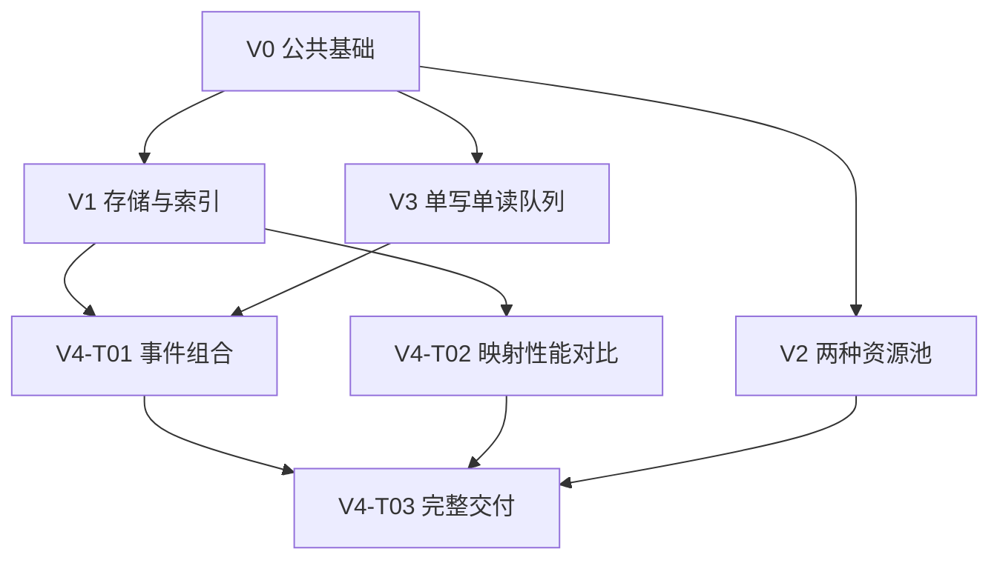

# Sprint Backlog（迭代任务文档）

> 项目：`qlib`｜文档版本：v0.5｜编制日期：2026-10-14｜更新日期：2026-10-15（Australia/Sydney）  
> 适用阶段：从零开发的初始迭代计划｜计划规模：5 个版本、10 项任务  
> 依据：`AGENTS.md`、`requirement.md` v0.3、`specs.md` v0.3，以及所提供的 qlib v0.5.1 参考源码。

这份文档回答三个问题：qlib 分几步开发，每一步要交付什么，怎样确认这一步已经完成。Sprint Backlog 在这里指“按开发阶段安排的任务清单”；目前没有约定每个阶段必须持续几天。

全文保留模板的 7 章。第 3 章对每个版本分别说明版本概况、任务总览、任务详情和版本验收；每项任务保留 12 项说明。具体代码怎样编写，查阅对应版本的实施计划。V0、V1 已完成；V2—V4 的任务和验收保持待执行。

## 1. Project Overview（项目开发总览）

### 1.1 项目开发目标

qlib 为 nqbook 等 C++ 项目提供可复用的基础工具。开发者完成这些工具后，调用程序可以用统一格式记录交易数据，保存对象并按编号找到它们，重复使用对象位置或内存，还可以把数据从一个线程交给另一个线程。线程是程序内可以独立推进的一条执行流程，例如一条流程接收数据，另一条流程处理数据。

本次从零完成一个使用 C++23 的纯头文件库。“纯头文件”表示使用者包含相应的 `.h` 文件即可编译使用，不需要额外链接 qlib 的二进制库。库运行时只依赖 C++ 标准库。最终交付六个公共头文件、CMake 接入配置、自动化测试、`map` 性能对比和使用说明；另建一个小型调用项目，确认这些文件能实际使用。CMake 是组织编译步骤和项目依赖的工具。

qlib 提供上述基础能力。订单簿如何更新、行情怎样接收、买卖如何撮合、数据怎样保存，以及服务如何运行，仍由使用 qlib 的程序负责。

### 1.2 参考文档（Requirement、Spec、Implementation Plan）

| 文档 | 当前状态与用途 | 本文引用方式 |
| --- | --- | --- |
| `AGENTS.md` | 已编写；说明目录安排、开发习惯、构建和验证方法。 | 开始任务前读取适用约定。 |
| `requirement.md` v0.3 | 规定要提供的功能、质量要求及验收标准；公共名称统一为 `qlib`/`QLIB`。 | FR-01—FR-16 表示功能需求，NFR-01—NFR-08 表示质量要求，AC-01—AC-16 表示验收标准；BR 表示业务规则。 |
| `specs.md` v0.3 | 说明接口怎样使用、内部怎样设计、哪些条件下提供保证，以及怎样验证。 | 用章节号查找依据，例如 §4.1 表示第 4.1 节。 |
| 各版本实施计划 | V0 使用 [Implementation_Plan (V0).md](<Implementation_Plan (V0).md>)，V1 使用 [Implementation_Plan(V1).md](Implementation_Plan(V1).md)，均已同步验收结果；V2—V4 计划保持不变。 | 按版本和 Vx-Txx 任务编号查阅对应文件；计划已写好不表示代码已完成。 |
| qlib v0.5.1 参考源码 | 已提供；用来理解现有接口、实现方法和文件安排。 | 作为参考材料；其代码和测试结果不算本次从零开发的完成证据。 |
| `Sprint_Backlog.md` v0.5 | 本文件；安排版本、任务、依赖、验收和进度。 | 使用 V0—V4 查版本，使用 Vx-Txx 查任务。 |

编号中的 UC 表示使用场景；OI、SPEC-OI 分别表示需求文档和规格文档中的待确认问题。后文保留这些编号，方便读者找到完整依据。

如果文档对同一行为的说明不一致，应先找出冲突，修订相应文档，再实施受影响的任务。实施计划可以细化编码步骤；增加功能或改变对外保证时，需要同步需求、规格和本任务清单。

### 1.3 当前项目状态

V0 与 V1 均已于 2026-10-15 完成，累计完成 4 / 10 项任务。V1 交付完整 hive、map 和对象/ID 索引组合验证；包含 V0 在内的 75 项测试在 Release 与 ASan/UBSan 下均通过，两个独立消费程序通过。V2—V4 保持未开始，本次工作止于 V1。证据见 [V0 记录](validation/V0-T01.md)和 [V1 记录](validation/V1.md)。

实际项目目录没有 Git 元数据，本次未提交或推送 V1。当前工作区标识为 `qlib-v1-20261015`，工具链、GoogleTest v1.17.0、命令和结果已记录。V0 的历史标识与[源码哈希清单](validation/v0-source-sha256.txt)保留。参考源码的 `0.5.1` 是参考项目版本号，不代表新项目的发布版本。`docs/validation/` 是本地验收材料，继续排除在 GitHub 推送之外。

### 1.4 版本划分原则

- 每个版本都交付一组可以实际调用和检查的能力。例如 V0 要能使用公共数据并运行测试，只有空目录或类型声明还不算完成。
- V0—V4 是本次开发阶段的编号，不是软件发布标签，也不自动对应软件的正式版本号。
- 建议按“公共基础、对象与索引、资源复用、线程交接、完整交付”的顺序学习。必须先完成哪些任务，另由依赖关系决定；没有依赖的任务可以调整顺序。
- 完成一个版本，需要该版本的功能、边界处理、文档和实际验证结果齐全。某项任务写完代码，还要通过任务验收和版本验收。
- 当前不承诺具体完成日期或未经测量的性能数字。以后若采用固定天数的迭代，再根据实际开发速度排期。

### 1.5 任务拆分原则

每项任务交付一个完整组件，或一个明确的组合使用结果，同时完成相应测试、使用规则说明和验证记录。这里的“使用规则”包括允许什么输入、操作有什么结果，以及哪些情况会使原来的地址或编号失效。具体类、函数和编码步骤放在实施计划中。

任务状态只使用“未开始、进行中、受阻、已完成”。版本状态使用“未开始、进行中、待验收、已完成”，必要时另写阻塞原因。开始日期按实际执行时间填写；验收标准和完成条件都满足后，才能改为“已完成”。负责人初始记为“项目开发者（AI 协助）”，不表示已安排额外人员。

### 1.6 全局完成标准（Definition of Done）

下表适用于每项任务。Definition of Done 指“标记完成前必须满足的条件”。任务自己的验收项在第 3 章补充。

| 检查项 | 标记任务完成前必须满足的条件 |
| --- | --- |
| 功能与范围 | 对应 FR 和 AC 已在规格允许的输入与元素类型下实现。能检查正常结果、关键边界和失败结果。允许使用的场景出了错，必须修复，不能临时改成“不支持”。 |
| 资源与并发 | 写清谁负责创建、持有和销毁对象，这就是对象的“所有权”和“生命周期”。还要写清指针（对象地址）、句柄（访问对象的编号）和迭代器（遍历位置）何时不能继续使用。涉及队列时，核实单生产者单消费者前提、数据何时可读，以及实际平台的原子操作能力；原子操作指其他线程不会观察到“只完成了一半”的操作。 |
| 自动化验证 | 运行当前已登记的全部测试，记录实际执行数量和结果。新增行为要有能发现错误的测试。没有发现测试、跳过测试或没有执行，均不能记为通过。 |
| 检查工具 | 对象和内存问题结合可用的 ASan（内存错误检查工具）与 UBSan（未定义行为检查工具）检查；队列并发结合适用的 TSan（线程间数据竞争检查工具）检查。工具不可用时写清原因和缺少的检查结果，不填写虚构结论。核心功能或并发验收仍缺失时不能通过。 |
| 文档与可维护性 | 头文件、中文使用规则注释、README 和规格说明一致，并能对应到任务。测试辅助代码和业务示例只按实际需要使用，不能因为方便测试就新增供调用方使用的公共接口（API）。 |
| 可重复证据 | 记录代码版本或可识别的工作区状态、工具环境、命令、实际测试数、结果和失败处理。性能测试另记硬件、输入数据和计时方式，使他人能照着重做。证据文件产生后再填写路径。 |
| 范围内问题 | 影响当前承诺功能的问题，必须作出明确选择，或按原有规格写清限制。已知的合法场景失败必须修复。可选增强另行登记，不阻塞与它无关的任务。 |
| 工作区与提交 | 检查改动范围，保留无关的已有工作，不提交构建缓存和下载的依赖。提交、推送或创建版本标签按有效用户授权执行；没有提交授权时，保留可识别的工作区验证记录即可。 |
| 状态更新 | 填写真实完成记录，同步任务和进度表。版本还需通过本版本的 Release Verification，即版本级验收，才能标记完成。 |

## 2. Version Roadmap（版本规划）

### 2.1 版本列表

| 版本编号 | 版本名称 | 版本目标 | 主要交付能力 | 版本状态 |
| --- | --- | --- | --- | --- |
| V0 | 公共基础与可构建工程 | 让调用程序首次能编译并使用 qlib 的公共数据。 | CMake 接入、`common.h`、公共数据测试。 | 已完成 |
| V1 | 对象存储与键值索引 | 保存对象，并能按唯一编号找到或移除它。 | `hive` 保存对象，`map` 保存“键→值”的查找关系，并验证两者共同使用时的创建和清理顺序。 | 已完成 |
| V2 | 对象与内存复用 | 区分“管理完整对象”和“只借还一块内存”两种需求。 | `pool` 管理可按编号访问的对象；`memory_pool` 管理固定大小的原始内存块。 | 未开始 |
| V3 | 线程间有序交接 | 让一条线程写入、一条线程取出，数据按写入顺序交接。 | `single_queue`，包括容量限制、双线程测试、停止使用和清理检查。 | 未开始 |
| V4 | 集成、性能与完整交付 | 确认组件能组合使用，并能接入独立项目。 | 事件组合示例、`map` 性能对比、六个头文件的接入验证及全部测试。 | 未开始 |

V1 中的“键”是用来查找数据的唯一标识，例如订单编号；“索引”是编号到对象地址的查找关系。V3 采用 SPSC（Single Producer, Single Consumer），意思是同一时间只有一个生产者线程写入、一个消费者线程取出；FIFO（First In, First Out）表示先写入的数据先取出。“有界”表示队列容量固定，满了就报告本次写入失败。

### 2.2 各版本的功能范围

| 版本 | 范围内 | 本版本不扩展的内容 |
| --- | --- | --- |
| V0 | 共享记录、价格和数量的整数比例、类别标签、`variant`、`price_level`，以及 CMake 接入和真实测试入口。`variant` 是一次存放多种指定类型中一种的类型容器；`price_level` 记录某个价位的总量和订单首尾地址。 | 不提前实现其余五种容器，也不替调用方规定“缺失数据该填什么值”。 |
| V1 | `hive` 保持存活对象地址稳定，`map` 提供规格选定的完整操作；两者组合时，明确由 `hive` 保存和销毁对象，`map` 只记录地址。 | 不加入订单簿算法，不承诺兼容标准容器的所有操作，也不承诺任意用户代码抛出异常后都能恢复到操作前状态。异常是操作无法正常完成时向调用方报告失败的 C++ 机制。 |
| V2 | 固定大小内存块的借还，以及可增长的句柄对象池；分别验证资源创建、复用、销毁和边界情况。 | 不加入可识别过期编号的“世代句柄”、通用内存分配框架或多线程共享池。 |
| V3 | 固定容量队列、满和空的结果、线程间读写先后保证、SPSC 测试，以及停止访问后的安全销毁。 | 不加入多个生产者和多个消费者共用的 MPMC 队列，也不管理线程、自动重试、等待通知或自动扩容。 |
| V4 | 同一程序内的组合示例，`map` 插入、查到、未查到、删除四类性能测量，独立调用项目，以及重新运行全部测试并保存结果。 | 不开发 nqbook 服务或网络业务；安装包、自动运行检查的 CI 流程、多平台认证和额外性能测试平台不纳入本次交付。 |

下表说明每条需求主要由哪项任务负责。组合任务会再次检查相关行为，但不重复计算需求完成数。

| 需求与验收编号 | 主责任任务 | 交付证据 |
| --- | --- | --- |
| FR-01 / AC-01 | V0-T01 | 检查四种行情记录各自包含的字段、单位和含义。 |
| FR-02 / AC-02 | V0-T01 | 检查买卖两侧各一档的快照，以及监控样本的字段。 |
| FR-03 / AC-03 | V0-T01 | 检查类别标签和两个 `variant` 所允许存放的记录类型。 |
| FR-04 / AC-04 | V0-T01 | 检查 `price_level` 的空状态与字段使用。 |
| FR-05 / AC-05 | V1-T01；V1-T03 组合复验 | 检查对象地址是否稳定、能否遍历和定位，以及对象是否按要求创建和销毁。 |
| FR-06 / AC-06 | V2-T02 | 检查存储增长后有效句柄仍可找到对象、空位置能复用、对象能正确销毁。 |
| FR-07 / AC-07 | V2-T01 | 检查内存地址对齐、借完和零容量时的结果、归还后复用及计数。“对齐”指地址满足类型所需的边界要求。 |
| FR-08 / AC-08 | V1-T02 | 检查唯一键、重复插入不覆盖、明确更新，以及不同键落到同一候选位置时仍可区分。 |
| FR-09 / AC-09 | V1-T02 | 检查查到和未查到的结果、只查找不插入的行为，以及规定的异常结果。 |
| FR-10 / AC-10 | V1-T02 | 检查删除、遍历、容量和扩容；检查删除位置留下的标记不会截断后续查找。该标记在设计中称为“墓碑”。 |
| FR-11 / AC-11 | V3-T01 | 检查队列满时写入失败，传入对象不被移走，已有数据不被覆盖，容量不增长。 |
| FR-12 / AC-12 | V3-T01；V4-T01 组合复验 | 检查先进先出、存储位置到末尾后绕回开头、双线程交接，以及操作不会因内部等待而一直无法返回。 |
| FR-13 / AC-13 | V3-T01 | 检查停止读写后的状态，并确认调用方等待两个线程结束后再销毁队列；等待线程结束的操作通常为 `join()`。 |
| FR-14 / AC-14 | V0-T01 建立；V4-T03 完成全部检查 | 验证 `qlib::qlib` 接入、各头文件单独包含、关闭库测试，以及独立调用项目。 |
| FR-15 / AC-15 | V0-T01 建立入口；各任务持续落实；V4-T03 汇总 | 组件和组合测试实际执行且数量大于零；保存每次重新检查已有行为的结果。 |
| FR-16 / AC-16 | V4-T02 | 用当前代码的优化构建进行性能测量，保存原始数据、环境和方法。优化构建指启用编译器优化的构建方式。 |

### 2.3 各版本的依赖关系

V0 先建立公共工程。之后，V1、V2、V3 的组件都可以在各自条件具备时开发；版本编号本身不增加依赖。V4 的事件组合要等 V1 和 V3，性能对比只需等 `map` 和测量环境就绪，最终验收再汇总全部能力。精确到任务的依赖见 §4.1。

箭头表示后面的工作需要用到前面的结果。例如事件组合需要对象存储、索引和队列，因此有两条箭头指向它。V1 指向性能对比的箭头只要求 V1-T02 的 `map` 完成，不要求先完成 V1-T03 的组合任务。

### 2.4 版本开发顺序与优先级

建议学习顺序为 V0 → V1 → V2 → V3 → V4。先让一个组件能用且能验证，再学下一个，有助于理解它们各自负责保存和清理什么。有条件并行开发时，按 §4.1 的真实依赖安排即可。

P0 表示核心功能、可靠使用和完整交付必需的任务。P1 表示可以等核心行为正确后再做的性能对比。V4-T02 虽为 P1，仍是本计划完整交付的必需项。每项任务自己的测试、使用说明和验证记录应随任务完成。

### 2.5 各版本的交付里程碑

里程碑表示一个阶段已经交付了可用结果。日期尚未排定，在实际安排和完成时填写。

| 里程碑 | 达成条件 | 计划日期 / 实际日期 |
| --- | --- | --- |
| M0：首个可消费能力 | V0-T01 及 V0 验收通过；小型调用程序能实际使用 `common.h`。这里的“消费”指其他项目使用这个库。 | 待实际排期 / — |
| M1：对象和索引可协作 | V1 三项任务及版本验收通过；索引中没有指向已销毁对象的地址。 | 待实际排期 / — |
| M2：两类资源复用明确 | V2 两项任务及版本验收通过；能清楚区分按编号管理对象和只借还原始内存块。 | 待实际排期 / — |
| M3：SPSC 可验证交接 | V3 的双线程交接和资源清理检查通过，并确认队列操作内部不等待另一侧推进。 | 待实际排期 / — |
| M4：完整项目可交付 | V4 三项任务及最终验收通过，全部承诺的需求都有交付和验证结果。 | 待实际排期 / — |

## 3. Version Details（版本详细计划）

以下代码路径均相对于目标开发仓库根目录。新增组合测试优先放入已有的相关 `*_test.cpp`；确需独立文件时，在实施计划中记录并加入真实测试目标。这不表示需要新增公共运行组件。各任务的工作量只表示相对复杂度，不承诺天数。

### 3.1 V0 — 公共基础与可构建工程

#### 3.1.1 Version Overview（版本概述）

V0 要先让开发者能够真正使用并检查 qlib：写一个小程序，包含 `common.h`，填写一条行情记录，再运行测试确认字段和公共常量符合约定。这样，后续组件都有同一套数据定义和测试入口。

| 字段 | 内容 |
| --- | --- |
| 版本编号与名称 | V0 — 公共基础与可构建工程。版本状态：已完成。 |
| 版本开发目标 | 建立能编译、调用并自动检查 `common.h` 的最小工程。统一的数据契约，就是所有使用方对字段、单位和含义遵守同一份约定。 |
| 本版本交付的核心能力 | C++23 纯头文件库的接入方式、可运行的公共数据测试，以及订单、撤单、成交、价位、快照和监控记录。纯头文件表示调用方包含头文件就能取得实现，无需额外链接 qlib 二进制库。 |
| 本版本范围内的功能 | FR-01—FR-04；FR-14 中的工程及 `common.h` 接入；FR-15 中的测试入口及公共数据检查。同时提供构建说明和生成文件忽略规则，避免把构建产物交进源码。 |
| 本版本范围外的功能 | 五种容器、订单簿业务、网络或持久化服务、性能基准，以及同时使用六个公共头文件的完整验证。也不包含 package/install 安装发布及 CI 自动检查流水线。后续组件随对应任务加入，V4 再做最终汇总验收。 |
| 前置版本与依赖条件 | 无前置实现版本。需要可用的 C++23 编译器及构建工具、CMake 3.28+，以及可获取或已准备好的 GoogleTest v1.17.0。CMake 用于组织构建，GoogleTest 用于编写和运行测试。启动任务时检查实际仓库，参考源码不能算成本次已经完成的实现。 |
| 对应的 Requirement、Spec 和 Implementation Plan | [requirement.md](requirement.md) §4.1、FR-14—FR-15、§6、AC-01—AC-04；[specs.md](specs.md) §3、§4.1、§4.7。[Implementation_Plan (V0).md](<Implementation_Plan (V0).md>) 按 V0-T01 衔接具体实施步骤。 |

#### 3.1.2 Task Overview（任务总览）

##### 3.1.2.1 任务列表

| 任务编号 | 任务名称 | 交付能力 | 优先级 | 前置依赖 | 任务状态 |
| --- | --- | --- | --- | --- | --- |
| V0-T01 | 工程接入与公共数据契约 | 调用方可以包含 `common.h` 使用公共定义；维护者可以构建并运行对应测试。 | P0 | 工具链和测试依赖可用；无前置任务。 | 已完成 |

##### 3.1.2.2 任务之间的依赖关系

本版本只有 V0-T01。工程接入、公共定义和验证要一起交付，才能得到一个真正可用的结果。仅创建空目录、声明类型或建立空测试文件，都不能单独算完成一个任务。

##### 3.1.2.3 建议执行顺序

先检查工程和工具链，再完成公共定义及调用检查，最后运行测试确认结果。这里说明先完成什么、后验证什么；具体改哪些代码，由 [Implementation_Plan (V0).md](<Implementation_Plan (V0).md>) 展开。

##### 3.1.2.4 任务工作量与风险评估（可选）

工作量：中。主要风险是 GoogleTest 无法取得、工具版本不满足要求，以及把“提供数据字段”误解为“库会自动完成交易业务”。例如，`book` 能保存快照数据，不表示它会自动计算快照。

字段、单位、标签和类型集合已由规格给出。缺失值该如何编码、不同编译器或平台能否直接交换结构体字节，以及字段在调用方业务中的具体解释，仍遵守已经声明的范围。跨 ABI 交换指跨越编译器或平台的二进制约定交换数据；这些约定可能影响结构体布局，不能直接假定两边相同。本版本不额外设计完整的数据交换协议。

#### 3.1.3 Task Details（任务详细说明）

##### 3.1.3.1 V0-T01 工程接入与公共数据契约

**任务编号与名称**

V0-T01 — 工程接入与公共数据契约。

**任务目标与交付能力**

交付一个能使用 `qlib/common.h`、能运行公共数据测试的最小库工程。后续组件沿用这套构建方式和数据定义，不需要各自另定字段或测试入口。

**任务的功能范围**

建立 CMake 的 `qlib` INTERFACE 目标及 `qlib::qlib` 别名。INTERFACE 目标只把头文件搜索路径、C++23 等使用要求传给调用方，本身不生成库二进制；别名提供稳定的接入名称。配置 `QLIB_BUILD_TESTS` 测试开关、GoogleTest，以及负责发现和汇总运行测试的 CTest。

实现六种共享记录、`price_level`、枚举、价格和数量比例、快照深度、四种消息标签、两个 variant、`overloaded` 和缓存行宏。variant 是可保存指定类型中任意一种值的容器，例如一份事件可保存订单或撤单。`overloaded` 用于把多个处理函数组合起来，让程序按当前记录类型选择函数。缓存行宏提供与处理器一次缓存一块数据有关的配置值。六种记录还要保留在编译时检查类型属性的断言。

**任务范围外的内容**

本任务不实现容器、队列或资源池。它不校验业务字段、不自动填写时间，也不撮合订单、计算快照、采集指标或收发保存数据。包含全部公共头文件的接入验收和性能基准由后续任务完成。

**前置任务与依赖条件**

无前置任务。实施前读取项目约定，检查实际工具链和 GoogleTest 获取条件；保留已有的用户修改。环境没有实际核实，就不能记录为已经通过。

**对应的需求与设计文档**

Requirement：FR-01—FR-04、FR-14—FR-15 的本阶段部分，BR-01—BR-05、BR-11，NFR-05—NFR-08，AC-01—AC-04 及 AC-14—AC-15 的公共数据部分。Spec：§3、§4.1、§4.7、§5.4—§5.5。Implementation Plan：在 [Implementation_Plan (V0).md](<Implementation_Plan (V0).md>) 中按 V0-T01 查阅实施步骤。

**涉及的技术模块、类和文件**

共享数据和接入验证模块已交付 `include/qlib/common.h`、根目录的 `CMakeLists.txt`、`tests/CMakeLists.txt`、`tests/common_test.cpp`、`README.md` 和 `.gitignore`。`LICENSE` 原样保留相邻参考 `qlib` 项目的许可证；验证夹具和运行记录位于 `docs/validation/`。

**实施要点与执行边界**

字段顺序、类型、单位和标签都以 Spec 为准。`order_action` 只有 `add` 和 `modify`，即新增和修改；撤单使用独立记录，不能随意增加为第三种订单动作。

公共记录只保存数据。普通记录不承诺自动填入具有业务含义的默认值；调用方必须负责初始化。`price_level` 则有明确的空状态：总量为 0，首尾订单指针为空。这里只注册实际已经建立的测试，也不为纯头文件库添加没有用途的 `.cpp` 文件、静态库或服务进程。

**验收标准（Acceptance Criteria）**

- 调用方能写入并读回四种行情记录、快照和监控记录各自定义的字段。价格和数量比例分别为 `10^10`、`10^8`，消息标签为 0/1/2/3，快照深度为 1。
- 两个 variant 只包含规定的成员类型，均不含 `metrics`。visitor 能按实际记录类型选中对应处理函数；visitor 就是这里按类型执行动作的访问者。
- 六种记录都通过“可平凡复制”和“标准布局”检查：前者要求复制对象表示时不依赖自定义复制逻辑，后者要求类型组织符合 C++ 对布局的限制。它们不代表所有平台上的结构体字节布局完全相同。
- 一个只使用 `common.h` 的最小调用程序可以编译。`QLIB_BUILD_TESTS` 在 qlib 作为顶层项目时默认打开、作为子项目时默认关闭；CTest 实际发现并运行公共数据测试。

**验证方法与测试要求**

用编译期断言检查类型属性和集合成员，用 GoogleTest 检查字段、常量、标签、variant 的类型选择、visitor 的分派以及价位空状态。实际配置、编译并运行 `common_test`/CTest，再编译一个只包含 `common.h` 的最小调用程序。

记录工具链、命令、实际执行的测试数量和结果。只完成构建配置，或 CTest 没有发现任何测试，都不能记为测试通过。

**完成条件（Definition of Done）**

上述验收项全部满足，公共定义、测试和 README 相互一致，真实验证记录可以查阅。仍未确定的业务含义没有被悄悄写成默认行为。完成后更新本任务和 V0 状态；提交和推送遵守已有授权，没有授权的 Git 操作不作为任务完成的前提。

**任务状态与完成记录**

状态：已完成；负责人：项目开发者（AI 协助）；开始与完成日期：2026-10-15（Australia/Sydney）；工作区标识：`qlib-v0-t01-20261015`。Git 未初始化，本次没有提交或推送。17 项用例直接执行全部通过；CTest 发现 17、执行 17、通过 17、失败 0、跳过 0。字段类型与顺序、类型属性、默认开关、OFF 依赖隔离、独立调用及宏覆盖检查均通过。完整命令和结果见[验证记录](validation/V0-T01.md)。

#### 3.1.4 Release Verification（版本级验收）

| 字段 | 内容 |
| --- | --- |
| 本版本完整功能场景 | 调用程序包含公共头，创建并初始化行情记录，把记录放入对应事件集合，再通过 visitor 识别类别。同时检查快照、监控样本和空价位能被正确表达。库不因此自动更新订单簿。 |
| 跨任务、跨模块的集成验证 | 检查公共头、CMake 接口目标、测试程序和 CTest 入口能够一起工作。本阶段只要求 `common.h` 的最小接入，不要求尚未实现的五种容器提前存在。 |
| 边界与错误场景验证 | 检查集合排除了不应包含的类型，标签不重复，价位默认状态为空，并明确普通记录由调用方初始化。关闭测试后不引入 GoogleTest 依赖。构建失败、依赖取得失败和测试断言失败分别记录，不能混为一种结果。 |
| 本版本的性能与质量验证 | 检查 NFR-05 的类型属性和数据定义、NFR-06 的本阶段接入、NFR-07 的说明可读性，以及 NFR-08 的验证记录。本版本没有数值性能门槛，也不要求运行性能基准。 |
| 版本交付物检查 | `common.h`、构建入口、公共数据测试、接入说明、忽略规则及实际验证记录齐全。构建目录和下载的测试依赖不提交进源码。 |
| 版本完成条件 | V0-T01 完成，AC-01—AC-04 通过，AC-14—AC-15 的本阶段部分已有实际证据。后续任务继续承担其余组件的验收，此时不能宣称整个 qlib 已完成。 |
| 版本验收结果 | 已通过；版本状态：已完成；开始与结束日期：2026-10-15；工作区：`qlib-v0-t01-20261015`；证据：[V0-T01](validation/V0-T01.md)。功能、独立调用、开关与宏覆盖检查通过，范围内无遗留必需项。ASan、UBSan、TSan 和性能基准未运行；V0 无自定义存储或线程实现，按 V0 计划不扩展检查矩阵。本次停止于 V0。 |

### 3.2 V1 — 对象存储与键值索引

#### 3.2.1 Version Overview（版本概述）

V1 解决“对象放在哪里、以后怎样找到它、最后由谁删除”这三个问题。`hive` 负责保存对象，让还活着的对象保留原地址；`map` 负责记录“键 → 值”的对应关系，例如“订单 ID → 订单地址”。两者一起使用时，还要验证创建和删除的顺序是否正确。

| 字段 | 内容 |
| --- | --- |
| 版本编号与名称 | V1 — 对象存储与键值索引。版本状态：已完成。 |
| 版本开发目标 | 交付各自可独立使用的完整 `hive` 和 `map`，并验证调用方如何保存对象、按 ID 找到对象，以及在不再需要时销毁对象。对象从构造到销毁的过程称为生命周期。 |
| 本版本交付的核心能力 | 增删其他对象时，保留对象的地址不变；能够遍历存活对象；能够建立、查询和删除唯一键映射；能够正确处理两个容器组合时的资源归属和失败。唯一键指同一个键最多对应一项。 |
| 本版本范围内的功能 | FR-05、FR-08—FR-10；对应组件测试、使用约定及本阶段接入；UC-01 中保存对象并建立索引的完整场景。 |
| 本版本范围外的功能 | 两种资源池、线程间队列、事件流水线、实际订单簿业务、性能基准和完整独立调用工程。也不自动增加任意非法指针诊断、任意移动异常恢复或对标准容器全部接口的兼容。移动异常指把值转交到另一个存储位置时发生异常；具体可用类型按 Spec 限定。 |
| 前置版本与依赖条件 | 需要 V0 的工程和测试入口。V1-T01、V1-T02 各自只依赖 V0-T01，两者可以独立开展；V1-T03 等前两项完成后开始。V2、V3 不是前置条件。 |
| 对应的 Requirement、Spec 和 Implementation Plan | [requirement.md](requirement.md) FR-05、FR-08—FR-10、UC-01、AC-05、AC-08—AC-10；[specs.md](specs.md) §4.2—§4.3、§2.4—§2.5、§5、§6.1—§6.3。[Implementation_Plan(V1).md](Implementation_Plan(V1).md) 按 V1-T01—V1-T03 衔接具体实施步骤。 |

#### 3.2.2 Task Overview（任务总览）

##### 3.2.2.1 任务列表

| 任务编号 | 任务名称 | 交付能力 | 优先级 | 前置依赖 | 任务状态 |
| --- | --- | --- | --- | --- | --- |
| V1-T01 | 完整 hive 地址稳定存储 | 调用方可保存、遍历、定位和删除对象；正常场景与关键边界有测试，地址和生命周期规则明确。 | P0 | V0-T01 | 已完成 |
| V1-T02 | 完整 map 唯一键索引 | 调用方可按键插入、查询、删除和遍历映射，并管理容量；冲突和关键边界有测试，资源归属规则明确。 | P0 | V0-T01 | 已完成 |
| V1-T03 | hive 与 ID 索引生命周期协作 | 验证保存对象、建立 ID 映射、查找、失败后清理，以及先移除引用再销毁对象的完整场景。 | P0 | V1-T01、V1-T02 | 已完成 |

##### 3.2.2.2 任务之间的依赖关系

V0-T01 完成后，V1-T01 和 V1-T02 都可以开始。两个头文件各自只依赖标准库，不要求先完成另一个容器。V1-T03 要实际调用这两种能力，所以必须等两者都可用，不能用只占接口、没有真实行为的代码代替验收。只完成其中一个容器，也不能把 V1 记为完成。

##### 3.2.2.3 建议执行顺序

建议先完成 V1-T01，理解谁负责保存和销毁对象，以及地址为何可以保持稳定；再完成 V1-T02，理解如何按 ID 查找；最后通过 V1-T03 把两者组合起来。前两项的顺序只是学习建议，可以按实际安排调整。

##### 3.2.2.4 任务工作量与风险评估（可选）

`hive` 删除对象后留下的空位置称为空洞，连续空洞需要合并，遍历时才能正确跳过。`map` 用哈希把键换算成查找起点；不同键可能得到同一起点，这叫冲突。删除时留下的“这里以前有过元素”标记叫墓碑，查找遇到它仍要继续。重哈希则是在表增长等情况下，重新安排键值项的存储位置。

| 任务 | 相对工作量 | 主要风险与处理边界 |
| --- | --- | --- |
| V1-T01 | 大 | 删除后空洞合并错误、跨存储块遍历漏项、对象漏销毁或重复销毁，以及构造失败后最后一个块状态错误。遵守 Spec 对有效指针和遍历位置的限制，不承诺识别任意旧地址。 |
| V1-T02 | 大 | 冲突、墓碑和重哈希导致漏查；右值键处理或构造异常破坏原内容。右值键是允许把内容转交给容器的键，重复插入时能否发生这种转交必须按接口区分。遵守已选类型条件，不笼统承诺所有异常都能完全撤销，也不承诺所有操作都只需固定数量的步骤。 |
| V1-T03 | 中 | 遇到重复 ID 时误删旧对象；建索引失败后留下新对象；索引仍指向已经销毁的对象。通过明确调用顺序和可控制的测试失败检查这些情况，不新增自动管理多容器操作的事务框架。 |

每个任务都要交付一项完整能力。内部可以分步骤编写，但类声明、成员变量或单个辅助函数不单独算作已经验收的任务。

#### 3.2.3 Task Details（任务详细说明）

##### 3.2.3.1 V1-T01 完整 hive 地址稳定存储

**任务编号与名称**

V1-T01 — 完整 hive 地址稳定存储。

**任务目标与交付能力**

调用方把对象存入 `hive` 后，可以保留其地址。只要该对象仍然存活，增加或删除其他对象不会让它搬家。调用方还能从前往后或从后往前遍历、通过当前有效地址找到位置，以及删除对象或清空容器。交付时一并提供完整使用约定和针对性测试。

**任务的功能范围**

实现 Spec §4.2 规定的全部选定接口：类型别名、构造和析构、移动和交换、可写及只读遍历、正向及反向遍历、数量和容量查询、移动插入、原地构造、单项及范围删除、清空、按有效存活对象地址定位，以及命名空间级 `swap`。类型别名是为接口使用的类型提供名称；原地构造是在最终存放位置直接创建对象。复制保持禁用，测试和使用说明随实现交付。

**任务范围外的内容**

不提供按 ID 查找、排序、按插入先后遍历、随机下标、`reserve` 预留容量、可安全同时写入的多线程能力，或标准 `std::hive` 的全部兼容接口。也不承诺检测已经失效的句柄和任意非法地址；句柄是调用方用来定位对象的访问凭据。修复所有不符合约定的输入，不是本任务的完成前提。

**前置任务与依赖条件**

V0-T01 完成，测试入口可用。实施前读取 Spec §4.2，确认可存放的类型、容量计算和有效访问位置等限制。V1-T02 是否完成不影响本任务启动。

**对应的需求与设计文档**

Requirement：FR-05、BR-07、BR-10、BR-12、AC-05，NFR-01、NFR-02 及 NFR-06—NFR-08 的相关部分。Spec：§4.2、§5.1—§5.2、§5.6、§6.2，尤其 SPEC-OI-08 已确定的迭代器与定位限制。迭代器是用来指向位置并继续遍历的访问工具。Implementation Plan：在 `Implementation_Plan(V1).md` 中按 V1-T01 查阅实施步骤。

**涉及的技术模块、类和文件**

涉及地址稳定存储模块、`hive<T>`，以及内部存储块、槽位、空洞和迭代器类型。`T` 是要保存的对象类型，槽位是存放一个对象的位置，迭代器是用来指向位置并继续遍历的访问工具。计划建立 `include/qlib/hive.h`、`tests/hive_test.cpp`，更新 `tests/CMakeLists.txt` 和 `README.md`。

**实施要点与执行边界**

按 Spec 维护对象的构造和销毁、存储块之间的连接、空洞及数量。增加或删除一项时，不搬迁其他存活对象。移动或交换容器后，重新取得迭代器；修改容器后，重新取得反向遍历位置。按地址定位只接受当前仍存活对象的有效地址。

元素析构必须不抛异常，容量计算结果必须能被使用的整数类型表示。新对象构造失败时，不得把未完成的对象计入存活数量；为这次插入已经增加的容量可以保留，不要求一并撤销。例如，新块已经申请成功、对象构造随后失败时，数量不增加，但容量可能变大。

**验收标准（Acceptance Criteria）**

- 增删其他对象后，保留对象的地址和内容仍然正确。正向、反向和 `const` 只读遍历都恰好覆盖当前存活集合，不重复、不漏项。
- 删除单项后，返回下一个可遍历位置；范围删除和空范围删除结果正确。能用当前存活对象的有效地址找到其位置。
- `clear` 后数量和容量都为 0。移动后，源容器可以重新使用；交换后，对象归属于正确的容器。
- 对象构造失败不增加存活数量，受支持的失败路径之后仍能继续使用容器。每个成功构造的对象最终只销毁一次，不漏掉也不重复。

**验证方法与测试要求**

在 `hive_test` 中检查空容器、跨块增长、空槽复用、删除空块、正反遍历、范围删除、移动、交换及生命周期。空洞合并要分别覆盖四种情况：被删位置两侧都不是空洞、只有左侧是空洞、只有右侧是空洞、两侧都是空洞。

用可控制的构造异常分别检查复用空槽、使用尚未用过的槽位、申请新块三条路径。测试只使用仍有效的地址和遍历位置。另行编译只包含该头文件的最小程序，并重新运行当前已注册的全部测试。

按工具可用情况运行 ASan/UBSan。ASan 用于发现越界、释放后访问等内存问题，UBSan 用于发现部分不符合 C++ 规则的操作。记录实际结果；工具没有运行时，明确记录原因和检查缺口。

**完成条件（Definition of Done）**

全部公开能力可用，AC-05 和承诺的边界检查通过，原有测试仍通过。README 与类说明讲清地址稳定性、访问何时失效、异常及线程限制，并留下实际验证记录、更新状态。本任务的单元测试通过后，V1-T03 的组合验收仍要单独完成。

**任务状态与完成记录**

状态：已完成；负责人：项目开发者（AI 协助）；开始与完成日期：2026-10-15；工作区：`qlib-v1-20261015`；验证：18 项 hive 测试及独立消费程序通过，全量 Release 与 ASan/UBSan 各 75/75；证据：[V1 验收记录](validation/V1.md)；实际结果：全部选定接口、地址稳定、空洞复用、生命周期及三条构造失败路径通过，无剩余必需项。

##### 3.2.3.2 V1-T02 完整 map 唯一键索引

**任务编号与名称**

V1-T02 — 完整 map 唯一键索引。

**任务目标与交付能力**

调用方能用唯一键建立对应关系，之后按键查询、明确修改值或删除关系。即使表曾经增长或删除过很多项，结果仍然正确。例如，ID 42 已有对应值时，再次插入不能悄悄覆盖它。交付时提供完整使用约定和测试。

**任务的功能范围**

实现 Spec §4.3 的全部选定接口：类型别名、默认构造和析构、移动和交换；`insert`、`emplace`、`try_emplace` 三种插入方式；下标访问；`find`、`contains`、`at` 查询；两种 `erase` 删除；正向和 `const` 只读遍历；`reserve` 预留容量、`clear` 清空；数量、容量和 `max_size` 查询；命名空间级 `swap`。同时验证重复键、哈希冲突、墓碑和增长后的行为。

**任务范围外的内容**

不保证按键排序遍历，不提供反向迭代、公开的自定义分配器或运行时传入策略对象的能力。分配器决定怎样取得内存；策略对象在这里决定怎样计算哈希和判断键相等。本任务不增加这些扩展。

当值是指针时，`map` 不自动销毁指针指向的外部对象。它也不支持并发写入，不承诺任意元素移动异常发生后的重哈希恢复。本阶段不运行性能基准，也不承诺速度一定超过标准库。

**前置任务与依赖条件**

V0-T01 完成，测试入口可用。所用类型和容量计算遵守 Spec 已限定的可靠使用条件。本任务与 V1-T01 没有技术上的先后依赖。

**对应的需求与设计文档**

Requirement：FR-08—FR-10、BR-06、BR-07、BR-10、BR-12、AC-08—AC-10，NFR-01、NFR-02 及 NFR-06—NFR-08 的相关部分。Spec：§4.3、§5.1—§5.3、§5.6、§6.2。Implementation Plan：在 `Implementation_Plan(V1).md` 中按 V1-T02 查阅实施步骤；性能基准另由 V4-T02 完成。

**涉及的技术模块、类和文件**

涉及键值索引模块、`map<Key,T,Hash,KeyEqual>` 及前向迭代器。`Key` 是查找用的键，`T` 是对应值，`Hash` 负责计算哈希，`KeyEqual` 负责判断两个键是否等价。计划建立 `include/qlib/map.h`、`tests/map_test.cpp`，更新 `tests/CMakeLists.txt` 和 `README.md`。

**实施要点与执行边界**

判断为等价的键必须得到相同哈希，键在表中期间的哈希结果要保持稳定。已经入表的键不能修改，否则原来的查找路径可能找不到它。

`value_type` 表示一项键和值。搬迁或销毁这种元素时，以及实际使用哈希、相等比较等策略操作时，均遵守 Spec 的不抛异常要求。直接构造新元素可以抛异常，但失败后不能报告插入成功。

保留右值键接口，不能把所有插入方式写成相同保证：`emplace` 可能先构造候选元素，再发现键重复；`insert` 和 `try_emplace` 遇到重复键时，不能因函数执行而移动实参。插入或重哈希后，按公开约定重新取得值引用和迭代器，不能继续使用已经失效的旧位置。

**验收标准（Acceptance Criteria）**

- 同一个键最多一项；重复插入保留旧值。`insert`/`try_emplace` 因键重复失败时，不因执行该函数而移动实参。
- 普通查询遇到缺键时不增加新项；`at` 抛出 `std::out_of_range`，表示要求访问的键不存在；下标访问遇到缺键时则建立默认值。三种行为不能混淆。
- 哈希冲突和已有删除标记不导致漏查。按键删除返回 0 或 1，表示实际删掉几项；按位置删除返回有效的后继位置。遍历只包含当前存活项。
- 预留容量或增长后，已有内容完整。`clear` 释放存储，之后容器仍可再次使用。新项构造失败不增加存活数量；移动、交换以及对象的构造和销毁符合约定。

**验证方法与测试要求**

在 `map_test` 检查空容器、重复键、只能移动而不能复制的值、缺键异常、冲突、墓碑复用、预留及增长、删除后继、清空、移动、交换和析构次数。还要检查探测绕回：查找位置走到存储末尾后，从开头继续查找仍能得到正确结果。

使用固定输入或固定随机种子产生操作序列，把结果与 `std::unordered_map` 比较；固定种子让后来的人能生成同一批输入、重现问题。构造异常只检查已经支持的路径，不故意触发范围外的“重哈希搬迁时抛异常”来要求未承诺的恢复。

编译只包含该头文件的最小程序，并重新运行已建立的测试。记录实际结果，辅助检查工具按可用情况运行和记录。

**完成条件（Definition of Done）**

AC-08—AC-10 和本任务边界检查通过，全部选定公开接口都有覆盖，原有测试仍通过。说明准确解释右值键、遍历位置何时失效、可用类型条件，以及操作成本随数据规模和冲突如何变化。

`max_size` 只提供规格所定义的容量上界信息，不能把粗略上界写成已经实现了所有溢出检测。补齐说明和实际证据后，更新任务状态。

**任务状态与完成记录**

状态：已完成；负责人：项目开发者（AI 协助）；开始与完成日期：2026-10-15；工作区：`qlib-v1-20261015`；验证：33 项 map 组件测试及独立消费程序通过，全量 Release 与 ASan/UBSan 各 75/75；证据：[V1 验收记录](validation/V1.md)；实际结果：全部选定接口、冲突与墓碑、容量、重载语义、构造失败及固定种子差分通过，无剩余必需项。

##### 3.2.3.3 V1-T03 hive 与 ID 索引生命周期协作

**任务编号与名称**

V1-T03 — hive 与 ID 索引生命周期协作。

**任务目标与交付能力**

交付并验证一个完整调用场景：`hive` 保存并负责销毁对象，`map` 保存“ID → 对象地址”。后者是非拥有索引，即它只帮助找到对象，不负责对象的生死。场景还要说明操作失败后谁来清理，以及删除时先做什么、后做什么。

**任务的功能范围**

调用方保存对象后建立 ID 索引，再按 ID 查找；增加或删除其他对象后，仍能找到保留的对象。检查重复 ID，并在新对象已经创建、索引却没有建立时回收这个新对象。正常删除时，先解除索引和其他不负责销毁对象的引用关系，再销毁对象。一并提供可运行的集成测试和简明说明。

**任务范围外的内容**

不新增订单簿类、撮合、价格排序、自动唯一 ID 分配、跨容器事务管理器、队列或多线程服务。重复 ID 出现后业务上应该拒绝、告警还是采取其他动作，由调用方决定，不封装进通用容器。

**前置任务与依赖条件**

V1-T01、V1-T02 都已完成，场景使用 V0 公共类型。调用方明确本测试中 ID 必须唯一；操作在单线程执行，或由外部同步保证多个线程不会不安全地同时访问。

**对应的需求与设计文档**

Requirement：UC-01、FR-05、FR-08—FR-10、BR-06—BR-07，NFR-01、NFR-02、NFR-07、NFR-08；AC-05、AC-08—AC-10 的组合行为。Spec：§2.4—§2.5、§4.2.3、§4.3.3、§5.6、§6.3 的对象与索引部分。Implementation Plan：在 `Implementation_Plan(V1).md` 中按 V1-T03 查阅实施步骤。

**涉及的技术模块、类和文件**

涉及地址稳定存储、键值索引和公共数据。主要组合 `hive<qlib::order>` 与 `map<std::int64_t,qlib::order*>`：前者存订单，后者把 64 位整数 ID 对应到订单地址。在 `tests/map_test.cpp` 增加独立的 hive/ID 索引集成用例，更新 README 示例；组件修复只针对实际发现的约定内问题。

**实施要点与执行边界**

`hive` 拥有订单对象，`map` 只拥有保存下来的指针值。删除 `map` 中的一项，只移除查找关系，不会自动销毁订单。

例如，旧订单 ID 42 已经建立索引，新创建的另一个订单也使用 ID 42。此次插入失败后，要保留原映射和原订单，只回收此次没有成功建立索引的新订单。若建立索引因其他受测原因失败，也由测试中的调用方执行这项清理；不改变容器公共 API，也不在频繁执行的正常路径里增加专门触发故障的接口。

正常删除时先移除索引和其他非拥有引用，再用当前有效的对象地址取得 `hive` 中的位置并删除对象。这样才能避免其他结构留下指向已销毁对象的地址。

**验收标准（Acceptance Criteria）**

- 建立的索引准确指向仍存活的对象。增加或删除其他对象、让 `map` 增长后，重新按 ID 查询仍能找到原对象。
- 重复 ID 不覆盖旧映射、不误删旧对象，也不遗留此次新创建但没有索引的对象。
- 对象已经创建而索引没有建立的失败路径，能够回收此次新对象。正常删除后，该 ID 查询不到，对应对象数量减少，其他索引仍然有效。
- 清理结束时两个容器都为空，每个对象只被销毁一次。

**验证方法与测试要求**

使用每次相同的 ID 序列完成保存、查询、增长、删除和重复键场景，逐步检查对象数量及索引实际指向谁。用测试侧可控制的失败，检查“对象已创建、索引尚未建立”时的清理；这项测试不能被描述为覆盖了所有内存耗尽情况。

配合构造和析构计数，或可用的内存检查工具，确认资源被正确释放。运行两个组件的单元测试和新增集成测试，确认组合改动没有破坏各自已有行为。

**完成条件（Definition of Done）**

UC-01 的正常、重复键及索引尚未建立时的失败场景都通过。说明清楚区分“谁销毁对象”和“谁提供查找”，不把本例描述为库自动提供的事务或订单簿功能。相关组件测试仍通过，实际证据和文档已更新，然后进入 V1 版本验收。

**任务状态与完成记录**

状态：已完成；负责人：项目开发者（AI 协助）；开始与完成日期：2026-10-15；工作区：`qlib-v1-20261015`；验证：7 项 HiveIndexIntegration 通过，全量 Release 与 ASan/UBSan 各 75/75；证据：[V1 验收记录](validation/V1.md)；实际结果：UC-01、重复 ID、索引前失败、先删索引再销毁及最终清理均通过，无剩余必需项。

#### 3.2.4 Release Verification（版本级验收）

| 字段 | 内容 |
| --- | --- |
| 本版本完整功能场景 | 调用方保存一组对象并建立 ID 索引；增删其他对象，查询并修改目标值；最后先解除索引，再删除对象。`hive` 的正反遍历和 `map` 中的索引项始终符合各自约定。 |
| 跨任务、跨模块的集成验证 | 运行 V1-T03，把 common 数据、hive 的对象管理和 map 的非拥有索引组合起来验证。同时确认两个容器各自可独立使用，不依赖 V2 或 V3。 |
| 边界与错误场景验证 | 汇总空容器、空洞合并、删除空块、冲突和墓碑、缺键、重复 ID、已支持的构造异常、移动、交换及访问失效规则。重复键和建索引失败不能破坏已有对象。非法迭代器、已删除地址，以及重哈希搬迁时抛异常，不属于当前承诺支持的失败路径。 |
| 本版本的性能与质量验证 | 检查结果正确、对象按约定构造和销毁、地址稳定，并保留可重复执行的验证记录。核对操作成本、异常及线程同步说明与实现一致。辅助工具只记录实际结果；不提前要求 V4 的映射基准，也不设没有依据的纳秒门槛。 |
| 版本交付物检查 | 两个公共头、两个组件测试、集成测试、测试注册、README/使用约定和实际验证记录齐全。V0 的公共数据与构建能力仍能正常使用，生成文件不混入交付源码。 |
| 版本完成条件 | V1-T01—V1-T03 全部完成，AC-05、AC-08—AC-10 和 UC-01 组合验收通过。运行当前已注册的全部测试，没有尚未解释的失败，使用限制可以查阅。队列、资源池和最终项目验收继续由后续版本承担。 |
| 版本验收结果 | 已通过；版本状态：已完成；开始与结束日期：2026-10-15；工作区：`qlib-v1-20261015`，无 Git 提交；证据：[V1 验收记录](validation/V1.md)。三个任务完成，Release 与 ASan/UBSan 各 75/75，0 失败、0 跳过；两个独立消费程序退出 0。范围内无剩余必需项，其他平台、性能基准和 TSan 未执行；本次停止于 V1。 |

### 3.3 V2 — 对象与内存复用

#### 3.3.1 Version Overview（版本概述）

V2 让调用方重复使用已经准备好的存储空间。本版提供两种独立工具：`memory_pool` 只借出和收回内存块，块里的对象由调用方负责创建和清理；`pool<T>` 直接管理对象，调用方用句柄访问对象。句柄是池返回的索引编号，不是对象的内存地址。

例如，调用方从 `memory_pool` 借到一块空间后，需要自己在其中构造对象，也要在归还前析构对象；使用 `pool<T>` 时，创建和释放对象由池的接口完成。这里的“构造”是让对象开始存在，“析构”是结束对象的生命并执行它的清理工作。

| 项目 | 内容 |
| --- | --- |
| 版本编号与名称 | V2 — 对象与内存复用。 |
| 版本开发目标 | 让调用方清楚地知道谁管理内存、谁负责对象的创建和清理，以及何时还能使用原来的地址或句柄。 |
| 本版本交付的核心能力 | `memory_pool` 按固定容量借还内存块；`pool<T>` 管理对象并在空间不足时增长；两者均附自动化测试和使用说明。 |
| 本版本范围内的功能 | FR-06、FR-07；检查合法配置、零容量、增长或耗尽、最近归还的空间优先复用、数量统计、对象构造和析构，以及规格已约定的新对象构造失败处理。最近归还者先复用称为 LIFO，即“后进先出”。 |
| 本版本范围外的功能 | 不提供带世代号的句柄，即不会用额外版本号识别已过期的句柄；不增加任意错误指针检查、重复释放诊断或多个线程同时写入的保护。不提供通用 allocator/PMR 接口，即不把池改造成标准容器可直接替换的内存分配器；不保证对象搬迁抛异常后全面恢复。两种池不互相依赖。 |
| 前置版本与依赖条件 | 两个任务均只需要 V0-T01 已提供工程、C++23 接入和测试入口。V1 是否完成不影响 V2 启动，两种池也不需要等待对方实现。 |
| 对应的 Requirement、Spec 和 Implementation Plan | Requirement：FR-06/07、BR-07/08/10/12、AC-06/07、NFR-01/02/04/06/07/08；Spec：§4.5、§4.6、§5、§6.1—6.2。对应版本 `Implementation_Pl.md` 按 V2-T01、V2-T02 衔接；任务实际执行后再补充执行结果。 |

#### 3.3.2 Task Overview（任务总览）

##### 3.3.2.1 任务列表

| 任务编号 | 任务名称 | 交付能力 | 优先级 | 前置依赖 | 任务状态 |
| --- | --- | --- | --- | --- | --- |
| V2-T01 | 实现并验证固定块原始内存池 | `memory_pool` 能借还内存块、查询状态并释放自身存储，使用限制写清楚。 | P0 | V0-T01 | 未开始 |
| V2-T02 | 实现并验证句柄对象池 | `pool<T>` 能创建、访问和释放对象，增长后仍能凭有效句柄找到原对象，并复用空闲位置。 | P0 | V0-T01 | 未开始 |

##### 3.3.2.2 任务之间的依赖关系

V2-T01 与 V2-T02 可以分别开发。`pool<T>` 使用自己的 `vector` 保存槽位；`vector` 是可增长的数组，槽位是其中用于放置一个对象的位置。它不需要先实现或调用 `memory_pool`。

两个任务共用 V0 的构建和测试配置。加入本任务的测试时，要保留另一任务已有的测试注册项，确保两组测试都能从同一个入口运行。

##### 3.3.2.3 建议执行顺序

建议先做 V2-T01，再做 V2-T02，便于先理解“提供空间”和“管理对象”分别负责什么。也可以并行开发，这个建议不增加技术依赖。各任务完成自身测试和说明后，再做 V2 整体验收。

##### 3.3.2.4 任务工作量与风险评估（可选）

| 任务 | 工作量判断 | 主要风险与控制 |
| --- | --- | --- |
| V2-T01 | 中等，接口数量集中。 | 每个块的起始地址必须满足对齐要求，即能被要求的对齐数整除。计算相邻块的间距时要正确向上取整，归还顺序和借出计数也要一致。只处理计算结果不会超出整数范围的合法输入，写清借还内存不等于创建或清理对象，不宣称能检查任意非法指针。 |
| V2-T02 | 中等，需要检查多种创建和释放过程。 | `vector` 增长可能搬动对象，所以旧地址可能失效。空位复用和构造失败后，空闲位置的记录及存活数量必须仍然正确。本版支持的对象类型要求移动构造和析构不抛异常；不能把句柄有效误写成地址固定。 |

#### 3.3.3 Task Details（任务详细说明）

##### 3.3.3.1 V2-T01 实现并验证固定块原始内存池

**任务编号与名称**

V2-T01 — 实现并验证固定块原始内存池。

**任务目标与交付能力**

调用方能创建一个具有指定块数的池，借出满足大小和对齐要求的内存块；所有块借完后，能收到明确的无块可用结果；归还后又能继续借用。池只管理这些空间，块里的对象始终由调用方创建和清理。

**任务的功能范围**

完成 Spec §4.6 约定的构造、析构、`allocate/deallocate`、五个状态或配置查询，以及不可复制、不可移动的限制。`allocate` 借出块，`deallocate` 归还块。还要完成块大小和对齐的调整、固定容量、零容量、LIFO 复用和当前借出数量统计。

**任务范围外的内容**

本任务不提供动态扩容、用户对象的自动构造或析构、内存自动清零，也不支持把其他池的块或 `nullptr` 交给本池归还。不增加重复归还检查、并发借还或任意非法配置出错后的恢复保证。

**前置任务与依赖条件**

仅依赖 V0-T01。开始前需要具备基线编译器、CMake 和测试依赖。V1、V2-T02、V3 均不是前置条件。

**对应的需求与设计文档**

Requirement：FR-07、BR-08/10、AC-07、NFR-01/02/04/06/07/08；Spec：§4.6、§5.1—5.5、§6.1—6.2；对应版本 `Implementation_Pl.md` 按 V2-T01 条目衔接。

**涉及的技术模块、类和文件**

原始内存管理模块、`qlib::memory_pool`；文件包括 `include/qlib/memory_pool.h`、`tests/memory_pool_test.cpp`、测试注册配置和 README 对应说明。

**实施要点与执行边界**

创建池时，按既定接口一次申请满足对齐要求的整片存储。借块时先使用已经归还的块，再使用从未借出过的块；只有成功借出，`size` 才加一。记录已归还块的连接关系称为“空闲链”，它决定下一次可以复用哪个块。

合法对齐值必须是平台支持的非零二次幂，例如 8、16 或 32；向上取整和计算总字节数都不能超出整数可表示的范围。`block_size==0` 和 `capacity==0` 都是合法输入。归还时，调用方必须传入本池借出、尚未归还的块的起始地址。

例如，先归还 A 块，再归还 B 块，下一次应先借出 B 块。若要加强容量检查，必须明确更新接口约定；本任务不默认增加遍历所有块来检查错误的机制。

**验收标准（Acceptance Criteria）**

1. 实际块大小不小于请求值，也不小于指针大小；各块起点满足实际对齐要求，块之间互不重叠。
2. 容量为 N 时最多借出 N 块，再借一次返回空且计数不变。零容量池始终没有块可借。
3. 块归还后可以再次借出；归还多个块时，按最近归还者优先的顺序复用。
4. `size` 表示当前借出的块数，`empty` 表示当前借出数为零，容量始终不变。因此 `empty` 为真不代表池里没有可借空间。
5. 借还操作不会构造或析构用户对象。销毁池时，池释放自身申请的存储。
6. 池创建完成后，借还操作不会再为池自身申请存储。

**验证方法与测试要求**

测试合法的小块、大小不是对齐值整数倍的块、平台支持的较高对齐、零块数、耗尽、交错借还、LIFO 顺序和计数。使用需要显式构造和析构的对象，演示调用方“借块—构造—析构—归还”的完整过程；如果构造失败，由调用方把块归还。

检查只包含该头文件时能否独立编译，以及类型限制是否符合规格。通过限定观察范围的分配记录，或直接检查实现，核实借还时池自身没有新申请存储。运行可用的 ASan/UBSan，即帮助发现内存访问错误和未定义行为的检查工具；记录命令、结果和未能运行的工具。

非法指针和重复归还不属于合法调用，不把它们当作必须返回普通错误结果的测试。

**完成条件（Definition of Done）**

完整行为和对应测试均已交付并实际通过。注释或 README 写明谁管理内存、`empty` 的含义、合法配置和线程使用前提。FR-07/AC-07 能找到对应证据，受阻事项如实记录。构建缓存不作为交付物，没有验证证据前不标记完成。

**任务状态与完成记录**

状态：未开始；负责人：项目开发者（AI 协助）；开始日期：—；完成日期：—；提交/工作区版本：—；验证：未执行；证据：—；实际结果：—。

##### 3.3.3.2 V2-T02 实现并验证句柄对象池

**任务编号与名称**

V2-T02 — 实现并验证句柄对象池。

**任务目标与交付能力**

调用方创建对象后取得一个索引句柄。池因空间不足而增长时，只要该对象尚未释放，调用方就能用原句柄重新找到同一个对象。释放对象时执行其清理工作，后续创建优先复用最近释放的位置。

例如，句柄 3 对应一个仍然存活的对象。池增长后，对象可能搬到新地址，但句柄 3 仍能找到它；旧指针或旧引用则可能已经不能使用。

**任务的功能范围**

完成 Spec §4.5 的构造、隐式析构、`emplace`、只读和可修改两种下标访问、`release`、`empty/size/capacity`。其中 `emplace` 创建对象并返回句柄，`release` 释放指定对象。

内部需要支持预留空间、追加增长、在空槽中记录下一空位、标记对象是否存活，以及规格支持的新对象构造失败处理。

**任务范围外的内容**

不保证对象地址固定，不提供排序、遍历、世代号或句柄有效性查询，也不诊断过期句柄或其他池的句柄。不提供池的复制和移动，不保证对象搬迁抛异常后的通用恢复，也不强制依赖 `memory_pool`。

**前置任务与依赖条件**

仅依赖 V0-T01。本版使用的测试对象必须满足移动构造和析构不抛异常的条件。V2-T01 是否完成不影响本任务启动。

**对应的需求与设计文档**

Requirement：FR-06、BR-07/10/12、AC-06、NFR-01/02/06/07/08；Spec：§4.5、§5.1—5.5、§5.6、§6.1—6.2；对应版本 `Implementation_Pl.md` 按 V2-T02 条目衔接。

**涉及的技术模块、类和文件**

句柄对象管理模块、`qlib::pool<T>` 及其内部槽位；文件包括 `include/qlib/pool.h`、`tests/pool_test.cpp`、测试注册配置和 README 对应说明。

**实施要点与执行边界**

用 `vector` 保存槽位。有对象的槽位保存对象，没有对象的槽位记录下一空闲位置。`emplace` 先复用空闲链的第一个位置；没有空位时再追加。只有构造成功，存活对象数才加一。

预留容量只是提前准备的空间，不是对象数量的上限。预留 0 也允许后续增长。每次创建对象后，调用方应通过句柄重新取得需要的引用，避免继续使用扩容前的旧引用。构造参数也不能引用可能被本次扩容搬动的池内对象。

用类型限制或说明明确要求移动构造和析构不抛异常。如果采用编译期拒绝不符合条件的类型，要与全局策略一致；参考实现没有强制检查的条件，不能写成已经自动检查。

**验收标准（Acceptance Criteria）**

1. 初始没有存活对象，实际容量不小于请求值。
2. 构造成功后返回有效句柄，存活数加一；增长后，原有效句柄仍能取得原对象的逻辑值。
3. 释放对象时执行析构，存活数减一；后续优先复用最近释放的句柄数值。旧句柄在释放后已经失效，即使之后出现相同数值，也不能把新对象当成旧对象。
4. 复用空槽时构造失败，空闲链仍可继续使用；追加时构造失败，存活数不增加。失败后允许容量或旧对象地址发生变化。
5. 释放不要求缩小容量；全部释放后 `empty` 为真。销毁池时，还未释放的存活对象都要得到清理。
6. 公共接口及不可复制、不可移动的限制与规格一致。

**验证方法与测试要求**

用初始容量 0 和 1 触发追加和增长，检查句柄能取得的内容、只能移动不能复制的对象、LIFO 复用、`const` 只读访问和对象创建/清理次数。

选择一种移动构造和析构不抛异常、但指定创建过程可以抛异常的测试类型。分别检查追加失败和复用空槽失败后能否继续正常使用。测试不要求容量回到原值，也不要求支持对象搬迁抛异常后的恢复。

检查头文件独立编译，运行可用的 ASan/UBSan 并记录结果。不通过访问失效句柄或其他池的句柄，要求实现返回规格未承诺的错误结果。

**完成条件（Definition of Done）**

完整功能、关键构造失败过程和对象生命周期测试均已实际通过。说明句柄与地址的区别、支持的类型条件、调用方必须提供有效句柄，以及多线程共享时需由调用方同步。FR-06/AC-06 能找到验证证据；测试注册、注释和 README 同步完成。

**任务状态与完成记录**

状态：未开始；负责人：项目开发者（AI 协助）；开始日期：—；完成日期：—；提交/工作区版本：—；验证：未执行；证据：—；实际结果：—。

#### 3.3.4 Release Verification（版本级验收）

| 项目 | 内容 |
| --- | --- |
| 本版本完整功能场景 | 固定内存池完成创建、借满、耗尽、归还、复用和销毁；对象池完成创建对象、增长、凭句柄访问、释放、复用和清理剩余对象。 |
| 跨任务、跨模块的集成验证 | 在同一调用项目中分别使用两种池，通过同一测试入口构建和运行。确认原始块中的对象由调用方管理，而 `pool<T>` 中的对象由池管理。两种池无需互相接入；与事件组合的样例由 V4-T01 负责。 |
| 边界与错误场景验证 | 检查零容量、大小和对齐调整、固定池耗尽、对象池增长，以及构造失败后的复用和计数。只验收已经声明的合法输入和异常范围，不要求失效访问或对象搬迁抛异常后仍可安全恢复。 |
| 本版本的性能与质量验证 | 固定池借还时自身不申请新存储，管理步骤不会随借出块数增加而逐个增加。对象池增长时允许搬迁和分配。记录生命周期测试、可用的 ASan/UBSan、头文件独立编译和工具限制，不自行增加没有依据的延迟门槛。 |
| 版本交付物检查 | 两个公共头文件、两组测试和注册配置、使用说明与限制、需求到验收的对应关系及实际证据；实施计划同步 V2 任务的实际结果。 |
| 版本完成条件 | V2-T01、V2-T02 均满足各自的完成条件（DoD）；FR-06/07 和相关质量要求都有可复核证据。未解决事项要明确写成输入或类型限制，或列为可选扩展，不能宣称已有错误检查能力。 |
| 版本验收结果 | 状态：未开始；验证：未执行；开始日期：—；结束日期：—；commit：—；证据：—；验收结论：—。 |

### 3.4 V3 — 线程间有序交接

#### 3.4.1 Version Overview（版本概述）

V3 解决一个线程产生数据、另一个线程接收数据的问题。`single_queue<T>` 只允许一名生产者负责放入、一名消费者负责取出，这称为 SPSC，即“单生产者、单消费者”。成功放入的数据按照先放入、先取出的顺序交接，这称为 FIFO，即“先进先出”。

例如，生产者依次成功放入编号 1、2、3，消费者就应依次收到 1、2、3。队列满时，本次放入失败；队列空时，本次取出没有值。调用方自己决定何时重试、何时停止两个线程。

| 项目 | 内容 |
| --- | --- |
| 版本编号与名称 | V3 — 线程间有序交接。 |
| 版本开发目标 | 在规定的线程角色、元素类型和平台条件下，完成容量固定的数据交接。消费者只能读取已经创建完成的对象，生产者只能复用消费者已经用完的位置。 |
| 本版本交付的核心能力 | 完整 `single_queue<T>`：初始化、放入和取出、满空反馈、状态查询、剩余对象清理，以及两个线程同时运行的验证。 |
| 本版本范围内的功能 | FR-11—FR-13；实际容量向上取整、容量固定、满时不移动传入参数、FIFO、存储位置多轮循环使用，以及一个线程完成的写入能正确被另一个线程看到。支持的元素类型条件要明确。 |
| 本版本范围外的功能 | 不支持 MPSC/MPMC，即多个生产者或多个消费者；不提供阻塞等待、创建线程、`close/clear/reset`、跨进程共享内存或动态扩容。不保证取出时移动抛异常后恢复为原状态，也不承诺未约定的平台支持和性能门槛。 |
| 前置版本与依赖条件 | 仅依赖 V0-T01，使用其中的 `common.h`、`QLIB_CACHE_LINE`、工程和测试入口。`QLIB_CACHE_LINE` 约定缓存行对齐大小，缓存行是处理器搬运和缓存数据的单位。V1、V2 均不是前置条件；需核实目标平台的相关原子操作能力。原子操作用于在线程之间安全读写共享状态。 |
| 对应的 Requirement、Spec 和 Implementation Plan | Requirement：FR-11—13、BR-09/10/12、AC-11—13、NFR-01/02/03/04/06/07/08；Spec：§4.4、§5、§6.1—6.2。对应版本 `Implementation_Pl.md` 按 V3-T01 衔接；任务实际执行后再补充结果。 |

#### 3.4.2 Task Overview（任务总览）

##### 3.4.2.1 任务列表

| 任务编号 | 任务名称 | 交付能力 | 优先级 | 前置依赖 | 任务状态 |
| --- | --- | --- | --- | --- | --- |
| V3-T01 | 实现并验证完整 SPSC 队列 | 固定容量、按放入顺序取出、满空反馈、正确创建和清理对象、状态查询，以及两个线程交接数据的验证证据。 | P0 | V0-T01 | 未开始 |

##### 3.4.2.2 任务之间的依赖关系

本版本只有一个任务，要交付能够完整使用的队列。声明几个原子变量或仅完成单线程放入，都不算任务完成；两个线程同时运行的行为也必须在本任务中验证。

本任务只依赖 V0-T01，与 V1、V2 独立。`hive/map/pool/memory_pool` 均不参与队列内部实现。

##### 3.4.2.3 建议执行顺序

先明确公共接口、支持的类型和合法容量，再处理对象何时创建、何时读取和清理、何时允许复用空间。两侧还要互相通知：生产者通知“数据已准备好”，消费者通知“这个位置已用完”。

随后验证单线程边界、双线程交接和销毁时剩余对象的清理。并发测试及使用说明是本任务的完成条件，不能推迟到 V4。

##### 3.4.2.4 任务工作量与风险评估（可选）

工作量较高，但职责集中。最主要的风险是通知顺序错误：消费者可能过早读取对象，或者生产者可能过早覆盖消费者仍在使用的位置。

实现使用 release/acquire 配对来传递状态。release 表示“我之前的操作已完成，现在公布进度”；另一侧 acquire 读取这个进度后，才能据此使用相应数据或空间。还要检查缓存的对侧进度是否正确，避免把旧进度误当作当前可用范围。

`size/empty` 在运行中不是所有线程共享的精确快照，不能据此保证下一次操作一定成功。通过明确 SPSC 角色、要求元素移动构造和析构不抛异常、按独立序号检查交接结果，以及核实平台能力来控制风险；不扩大本次接口去支持其他并发模型。

#### 3.4.3 Task Details（任务详细说明）

##### 3.4.3.1 V3-T01 实现并验证完整 SPSC 队列

**任务编号与名称**

V3-T01 — 实现并验证完整 SPSC 队列。

**任务目标与交付能力**

一名生产者和一名消费者能同时运行并交接元素。满时放入失败，空时取出没有结果；成功交接的元素保持原顺序。已经用完的位置能安全复用，所有访问结束后能释放队列资源。

**任务的功能范围**

完成 Spec §4.4 的构造、析构、`try_emplace/try_push/try_pop`、`capacity/size/empty`，以及不可复制、不可移动的限制。`try_emplace/try_push` 尝试放入元素，`try_pop` 尝试取出元素并返回 `std::optional<T>`，即“可能带一个值，也可能没有值”的结果。

内部需要准备对象槽位、记录两侧进度、缓存对侧进度，并完成两个方向的状态发布。交付同时包括单线程测试和双线程测试。

**任务范围外的内容**

不支持多个生产者或多个消费者，不提供阻塞、等待、自动重试或线程创建和退出接口。不提供第三个线程可读取的精确状态快照，也不提供动态扩容、跨进程队列、对象移动抛异常后的无损恢复，或所有平台都无需锁的保证。

**前置任务与依赖条件**

仅依赖 V0-T01。环境必须能运行双线程测试，目标平台必须支持所需 C++ 原子操作。元素 `T` 必须可移动，且移动构造和析构不抛异常；使用其他参数创建新对象时可以抛异常，但要符合下文的失败处理约定。

**对应的需求与设计文档**

Requirement：FR-11—13、BR-09/10/12、AC-11—13、NFR-01/02/03/04/06/07/08；Spec：§4.4、§5.1—5.5、§6.1—6.2；对应版本 `Implementation_Pl.md` 按 V3-T01 条目衔接。

**涉及的技术模块、类和文件**

线程间数据传递模块、`qlib::single_queue<T>`；文件包括 `include/qlib/single_queue.h`、既有 `include/qlib/common.h` 中的缓存行约定、`tests/single_queue_test.cpp`、测试线程链接和注册配置，以及 README。不顺带修改公共数据的含义。

**实施要点与执行边界**

一次申请二次幂数量的槽位，实际容量至少为 1。合法输入要求容量取整、计数及总字节数计算均不超出可表示范围。运行期间容量不再增长。

生产者先构造对象，再用 release 更新 `tail`，通知消费者数据已准备好。消费者取得值并析构槽位里的对象后，再用 release 更新 `head`，通知生产者这个位置可以再次使用。另一侧通过 acquire 读取可用范围；各自缓存的进度只能由所属一侧修改。

运行中的 `size/empty` 只供参与队列操作的两侧观察；所有线程同步结束后，可以查询准确的最终状态。不能把它们作为第三个线程取得一致快照的接口。

队列必须在线程开始访问前创建，并在全部访问结束后销毁。需要核实实际平台的 `atomic<uint64_t>` 是否无锁，即这些原子操作是否无需内部锁；还要核对 `QLIB_CACHE_LINE` 在各处一致。仅使用 `alignas(64)` 设置地址对齐，不能证明线程同步正确或原子操作无锁。

**验收标准（Acceptance Criteria）**

1. 请求容量 0 或 1 时，实际容量为 1；请求不是二次幂时正确向上取整，初始化后容量保持不变。
2. 填满实际容量后，放入失败，本函数不移动传入参数，也不覆盖旧数据。空队列调用 `try_pop` 返回没有值的 optional。
3. 成功放入的元素经过多轮槽位循环使用和双线程交接后，没有丢失、重复或乱序。槽位循环使用也称为“绕回”，例如用完最后一个位置后回到第一个位置。
4. 新对象构造失败时，不把该项公布给消费者；缓存和传入参数可以发生各自约定允许的变化，不要求一切恢复原状。
5. 取出结果拥有自己的值，不依赖原槽位继续存在；槽位对象和销毁队列时剩余对象的创建、清理次数均正确。
6. 两个线程结束并完成 `join` 后，数量准确。`join` 是调用方等待线程执行结束的操作。
7. 队列自身的操作不申请新存储，也不在函数内部循环等待另一侧推进；提供实际平台原子操作能力的检查证据。

**验证方法与测试要求**

正常和边界测试覆盖容量 0、1、非二次幂，满与空，单项交替放入和取出，以及多轮绕回。用 `unique_ptr` 检查满时失败是否保留调用方的对象所有权；它是由单一持有者负责清理对象的智能指针。

使用移动构造和析构不抛异常、但指定创建过程可抛异常的测试类型，确认创建失败后消费者不会读到未完成的新项。

双线程测试使用唯一递增序号，并另外记录成功放入的项，作为核对结果的依据。改变生产者和消费者的速度，检查交接结果。测试应有失败退出或超时机制，避免出错后一直等待；两个线程 `join` 后检查最终状态。

结合对象生命周期计数、头文件独立编译、同步代码评审，以及可用的 ASan/UBSan/TSan 验证。TSan 是帮助发现线程之间数据竞争的检查工具。数组位置绕回不等于 64 位计数器溢出，不能把前者写成后者已经测试。记录原子检查、环境、负载、命令、结果和工具限制。

**完成条件（Definition of Done）**

FR-11—13/AC-11—13 对应的完整行为和双线程验证均已实际通过。同步分析和目标平台的无锁能力检查应能支撑 NFR-03；平台不支持时，要明确记录该要求未满足或任务受阻。

说明支持的类型、合法容量、状态查询和线程生命周期限制。未运行的测试不能算通过；工具不可用时说明验证范围。结论只覆盖实际检查的平台和队列自身管理过程，不宣称所有平台或用户提供的构造代码都无锁。

**任务状态与完成记录**

状态：未开始；负责人：项目开发者（AI 协助）；开始日期：—；完成日期：—；提交/工作区版本：—；验证：未执行；证据：—；实际结果：—。

#### 3.4.4 Release Verification（版本级验收）

| 项目 | 内容 |
| --- | --- |
| 本版本完整功能场景 | 创建队列、放入至满、取出并循环复用位置、双线程连续交接、停止并等待两个线程结束、查询最终状态，以及销毁剩余元素。满的判断以实际容量为准。 |
| 跨任务、跨模块的集成验证 | 在 V0 工程中，独立包含队列头文件即可构建和运行；核对 `common.h` 的缓存行约定。可用已有 `feed_event` 检查事件类型能否接入。队列与存储、索引的完整组合由 V4-T01 负责，不增加 V3 的前置条件。 |
| 边界与错误场景验证 | 检查空和满、容量请求 0/1/非二次幂、满时失败仍保留所有权、新对象构造失败、两侧速度不同、槽位复用，以及队列仍有对象时的销毁。不要求实现从违反线程角色、容量计算溢出或对象移动抛异常中恢复。 |
| 本版本的性能与质量验证 | 记录目标平台原子操作是否无锁，检查两个方向的 release/acquire，以及操作内部是否存在等待另一侧的循环；验证队列自身资源固定。由并发序号、生命周期和适用工具的证据共同支撑结论，不自行规定延迟或吞吐门槛，也不把一次工具无告警当作所有情况都正确的证明。 |
| 版本交付物检查 | 队列公共头文件、完整测试及线程链接和注册配置、SPSC 使用与销毁示例、类型和容量限制、状态查询说明，以及实际验证证据；实施计划同步 V3-T01 的实际结果。 |
| 版本完成条件 | V3-T01 满足自身完成条件；对应功能及 NFR-03/04 等质量要求均有证据。平台和类型限制已写清，并发验证已经完成。 |
| 版本验收结果 | 状态：未开始；验证：未执行；开始日期：—；结束日期：—；commit：—；证据：—；验收结论：—。 |

### 3.5 V4 — 集成、性能与完整交付

#### 3.5.1 Version Overview（版本概述）

V4 要回答三个问题：前面完成的组件能否一起使用，`map` 在本次测量中表现如何，另一个 C++ 项目能否顺利接入完整的 qlib。开发者需要实际运行组合样例、性能测量和独立接入检查，并保存能对应到当前代码的记录。

| 项目 | 计划内容 |
| --- | --- |
| 版本编号与名称 | V4：集成、性能与完整交付。 |
| 版本开发目标 | 将各组件整理成其他项目能够使用的完整库，并提供可检查、可重复执行的验证记录。 |
| 本版本交付的核心能力 | 在同一个程序进程内交接事件、保存对象并按 ID 查找；比较当前 `map` 的性能；提供独立接入工程和完整交付记录。 |
| 本版本范围内的功能 | V4-T01 验证事件组合；V4-T02 运行映射基准，即按固定方法比较容器性能；V4-T03 验证独立项目接入并完成整体验收。 |
| 本版本范围外的功能 | 实际交易所接入、nqbook 服务、自动维护订单簿状态的业务逻辑、跨进程通信协议、安装包发布、CI 自动构建平台和额外性能测量套件。 |
| 前置版本与依赖条件 | 事件组合需要 V1-T03 与 V3-T01 完成；性能测量需要 V1-T02 完成，并确定测量环境；最终验收还需要 V2 两项任务完成。各任务满足自己的条件后即可启动。 |
| 对应的 Requirement、Spec 和 Implementation Plan | `requirement.md` §5、FR-14—FR-16、AC-14—AC-16 及组合场景相关需求；`specs.md` §4.7、§5、§6；V4 `Implementation_Pl.md`，按 V4-T01—V4-T03 衔接。 |

#### 3.5.2 Task Overview（任务总览）

##### 3.5.2.1 任务列表

| 任务编号 | 任务名称 | 交付能力 | 优先级 | 前置依赖 | 任务状态 |
| --- | --- | --- | --- | --- | --- |
| V4-T01 | 事件队列、对象存储与索引组合 | 运行完整样例：传递事件值、按 ID 找到对象，并按正确顺序移除对象。 | P0 | V1-T03、V3-T01 | 未开始 |
| V4-T02 | 映射基准与结果记录 | 在相同条件下比较两种映射容器，保存程序能够读取的测量结果。 | P1 | V1-T02；测量环境明确 | 未开始 |
| V4-T03 | 独立消费项目与整体验收 | 用另一个项目实际使用六个公共头文件，确认关闭测试后不依赖测试框架，并核对完整交付。 | P0 | V4-T01、V4-T02、V2-T01、V2-T02 | 未开始 |

这里的“消费项目”是使用 qlib 的另一个项目。V4-T02 的 P1 表示可以在核心功能正确后开展，仍是完整交付必须完成的任务。

##### 3.5.2.2 任务之间的依赖关系

V4-T01 和 V4-T02 互不依赖，可以分别开展；两者的验证记录都要交给 V4-T03 核对。事件组合不要求加入对象池或内存块池，两种池各自的使用场景在 V4-T03 中汇总验证。

V4-T03 的直接前置任务又依赖更早的组件任务，因此完成这些前置任务后，V0—V3 的全部实现任务也应已经完成。

##### 3.5.2.3 建议执行顺序

建议先复验事件组合，再运行性能测量，最后使用没有旧构建缓存的新目录，完成独立项目接入和全量回归。全量回归指重新运行已有的全部测试，确认后续改动没有破坏原来应当正确的行为。

如果 `map` 已完成且测量环境就绪，可以提前执行 V4-T02。之后若 `map` 发生会影响测量的改动，应重跑受影响的项目，并注明结果对应哪一版代码。

##### 3.5.2.4 任务工作量与风险评估（可选）

| 任务 | 相对工作量 | 主要风险与处理 |
| --- | --- | --- |
| V4-T01 | 中 | 容易把演示规则写成新增业务功能，或先销毁对象、后删除索引。样例明确填写输入值，由一个明确的容器负责对象生死，并提前列出最终应留下的对象。 |
| V4-T02 | 中 | 两个容器可能使用不同输入或计时范围；编译器也可能删去无人使用结果的计算。统一测量方法，让程序实际使用计算结果，并保存本次原始输出，不能借用旧图。 |
| V4-T03 | 中 | CMake 配置成功不代表公共头能编译使用；关闭测试后也可能仍下载测试依赖。必须实际编译、运行独立项目，并检查配置时是否还获取测试依赖。 |

#### 3.5.3 Task Details（任务详细说明）

##### 3.5.3.1 V4-T01 — 事件队列、对象存储与索引组合

**任务编号与名称**

V4-T01：事件队列、对象存储与索引组合。

**任务目标与交付能力**

交付一个可运行的样例，证明共享记录、事件队列、对象存储和 ID 索引能够在同一程序进程内配合。队列采用 SPSC，即一个生产线程发送、一个消费线程接收；接收方再按约定保存、查找和移除对象。

**任务的功能范围**

建立订单对象，以及“ID 对应对象地址”的索引。索引只帮助找到对象，不负责销毁对象。将字段已明确填写的事件值送入队列，接收后识别事件类别、查找对象，并按样例规则移除。检查队列已满、ID 重复、找不到 ID 和结束时清理对象的情况。

**任务范围外的内容**

不实现通用订单簿、部分撤单业务算法、行情网络接入或成交匹配。不承诺多个容器的所有操作都能像一个事务那样共同成功或共同回退，也不要求把两种资源池加入事件流程。

**前置任务与依赖条件**

V1-T03 和 V3-T01 已完成；V0 的公共定义通过这些任务的前置依赖已经具备。样例使用符合规格类型条件的对象，例如遵守移动、析构及相关策略函数的异常限制。对象存储和索引只由消费侧的一个线程管理。

**对应的需求与设计文档**

`requirement.md`：UC-01、UC-02，FR-01、FR-03、FR-05、FR-08—FR-13、FR-15，NFR-01—NFR-03、NFR-05、NFR-07、NFR-08。

`specs.md`：§2.5、§4.1—§4.4、§6.3。V4 `Implementation_Pl.md`：按 V4-T01 衔接。

**涉及的技术模块、类和文件**

涉及 `common.h`、`hive.h`、`map.h`、`single_queue.h`。具体组合为：用 `feed_event` 表示不同种类的事件，用 `single_queue<feed_event>` 交接事件，用 `hive<order>` 保存订单，用 `map<std::int64_t, order*>` 按整数 ID 找到订单地址。集成测试可放入 `tests/single_queue_test.cpp`，并同步 README 的使用说明。

**实施要点与执行边界**

队列传递事件值。存活的订单归 `hive` 管理；`map` 只保存指针，删除映射不会代替 `hive` 销毁对象。消费者负责修改这两个容器，生产者不能同时访问或修改它们。

建立新对象后，如果发现 ID 重复，或索引建立在规格支持的失败情况下没有成功，调用方应回收刚建立的对象。移除已有对象时，先删除索引，再销毁对象，避免索引指向已经不存在的对象。

例如，ID 为 101 的旧订单已经存在时，再收到 ID 为 101 的新订单，不能覆盖原映射；如果样例已经为新订单建立了对象，就应将这个新对象回收。样例可以另行规定“撤单数量恰好等于订单数量时整单移除”来演示组合，但这只是样例规则，不是库新增的业务接口。

发送失败后的重试、停止发送和停止接收由样例调用方安排。等待线程结束，即完成 `join` 后，才能销毁仍可能被线程使用的队列或对象。`size()` 只是观察数量的接口，不能据此保证下一次发送或接收必定成功。

**验收标准（Acceptance Criteria）**

1. 订单和事件经过交接后，ID、各自包含的价格或数量字段，以及事件类型保持正确。
2. 多个对象经过插入、查找和指定移除后，剩余索引都指向仍然存活的对象。
3. 重复 ID 不覆盖旧映射，因本次重复插入新建的对象已回收；找不到 ID 时不会误删其他对象。
4. 队列满时，未成功发送的事件没有被丢弃，调用方按明确的策略处理它。
5. 结束后，队列、索引和对象存储都符合事先列出的预期状态；没有对象被重复销毁，也没有索引指向已销毁对象。

**验证方法与测试要求**

先用固定的小数据集在单线程中运行组合流程，明确每一步和最终结果；再用一个生产线程、一个消费线程运行同样的业务样例。给事件设置唯一序号，核对成功发送和接收的序号，以及最终留下的对象集合。通过构造和析构次数检查对象是否正确回收。

引用 V1-T03 中“操作失败后回收新对象”的受支持测试，必要时重新运行。不要故意让哈希策略抛出异常，去要求 `map` 支持规格没有承诺的异常恢复。哈希策略是根据键计算查找位置的规则。最后运行全部已有测试，记录命令、实际测试数量和结果。

**完成条件（Definition of Done）**

上述组合检查实际通过；开发者能说明谁管理对象、何时停止线程、何时销毁资源；样例说明与规格一致，验证记录可复查，并满足 §1.6。

**任务状态与完成记录**

状态：未开始；负责人：项目开发者（AI 协助）；开始日期：—；完成日期：—；提交/工作区版本：—；验证：未执行；证据：—。

##### 3.5.3.2 V4-T02 — 映射基准与结果记录

**任务编号与名称**

V4-T02：映射基准与结果记录。

**任务目标与交付能力**

用相同输入和计时范围比较 `qlib::map` 与标准库的 `std::unordered_map`，保存本次实际测量的数据。读者应能看出测了什么、在哪台机器上测，以及如何重复这次测量。

**任务的功能范围**

构建 `map_bench` 性能测量程序，分别比较插入、查找已存在的键、查找不存在的键和删除。使用启用优化的构建方式，保存结果，并记录环境和测量方法。

**任务范围外的内容**

不承诺固定的纳秒耗时，也不要求 qlib 必须快于标准库。不建立 p99 测量平台；p99 是将多次耗时从短到长排列后，约 99% 结果不超过的耗时位置。不增加其他组件的性能套件，不强制把程序绑定到指定 CPU 核心，不用性能测量代替功能测试，也不要求重绘参考 SVG 图。

**前置任务与依赖条件**

V1-T02 已完成，对应功能测试已通过，并具备能够记录配置的实际测量环境。无需等待队列、资源池或事件组合任务完成。

**对应的需求与设计文档**

`requirement.md`：FR-16、AC-16、NFR-04、NFR-08、OI-04。

`specs.md`：§4.7、§5.3、§6.4、SPEC-OI-04。V4 `Implementation_Pl.md`：按 V4-T02 衔接。

**涉及的技术模块、类和文件**

涉及 `tests/map_bench.cpp`、`tests/CMakeLists.txt`、`include/qlib/map.h` 和 README 中的基准说明。执行时登记标准输出 `stdout`、标准错误输出 `stderr` 以及环境记录的保存路径；这两个输出通道分别用于保存测量数据和辅助检查信息。

**实施要点与执行边界**

两个容器都使用一百万个打乱顺序的整数键，随机种子固定为 42。每一类操作测量三次，取其中最小值。种子固定是为了让打乱顺序可重复，不表示每次测得的耗时必须相同。

每项操作开始前的准备工作和最后销毁容器的时间不计入该项耗时；插入过程中为了容纳新元素而进行的必要扩容要计入。两个容器使用相同的配置和准备方法。例如，不能让一个容器把准备工作计入“插入耗时”，另一个却不计入。

程序要实际读取计算结果，并汇入 `sink`，即专门保留结果以防编译器把计算删掉的汇总值。基准单独运行，不注册成“只有 qlib 更快才通过”的 CTest 测试。若测量过程中为修复功能而改动 `map`，先重跑功能测试，再重新测量。

**验收标准（Acceptance Criteria）**

1. 两个容器的四类操作都有本次结果，按既定格式输出 8 条无表头的 CSV 数据行；CSV 是用逗号分隔字段的文本格式。
2. 每行包含容器名、操作类别和 `ns/op` 数值，即每次操作平均耗费的纳秒数。数值必须有限且非负，`stderr` 中保留 `sink`。
3. 输入规模、随机种子、重复次数、取最小值的方法和计时范围均与规格一致。
4. 记录 CPU、操作系统及是否使用 WSL、编译器与标准库、构建选项、代码版本和完整执行命令。WSL 是在 Windows 上运行 Linux 环境的方式。
5. 不把三次结果的最小值解释成尾延迟，也就是较慢的少数请求需要多久；不按哪个容器更快决定任务是否通过。

**验证方法与测试要求**

检查两个容器的输入、操作内容和计时起止位置一致。在 Release 优化构建下运行 `./build/tests/map_bench`，保存原始输出和退出结果。解析输出，核对 2 个容器 × 4 类操作均存在，且数值有效。

核对查找和删除是否作用于预期的键，避免计时循环没有做实际工作，或本应查找不存在的键却误用了已有键。若出现零耗时或异常波动，检查计时精度、编译优化和运行环境，并记录检查与处理结果。

**完成条件（Definition of Done）**

程序实际运行完成，输出可解析，方法和环境记录完整，结果对应当前代码，测量局限已写明，并满足 §1.6 中适用的要求。程序执行失败或只有参考图时，不能标记完成。

**任务状态与完成记录**

状态：未开始；负责人：项目开发者（AI 协助）；开始日期：—；完成日期：—；提交/工作区版本：—；验证：未执行；证据：—。

##### 3.5.3.3 V4-T03 — 独立消费项目与整体验收

**任务编号与名称**

V4-T03：独立消费项目与整体验收。

**任务目标与交付能力**

在选定的实际环境中，用另一个 C++ 项目接入完整 qlib，确认库确实能够独立使用。逐项核对需求、代码、测试和文档，让读者能够检查每项承诺是如何完成的。

**任务的功能范围**

分别验证六个公共头文件能否单独包含和使用；让新项目通过 `qlib::qlib` 接入库；检查 qlib 作为主项目或子项目时的测试开关。重新检查全部测试、组件组合和两种资源池的使用场景，核对基准证据、文档一致性及交付清单。

**任务范围外的内容**

不自动推送代码、打版本标签或发布。不新增 `install/package` 安装与包导出能力，不强制建立 CI 自动构建或多平台验证组合，也不重构无关业务。

**前置任务与依赖条件**

V4-T01、V4-T02、V2-T01 和 V2-T02 已完成；它们的前置依赖也应已完成，因此覆盖 V0—V3 的全部实现任务。最终验收前选定能够唯一识别的代码状态，例如明确的提交或工作区标识，确保结果可以对应到实际代码。

**对应的需求与设计文档**

`requirement.md`：UC-03—UC-05、FR-14—FR-16、AC-14—AC-16，并核对全部需求是否覆盖。

`specs.md`：§4.7、§5.4—§5.6、§6.1—§6.5。`AGENTS.md`：Build/Conventions，即构建与开发约定。V4 `Implementation_Pl.md`：按 V4-T03 衔接。

**涉及的技术模块、类和文件**

涉及 `include/qlib/` 下六个头文件、根目录和测试目录中的 `CMakeLists.txt`、六个 `tests/*_test.cpp`、`tests/map_bench.cpp`、README、LICENSE 和项目文档。独立消费工程放在专用验证目录中；不为验证而给 qlib 增加运行时库入口。

**实施要点与执行边界**

为每个公共头建立单独编译的源文件，也就是独立的“翻译单元”，并实际调用有代表性的公共操作。只写一个 `#include` 而不使用接口，或只配置提供编译选项的 `INTERFACE` 目标，都不足以证明接入成功。

先把 qlib 作为子目录接入，检查测试默认关闭；再显式设置 `QLIB_BUILD_TESTS=OFF`，确认不需要下载或链接 GoogleTest 测试框架。使用新的干净构建目录，避免以前留下的缓存或下载文件掩盖问题。

文档中的测试和运行结果必须与实际记录一致。保留许可证及原有署名。

**验收标准（Acceptance Criteria）**

1. 六个头文件分别编译成功；消费程序通过 `qlib::qlib` 自动取得 C++23 要求和头文件搜索路径，并运行成功。
2. 关闭测试时不获取 GoogleTest；库运行时不依赖 nqbook，也不依赖网络。
3. 六类组件的测试程序全部构建；CTest 实际发现的测试数量大于零，范围内全部必需用例通过；组件组合和两种池的场景均有验证记录。
4. 当前代码对应的基准证据满足 V4-T02。
5. 16 项功能需求（FR）和 8 项非功能需求（NFR）都有证据，或按原要求写明适用限制；不存在尚未实现的必需项。
6. 交付内容不包含构建缓存、下载的依赖或虚构运行结果。

**验证方法与测试要求**

在选定的最终代码状态上，重新配置、编译并运行全量 CTest，记录用例总数以及通过、失败、跳过数量。执行独立消费项目和公共头的分别编译检查，并检查关闭测试时的行为。

核对检查对象生死和多线程访问问题的工具实际得到了什么结果；未运行或工具不可用的部分要写明限制。逐项回看 §2.2 的功能覆盖表和 §4.2 的共享组件及质量要求表。最终代码有改动时，重跑受影响的集成验证和基准，不能用旧代码的结果验收新代码。

**完成条件（Definition of Done）**

所有任务、需求覆盖和交付清单均可核实；核心失败以及导致验收受阻的问题已解决；使用限制已写进调用方能够查阅的文档；V4 验收记录完整，并满足 §1.6。未经授权的推送或公开发布不属于完成条件。

**任务状态与完成记录**

状态：未开始；负责人：项目开发者（AI 协助）；开始日期：—；完成日期：—；提交/工作区版本：—；验证：未执行；证据：—。

#### 3.5.4 Release Verification（版本级验收）

版本验收检查的是完整 qlib 的交付结果。下面每项都需要实际记录，不能仅凭各个任务“代码已写完”判断通过。

| 项目 | 验收要求与初始记录 |
| --- | --- |
| 本版本完整功能场景 | 独立消费项目实际使用共享记录和全部五种容器；事件交接后能够按 ID 安全移除对象；对象池和内存块池分别完成申请、使用、归还；`map` 基准完成四类操作测量。 |
| 跨任务、跨模块的集成验证 | 检查公共记录经过队列交给消费者后，数据仍正确，且 `map` 与 `hive` 的对象管理职责明确。检查 CMake 传递编译要求、每个头能单独使用，以及测试依赖不会变成库的运行依赖。两种资源池独立验证，不要求它们互相依赖。 |
| 边界与错误场景验证 | 复验重复键、规格支持的失败后回收、查找未命中、队列满与空、队列位置绕回开头、停止使用，以及池耗尽和复用。确认没有索引指向已销毁对象，没有漏销毁或重复销毁；不把非法指针、句柄或迭代器的使用写成受支持行为。 |
| 本版本的性能与质量验证 | 最终代码的全部回归测试通过；基准保留环境记录和原始数据；队列及固定块池自身的存储不会在使用中增长。对象生死和并发检查结果真实，工具限制明确。无锁能力，即操作是否依赖底层锁，以及 ABI，即编译后的二进制接口兼容性，都只按实际验证和原规格表述，不扩大结论。 |
| 版本交付物检查 | 六个公共头、两个 CMake 配置、六类组件测试、集成验证、`map_bench`、README、许可证、需求/规格/任务记录，以及实际验证证据齐全。同步 V4 `Implementation_Pl.md` 中的最终任务结果。 |
| 版本完成条件 | V0—V4 共 10 项任务和 5 个版本的范围内验收全部通过，必需需求没有缺项；文档、当前代码和证据一致。实际软件版本标签及对外发布另按授权处理。 |
| 版本验收结果 | 未执行；验收日期：—；验收人：—；代码版本：—；证据位置：—；失败/受阻项：待执行后记录；版本状态：未开始。 |

## 4. Cross-Version Dependencies（跨版本依赖）

### 4.1 版本之间的技术依赖

本节回答“开始一项任务前，哪些东西必须先做好”。下表只列直接前置任务。例如，V1-T03 需要 V1-T01 和 V1-T02，而这两项又需要 V0-T01；因此不在 V1-T03 的行里重复列出 V0-T01。

这些依赖是开发和验证的先后条件。它们不表示各容器的头文件都要包含其他容器。

| 任务 | 必需前置任务 | 启动时补充检查 |
| --- | --- | --- |
| V0-T01 | 无 | 找到实际开发仓库，核对采用的需求与规格版本，确认 C++23 编译工具、CMake 和测试依赖可以使用。 |
| V1-T01 | V0-T01 | 核对 `hive` 的公开接口，明确哪些迭代器和对象指针仍可使用，以及对象构造失败时必须保留什么状态。迭代器是调用方用来指向和遍历容器元素的位置记录。 |
| V1-T02 | V0-T01 | 核对 `map` 的公开接口、容量范围，以及元素和策略的类型条件。这里的策略指调用方提供的哈希和键比较方式；哈希用于把键转换成查找位置的线索。元素迁移及相关策略必须满足规格规定的不抛出异常等条件。 |
| V1-T03 | V1-T01、V1-T02 | 明确谁负责保存和销毁对象，谁只保存对象地址；写清建立索引失败后如何清理新对象。“非拥有索引”只帮助找到对象，不负责延长对象寿命。 |
| V2-T01 | V0-T01 | 核对每块内存的合法大小、起始地址的对齐要求，以及总容量能否由使用的整数类型正确表示。对齐要求决定地址必须是多大数值的整数倍。 |
| V2-T02 | V0-T01 | 核对有效句柄、对象移动和销毁时不抛出异常的要求，以及存储增长后哪些地址会失效。句柄是用于再次找到对象的编号；它与直接指向对象的地址不同。 |
| V3-T01 | V0-T01 | 核对公共宏与头文件依赖，检查目标机器是否支持所需的原子操作，并确认队列元素满足规格要求。原子操作是供线程安全协调使用、不会被其他线程看到执行一半的操作。 |
| V4-T01 | V1-T03、V3-T01 | 明确填写样例字段，确定消费线程负责哪些对象，并写清如何停止交接、结束线程和销毁资源。 |
| V4-T02 | V1-T02 | 准备开启编译优化的构建、测量环境和统一的性能比较方法，确保被比较的两种容器处理相同输入。 |
| V4-T03 | V4-T01、V4-T02、V2-T01、V2-T02 | 确认最终代码状态、全部测试用例、独立调用项目的目录，以及验证记录是否齐全。 |

V1-T01 与 V1-T02 可以独立实施，V2-T01 与 V2-T02 也可以独立实施。若一项任务修改了共享定义或公开使用规则，还要重新检查已完成的使用方。例如，修改公共字段后，要重跑依赖该字段的测试；历史上的“已完成”不能替代这次检查。

### 4.2 跨版本共享组件

共享组件是多个任务会共同使用的定义、规则或验证材料。指定维护责任，是为了避免不同任务各写一份、最后出现含义不一致。

| 共享内容 | 建立与维护责任 | 使用约束 |
| --- | --- | --- |
| `common.h` 与共享字段含义 | V0-T01 建立；V4-T01/V4-T03 重新验证。 | 调用方使用同一份定义。如果字段在内存中的排列或字段含义改变，需同步修改规格和测试，并重新编译使用这些定义的程序。 |
| `qlib::qlib` 与测试构建入口 | V0-T01 建立；每项任务随组件增加而扩展；V4-T03 汇总检查。 | `qlib::qlib` 是调用项目接入库时使用的 CMake 目标。核心库不依赖 GoogleTest；构建文件只登记已经存在的真实实现和测试。 |
| 生命周期、冲突哈希、序号等测试夹具 | 由所属组件任务维护。 | 测试夹具是帮助构造测试场景的辅助类型或数据，例如记录对象被创建和销毁的次数。只有多个测试确实需要时才共享；不为了测试方便而给库增加公开运行接口。冲突哈希测试会让不同键得到相同查找线索，用来检查它们能否仍被正确区分。 |
| `hive` 对象与 `map` 非拥有索引的规则 | V1-T03 建立；V4-T01 使用。 | 先创建对象，再建立指向它的索引；若新索引建立失败，回收本次新对象。删除时先移除索引，再销毁对象，避免索引仍指向已经销毁的对象。 |
| 验证记录与公共使用说明 | 各任务完成相关工作时立即更新；V4-T03 汇总。 | 记录实际代码版本、环境、命令和结果。截图或以前生成的 SVG 图片可以辅助说明，但不能替代本次验证的原始记录。 |

非功能需求说明“除了功能能用，还必须达到什么质量”。这些要求应随所属任务验证，不留到最后才集中讨论。NFR 编号用于回查 `requirement.md` 中的对应条目。

| 非功能需求 | 责任任务 | 核心证据 |
| --- | --- | --- |
| NFR-01 正确性与确定性 | 所有功能任务；V1-T03、V4-T01 再次验证组合使用。 | 先独立写出预期结果，再检查实际字段、类型集合、数量、顺序和失败结果是否一致；不能直接把实现算出的结果当作预期。 |
| NFR-02 生命周期与资源可靠性 | V1、V2、V3 各组件；两个组合任务。 | 记录对象创建和销毁次数，检查清空、销毁、复用是否正确，并保存可用检查工具的结果。对象生命周期指从对象成功创建到被销毁的这段时间。 |
| NFR-03 并发正确性与进展 | V3-T01；V4-T01 再次检查组合时的使用方式。 | 记录机器的原子操作能力，检查线程间同步和操作能否继续完成；用不重复的序号进行双线程测试，并在适用时使用 TSan。TSan 是帮助发现多个线程不安全地同时访问同一数据的检查工具。 |
| NFR-04 性能与有界资源 | V2-T01、V3-T01；V4-T02。 | 检查固定容量的存储不会自行增长，核对内存借还和队列交接所需的管理工作量；在相同条件下测量 `map` 与比较对象。 |
| NFR-05 数据兼容性 | V0-T01；V4-T01/V4-T03 再次验证。 | 检查字段、比例、标签、记录集合和类型属性，并确认独立调用项目使用同一套定义。 |
| NFR-06 可接入性与独立性 | V0-T01、每个新增公共头的任务、V4-T03。 | 每个公共头文件都能单独包含并实际创建、使用相关类型；检查 CMake 接入目标，以及关闭测试后调用项目能否正常构建。 |
| NFR-07 可理解性与可维护性 | 每项任务；V4-T03 汇总。 | 写清组件用途、谁负责对象、允许怎样使用线程、哪些操作会使旧地址或位置失效，以及失败时有什么结果；中文注释、README 和规格保持一致。 |
| NFR-08 验证可重复性 | 每项任务；V4-T02/V4-T03 汇总。 | 保存真实环境、命令、测试数量和代码状态，让后来的人可以重复验证；性能记录另附硬件信息和测量方法。 |

### 4.3 尚未实现的功能与限制

V0 的公共数据与工程接入、V1 的对象存储与键值索引已完成，其余六项任务保持未开始。下表保留全项目范围及调用方条件；资源池、并发和性能要求由后续版本实现并验证。

| 范围或限制 | 本次处理方式 |
| --- | --- |
| 公共数据只描述记录，不自动维护业务状态。 | 不增加求和、订单簿、撤单业务处理或监控数据采集。字段缺少数值时填什么、某个买卖档位为空时怎样表示，由调用方明确约定。 |
| 本机内存布局。 | 保留指定字段和类型属性，但不保证不同 ABI 之间能直接交换对象的内存字节。ABI 是编译工具和平台对数据布局、函数调用等约定的总称。若要跨平台保存或传输数据，需要另外规定编码方式；对象指针只能在所属进程、且所指对象仍有效时使用。 |
| `hive` 迭代器与地址定位。 | 移动或交换容器后，重新取得迭代器；修改容器后，重新取得反向遍历位置。按地址查找对象只保证接受当前有效、仍存活的对象地址。 |
| `map` / `pool` / queue 的可靠类型域。 | 可靠类型域指本次明确支持、可以据此保证正确行为的元素和策略类型。元素移动、销毁和相关策略必须满足规格规定的不抛出异常等条件；不承诺任意用户类型抛出异常后都能完整恢复到操作前状态。 |
| 容量与访问凭据。 | 容量配置必须合法，且数值不能超出所用整数类型的表示范围；访问时必须使用有效指针、句柄或迭代器。本次没有承诺的数值溢出检查、所属容器检查，不能写成已经具备的保护。 |
| 并发模型。 | 只有 queue 提供规定的 SPSC 交接，即一个线程负责写入、另一个线程负责取出。其他组件应由调用方安排单线程使用，或自行同步访问；销毁任何组件前，都要先结束对它的访问。 |
| 性能与平台结论。 | 初期以 Linux x86-64 / WSL2 为验证基线，并记录实际机器。“原子操作无需锁”、吞吐量和 ABI 等结论只适用于已检查的环境，不能直接推广到其他机器。 |
| 交付与分发。 | 本次交付头文件、作为 CMake 子项目的接入方式、测试与 `map` 性能比较。安装规则和软件包分发（install/package）、完整的自动持续验证流程（CI）、多平台认证尚未纳入本次范围。 |

### 4.4 技术债务与后续改进任务

技术债务是为了先完成当前目标而留下、以后还需要处理的实现问题。V0、V1 验收和独立审查未发现范围内需要遗留处理的问题。

下表登记的是已知风险或可选增强方向，不计入本次 10 项任务。决定加入后续版本时，需要写清新增范围、预期收益和验收方法。

| 候选编号 | 内容 | 后续接管方式 |
| --- | --- | --- |
| FUT-01 | 为 `hive` 移动/交换后的迭代器、反向遍历位置及非法地址定位提供更强保证。 | 先在 V1-T01 写清当前限制。若后续扩展，再明确哪些旧位置继续有效、哪些会失效，以及已有调用代码是否需要修改。 |
| FUT-02 | 支持移动时可能抛出异常的任意元素、可能抛出异常的策略，以及失败后能恢复原状的重新散列。重新散列（rehash）是 `map` 调整内部容量后重新安排各键的位置。 | 在当前保证之外单独评估所需算法和成本，不作为基础复刻的隐含要求。 |
| FUT-03 | 增加容量运算检查、带世代信息的句柄、所属容器检查和重复归还诊断。世代信息用于区分同一位置先后存放的不同对象，防止旧句柄误认新对象。 | 先确定接受哪些输入、发现错误后怎样反馈，以及经常执行的操作会增加多少成本；不默认每次操作都扫描整个容器。 |
| FUT-04 | 增加更接近实际生产使用的负载、较慢那部分请求的延迟测量、固定硬件环境和性能退步阈值。 | 先由 V4-T02 提供初始测量，再提出能够重复测量和验收的数值目标。 |
| FUT-05 | 增加 install/package、CI、多平台验证和更多组件的性能比较。 | V4 完成后，根据实际调用项目的接入需要另行规划。 |

## 5. Progress Tracking（开发进度跟踪）

### 5.1 各版本完成状态

下表按“完成了几项任务”计算比例，不表示投入工时、难度或交付价值的比例。例如，完成一项较小任务与完成一项较大任务，在这里都只计为一项。

| 版本 | 已完成 / 总任务 | 当前状态 | 版本验收 | 实际交付日期 |
| --- | --- | --- | --- | --- |
| V0 | 1 / 1 | 已完成 | 已通过 | 2026-10-15 |
| V1 | 3 / 3 | 已完成 | 已通过 | 2026-10-15 |
| V2 | 0 / 2 | 未开始 | 未执行 | — |
| V3 | 0 / 1 | 未开始 | 未执行 | — |
| V4 | 0 / 3 | 未开始 | 未执行 | — |
| 合计 | 4 / 10（40%） | V0、V1 已完成，后续未开始 | V0、V1 已通过 | V0、V1：2026-10-15 |

### 5.2 当前正在执行的任务

当前执行任务：无。V1-T01—V1-T03 已实现并通过版本验收，本次执行停止于 V1。

V2—V4 保持未开始。后续任务继续按既定依赖与对应版本计划执行，本次不自动启动 V2。

### 5.3 已完成任务与交付记录

V0-T01 与 V1 的三项任务已完成，累计进度为 4 / 10。完成数依据实际实现与验收记录计算，文档编写本身不计作实现任务。

每次实际验收通过后，在下表追加一行，并同步对应任务和版本状态。若没有提交代码，可填写能明确识别本次代码状态的工作区标识，不能虚构 Git 提交编号（commit）。

| 任务编号 | 完成日期 | 代码版本/工作区标识 | 交付内容 | 验证命令、实际数量与结果 | 证据位置 |
| --- | --- | --- | --- | --- | --- |
| V0-T01 | 2026-10-15 | `qlib-v0-t01-20261015`；Git 未初始化，无提交 | 公共定义、两个 CMake 文件、17 项测试、README、忽略规则、许可证及验证夹具 | Release 构建通过；直接测试与 CTest 均为 17/17 通过；四种开关场景及独立宏覆盖检查通过。完整命令见证据。 | [验证记录](validation/V0-T01.md)、[源码哈希](validation/v0-source-sha256.txt) |
| V1-T01 | 2026-10-15 | `qlib-v1-20261015`；无 Git 提交 | 完整 hive、18 项测试、独立调用、契约说明 | hive 18/18；所在全量 Release 与 ASan/UBSan 各 75/75；独立调用退出 0。完整命令见证据。 | [V1 验收记录](validation/V1.md) |
| V1-T02 | 2026-10-15 | `qlib-v1-20261015`；无 Git 提交 | 完整 map、33 项组件测试、独立调用、契约说明 | map 33/33；所在全量 Release 与 ASan/UBSan 各 75/75；独立调用退出 0。完整命令见证据。 | [V1 验收记录](validation/V1.md) |
| V1-T03 | 2026-10-15 | `qlib-v1-20261015`；无 Git 提交 | 7 项 HiveIndexIntegration、README 组合用法与清理顺序 | 集成 7/7；全量 75 项均无失败、无跳过；生命周期和失败清理通过。 | [V1 验收记录](validation/V1.md) |

### 5.4 阻塞问题与风险

V0、V1 没有剩余阻塞。V1 的 GoogleTest 获取受沙箱代理限制，LeakSanitizer 受 ptrace 环境限制，均在获准的沙箱外重跑后通过；原因与结果见 [V1 记录](validation/V1.md)。实际项目路径与写权限路径不一致，通过临时副本验证和获准同步解决，保留无关的已有文件。下表保留后续任务需要检查的风险。

日常实现选择可以在需求和规格允许的范围内落实。只有某个问题会影响当前对外承诺、又无法从现有文档确定处理方式时，才阻塞受影响的任务。

| 风险/来源 | 责任任务 | 当前状态与处理 |
| --- | --- | --- |
| 实际仓库、CMake ≥3.28、C++23 与 GoogleTest 获取。 | V0-T01 | 已核实：WSL2 x86-64 / Ubuntu 24.04.4、GCC 13.3、CMake 3.28.3、Make 4.3、Git 2.43、GoogleTest v1.17.0。工作目录未初始化 Git，使用工作区标识和哈希清单定位源码。 |
| OI-01 / SPEC-OI-01：接口兼容。 | 各公共组件任务 | 以规格已列出的公开接口和行为为准。若以后要求完整替代其他库，还需另行记录新增范围。 |
| OI-02 / SPEC-OI-02：异常与类型。 | V1-T01/T02、V2-T02、V3-T01 | V1 已按规格实现并注明支持条件，受支持的构造失败已验证；不支持任意类型抛出异常后的恢复。后续组件按各自规格落实。 |
| OI-03 / SPEC-OI-03：容量与非法输入。 | 各容器任务 | V1 已写清合法输入与有效访问位置，不增加容量溢出或任意旧指针诊断。不把原本未承诺的非法访问恢复能力列为核心验收项。 |
| OI-04 / SPEC-OI-04：性能阈值。 | V4-T02 | 当前要求能够复核的性能比较。固定数值目标尚未确定，但不妨碍按既定方法测量和记录结果。 |
| OI-05 / SPEC-OI-05：平台支持。 | V0-T01、V3-T01、V4-T03 | 记录实际编译工具和原子操作能力；没有验证过的平台，不宣称已经支持。 |
| OI-06 / SPEC-OI-06：调用方数据协议。 | V0-T01、V4-T01 | 样例明确填写字段，不替调用方猜测未定义的含义。业务接入若需要“缺失值用什么表示”等规则，再明确相应约定。 |
| OI-07 / SPEC-OI-07：发布与验证扩展。 | V4-T03 | 当前不包含 install/package/CI；不因这些可选分发或自动验证方式尚未建立而阻塞本次开发。 |
| SPEC-OI-08：`hive` 迭代器与定位。 | V1-T01、V1-T03 | 已写明现有限制，并通过合法场景的测试；更强保证仍登记在 FUT-01。 |
| 组合清理与过期证据。 | V1-T03、V4-T01、V4-T03 | 验证重复键和索引失败时是否正确回收本次新对象，删除时是否先移除索引再销毁对象。相关实现改变后，重新运行受影响的验证，不能继续使用旧结果。 |

实际发生阻塞时，补记发现日期、具体表现、受影响任务、已经尝试的措施、满足什么条件可以继续，以及相关证据。例如，依赖下载实际失败后，应记录失败命令和原因，不能仍只写“可能有网络风险”。

### 5.5 计划调整与任务变更

V0、V1 按既定范围完成，没有拆分或新增任务。版本范围、10 项任务、技术依赖和验收标准保持不变。V1 仅保存简短验收记录与手写消费源码，任务新建的临时构建和下载依赖用完清理。

后续修改计划时，要记录原范围、新范围、原因，以及受影响的需求、依赖和验收内容，并同步 §2、§3、§4、§5 和 §7。若只是调整建议学习顺序，且依赖与范围没有变化，记录原因即可；若增加需求或改变对外保证，还要同步需求和规格文档。

拆分或合并任务后，要留下原任务 ID 对应到哪里，方便查找历史记录。已完成任务若受到后续改动影响，应列出需要重新验证的内容；验证前不能直接沿用过去的“通过”结论。

## 6. Review & Iteration（复盘与迭代）

### 6.1 本版本完成情况

V0、V1 已完成 4 项计划任务，交付公共数据、工程接入、hive 和 map。全量 75 项测试在 Release 与 ASan/UBSan 下通过，两个新增头文件的独立调用通过，范围内没有剩余必需项。V2—V4 尚未执行验收。

| 版本 | 计划任务 / 实际完成 | 验收结论 | 剩余必需项 | 复盘日期 |
| --- | --- | --- | --- | --- |
| V0 | 1 / 1 | 已通过，见[验证记录](validation/V0-T01.md) | 无 | 2026-10-15 |
| V1 | 3 / 3 | 已通过，见 [V1 记录](validation/V1.md) | 无 | 2026-10-15 |
| V2 | 2 / 0 | 未执行 | V2-T01、V2-T02 | — |
| V3 | 1 / 0 | 未执行 | V3-T01 | — |
| V4 | 3 / 0 | 未执行 | V4-T01—V4-T03 | — |

### 6.2 实际结果与原计划的差异

V0 的接口、范围和验收内容与计划一致。依赖获取曾受沙箱代理访问限制，重试后完成；没有增加容器、线程或性能任务。计划未承诺完成日期或性能数值，本次验收也不据此评价进度或性能。

| 对应版本/任务 | 原计划 | 实际结果 | 差异原因 | 后续处理 |
| --- | --- | --- | --- | --- |
| V0 / V0-T01 | 公共定义、真实测试、独立调用、开关与宏覆盖验证。 | 全部完成；17 项测试通过，三个独立调用配置退出 0。 | 无功能范围变化；首次依赖获取需在获准的沙箱外重试。 | 保存失败与重试证据；本次停止于 V0。 |
| V1 / V1-T01—T03 | 完整 hive、map、UC-01 组合、独立调用及全量回归；工具可用时执行 ASan/UBSan。 | 全部完成；Release 与 ASan/UBSan 各 75/75，两个独立调用退出 0。 | 无接口或验收范围变化；写权限路径过期，使用临时副本；依赖和 sanitizer 运行需获准在沙箱外执行。 | 保存简短验收记录，清理临时产物；本次停止于 V1。 |

### 6.3 开发过程中发现的问题

V0 首次配置在获取 GoogleTest 时遇到沙箱代理访问失败。获准后在沙箱外重跑原命令，仍不传测试开关，确认顶层默认 ON 并完成依赖获取和测试。失败日志为 `validation/v0-configure.log`，成功重试日志为 `validation/v0-configure-retry.log`；完整过程见[验证记录](validation/V0-T01.md)。独立审查未发现实现问题。

V1 遇到相同的依赖代理限制；开发阶段直接运行 map 的内存检查时，33 项测试通过后 LeakSanitizer 因 ptrace 限制退出失败。获准在沙箱外重跑后退出 0，最终全量 75 项内存检查也通过，没有关闭泄漏检测。没有剩余实现问题，见 [V1 记录](validation/V1.md)。

若在文档允许的使用条件下出现资源管理或并发错误，应先在所属任务中修复并验证。不能只把问题放进下一版计划，就把当前任务标记为完成。

### 6.4 需要更新的技术文档

下表说明出现变化后需要同步哪些材料。V0 的结果已同步至 [Implementation_Plan (V0).md](<Implementation_Plan (V0).md>)；本次 V1 的结果同步至 [Implementation_Plan(V1).md](Implementation_Plan(V1).md)、README 和本地验收记录。V2—V4 计划保持原内容。

| 触发条件 | 需要同步的文档 |
| --- | --- |
| 开始某项任务并细化实施步骤。 | 补充对应版本实施计划中该任务 ID 的实施内容；本迭代任务文档更新状态。V0 使用 `Implementation_Plan (V0).md`。 |
| 需求或验收范围发生变化。 | 更新 `requirement.md`、`specs.md`，以及本文件中相应的需求对应关系和验收项。 |
| 接口、失效规则、异常或支持的类型条件发生变化。 | 更新 `specs.md`、公共头文件的使用规则注释、README 和相关测试。 |
| 构建方式、仓库布局或开发命令发生变化。 | 更新 `AGENTS.md`、README 和构建说明；若保留 `CLAUDE.md`，也要同步一致。 |
| 实际验证或性能比较完成。 | 填写任务完成记录、版本验收结果和证据位置；性能比较另记方法与环境。 |
| 下一版本范围或依赖调整。 | 更新本文件 §2—§5 和 §7，必要时同步对应实施计划。 |

### 6.5 下一版本的调整事项

V0 已提供公共类型和构建入口，V1 已补齐对象存储与索引。本次没有调整后续版本范围，也不自动启动 V2。后续可将对象创建、保存和销毁方面的经验用于 V2；V2 完成后，仍按 V3 自身的线程和内存序要求单独验收。内存序规定不同线程何时可以看到彼此的写入结果，不能用单线程测试代替。V3 完成后，确定供 V4 组合使用的接口并保持稳定。

这些是按建议开发顺序安排的检查重点，不增加版本间的必需前置依赖。实际工作量明显偏离估计时，可以调整后续任务顺序或细化内部步骤；任务完成仍以完整能力、必要边界和真实验收证据为准。

## 7. Change Log（变更记录）

### 7.1 版本规划变更

| 日期 | 文档版本 | 变更 | 原因与影响 |
| --- | --- | --- | --- |
| 2026-10-14 | v0.1 | 初建 V0—V4 五个计划版本。 | 按公共基础、对象存储与索引、资源复用、单生产者单消费者交接、完整交付的顺序组织从零开发。 |
| 2026-10-14 | v0.2 | 将版本目标与范围说明改写为通俗中文。 | 帮助读者理解各版交付什么、为什么这样安排；五个版本及其范围、优先级和里程碑不变。 |

### 7.2 任务拆分与依赖变更

| 日期 | 文档版本 | 变更 | 原因与影响 |
| --- | --- | --- | --- |
| 2026-10-14 | v0.1 | 建立 10 项任务，区分建议学习顺序与技术依赖。 | 测试和使用规则随组件一起交付；两种池可以独立实现，`map` 完成后即可启动性能比较，最终验收检查所有能力。 |
| 2026-10-14 | v0.2 | 解释任务目标、前置条件与失败处理，并更新实施计划引用。 | 10 项任务的编号、拆分、优先级与技术依赖不变；V0—V4 的 `Implementation_Pl.md` 已生成，替换原来“尚未创建”的过时说明。全部实现任务仍未开始。 |

### 7.3 验收标准变更

| 日期 | 文档版本 | 变更 | 原因与影响 |
| --- | --- | --- | --- |
| 2026-10-14 | v0.1 | 按功能需求 FR、验收标准 AC 和非功能需求 NFR 建立任务级与版本级验收。 | 沿用规格规定的支持条件，要求真实验证记录；不新增固定性能门槛、非法输入恢复能力或未获授权的发布要求。 |
| 2026-10-14 | v0.2 | 将验收描述展开为具体输入、操作、结果与所需证据。 | 原验收标准和完成条件不变，没有降低边界、资源或并发检查要求；本次未运行构建、测试或性能比较，验收状态仍为未执行。 |

### 7.4 文档修改历史

| 文档版本 | 日期 | 修改内容 | 验证范围 |
| --- | --- | --- | --- |
| v0.1 | 2026-10-14 | 按所提供模板编写 qlib 初始 Sprint Backlog；保留 7 章、每版四组计划和每任务 12 项说明。 | 核对模板字段、需求与规格对应关系、任务编号和依赖、初始状态及范围边界；未执行新项目构建、测试或性能比较，不计为实现任务完成。 |
| v0.2 | 2026-10-14 | 按本次通俗写作要求改写全文，解释必要术语并补充具体例子；引用已改写的 `requirement.md` v0.2、`specs.md` v0.2，以及已生成的 V0—V4 `Implementation_Pl.md`。 | 核对章节和表字段、五个版本、10 项任务、需求编号、技术依赖、验收标准与未开始状态；仅更新文档说明及引用，未运行构建、测试或性能比较。 |
| v0.3 | 2026-10-15 | 记录 V0-T01 和 V0 已完成，更新总进度为 1/10、当前状态、验收与复盘，并修正 V0 实施计划文件名。 | 17 项测试、独立调用、开关、依赖隔离及宏覆盖均通过，链接实际证据。V1—V4 的任务、状态和验收内容保持不变；本次停止于 V0。 |
| v0.4 | 2026-10-15 | 将项目名称和全部公共接口前缀统一为 `qlib`/`QLIB`，同步 V0—V4 文档。 | Release 构建、17 项测试和独立调用均通过；V1—V4 的任务状态保持未开始。 |
| v0.5 | 2026-10-15 | 记录 V1 三任务及版本验收完成，总进度更新为 4/10；同步说明、实施计划和实际证据，修正 V1 文件名引用。 | Release 与 ASan/UBSan 各 75/75，两个独立消费程序通过。接口和验收标准不变；V2—V4 保持未开始；未提交或推送 V1。 |
