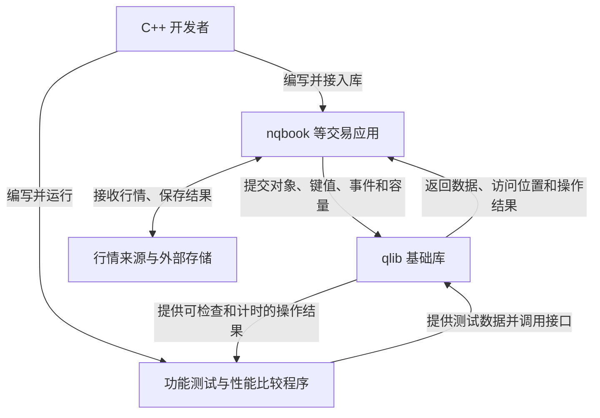
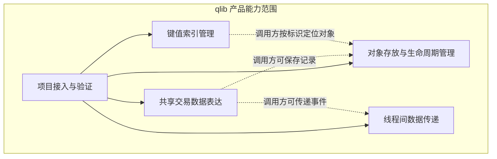

# Requirement（需求文档）

**项目：** qlib  
**文档版本：** 0.3  
**日期：** 2026-10-15  
**状态：** 供开发、设计和验收使用；本文描述目标要求，不表示项目已经实现或验证  
**参考基线：** 用户提供的 qlib 源码，其 CMake 项目版本为 v0.5.1

本文按新版 template 的“全文写作要求”说明需求。0.3 版统一使用 `qlib`/`QLIB` 名称，保留原有需求范围、编号、规则和验收要求。文档版本与软件版本分别记录。

## 0. Revision History

| 文档版本 | 日期 | 修改人 | 主要变更及原因 |
| --- | --- | --- | --- |
| 0.1 | 2026-10-14 | 项目负责人，AI 辅助起草 | 根据用户提供的需求模板与 qlib v0.5.1 参考源码建立初稿；补充需求必要性、产品能力划分、数据规则、验收映射及待确认事项，供从零开发使用。 |
| 0.2 | 2026-10-14 | 项目负责人，AI 辅助改写 | 按新版模板改写全文，让不了解项目的读者也能理解用途、参与者、输入、结果及限制；补充术语解释和具体例子。未新增、删除或改变原有需求，不把本次文档检查记作软件验收。 |
| 0.3 | 2026-10-15 | 项目负责人，AI 辅助修改 | 将项目名称及公共接口前缀统一为 `qlib`/`QLIB`；功能范围和验收标准保持不变。 |

本表说明需求文档改了什么、为什么改。今后若改变功能范围或行为，应在这里写明受影响的需求编号和原因，再调整相关设计与任务。

## 1. Introduction

### 1.1 文档目的

这份文档回答四个问题：qlib 要提供什么、为什么需要、使用者要满足什么条件，以及怎样判断做出来的东西符合要求。项目负责人用它确定范围，开发人员据此设计，测试人员据此检查结果，使用 qlib 的人据此了解能依赖哪些行为。

功能需求说明“能做什么”，例如按订单编号查找数据；非功能需求说明“做到什么质量”，例如结果正确、内存使用有明确上限、验证可以重复。内部怎样组织类、保存成员变量或实现算法，由 specs.md 说明；开发任务和编码步骤放在 Sprint Backlog 与 Implementation Plan。

本文用编号连接相关内容：`SRC` 是需求来源，`NEED` 是要解决的问题，`BR` 是业务或使用规则，`FR` 是功能需求，`UC` 是具体使用场景，`EXT` 是对外接口要求，`NFR` 是质量要求，`AC` 是验收条目，`OI` 是待确认问题。例如，FR-11 的含义是第 11 项功能需求，编号不代表开发顺序。

### 1.2 产品概述

qlib 是一套供其他 C++ 程序调用的基础工具。直接使用它的是开发者写的程序，本文称为“调用方”。nqbook 是一个目标调用方：它处理行情并维护订单簿，也就是记录当前尚未成交完的买卖订单；qlib 为这类应用提供统一数据格式，以及保存、查找、传递和重复使用数据或内存的能力。

例如，应用收到订单后，需要表示“哪笔订单、价格多少、数量多少”，把它存下来，并在收到撤单消息时按编号找回。撤单是撤掉订单中的部分或全部剩余数量，成交是买卖已经达成的事实，价位是某个买卖方向上的一个价格。qlib 可以帮助表达和保存这些信息，但实际扣减订单、撮合买卖等业务由调用方执行。

开发者通过头文件在自己的程序里使用 qlib。头文件向编译器提供类型和接口；qlib 不提供网页、桌面界面或需要单独启动的交易服务。它可以被行情处理、历史数据回放和研究程序使用，也可以用来存放普通非交易对象；这里的对象指程序中的一份数据或一个工作实体。

共享交易记录适用于能够转换成订单、撤单、成交和价位更新的信息。具体支持哪些股票、合约或市场，交易所数据怎样转换、有哪些交易规则，由调用方决定。qlib 不直接连接交易所、生成策略信号或执行交易。

### 1.3 项目范围

项目要交付一组可独立使用、行为清楚并能实际验证的基础能力，让不同程序不用反复定义相同数据或重写相同管理功能。完整范围对应参考项目的主要对外能力，每次迭代只做已经选定的部分。

| 范围内 | 应交付什么，读者怎样理解 |
| --- | --- |
| 共享交易数据表达 | 提供订单、撤单、成交、L2 价位、快照和监控样本的共同格式。L2 价位表示某侧某价位的总数量；快照是某一时刻的价量副本；监控样本记录当时的运行情况。 |
| 对象存放与生命周期管理 | 支持三种使用目标：保存后不随意改变对象地址；用句柄即一个编号反复找到对象；借还固定大小的原始内存。生命周期指对象从创建完成到销毁的这段时间，原始内存则只是尚未必创建对象的字节空间。 |
| 键值索引管理 | 保存“键 → 值”的对应关系，例如“订单 ID → 订单数据”，支持建立、查找、修改值、删除、逐项访问和提前准备容量。同一个键至多对应一项。 |
| 线程间数据传递 | 线程是程序中的一条工作流程，多条线程可以交错或并行执行。这里一个线程负责放入，另一个线程负责取出，这叫 SPSC（单生产者、单消费者）。队列有固定容量，并按 FIFO（先进先出）交接成功放入的数据。 |
| 项目接入与验证 | 提供头文件和 CMake 接入方式。CMake 用于组织编译；自动化测试检查结果是否正确，另有独立的性能比较程序测量键值索引的操作耗时。 |

| 范围外 | 哪些工作仍由调用方或其他系统完成 |
| --- | --- |
| 订单簿业务与撮合引擎 | 调用方根据新增、修改、撤单和成交更新订单簿，决定哪些买卖成交，并计算快照；qlib 不自动执行这些动作。 |
| 行情接入与网络服务 | 调用方连接数据源、解析交易所消息、订阅行情，并处理断线重连和消息重传；qlib 不接管网络连接。 |
| 存储和监控服务 | 调用方写数据库、日志或 Parquet 等数据文件，并采集、发送和展示运行指标；qlib 只提供相关数据表达。 |
| 交易、风控与策略 | 其他程序决定下单、检查风险、执行交易和分析收益。 |
| 更通用的线程交接 | 不要求多个生产者共用一个消费者的 MPSC，或多生产者、多消费者的 MPMC；也不提供自动等待、通用线程池或两个进程共用的队列。进程是一个正在运行的程序实例。 |
| 全面替代标准库 | 不补齐 C++ 标准库中全部容器。标准库是 C++ 提供的通用工具，容器负责保存一批数据；qlib 与它名称相似的接口也不保证使用规则完全相同。 |
| 跨平台数据交换与迁移 | 不提供通用序列化，即把数据按统一外部格式编码；也不负责不同字节排列方式的转换、协议协商或旧文件升级迁移。 |

优先级 **P0** 表示先满足的核心正确性、接入和关键使用要求；**P1** 表示可以稍后实施、但仍属于完整交付的要求。P1 不能在最终验收时被默默省略。具体迭代、日期和任务在开发计划中安排，本需求文档不规定逐次编码顺序。

### 1.4 需求来源与必要性

| 来源编号 | 来源 | 怎样用于确定需求 |
| --- | --- | --- |
| SRC-01 | 用户提供的 qlib v0.5.1 参考源码，包括说明、公共头文件、测试和构建配置。 | 了解参考项目能供调用方做什么，以及已有字段和接口要保持哪些含义；参考代码采用的每种内部做法不自动变成需求。 |
| SRC-02 | 用户希望从头走一遍 qlib 的完整开发过程，并理解 nqbook 为什么需要它。 | 要求每项能力能解释用途、逐步开发并独立验证，让读者能从需求看懂后续设计依据。 |
| SRC-03 | 用户提供的 requirement.md 模板，本次加入全文写作要求。 | 规定文档结构，并要求把问题、需求、规则和验收关系解释清楚。 |

以下问题来自参考项目的使用场景和本次开发目标，不表示已经做过生产用户访谈或故障统计。

| 问题编号 | 谁遇到了什么问题 | 为什么需要改进 | 对应需求 |
| --- | --- | --- | --- |
| NEED-01 | 接收行情、处理订单和保存记录的程序，可能各自解释价格单位、数量或消息种类。 | 大家应使用同一含义。例如“撤掉 2”不能被另一程序读成“还剩 2”。 | FR-01—FR-04；NFR-05。 |
| NEED-02 | 程序保存了某个订单的地址，增加其他订单后，原订单若搬到另一位置，旧地址就无法继续使用。 | 需要一种存储能力，使插删其他对象时，仍在使用的对象地址保持不变。 | FR-05；NFR-01、NFR-02。 |
| NEED-03 | 对象或工作内存频繁申请、释放，程序既想重复利用空间，又容易混淆谁负责销毁对象。 | 分别明确“凭编号管理对象”和“只借一段内存”的能力，避免忘记清理或重复清理。 | FR-06、FR-07；NFR-02、NFR-04。 |
| NEED-04 | 程序收到订单 ID 后，如果每次都逐个查看全部订单，会增加大量重复查找工作。 | 需要维护编号与数据的对应关系，并能检查查找、修改和删除结果。 | FR-08—FR-10；NFR-01、NFR-04。 |
| NEED-05 | 一个线程接收数据，另一个线程处理数据，二者速度不同，可能积压。 | 需要有容量上限的顺序交接；放不下时明确告知，不能悄悄覆盖尚未处理的数据。 | FR-11—FR-13；NFR-03、NFR-04。 |
| NEED-06 | 应用只想使用一项基础能力，却可能被要求部署额外服务或安装一整套运行组件。 | qlib 应在应用程序内部直接使用，运行时只需要 C++ 标准库。 | FR-14；NFR-06、NFR-07。 |
| NEED-07 | “看起来能运行”或“代码更短”无法说明所有关键行为正确，也无法说明速度是否改善。 | 需要可重复的功能测试，以及注明条件的性能比较，让后续修改有证据可查。 | FR-15、FR-16；NFR-01、NFR-04、NFR-08。 |

## 2. Overall Description

### 2.1 产品视角描述

本项目根据参考 qlib 独立复刻一套基础库。应用向它提交数据、键值或容量要求，它返回保存结果、查找结果、取出的数据或成功/失败状态。应用与行情来源、文件和数据库之间的通信，仍由应用自己完成。

这张上下文图说明谁使用 qlib，以及系统边界两边交换什么。比如，交易应用接收一条撤单消息后，可以用 qlib 查找订单，再自行处理撤单；不会由 qlib 的某个后台服务接收网络消息。测试程序和应用一样通过公开接口调用库，因此也是库的外部使用者。

图中箭头表示调用或数据交换，不表示 qlib 会自动建立网络连接。qlib 的代码编译进使用它的程序，与该程序一起运行。

### 2.2 User Classes

这里按使用目标区分角色，不是给 qlib 设计登录账号或权限等级。同一个人可以同时承担开发、维护和测试角色。

| 用户类别 | 什么时候使用 | 要完成什么，负责什么 |
| --- | --- | --- |
| 交易应用开发者 | 编写和运行行情应用时经常使用。 | 选择需要的能力，提交数据并处理结果；负责订单业务规则，以及多个线程共同访问数据时的协调。 |
| 库开发与维护者 | 开发和修改 qlib 时频繁使用。 | 实现需求，维护接口规则，说明修改是否影响旧调用程序；代码仓库修改权限由项目管理工具控制。 |
| 测试与性能验证人员 | 相关功能修改后或准备交付时使用。 | 准备输入，核对结果，测量性能，记录实际环境、失败原因和验证证据。 |
| 学习与研究使用者 | 按学习或实验任务使用。 | 理解各项能力的用途，运行例子并与标准库比较；实验结果未经验证不能作为生产保证。 |

nqbook、自动化测试和构建程序都是外部软件调用方。qlib 内部不再给它们区分“管理员”或“普通用户”。

### 2.3 Operating Environment

本节说明开发和验收需要什么环境。满足环境要求只是能开始编译和验证，不表示所有功能已经通过检查。

| 项目 | 环境要求与适用边界 |
| --- | --- |
| 首要开发与验收平台 | Linux x86-64，即运行在 64 位 x86 处理器上的 Linux。用户的 Ubuntu 24.04 / WSL2 可以作为首要环境；WSL2 是 Windows 中的 Linux 运行环境，测性能时应注明使用了它。 |
| 语言与工具 | 支持 C++23 的编译器和相应标准库，CMake 3.28 或更新版本，以及可用的编译工具。实际采用的编译器版本写入验收记录。 |
| 程序运行 | qlib 在调用程序的进程内工作，不要求浏览器、数据库、独立监听端口或另起一个服务。 |
| 功能测试 | 参考项目使用 GoogleTest v1.17.0，它是组织测试和报告失败的框架。第一次获取它需要网络，或提前准备好本地依赖。 |
| 两线程交接 | 主机能运行生产者和消费者线程。若要声称交接不依赖阻塞锁，还需检查平台对相关原子操作的支持；原子操作为多个线程读写同一数据提供规定的保证，但不代表任意平台都不使用内部锁。 |
| 性能测量 | 记录 CPU、操作系统、编译器、优化配置及负载，也就是测哪些操作、使用多少数据。具体数值门槛在环境固定后确认。 |
| 其他平台 | 原生 Windows、macOS、ARM 等平台的正式支持范围待确认。使用标准 C++ 不等于这些组合都已经验证。 |

### 2.4 Constraints

这些是设计时必须遵守的限制，不能因为换了内部实现，就让调用方看到另一种行为。

- qlib 采用纯头文件形式，也就是通过头文件提供公共声明和所需实现，由调用方编译。公开名称位于 `qlib` 命名空间，也就是用 `qlib::` 前缀区分本库的名称与其他代码的名称；CMake 提供 `qlib::qlib` 接入目标，让应用取得库需要的编译配置。
- 程序运行时，库只依赖 C++ 标准库。测试框架是开发和验证工具，不是应用运行前必须启动的服务。
- 参考项目的公共字段含义、单位、类别标签和主要使用规则是兼容基线。有意改变时，应在规格和版本说明中明确告知调用方。
- 价格和数量使用定点整数，即把小数乘以约定比例后存成整数，不能在这些共享字段里改成浮点数。字段宽度及布局变化也要考虑与现有使用者的兼容。
- 普通存储和索引能力不默认允许多个线程同时修改；专门的线程交接能力只承诺 SPSC。
- 复用参考代码时保留其要求的许可证和署名；这属于项目交付约定，不把本库扩展为交易合规系统。
- 当前没有确认的交付截止日期、生产数据规模或纳秒级耗时门槛。纳秒是十亿分之一秒，本稿不自行写入没有依据的速度数字。

### 2.5 Assumptions

下列前提说明调用方需要提供什么。它们不是 qlib 已经自动替使用者检查的功能。

- 调用方提供的 C++ 对象满足最终接口要求，能够按规定构造、移动和销毁。构造是创建对象，移动是按类型规则把值或资源转给另一个对象，销毁是结束对象使用并执行其清理动作。
- 共享记录中需要使用的字段，在读取或传递前已经初始化，也就是先设好值；交易所时间、品种编号和业务值由调用方填写，库不自行补齐。
- 订单是否合法、行情序号是否缺失、消息是否重复，以及业务时间顺序是否正确，由调用方检查。
- 调用方不使用失效迭代器、已释放句柄或外池指针。迭代器是逐项访问容器时持有的位置；指针保存对象的内存地址。对应对象已删除或位置已失效时，继续使用不保证能得到一个可处理的错误返回。
- 普通存储和索引的写入由调用方同步，即安排不同线程的访问先后，避免冲突；销毁组件前，所有使用者已停止访问。
- 若程序之间交换结构体的本机布局，即当前编译环境下的原始内存形式，它们使用相同公共定义和兼容 ABI。ABI 是类型大小、对齐和内存布局等二进制约定；不同环境不一定一致，跨平台协议要单独设计。

例如，应用若想让两个线程同时向同一队列放数据，就不再满足 SPSC 前提，需要重新评估并发范围。不能一面改变使用条件，一面继续沿用原来的保证。其他前提不成立时，也应明确是否新增输入检查、并发能力或数据编码要求。

### 2.6 Dependencies

本节列出项目依赖的外部条件，以及缺失时具体影响哪一步。它不表示 qlib 要把这些工具都做成自己的功能。

| 外部依赖 | 为什么需要 | 未准备好时的影响 |
| --- | --- | --- |
| 编译器与标准库 | 把库和调用代码编译成可运行程序。 | 无法完成编译和该平台的验收。 |
| CMake 与构建工具 | 用一致方式组织库、测试和性能程序的编译。 | 无法按项目约定重复构建过程。 |
| GoogleTest 源码或可用本地副本 | 编译并运行自动化测试。 | 测试阶段受阻；不影响库声明本身，但不能因此报告测试通过。 |
| 调用场景与测试数据 | 知道使用者提交什么，正确结果应是什么。 | 可以先使用每次都能得到相同期望结果的人工数据；生产性能判断仍需有代表性的真实场景。 |
| 固定性能环境 | 让不同实现的测量结果有可比性。 | 功能仍可开发，但不能承诺尚未测量的绝对耗时。 |
| 外部应用同步公共定义 | 让应用和库对字段含义及布局保持一致。 | 定义改变后，旧应用可能需要调整代码并重新编译。 |

nqbook 是计划使用 qlib 的应用，不是运行 qlib 的前提。不开启 nqbook，仍应能单独编译并运行 qlib 的验证程序。

### 2.7 系统模块与功能划分

本节按“调用方想完成什么”分组。一个模块可能最后由多个类或文件实现；这里不规定代码结构，只规定它提供哪些能力。模块和功能名称与第 4 章保持一致。

| 模块 | 主要使用者及目标 | 功能清单 | 责任边界 |
| --- | --- | --- | --- |
| 共享交易数据表达 | 应用开发者和记录程序，希望大家读懂同一份交易数据。 | 行情事件表达；快照与监控数据表达；事件分类与统一处理；价位关联数据表达。 | 规定数据表达，不自动执行业务。 |
| 对象存放与生命周期管理 | 应用开发者，希望保存、找到、销毁对象，或重复使用工作内存。 | 地址稳定的对象存储；基于句柄的对象管理；固定大小内存块管理。 | 对象、定位编号和空内存是三种不同的使用对象，不能混用其保证。 |
| 键值索引管理 | 应用开发者，希望凭订单 ID 等键找数据。 | 唯一键映射建立与更新；按键查询；映射删除、遍历与容量管理。 | 管理键和值的对应关系；ID 在哪些业务范围内应唯一，由调用方决定。 |
| 线程间数据传递 | 多线程应用开发者，希望两个工作线程按顺序交接数据。 | 有界入队；按序出队；队列状态与结束使用。 | 只覆盖 SPSC，不决定消费者什么时候运行，也不决定积压时如何处理。 |
| 项目接入与验证 | 集成人员、维护者和测试人员，希望接入方便且结果能核实。 | 项目接入；自动化功能验证；性能对比与结果输出。 | 提供可运行的验证入口，不能把尚未测量的性能当成已经实现。 |

实线表示这些能力都要能接入和验证；虚线表示应用可以把能力组合起来。例如，先保存订单，再为订单 ID 建立索引。箭头不表示库会自动替应用执行完整流程，使用一个组件也不要求同时创建其他组件。普通存储和传递能力同样可以处理非交易数据。

### 2.8 核心业务流程

| 流程 | 谁发起，怎样完成 | qlib 应完成什么 | 最终结果与详细用例 |
| --- | --- | --- | --- |
| 保存并定位一个对象 | 应用提交对象，建立编号索引，之后按编号查询；结束使用时先解除索引和引用，再删除对象。 | 保存对象并保持约定的地址稳定，建立或查找对应关系，按要求销毁对象；应用安排各步顺序。 | 对象存活时可找到，删除后不再用旧引用；UC-01。 |
| 两个线程交接事件 | 生产者准备数据并尝试放入，消费者尝试取出，再执行业务处理。 | 有空位就接收，满时报告失败；有数据就按序返回，空时报告无结果。 | 成功交接的顺序清楚，未消费数据不会被静默覆盖；UC-02。 |
| 重复使用资源 | 应用申请对象或内存块，使用后释放或归还，再次申请。 | 根据所选能力管理对象的创建销毁，或只管理内存块借还。 | 资源可以复用，谁负责清理明确；UC-03、UC-04。 |
| 接入并验证 | 开发者接入接口，编译并运行测试，需要评价性能时再运行比较程序。 | 提供接入配置和可执行的验证入口。 | 形成实际执行记录，能看出哪些通过、哪些失败或未执行；UC-05。 |

例如，“保存并定位对象”完成后，应用能按 ID 42 找到那份订单，但这不表示 qlib 已经判断该订单应该成交或撤销。业务处理仍由应用决定；第 5 章再说明每个流程的前提、正常步骤和失败处理。

## 3. Business Rules

本章说明使用 qlib 时必须共同遵守的规则。例如，发送方和接收方必须对“数量 10”采用同一种单位，否则两边虽然读到同一个数字，理解的实际数量却不同。表中的“调用方”是使用 qlib 的应用程序：qlib 负责提供约定的数据表达和库功能，应用程序负责填写业务数据、更新订单簿，并按要求使用这些功能。

| 编号 | 规则 | 执行或维护责任 |
| --- | --- | --- |
| BR-01 | 价格以 `1/10^10` 为一个存储单位，数量以 `1/10^8` 为一个存储单位。也就是说，实际价格 1 要写成整数 `10,000,000,000`，实际数量 1 要写成整数 `100,000,000`。交换这些数据的程序必须采用同一套换算方式。 | qlib 提供统一定义；调用方负责把实际价格和数量正确换算后写入，并按相同单位读取。 |
| BR-02 | `event_ns` 记录交易所中事件发生的时间，`recv_ns` 记录本地程序收到该事件的时间。二者都使用 Unix epoch 纳秒，即从 UTC 时间 1970 年 1 月 1 日零时起累计的纳秒数；1 秒等于十亿纳秒。接收时间不能被当作交易所事件时间，反之亦然。 | 调用方分别填写两个时间；qlib 保留其数值和含义。 |
| BR-03 | 新增订单时，`qty` 表示新增数量；修改订单时，`new_qty` 表示修改后的剩余数量，不是增减了多少。撤单使用单独的撤单记录，`cancel.qty` 表示撤掉的数量。例如，按 BR-01 换算后，剩余 10 改成剩余 6 应填写新的剩余量 6；撤掉 4 则应填写撤单数量 4。 | qlib 固定这些字段的含义；调用方据此更新订单状态。 |
| BR-04 | L2 价位数据只说明某个价格上合计还有多少数量，不逐笔列出订单。其中 `qty` 是更新后的总量：先收到总量 10，再收到总量 6，结果是 6，不是 16；同一条记录再来一次也不能重复累加。`qty <= 0` 表示应移除该价位。 | 调用方按这些含义更新价位；qlib 只提供数据表达，不自动维护订单簿。 |
| BR-05 | 快照是某一时刻买卖双方价位情况的一份记录。每一侧都按最优价格在前排列，买方最高价优先、卖方最低价优先；参考范围为每侧 1 档，即各记录一个最优价位。监控样本记录程序运行情况，不属于行情事件。 | qlib 提供快照和监控数据的表达；调用方负责产生、排列和填写数据。 |
| BR-06 | 键值映射是“凭一个标识找到一项数据”的对应关系，一个键只能对应一项。例如，订单 ID 42 已对应数据 A，再普通插入“42 对应 B”时仍应保留 A；要改成 B，调用方必须明确执行更新。 | qlib 的键值索引功能负责保持键唯一，并执行重复插入与更新的约定。 |
| BR-07 | 地址是对象所在的内存位置，句柄是用于查找对象的编号，迭代器是逐项访问容器时使用的位置记录。这三者有效的条件不同，不能认为“句柄还有效”就代表“以前取得的地址也有效”。对象释放后，指向该对象的旧地址、句柄或遍历位置都不能继续使用。 | qlib 保持各功能明确承诺的有效性；调用方遵守各自的失效条件。 |
| BR-08 | 原始内存块只是一块可用空间，还不是已经创建好的 C++ 对象。借出内存不代表替调用方创建了对象，归还内存也不代表替调用方清理了对象。只能向原来借出的池归还该块，且同一次借出只能归还一次。 | qlib 管理内存块的借还；调用方负责在其中创建对象，并在归还前完成所需的对象清理。 |
| BR-09 | SPSC 指“单生产者、单消费者”：只允许一个线程负责放入数据，另一个线程负责取出数据。队列满时必须报告放入失败，不能悄悄覆盖尚未取出的数据；队列空时必须报告没有数据，不能返回伪造的事件。 | qlib 执行放入、取出和满空反馈；调用方保证线程数量符合要求，并协调开始、停止和销毁。 |
| BR-10 | 普通对象存储、键值索引和资源池不负责协调多个线程同时修改。调用方必须安排同步，避免相互干扰的访问同时发生；销毁组件时，其他线程必须已经停止访问它。这里的销毁包括析构，即 C++ 对象结束使用时执行的清理。 | 调用方负责协调线程和访问时机。 |
| BR-11 | 公共记录中的字段、标签、数量单位或快照深度一旦变化，维护者必须通知所有相关调用方。标签是区分记录类别的约定值，深度是每一侧记录多少档价位。在一台机器上看到相同的内存排列，不代表这些数据直接搬到其他平台后也一定能被正确解释。 | 维护者协调公共定义和版本；调用方使用一致的定义重新构建和接入。 |
| BR-12 | 元素通过移动或原地构造进入容器：前者把已有对象的数据或资源转交给容器中的元素，后者根据调用方提供的信息直接在容器内创建元素。qlib 容器本身不提供复制能力；元素需要满足哪些条件、容器本身能否移动，都以公开使用约定为准，不能因为“元素可以移动”就推断“容器也能移动”。 | qlib 的公开接口和类型要求给出这些限制；调用方按对应约定使用。 |

## 4. Functional Requirements

本章沿用第 2.7 节的五个模块，逐项说明“为什么需要、调用方怎样使用、qlib 必须给出什么结果”。每项功能保留独立编号，以便后续设计、测试和验收引用。P0 表示应优先满足的核心要求，P1 表示可稍后实现、但完整项目验收仍必须完成的要求；实际先做哪一项由迭代计划确定。`NEED` 编号对应第 1.4 节的用户需要，`SRC` 编号对应需求依据，`BR` 编号对应上一章的规则。第 7 章继续规定公开接口的兼容要求，内部实现写入规格文档。

### 4.1 共享交易数据表达

接收行情的程序、维护订单簿的程序和读取结果的程序，需要对同一份数据有相同理解。此模块提供共同的数据表达，让这些程序能够说明“发生了什么”和“当前记录了什么”；填写数据并执行交易业务操作仍由调用方负责。

#### 4.1.1 FR-01 行情事件表达

为避免接收行情的程序和订单簿把同一条消息理解成不同意思，调用方准备订单、撤单、成交或 L2 价位更新时，qlib 应提供四类公共记录，容纳第 6 章规定的全部字段，并原样保留调用方写入的标识、价格、数量和时间。不同数量必须各有明确含义：新增量、修改后的剩余量、撤掉的数量，以及某个价位更新后的合计数量不能混用。例如，将订单剩余量从 10 改成 6，表示新剩余量为 6，不表示再增加 6。若数据缺字段、数量不符合业务规则或时间异常，调用方负责判断和处理；qlib 不自动补值，不执行买卖订单配对成交，不剔除重复消息，也不更新订单簿。验证时，应能分别表达四类事件，并在不同使用位置读到相同的字段值和含义。**优先级：P0；来源：NEED-01、SRC-01；规则：BR-01—BR-04、BR-11。**

#### 4.1.2 FR-02 快照与监控数据表达

为让读取订单簿结果和运行情况的程序使用统一格式，调用方提供某一时刻的买卖价位、时间或运行统计时，qlib 应分别提供快照和监控样本的表达。快照必须能记录约定深度内买卖两侧的价格与数量；监控样本必须区分“到现在总共发生了多少次”“到现在总共花了多少时间”和“当前有多少”，例如累计收到的消息数不能被当作当前仍保存的订单数。qlib 不自行排列价位、采集指标、计算每秒速率或发送这些记录；没有买方或卖方价位时具体填什么等未确定问题，按第 11 章处理。验证时，第 6 章列出的数据应能完整写入并读回，监控样本不能被当成行情输入事件。**优先级：P0；来源：NEED-01、SRC-01；规则：BR-02、BR-05、BR-11。**

#### 4.1.3 FR-03 事件分类与统一处理

为让调用方通过同一套入口接收多种事件后仍知道该怎样处理，qlib 应提供一种统一持有四类行情事件的方式，并保留其中实际装的是订单、撤单、成交还是 L2 价位更新的信息；供记录流程使用的另一种统一表达还应能容纳快照。例如，同一个接收入口这次收到订单、下次收到撤单，调用方都应能识别类别并选择对应处理。监控数据不属于这两个支持集合，不能混入；开发者若试图把不受支持的 C++ 数据类型作为其中一种记录，编译时应无法通过。对于从网络收到的未知标签，或标签所指类别与消息长度不符的情况，调用方的接入程序负责拒绝。验证时，每种受支持记录都应能正确识别、访问，公开标签与记录类别的对应关系应保持一致。**优先级：P0；来源：NEED-01、SRC-01；规则：BR-03、BR-05、BR-11。**

#### 4.1.4 FR-04 价位关联数据表达

为让不同订单簿程序复用同一套“一个价位上有多少量、有哪些订单”的描述，qlib 应提供价位总量及订单队列首尾关系的公共数据。调用方创建空价位时，总量应为零，首尾都不指向订单；若逐笔维护订单，调用方自行把这些订单按需要连接起来，若只维护价位合计数量，则可以只填写总量而不建立订单连接。这里的首尾关系指向当前进程内的对象，也就是正在运行的这一个程序所拥有的对象，不能直接作为网络消息发给另一个程序使用。qlib 不自动排序订单、汇总数量或检查订单连接是否正确。验证时，空价位应有确定的初始状态，逐笔和合计数量两种用法都能表达，文档应说明由调用方保证被引用订单仍然存在，并在其删除后停止使用旧引用。**优先级：P0；来源：NEED-01、NEED-02、SRC-01；规则：BR-04、BR-07、BR-11。**

### 4.2 对象存放与生命周期管理

调用方可能需要保存对象、凭编号找回对象，或者只借一块空间供自己使用。此模块分别提供这三种能力，并说明谁负责创建和销毁对象。“地址不变”“编号仍能找回对象”和“空闲内存可以再次借出”各自解决不同问题，不能互相替代。

#### 4.2.1 FR-05 地址稳定的对象存储

为让其他索引或订单关联能够一直使用某个对象的地址，调用方放入对象或提供信息直接在存储中创建对象后，qlib 应保证：只要这个对象尚未被删除，插入或删除其他对象都不会改变它的地址。调用方还应能删除单项或一段有效范围，按正向或反向逐项访问，从有效对象地址取得对应的遍历位置，清空全部对象，并查询现有数量和容量。遍历必须覆盖全部尚未删除的对象且不重复，但不保证按插入先后排列；清空时应销毁这些对象并释放它们的存储。调用方必须向删除和地址定位操作提供有效对象或位置；若创建对象或申请内存失败，qlib 不能把半完成的对象算作正常存活对象，但不要求失败后容量恢复成操作前的数值。验证时，可先记住对象 A 的地址，再插入、删除其他对象，确认 A 的内容和地址仍正确；被删除对象应只清理一次，后续遍历不得再返回它。**优先级：P0；来源：NEED-02、SRC-01；规则：BR-07、BR-10、BR-12。**

#### 4.2.2 FR-06 基于句柄的对象管理

为让调用方在存储扩大后仍能找到原来的对象，qlib 应在成功创建对象后返回索引句柄，即一个之后用来访问该对象的编号。调用方应能凭有效句柄访问对象、释放对象并完成清理、查询当前存活对象数；释放后空出的存放位置应可再次使用，并优先使用最近释放的位置。扩大存储不能让尚未释放的句柄改为指向其他对象，但原来取得的指针或引用可能失效，因此调用方应重新凭句柄获取访问位置。创建新对象失败不能增加存活数量；对象释放后旧句柄立即失效，其数值却可以分配给以后的新对象，qlib 不保证识别所有旧句柄误用。例如，编号 5 的对象释放后，编号 5 可能被另一个新对象使用，调用方不能据此认为旧对象还在。验证时，存储扩大前后有效句柄应仍找到正确对象，释放和再次申请后的对象清理与数量应一致。**优先级：P0；来源：NEED-03、SRC-01；规则：BR-07、BR-10、BR-12。**

#### 4.2.3 FR-07 固定大小内存块管理

为让调用方在预定资源上限内反复借用工作空间，qlib 应接受每块所需大小、块数和合法的对齐要求；对齐是对内存起始地址的限制，调用方要放入的数据可能要求其地址满足这一限制。库应提供固定块数的原始内存，每块实际可用空间不少于请求值，并满足有效对齐要求；调用方应能借出、归还和再次借出这些块，查询实际块大小、对齐、总容量和当前借出数量。全部借出或容量为零时，应返回没有可用块的结果；归还后应优先再次借出最近归还的块。qlib 不自动增加容量，也不替调用方创建或销毁其中的对象；整个池销毁后，所有块的地址都不能再使用。归还别的池的块、重复归还同一块或提供不合法配置，不属于正常使用范围，具体检查方式见第 11 章。验证时，最多应能借出约定数量的块，各块空间互不重叠，归还后又能借出，所有查询数量准确。**优先级：P0；来源：NEED-03、SRC-01；规则：BR-08、BR-10。**

### 4.3 键值索引管理

调用方常需要“给一个订单 ID，就找到对应的数据”。此模块保存这种标识与数据的对应关系，其中用于查找的标识称为键，对应的数据称为值。值可以是完整业务数据，也可以是另一个对象的地址或句柄；若只是保存后两者，调用方仍负责保证那个对象可以被访问。

#### 4.3.1 FR-08 唯一键映射建立与更新

为避免同一个标识对应多项数据而无法确定该用哪一项，调用方提交键和值，或提交创建值所需的信息时，qlib 应保证同一键最多保留一项映射，并返回对应项及本次是否新增。普通重复插入必须保留旧值；调用方找到已有值后，可以明确修改它。下标式访问是“用键直接取得对应值”的一种方式，它在键不存在时可以创建默认值。哈希是把键计算成辅助查找的数值；不同键可能得到相同数值，这叫哈希冲突。即使发生冲突，不同键也必须各自保存而不混淆；调用方逐项遍历时不能借此修改已经存入的键。对于不同插入用法是否会提前创建对象或移动传入值，规格文档应分别说明；申请内存或处理元素发生异常时，不能报告新增成功。验证时，键应保持唯一，重复插入不覆盖旧值，主动更新后能读到新值，发生冲突的不同键仍分别对应正确数据。**优先级：P0；来源：NEED-04、SRC-01；规则：BR-06、BR-10、BR-12。**

#### 4.3.2 FR-09 按键查询

为让调用方凭标识找到数据，并明确知道“找不到”，qlib 应提供普通查找、判断键是否存在，以及要求该键必须存在的访问方式。已有键应返回对应数据；普通查找遇到不存在的键，应报告未找到且不新建映射；使用“键必须存在”的访问方式仍找不到时，应抛出已公开说明的异常，即交给调用方处理的错误信号。例如，查询订单 ID 42 不应因为没有找到，就自动增加一条 ID 42 的记录。验证时，已有键应返回正确值，查不到时映射数量不变，只读查询不改变内容；即使不同键的哈希结果相同，或此前删除过其他键，也不能漏掉存在的键，或把不存在的键误报为存在。**优先级：P0；来源：NEED-04、SRC-01；规则：BR-06、BR-07、BR-10。**

#### 4.3.3 FR-10 映射删除、遍历与容量管理

为让索引跟随数据的增加、删除和规模变化继续可用，qlib 应允许调用方按键或有效遍历位置删除映射，逐项访问全部仍存在的映射，清空映射，查询数量和容量，并按预计规模提前预留容量。按不存在的键删除时，应返回删除数量零；删除成功后该键不能再查到，其他键值关系不能受损；清空应销毁全部映射元素。库不保证遍历顺序；插入或重新安排存储后，调用方不能继续假定之前保存的迭代器和引用仍有效，也就是不能未经确认就沿用旧的遍历位置或旧的元素访问方式。使用已经失效的位置或引用属于违反使用前提。验证时，删除数量应准确，遍历全部现有映射不能漏项或重复，容量变化后保留下来的键和值仍应一致。**优先级：P0；来源：NEED-04、SRC-01；规则：BR-06、BR-07、BR-10。**

### 4.4 线程间数据传递

一个线程可以负责准备事件，另一个线程负责处理事件；队列让它们按先放入、先取出的顺序交接。调用方负责创建队列、启动和协调这两个线程，qlib 只执行约定的数据交接，不自动创建线程或安排失败后的重试。

#### 4.4.1 FR-11 有界入队

为避免生产数据比处理数据更快时无限占用内存，调用方应能指定所需最小容量创建队列，qlib 应公开实际容量，保证它不小于请求值且至少为一，并在队列存在期间保持不变。唯一生产者提交对象或创建对象所需的信息时，有空位就应按提交顺序接收；已满则应立即报告失败，不覆盖尚未取出的数据，也不移动这次提交的实参，即不把调用方交来的对象数据或资源转走。对象尚未创建成功时，消费者不能看到它；创建失败可按公开异常约定向调用方报告。验证时，在没有消费者取走数据的前提下，实际容量以内的提交应成功，超过容量的提交应失败，队列原有数据不受覆盖，该次提交的原对象仍可由调用方继续使用。**优先级：P0；来源：NEED-05、SRC-01；规则：BR-09、BR-12。**

#### 4.4.2 FR-12 按序出队

为让处理事件的线程保持生产时的顺序，唯一消费者请求数据时，qlib 应返回最早成功放入且尚未取出的元素；成功取出后，应清理队列原存放位置中的对象，使这个位置可以再次使用。队列为空时应明确返回没有结果，不能用一个默认事件假装取到了数据。在元素满足公开类型要求且正常执行的条件下，交接不得丢失、重复或乱序，例如依次成功放入 A、B、C，就应依次取到 A、B、C，即使期间反复用满并腾出队列也是如此。若移动元素时抛出异常，能恢复到什么状态必须由规格文档确定；确认前不能承诺整个出队过程会完整撤销并恢复到操作前。验证应覆盖多轮容量复用和两个线程同时工作，实际取出序列应与成功放入的序列一致。**优先级：P0；来源：NEED-05、SRC-01；规则：BR-09、BR-12。**

#### 4.4.3 FR-13 队列状态与结束使用

为让调用方了解积压情况并结束数据交接，qlib 应提供实际容量、当前元素数量和是否为空的查询；在两个线程都已停止操作时，这些结果必须精确。线程仍在工作时，数量和空状态只代表查询时看到的情况，不能保证下一次放入或取出一定成功，调用方必须检查实际操作结果。结束使用时，调用方应先停止所有访问，再销毁队列；qlib 应清理仍留在队列中的每个对象并释放自己持有的资源，但不会替调用方停止线程。验证时，静止队列的查询应准确，销毁时每个剩余对象应恰好清理一次；一边访问、一边销毁不能被当作受支持的正常用法。**优先级：P0；来源：NEED-05、SRC-01；规则：BR-07、BR-09、BR-10。**

### 4.5 项目接入与验证

开发者需要把 qlib 用进自己的程序，维护者则需要反复检查它是否正确、性能表现如何。本模块提供这些入口；测试和性能对比是开发验证工具，不是应用运行时必须额外启动的服务。

#### 4.5.1 FR-14 项目接入

为让开发者方便地使用所需能力，qlib 应允许调用方包含对应公开头文件后独立使用组件；使用 CMake 这个构建配置工具时，调用方应能通过 `qlib::qlib` 接入目标取得头文件所在路径和要求的 C++ 语言标准，而不必自行重复填写。qlib 被加入其他项目时，默认不构建 qlib 自己的测试；应用运行时也不要求 GoogleTest 测试工具、网络服务或另一个单独启动的程序。若工具缺失或编译条件不满足，构建应明确失败；只完成构建配置、没有真正编译接口，不能算接入成功。验证时，一个最小调用项目应能够编译并运行；每个公共头文件都应能在具备必要标准库环境的独立编译单元中包含，也就是单独写一个使用该头文件的 C++ 源文件时，不应依赖调用方碰巧先包含其他 qlib 头文件。**优先级：P0；来源：NEED-06、SRC-01、SRC-02；规则：BR-11。**

#### 4.5.2 FR-15 自动化功能验证

为让维护者每次修改代码后都能重复确认行为是否正确，qlib 应提供统一的构建入口来启用测试，自动检查共享数据定义、各组件的正常操作、关键边界以及约定的对象创建和清理规则。测试应支持集中运行、显示失败信息，并通过测试程序的退出结果明确区分通过和失败，使人工和自动化工具都能判断。没有找到任何测试、测试依赖下载失败，或某项检查被跳过，都不能记作验证通过。例如，队列满时不覆盖旧数据这一要求，应有相应测试能发现错误覆盖。验证时，每项 P0 功能都应有对应检查，针对性的错误行为能够被用例检出，文档应记录实际可用的测试入口。**优先级：P0；来源：NEED-07、SRC-01、SRC-02；规则：关联全部行为规则。**

#### 4.5.3 FR-16 性能对比与结果输出

为让维护者判断 qlib 键值索引在哪些操作上更合适，项目应提供可单独运行的性能对比程序，在相同输入条件下比较 qlib 映射与 C++ 标准库的 `std::unordered_map`。对比必须覆盖插入、查询存在的键、查询不存在的键和删除，并输出所用容器、工作负载和每次操作耗时；工作负载指这次用了多少数据、执行了哪些操作。测量应使用启用编译优化的程序，说明数据规模和重复测量方法。性能对比不能代替正确性测试，也不要求 qlib 在每一项上都快于标准库；若配置或输入负载无效，不能把产生的数字当作有效性能证据。验证时，应能说明双方输入如何保持一致、计时从哪里开始到哪里结束，结果应可导出，并能结合编译器、机器等环境记录重新核查。**优先级：P1；来源：NEED-07、SRC-01、SRC-02；规则：不新增交易业务规则。**

## 5. Use Cases

本章把需求放进实际使用场景：调用 qlib 的应用程序先做什么，qlib 应当回应什么，之后谁继续处理。这里的“调用方”通常是应用代码；开发者编写这些代码，程序运行时再执行操作。每个用例中的 FR 编号指向第 4 章的功能要求，BR 编号指向第 3 章必须遵守的规则。

### 5.1 UC-01 保存、定位并删除对象

应用保存一个对象后，往往还要按它的标识再次找到它。例如，订单簿先保存订单 1001，再建立“1001 对应哪张订单”的索引。本用例要求保存、查找和删除能够配合完成，同时明确谁负责清除已经失效的引用。

| 项目 | 内容 |
| --- | --- |
| 关联需求 | FR-05、FR-08—FR-10；BR-06、BR-07、BR-10。 |
| 参与者 | 使用 qlib 的应用代码。 |
| 前置条件 | 应用已经准备好地址稳定的对象存储和键值索引。“地址稳定”是指其他对象的插入、删除不会搬走这个仍然存活的对象；“键值索引”是指用订单编号等键找到对应值。应用已选择对象的键，并确保不会发生未经协调的并发修改。 |
| 触发 | 应用需要保存一个之后还会按标识访问的对象。 |

| 步骤 | 调用方动作 | qlib 的响应或应保持的结果 |
| --- | --- | --- |
| 1 | 提交需要保存的对象。 | 保存对象，并提供可以访问它的位置。 |
| 2 | 用业务键建立指向该对象的索引，例如用订单编号 1001 关联订单地址。 | 建立映射，并报告这是新增的一项。 |
| 3 | 根据后续业务插入或删除其他对象。 | 保持原对象的地址不变，前提是原对象仍然存活。 |
| 4 | 用原来的键查询。 | 返回对应映射，使调用方能够访问原对象。 |
| 5 | 确认不再需要该对象后，先解除指向它的外部引用和索引，再删除对象。 | 结束该对象的生命周期，即销毁对象并使原来的访问位置失效；其他存活对象仍有效。 |

**替代或异常流程：** 如果键已存在，索引保留旧映射，调用方决定如何处理这次准备的新对象。如果对象已经保存，但索引建立失败，调用方负责回收这个尚未进入索引的新对象；qlib 不会自动把两个组件的操作作为一笔整体事务撤回。查询不存在的键时，库返回“未找到”，不虚构对象。

**后置条件：** 对象保留期间，调用方可以通过键找到它；删除之后，调用方不再使用指向它的旧引用，其他对象仍可正常访问。例如，删除订单 1001 前，应用先清除“1001 → 订单地址”的映射，再删除订单，避免下次查找得到已经失效的地址。

### 5.2 UC-02 两个线程交接行情事件

接收行情的线程和处理行情的线程可能以不同速度工作。队列用于暂时保存尚未处理的事件：一个线程负责放入，称为“生产者”；另一个线程负责取出，称为“消费者”。本用例只支持这两个角色各一个线程，也就是 SPSC（单生产者、单消费者）。

| 项目 | 内容 |
| --- | --- |
| 关联需求 | FR-01、FR-03、FR-11—FR-13；BR-09、BR-10。 |
| 参与者 | 一个生产者线程、一个消费者线程。 |
| 前置条件 | 队列已经创建成功；传递的对象满足接口对创建、移动和销毁的要求；生产者只修改入队一侧，消费者只修改出队一侧，不让额外线程同时承担同一角色。 |
| 触发 | 生产者准备好一个行情事件，希望交给消费者。 |

| 步骤 | 调用方动作 | qlib 的响应或应保持的结果 |
| --- | --- | --- |
| 1 | 生产者尝试把事件放入队列。 | 有空间时接收事件，并报告成功。 |
| 2 | 消费者尝试从队列取出事件。 | 返回最早成功放入但尚未取出的事件，并让其占用的位置可以再次使用。 |
| 3 | 消费者判断事件属于订单、撤单、成交还是价位更新。 | 提供可识别、可读取的事件；实际业务处理由调用方选择并执行。 |
| 4 | 应用准备结束数据交接，协调两个线程停止访问队列，然后销毁队列。 | 清理仍留在队列中的对象并释放队列持有的资源。 |

**替代或异常流程：** 队列满时，入队失败，库不移动这次提交的实参，也就是不把调用方原对象的内容转移走；调用方可以决定重试、降低发送速度或采用其他策略。队列空时，出队返回“没有结果”，调用方决定是否以及如何等待。qlib 不自行重试、不覆盖或丢弃旧事件，也不负责终止线程。

**后置条件：** 正常执行时，所有成功入队并被取出的事件顺序一致，不重复交接；最后仍未消费的对象会在队列销毁时清理。例如，生产者依次成功放入“新增订单 A”和“撤销订单 A”的事件，消费者就应按这个顺序取出；如果第三个事件因队列满而未能放入，应用仍须自行决定它下一步怎么办。

### 5.3 UC-03 通过句柄管理可复用对象

有些应用需要一个能反复用来找对象的编号，而不需要一直记住对象所在的内存地址。这里的“句柄”就是 qlib 返回的索引编号。存储增长后，对象可能换了地址，但尚未释放的句柄仍应找到同一个对象。

| 项目 | 内容 |
| --- | --- |
| 关联需求 | FR-06；BR-07、BR-10、BR-12。 |
| 参与者 | 需要管理工作对象的应用代码。 |
| 前置条件 | 对象类型满足公开的使用要求；调用方不继续保留和使用已经释放的句柄；可能同时发生的写操作已由调用方协调。 |
| 触发 | 应用需要创建一个新的工作对象。 |

| 步骤 | 调用方动作 | qlib 的响应或应保持的结果 |
| --- | --- | --- |
| 1 | 提供创建对象需要的参数。 | 创建对象并返回句柄。 |
| 2 | 凭这个有效句柄请求访问对象。 | 找到该句柄对应的存活对象。 |
| 3 | 继续增加其他对象，直到存储需要增长。 | 原来尚未释放的句柄仍对应原对象。 |
| 4 | 不再需要对象时，释放其句柄。 | 销毁对象，回收它占用的位置。 |
| 5 | 之后再次申请对象。 | 可以复用已经回收的位置。 |

**替代或异常流程：** 如果对象创建失败，库不返回一个表示新对象创建成功的句柄，也不增加存活对象数量。存储增长可能使先前取得的指针或引用失效，因此不能把“句柄仍有效”理解成“旧地址也仍有效”。释放后的句柄数值可能分配给另一个对象，库不保证自动识别所有旧句柄误用。

**后置条件：** 有效句柄对应仍然存活的对象；释放后的对象不能再被访问，回收的位置可以再次利用。例如，句柄 7 原来对应工作对象 A，释放 A 后，句柄 7 可能重新分配给 B；调用方不能把旧的 7 当成仍能访问 A 的凭据。

### 5.4 UC-04 借用并归还固定内存块

应用有时只需要一块可用内存，希望事先限制最多能借出多少块。原始内存池满足这个需求，但“借到内存”不等于“其中已经有一个可使用的业务对象”：如果应用需要在这块内存里放对象，应由应用负责创建和销毁该对象。

| 项目 | 内容 |
| --- | --- |
| 关联需求 | FR-07；BR-08、BR-10。 |
| 参与者 | 需要控制内存预算的应用代码。 |
| 前置条件 | 内存池已经按合法的块大小、块数和对齐要求创建。“对齐”是指块的起始地址满足使用它的数据类型所要求的地址间隔。 |
| 触发 | 应用需要一块工作内存。 |

| 步骤 | 调用方动作 | qlib 的响应或应保持的结果 |
| --- | --- | --- |
| 1 | 申请一块内存。 | 有空闲块时，返回一块大小和对齐符合约定的原始内存。 |
| 2 | 使用这块内存；如需对象，自行创建对象。 | 继续管理内存块的借出状态，不代替调用方管理其中的业务对象。 |
| 3 | 使用结束后，先销毁自己创建的对象，再把块归还原池。 | 接收有效归还，并更新借出数量。 |
| 4 | 之后再次申请。 | 可以重新分配已经归还的块。 |

**替代或异常流程：** 所有块都已借出时，库返回空指针，表示没有可用块，由调用方决定等待还是报告失败。容量为零的池始终没有块可借。归还其他池的指针或重复归还同一块不属于本用例允许的正常操作，不能依赖库自动修复这些错误。

**后置条件：** 归还的块可以复用，池不负责销毁调用方放入其中的对象；池本身销毁后，旧块地址全部不可再使用。例如，一个池只提供两块内存，应用同时借走两块后，第三次申请应得到空结果；归还其中一块后才有机会继续借用。

### 5.5 UC-05 接入库并验证交付

功能写完并不等于已经证明它可用。开发者需要实际接入、编译和运行检查，让测试结果说明本次完成了哪些要求；如果本次交付涉及性能，还需要留下能够复核的测量条件和结果。

| 项目 | 内容 |
| --- | --- |
| 关联需求 | FR-14—FR-16；NFR-01、NFR-04、NFR-06—NFR-08。 |
| 参与者 | 开发者、测试人员或自动化构建程序。 |
| 前置条件 | 具备受支持的编译、构建工具和可用测试依赖；进行性能验证时，还需记录固定的测量环境，以及启用编译优化的构建配置。 |
| 触发 | 新增功能、修复缺陷、修改接口使用约定，或准备交付版本。 |

| 步骤 | 参与者动作 | 应得到的响应或结果 |
| --- | --- | --- |
| 1 | 把公开头文件和构建目标接入调用项目。 | 调用项目能够取得使用 qlib 所需的接口和构建要求。 |
| 2 | 编译调用示例和本版本测试。 | 获得能够执行的调用程序和测试程序，或得到明确的失败信息。 |
| 3 | 执行相关测试与回归检查；回归检查是确认本次修改没有破坏原有行为。 | 得到实际执行的测试数量、成功或失败结果以及失败说明。 |
| 4 | 如果本次包含性能相关交付，运行基准测试并记录条件。 | 得到对应容器、数据负载和测量环境的性能结果。 |
| 5 | 汇总需求覆盖情况、失败项和仍待确认的问题。 | 形成可复核的验证证据，并明确这次交付的范围。 |

**替代或异常流程：** 配置、编译、依赖获取或测试任一环节失败时，应记录原因，不将交付判为通过。只完成构建配置，不能说明程序已能编译运行；没有执行基准测试，也不能说明性能已经达标。

**后置条件：** 项目负责人能够根据证据判断已验证的范围，但本用例不代替负责人决定发布或推送。例如，一次索引修复应留下相关测试和回归结果；若没有测量性能，交付说明就不能把“修复已通过功能检查”写成“性能已经提升”。

## 6. Data Requirements

本章说明 qlib 提供哪些公共数据，以及调用方应怎样填写和理解它们。“记录”可以理解为一张有固定栏目表格：例如一条成交记录要包含成交价、成交量和时间。qlib 统一这些栏目的名称和表示方式，业务程序负责提供真实、有效的内容。

### 6.1 公共字段与取值规则

以下字段是参考基线已经公开的数据表示。调用方需要按这些约定填写和读取，才能交换同一份数据；这里不规定容器内部怎样存储它们。表中的“必需”是说调用方在有效使用记录前必须准备好字段，不表示 qlib 会自动检查或补齐。普通记录没有可直接用于业务的默认内容，未经初始化的字段不能读取。

“64 位有符号整数”能表示负数、零和正数；“无符号整数”只能表示零和正数。位数决定能存下多大的数，业务规则则决定其中哪些值真正有效，两者不能混为一谈。

| 字段或类别 | 表示与来源 | 必需性、范围及含义 |
| --- | --- | --- |
| `seq`：序列号 | 64 位有符号整数；来自行情源或把原始行情整理成公共记录的接入程序。 | 含有该字段的行情记录需显式赋值。编号是否唯一、在哪个范围内递增，以及缺少编号时填什么，由数据来源约定；库不会自动补上跳过的编号。 |
| `instrument_id`：交易品种标识 | 32 位无符号整数；由调用方的品种编号体系提供。 | 订单、撤单、成交、L2 价位记录和快照都需填写。可表示范围为 0 至 `2^32-1`；哪些编号有效由调用方决定。L2 记录表示一个价格上汇总后的数量，详见第 6.2 节。 |
| 订单标识 | `order_id`、`buy_order_id`、`sell_order_id` 均为 64 位有符号整数；来自源数据的订单标识体系。 | 分别用于指出相关订单、买方订单和卖方订单。含义与有效范围由源数据约定；库不自行分配编号，也不擅自认定 0 一定无效。 |
| 价格 | `price`，以及 `bid_price`、`ask_price` 的各个元素，均为 64 位有符号整数；由调用方换算后填写。 | 使用固定比例 `price_scale=10^10`，即每个整数单位代表 `1/10^10` 个价格单位。把小数价格换算成整数时如何舍入、超出可表示范围时如何处理，由调用方约定。 |
| 数量 | `qty`、`new_qty`，以及 `bid_qty`、`ask_qty` 的各个元素，均为 64 位有符号整数；由调用方换算后填写。 | 使用固定比例 `qty_scale=10^8`，即每个整数单位代表 `1/10^8` 个数量单位。字段可能表示新增量、新的剩余量、撤掉量或价位总量，必须结合记录类别解释。 |
| 事件与接收时间 | `event_ns`、`recv_ns` 均为 64 位有符号整数，由调用方赋值。 | 都使用 Unix epoch 纳秒，即从 1970-01-01 00:00:00 UTC 起计时，单位为十亿分之一秒。`event_ns` 是交易所事件时间，`recv_ns` 是本地收到数据的时间；零值或缺失时间代表什么，不能由库自行猜测。 |
| `side`：买卖方向 | 以 8 位无符号整数为底层表示的枚举，即一组固定名称的可选值。 | 可选 `buy`（买）或 `sell`（卖）。网络数据里的未知方向值，由行情接入方检查。 |
| `type`：订单类别 | 以 8 位无符号整数为底层表示的枚举。 | 可选 `limit`（限价单，规定可接受成交价格的界限）或 `market`（市价单，按市场可得价格寻求成交）。实际处理由调用方完成，记录写了哪种类别，不表示 qlib 会执行对应的成交撮合规则。 |
| `action`：订单动作 | 以 8 位无符号整数为底层表示的枚举。 | 可选 `add`（新增）或 `modify`（修改）。撤单通过独立记录表示，不是这里的另一个动作值。 |
| 本地订单关联 | `prev`、`next`、`head`、`tail` 都是指向订单的非拥有指针，由持有这些订单的进程建立。 | `prev`、`next` 指向前后订单，`head`、`tail` 指向队列首尾。“非拥有”表示这些地址只用于找到订单，不接管订单的销毁责任；不能把另一个进程里的地址直接当作本进程可读取的订单。 |

例如，价格 12.5 应表示为整数 `125000000000`，数量 3 应表示为整数 `300000000`。如果订单原来剩余 3 单位，这次撤掉 1 单位，撤单记录的 `qty` 表示撤掉的 1 单位，而不是撤单后剩余的 2 单位。

价格、数量、时间和标识能存进整数，不代表业务上一定有效。调用方应根据行情来源和自身规则判断合法性；换算超出整数可表示范围时，不能让有符号整数溢出后继续使用错误的结果。

### 6.2 核心记录

不同记录回答不同问题：订单记录说明订单怎样新增或修改，成交记录说明已经发生了什么成交，快照说明某个时刻的汇总状态。下表保留完整字段名称；各字段的数据类型按第 6.1 节理解，监控字段另见第 6.3 节。

| 数据对象 | 完整字段 | 来源、用途与特别规则 |
| --- | --- | --- |
| `order`：订单新增或修改 | `seq`、`order_id`、`price`、`qty`、`new_qty`、`prev`、`next`、`instrument_id`、`side`、`type`、`action`、`event_ns`、`recv_ns` | 由上游接入程序把订单数据整理后提供。新增时使用 `qty`，修改时使用 `new_qty` 表示新的剩余量；调用方按动作读取对应字段。拥有订单的本地程序负责维护前后订单关系。 |
| `cancel`：撤单 | `seq`、`order_id`、`qty`、`instrument_id`、`side`、`event_ns`、`recv_ns` | 表示对指定订单撤掉多少数量，`qty` 是撤掉量。如果全部撤掉，就把原来的剩余量作为撤掉量。该记录不携带价格和订单类别。 |
| `trade`：成交 | `seq`、`buy_order_id`、`sell_order_id`、`price`、`qty`、`event_ns`、`instrument_id`、`side`、`recv_ns` | 表示已经发生的成交。`side` 在该行情源中具体表示哪一侧，以及缺少一侧订单编号时如何填写，由接入方约定，不能凭空补出不存在的订单。 |
| `level`：L2 价位更新 | `seq`、`price`、`qty`、`event_ns`、`instrument_id`、`side`、`recv_ns` | 表示某个品种、某一买卖方向、某个价格上的最新绝对总量，也就是“更新之后一共还有多少”，不是“再加多少”。`qty <= 0` 的业务含义是移除该价位，由调用方执行。 |
| `book`：聚合快照 | `event_ns`、`bid_price`、`bid_qty`、`ask_price`、`ask_qty`、`instrument_id`、`recv_ns` | 由调用方生成某一时刻的买卖价位汇总。买侧价格与买侧数量、卖侧价格与卖侧数量按数组中的位置一一对应；四个数组的元素均为 64 位有符号整数，当前长度均为 `snapshot_depth=1`，每侧最优价位排在最前。 |
| `metrics`：监控样本 | 全部字段见第 6.3 节。 | 由调用方采集，用于描述程序处理了多少数据、当前有多少对象等运行情况，不属于普通行情输入事件。 |
| `price_level`：本地价位关联数据 | `qty`、`head`、`tail`。 | `qty` 是 64 位有符号数量整数；`head`、`tail` 是指向订单的非拥有指针。初始状态明确为 `qty=0`、两个指针为空。逐笔价位由调用方维护总量和 FIFO（先进先出，即先进入同价位队列的订单排在前面）关系；只保存汇总量的聚合价位不挂接订单。 |

例如，一条 L2 记录写着“买侧、价格 12.5、数量 8”，表示这个价位现在总共有 8 单位。重复收到同样的记录，不表示数量应变成 16。一个深度为 1 的 `book` 则只表达该时刻买侧最优价和卖侧最优价，以及各自对应的总量。

`order`、`cancel`、`trade`、`level`、`book`、`metrics` 这六种记录必须保留 C++ 的“可平凡复制”和“标准布局”性质。前者表示复制记录本身不需要执行自定义复制逻辑，后者表示字段排列遵守 C++ 的标准布局规则；这两项要求便于程序按约定使用公共数据，但不意味着不同机器上的原始字节一定兼容，也不意味着复制指针就会复制指向的订单。

这六种记录没有“所有字段都会自动填零并立即可用于业务”的保证。调用方可以显式进行值初始化，使字段从确定的初始值开始，但仍须按用途写入正确的编号、时间、数量等内容。`price_level` 与它们不同，已经明确约定初始总量为零、首尾为空。空快照档位应填什么、缺失时间怎样表示、未知订单编号如何映射，仍按第 11 章的待确认问题处理。

### 6.3 监控样本字段

监控样本是应用在某个时刻填好的一组运行数字，qlib 提供存放这些数字的记录，不负责自动采集。阅读时需要区分“从某个起点累计了多少”和“现在有多少”：例如累计处理过 1 万条事件，并不意味着当前仍有 1 万张挂单。

| 字段组 | 字段 | 类型与具体含义 |
| --- | --- | --- |
| 样本时间 | `ts_ns` | 64 位有符号整数；以 Unix epoch 纳秒表示这份样本的时间。 |
| 行情累计值 | `feed_messages` | 64 位无符号整数；累计行情消息数。 |
| 行情累计值 | `feed_bytes` | 64 位无符号整数；累计行情字节数。 |
| 行情累计值 | `feed_orders` | 64 位无符号整数；累计订单记录数。 |
| 行情累计值 | `feed_trades` | 64 位无符号整数；累计成交记录数。 |
| 行情累计值 | `feed_levels` | 64 位无符号整数；累计价位更新记录数。 |
| 行情累计值 | `feed_dropped` | 64 位无符号整数；累计丢弃数。 |
| 订单簿累计值 | `book_events` | 64 位无符号整数；累计处理事件数。 |
| 订单簿累计值 | `book_apply_ns` | 64 位无符号整数；被采样的处理耗时之和，单位为纳秒。它是累计耗时，不能直接当作一次处理的平均耗时。 |
| 订单簿累计值 | `book_samples` | 64 位无符号整数；处理耗时的采样次数。 |
| 当前状态量 | `book_instruments` | 64 位无符号整数；当前品种数。 |
| 当前状态量 | `book_resting_orders` | 64 位无符号整数；当前挂单数，即当前仍保留在订单簿中的订单数。 |
| 当前状态量 | `book_memory_bytes` | 64 位无符号整数；当前内存字节量。 |
| 写出累计值 | `writer_orders` | 64 位无符号整数；调用方记录流程累计写出的订单记录数。 |
| 写出累计值 | `writer_trades` | 64 位无符号整数；调用方记录流程累计写出的成交记录数。 |
| 写出累计值 | `writer_levels` | 64 位无符号整数；调用方记录流程累计写出的价位更新记录数。 |
| 写出累计值 | `writer_books` | 64 位无符号整数；调用方记录流程累计写出的快照数。 |

例如，`book_apply_ns` 为 1000、`book_samples` 为 10，表示 10 次采样的总处理耗时为 1000 纳秒；1000 不是平均每次耗时。如果调用方需要平均值，应根据自己的统计口径另行计算，qlib 不自动计算平均值、相邻样本差值或每秒速率。

计数从什么时候开始、什么时候重置，以及进程重启后怎样解读新样本，都由使用监控数据的调用方规定。当前参考记录没有专门统计撤单的字段；本次需求不自行添加字段或改变记录布局。

### 6.4 类型集合、标签与数据关系

有些处理入口需要接收多种记录，但每次只处理其中一种。类型集合规定“这个入口允许装哪些记录”，标签则用一个小整数表明行情类别。两者帮助调用方分清数据，但不能代替接入方检查外部消息。

| 定义 | 内容或关系 |
| --- | --- |
| `feed_event`：行情事件集合 | 一次可持有 `order`、`trade`、`level`、`cancel` 中的一种；不包含快照、监控样本或本地价位关联数据。 |
| `record`：记录流程使用的集合 | 可持有 `order`、`trade`、`level`、`cancel`、`book` 中的一种。它比行情事件集合多了快照，但不包含 `metrics` 或 `price_level`。 |
| 行情标签 | `order_tag=0`、`trade_tag=1`、`level_tag=2`、`cancel_tag=3`，均为一字节标识，分别表示订单、成交、价位更新和撤单。 |
| 订单与撤单 | 撤单通过订单标识引用同一品种语境下的订单。这个订单是否存在、剩余量是否足够撤销，由使用 qlib 的订单簿程序验证。 |
| 价位与订单 | 一个逐笔价位可以关联多个买卖方向相同、价格相同的订单。调用方负责维护这些订单的先后关系和价位总量。 |
| 快照与价位 | 快照是某一时刻、选定深度下的价位内容。它不与内部价位节点共享可以跨进程直接读取的指针。 |
| 索引与对象 | 索引可以保存对象本身，也可以保存对象指针或句柄。如果保存的只是非拥有引用，即用于找到外部对象的凭据，删除映射不会自动删除那个外部对象。 |

例如，接入线程可以交出一个包含撤单记录的 `feed_event`，消费者再读取这条撤单并处理。写出记录的流程还可以接收包含快照的 `record`；监控样本不能因为也是一份数据，就被塞进这两个集合。标签约定只说明类别编号，不能据此认定整个记录已经有了可跨平台直接交换的字节格式。

### 6.5 生命周期与保存要求

“生命周期”是指一个对象从创建成功到被销毁的这段时间。调用方不仅要知道怎样找到对象，还要知道谁负责结束它的使用、结束后哪些旧地址或编号不能再用。

| 对象或场景 | 必须遵守的要求 |
| --- | --- |
| 对象存储、句柄池和队列 | 各自负责管理内部已经创建成功的对象，包括在删除、释放或最终清理时结束对象生命周期。原始内存池只管理内存块，不代替调用方创建和销毁块中的对象。 |
| 地址稳定的对象 | 只有该对象仍存活、拥有它的存储仍存在时，稳定地址才有效。删除对象或销毁所有者后，调用方不能继续使用旧地址。 |
| 句柄管理的对象 | 句柄一经释放就失效。之后再次出现相同的编号，可能对应另一个对象，不表示原对象恢复。 |
| 键值映射 | 映射拥有自己的键和值；如果值是裸指针，也就是单独保存的地址，映射只保存该地址本身，不自行取得或推断地址所指对象的所有权。 |
| 进程结束与历史保存 | qlib 不要求磁盘保存、历史记录、重启恢复、数据库备份或特定数据保留期限。调用方如果需要在进程结束后保留数据，应另外实现保存和恢复。 |
| 数据定义变化 | 字段布局或字段含义变化后，以原始字节保存的旧数据和其他调用方可能不再兼容。本项目不承诺自动把旧数据迁移成新格式。 |

例如，索引里保存了订单地址，删除这个索引项只会删除“编号与地址的对应关系”，不会顺带销毁外部存储中的订单。应用仍要根据订单实际归谁管理来完成删除；同样，重新启动程序也不会让此前的内存地址重新指向原订单。

## 7. External Requirements

本章规定外部程序怎样接入 qlib，以及调用成功、没有找到数据或资源用完时，程序能得到什么结果。qlib 的使用者主要是 C++ 程序，因此这里的“接口”是程序之间的使用约定。

### 7.1 对外程序接口

**EXT-01：C++ 程序使用公开能力。** 开发者在自己的程序中包含所需头文件，再调用 qlib 提供的能力。公开名称统一放在 `qlib` 命名空间中；命名空间相当于名称前缀，用来区分“这是 qlib 提供的名称”。参考组件名称包括 `hive`、`map`、`single_queue`、`pool`、`memory_pool`，共享数据定义通过 `qlib/common.h` 提供。开发时须保持本次选定的公共契约，也就是已经向调用方承诺的使用方法和结果。规格文档应逐项说明同名操作的不同参数形式、返回内容、迭代器以及失效条件；迭代器用于表示遍历到了哪个元素，“失效”表示原来的访问位置不能再使用。不能因为某个名称与 C++ 标准库容器相似，就默认它们的行为完全相同。

**EXT-02：CMake 项目接入 qlib。** CMake 是项目用来组织编译工作的工具。调用方项目接入 `qlib::qlib` 这个接口目标后，应能取得寻找 qlib 头文件所需的路径，以及使用 C++23 的要求。开发者通过 `QLIB_BUILD_TESTS` 开关决定是否构建测试：单独构建 qlib 时默认开启；把 qlib 放进另一个项目时默认关闭。缺少必需工具或依赖时，构建应明确报错。程序使用 qlib 时，不应因此增加运行期间的网络依赖。

**EXT-03：发送方与接收方交换共享记录。** 行情发送方和接收方采用现有约定交换记录时，先放一个字节的类别标签，再放对应记录在当前机器上的内存表示；双方必须对标签、记录类型和数据长度采用一致约定。例如，发送方写入“订单”标签，后面的内容就必须符合双方约定的订单记录。实际发送、接收和数据检查由调用方完成，qlib 只提供这里涉及的共享定义。qlib 不负责连接超时、重新连接或再次发送，也不保证跨 ABI 兼容；ABI 是编译器、平台等共同决定的二进制使用约定，变化后同一条记录在内存中的排列可能不同。

**EXT-04：读取验证结果。** 开发者或验证程序运行测试后，应能明确判断成功或失败。性能基准是专门测量操作耗时的程序，其结果应按 `container,workload,ns/op` 输出，分别表示被测容器、所做操作和每次操作的纳秒耗时，使其他程序也能读取。没有测试、跳过测试或未运行基准，都必须另行记录，不能算作通过。

### 7.2 错误与资源状态

调用方需要分清“没有对应数据”“资源暂时用完”和“调用方式违反约定”。下表说明它在各种情况下应收到什么结果。例如，查不到订单编号可以是正常结果；拿已经释放的对象地址继续读取，则不是一次受支持的正常查询。

| 情况 | 调用方应得到的结果或承担的责任 |
| --- | --- |
| 普通查找没有找到键 | 库返回“未找到”，不因此新增数据；如果调用方只询问是否存在，答案为否。 |
| 使用要求键必须存在的访问方式，但键不存在 | 参考 `at` 的约定，库抛出 `std::out_of_range` 异常，通知调用方请求的键不存在。 |
| 删除不存在的键 | 库返回删除数量 0，其他键值记录保持有效。 |
| 队列已经满，或队列为空 | 满时入队报告失败；空时出队返回无结果。库不能捏造一条数据，也不能悄悄覆盖旧数据来隐藏这个状态。 |
| 固定内存池的块已经全部借出 | 库返回空指针，表示没有可借的块；是否稍后再试或结束操作，由调用方决定。 |
| 申请内存失败，或用户对象构造、移动失败 | 库按照公开的异常约定把失败传给调用方。“构造”是创建对象，“移动”是把对象内容转交到另一个对象。不能笼统承诺所有组件和所有对象类型在失败后都完全保持原状；尚未明确的保证见 OI-02。 |
| 使用无效迭代器、已经释放的句柄或错误指针 | 调用方违反了操作前必须满足的条件。这些值已不能合法地定位当前对象；是否增加检测由 OI-03 决定，不能默认库一定会发现问题并恢复。 |

本次没有网页交互、账号认证、REST 接口或硬件设备协议。REST 接口是通过网络请求访问服务的一类接口；如果未来需要这些外部交互，应另行补充需求，不能直接套用本地 C++ 库的约定。

## 8. Non-functional Requirements

本章说明功能做到什么程度才算合格，包括结果是否正确、资源是否被正确释放、两个线程交接数据是否可靠，以及别人能否重复验证结果。“P0”表示应优先满足的核心要求，“P1”表示可以稍后实现、但完整交付仍必须满足的要求；某项采用不同优先级时，会单独说明。

**NFR-01 正确性与确定性**

**优先级：P0；来源与场景：NEED-01—NEED-05、NEED-07。** qlib 是其他程序的基础工具，一处结果错误可能影响所有使用它的程序。因此，在输入合法、对象类型满足已声明条件时，每项操作都必须符合第 4 章约定。测试人员应提供固定输入，独立写出正确结果，再核对实际内容、数量、查询结果、约定顺序以及哪些旧访问位置应失效。例如，插入三项后删除一项，应检查剩下的是哪两项，不能只检查程序有没有崩溃。对于不保证遍历顺序的容器，应比较元素是否齐全、行为是否符合约定，不能因为元素出现的先后不同就判失败。

**NFR-02 生命周期与资源可靠性**

**优先级：P0；来源与场景：NEED-02、NEED-03。** 对象和内存会被频繁创建、删除与复用，库必须正确清理自己负责的资源。“生命周期”指对象从创建成功到销毁的这段时间；对象销毁时执行的清理过程称为析构。对于支持范围内的创建、删除、清空、复用和销毁，库不得遗漏应释放的资源，也不得对同一个对象重复析构。测试应记录对象创建与销毁的次数，并在工具可用时使用 ASan、UBSan 检查有效使用场景：前者帮助发现越界、使用已释放内存等问题，后者帮助发现不符合 C++ 规则的操作。没有运行这些工具时，应记录检查限制。调用方主动读取已经失效的地址，不属于本项保证的有效场景。

**NFR-03 并发正确性与进展**

**优先级：P0；来源与场景：NEED-05。** 当一个线程放入数据、另一个线程取出数据时，消费者只能收到已经构造完成的元素，取走后的存放位置才能安全复用。这里采用 SPSC 条件，即只有一个生产者负责入队、一个消费者负责出队。

在目标平台的相关原子操作支持无锁、元素符合约定条件时，队列的数据交接管理不得使用阻塞锁，也不得通过循环一直等待另一侧继续工作。原子操作是用于安全协调共享状态的一类操作；这里的“支持无锁”表示这些操作本身不依赖锁。队列满或空时必须及时返回结果，即使另一侧暂停，本次尝试也不能因此一直等下去。这项要求针对队列自身的交接管理，不保证用户所提供元素的内部代码也不使用锁。

测试人员应给每条数据设置唯一序号，让队列多轮用完再复用，并分别安排生产快、消费快等情况；只以成功入队的数据作为预期序列，检查交接结果没有丢失、重复或乱序。还应检查目标平台的原子操作能力，以及交接时的同步与持续推进条件；工具可用时结合 TSan 检查，TSan 用于帮助发现线程间未正确协调的数据访问。有限次数的测试通过不能替代对所有执行情况的严格证明。

**NFR-04 性能与有界资源**

**优先级：资源行为为 P0，性能对比为 P1；来源与场景：NEED-03—NEED-05、NEED-07。** 调用方需要知道最多使用多少存储，也需要有依据地比较不同工具的速度。队列与固定内存池初始化后，容量不得继续增长；之后的入队、出队或内存块借还，不得为组件自身的存储额外申请空间。用户元素内部自行申请的资源必须单独区分，不能据此声称所有相关代码都不会申请内存。

固定池借还和队列正常操作中，组件自身的管理工作量不得随已经使用的数量成比例增加。例如，队列已有更多元素，不应就让一次正常入队必须逐个处理这些元素。具体延迟和吞吐量门槛仍按 OI-04 确认：延迟是一次操作花多久，吞吐量是一段时间完成多少次操作。映射性能应在相同操作负载下比较，并报告测量条件；不要求 qlib 每项结果都快于标准库，也不能用胜负代替功能验收。

**NFR-05 数据兼容性**

**优先级：P0；来源与场景：NEED-01。** 多个调用方读取同一种记录时，需要对字段含义和表示方式保持一致。交付必须保持约定字段、整数换算比例、标签、记录类型集合，以及六种记录的“可平凡复制”和“标准布局”属性。前者是 C++ 对一类可按对象字节复制的类型所作的规定，后者是 C++ 对成员布局等作出的限制；它们都不等于记录能直接在任意两台机器间交换。

验证应同时包括编译时的类型属性检查，以及创建记录后写入、读取字段的测试。ABI、编译配置或快照深度改变时，必须说明是否影响现有调用方读取数据；不能仅凭类型属性检查通过，就宣布跨平台交换协议已经得到验证。

**NFR-06 可接入性与独立性**

**优先级：P0；来源与场景：NEED-06。** 开发者应能按需使用 qlib，而不用先部署其他服务。每个公开头文件都应能单独包含；开发者编写最小调用程序，通过 CMake 接入后，应能实际编译并运行。关闭测试后，库不得依赖 GoogleTest 测试框架；使用基础组件也不应要求 nqbook 存在或外部网络可用。仅完成 CMake 配置，尚不能证明程序已经能够使用接口。

**NFR-07 可理解性与可维护性**

**优先级：P1；来源与场景：NEED-06、SRC-02。** 个人复刻既要能使用，也要能说明选择依据，并在以后继续修改。每项公开能力应解释用途、谁负责销毁对象或释放资源、允许哪些线程同时操作、旧访问位置什么时候不能再用，以及失败时返回什么或抛出什么异常。README 应能带领开发者完成接入和验证；解释性注释使用中文、标识符使用英文，遵守项目约定。评审者应能从一项需求找到对应规格、实现和验证记录，不要求每做一个小任务就另建一套文档。

**NFR-08 验证可重复性**

**优先级：P0；来源与场景：NEED-07。** 后续修改者需要知道“当时检查的是什么，怎样再次检查”。功能验证应记录代码版本、编译器、构建模式、测试命令、实际测试数量以及失败详情。构建模式是编译时采用的配置，例如是否启用优化。性能记录还应说明硬件、执行的操作和数据规模、从哪里开始到哪里停止计时，以及怎样重复测量。未运行、因为条件不足而受阻和已经通过必须分开记录，不能拿参考项目的图表当作本次项目的实测结果。

本库不作为独立在线服务运行，也没有交互界面，因此本次不设没有依据的 99.99% 在线率、界面无障碍或每秒业务请求数指标。合法调用时的内存可靠性属于本次要求；隔离恶意输入，以及为多个互不信任的用户提供权限管理，均不在本次范围内。

## 9. Acceptance Criteria（验收标准）

本章告诉测试人员具体要做什么、观察什么结果，才能判断交付是否满足需求。AC 是验收编号；每项后面的 FR、BR、NFR 分别指向对应的功能要求、业务规则和质量要求，方便发现问题后回到原要求核对。

### 9.1 验收前提

测试人员应使用本版本声明支持的编译器、平台和构建配置，并提供使用的测试数据、代码版本和实际结果记录。下面写的是“应该怎样验收”，不是已经完成的测试结果；本文件不声称复刻项目已经通过测试。每个迭代只对已纳入该阶段的需求验收；完整项目验收则必须覆盖全部已经承诺的 P0、P1 要求。

### 9.2 功能与规则覆盖

**AC-01：共享行情记录。** 关联 FR-01；BR-01—BR-04；NFR-01、NFR-05。测试程序分别创建订单、成交、L2 价位和撤单四种行情记录，按每类记录实际包含的字段写入价格、数量、标识以及事件时间和接收时间，再从程序的不同使用位置读取，所有值应保持一致。新增、修改和撤单应由各自约定的字段表达；L2 数量表示某价位更新后的绝对总量。例如，写入“总量 8”应读回 8，不能被当成“在原数量上加 8”。库不能在保存这些记录时悄悄修改调用方的业务状态。

**AC-02：快照和监控样本。** 关联 FR-02；BR-05；NFR-05。测试程序写入并读取买卖两侧的快照及各类监控指标，检查所有约定字段都能完整保留。当前快照每侧只有一个价位；监控数据中“从开始到现在累计多少”和“现在有多少”应能区分。某侧没有价位时怎样编码仍未确定，测试人员不能自行选一个值，再把它当成正式交换规则。

**AC-03：记录类别与标签。** 关联 FR-03；BR-11；NFR-05。测试程序分别放入四种行情记录及快照，应能正确识别类别，并进入对应的处理分支。订单、成交、价位、撤单的标签应依次为 0、1、2、3；行情集合只接受四种行情，不接受快照；扩展记录集合额外接受快照。两个集合都不接受监控样本。

**AC-04：价位关联表达。** 关联 FR-04；BR-07；NFR-01。测试程序创建空价位后，应读到总量为零、首尾订单均为空。由调用方建立逐笔订单的关联，或只填写聚合总量后，应能读回相应信息。库不应自动求和或维护订单之间的链式关系；某进程中的订单指针也不能被视为在另一个进程中同样可用。

**AC-05：地址稳定的对象存储。** 关联 FR-05；BR-07、BR-12；NFR-01、NFR-02。测试程序保存一组对象并记下地址，随后插入、删除其他对象。原来仍然存活的对象地址应保持不变。正向和反向遍历都应恰好访问全部存活对象，不能遗漏或重复；通过有效对象地址取得的遍历位置应指向该对象。删除有效范围或清空时，实际销毁数量应与应删除数量一致，每个被删除对象只销毁一次。

**AC-06：句柄管理对象。** 关联 FR-06；BR-07；NFR-01、NFR-02。测试程序创建对象后取得句柄，即库返回的对象定位编号；再持续增加对象，直到存储发生增长。原来仍有效的句柄应继续找到原对象的值。释放一个对象后，存活数量应减少一次，对象只析构一次；后续申请能够复用空出的槽位。另行让对象构造失败，失败后存活数量不得增加。

**AC-07：固定内存块。** 关联 FR-07；BR-08；NFR-02、NFR-04。测试程序创建可容纳 N 块内存的固定池，连续借出 N 块后，再借应返回空结果。每块的可用大小应满足请求，起始地址应满足约定对齐要求，各块不能占用重叠空间；“对齐”表示起始地址满足所请求的边界要求。归还后应能再次借出，借出数量应准确。容量为零时，每次申请都应无块可借。

**AC-08：建立和修改映射。** 关联 FR-08；BR-06、BR-12；NFR-01。测试程序插入新键应得到新增成功；再次插入相同键时应得到“未新增”，原值保持不变。调用方明确修改已有值后，应能读到新值。使用允许自动创建的下标访问方式访问缺失键，应建立默认值。另外，应让不同键发生哈希冲突，即它们得到相同的查找散列值，确认这些键仍各自保存正确数据，互不覆盖。

**AC-09：按键查询。** 关联 FR-09；BR-06；NFR-01。查询已存在的键，应得到它对应的值；普通查询不存在的键，应返回未找到，且记录数量不变。使用要求键必须存在的访问方式时，缺键应抛出约定异常。测试还应包含发生冲突的键和删除过其他键的情况，确认不会漏掉存在的键，也不会把不存在的键误判为存在。

**AC-10：删除、遍历与容量变化。** 关联 FR-10；BR-06、BR-07；NFR-01、NFR-02。删除不存在的键应返回 0，删除存在的键应返回 1，其余记录仍能正确查到。调用方提前预留容量，或者存储随数据增加而增长后，原有内容仍应完整可查；遍历得到的内容应与当前全部存活记录一致。清空后，记录数量应为零。

**AC-11：队列满时入队。** 关联 FR-11；BR-09；NFR-03、NFR-04。测试程序按照库公布的实际容量把队列填满，再提交一个对象。该次入队必须失败，提交对象的内容不能因为移动而被取走，先前已入队的数据不能被覆盖，队列容量也不能增长。

**AC-12：队列按序交接。** 关联 FR-12；BR-09；NFR-01、NFR-03。空队列出队应返回无结果。测试人员随后安排一个生产者线程和一个消费者线程交接带唯一序号的数据，让存放位置经过多次用完和复用，比较成功入队与成功交接的序列：不得丢失、重复或乱序，取走数据后腾出的空间应能再次使用。还应检查目标平台相关原子操作的无锁能力，以及队列交接管理是否满足约定，确认没有使用阻塞锁或一直等待另一侧推进的循环。

**AC-13：队列状态和结束使用。** 关联 FR-13；BR-09、BR-10；NFR-02、NFR-03。测试程序停止入队和出队后，查询数量与是否为空，应得到准确结果。生产者和消费者都已结束之后再销毁队列，仍留在队列中的对象应各析构一次。两个线程仍在操作时读到的数量只能描述瞬间状态，不能用它来断言下一次入队或出队必定成功。

**AC-14：独立接入。** 关联 FR-14；NFR-06。开发者应分别为每个公开头文件编写最小使用程序，独立包含该头文件并成功编译。另一个 CMake 项目应能通过 `qlib::qlib` 接入 qlib；以默认设置把 qlib 作为子项目接入时，不应获取或运行测试依赖。

**AC-15：实际执行自动化测试。** 关联 FR-15；NFR-01、NFR-08。测试人员应通过统一构建入口构建并实际运行本版本全部已注册测试，即已纳入测试入口的用例。实际运行数量必须大于零，不能有未解释的失败；每项纳入本次范围的核心需求都应有检查记录。跳过或因条件不足而受阻的项应单独列出，不能算作已通过。

**AC-16：可复核的映射性能对比。** 关联 FR-16；NFR-04、NFR-08。测试人员应在启用优化的构建配置下，运行 qlib 映射与 `std::unordered_map` 的插入、命中查询、未命中查询和删除四类对比。两者必须采用可比较的输入与计时范围，并输出其他程序能够读取的耗时结果，同时记录测量环境。程序应正常结束，数据应有效；哪一方更快不能用来判断功能是否正确。

### 9.3 质量与交付通过条件

- **本次范围内的功能全部满足。** 纳入本版本的功能验收项应全部通过。未完成项必须保留真实状态，不能标成通过，也不能不作说明就从要求中删除。
- **资源与线程方面有检查依据。** 对象创建和销毁、内存使用、线程间交接等质量要求，应分别有对应证据。哪些工具未执行、检查适用于哪些场景，应如实记录。
- **公开说明与实际行为一致。** 公共数据定义、使用文档、测试和规格应相互一致；数据布局或行为变化要有说明。按 NFR-07 检查各项能力的用途、资源归属、线程条件、访问失效与错误行为，并确认第 7 章约定的接入方式和错误结果均已具备。
- **性能结论有相应证据。** 已经确认的性能阈值应在约定环境下验证。尚未确认的阈值不妨碍已经明确范围的功能阶段验收，但不能据此宣称项目已满足生产环境的低延迟指标。
- **交付材料齐全。** 应交付公共头文件、构建配置、对应测试、已经承诺的基准程序、使用方法与契约说明，以及需求覆盖和实际验证记录。需求覆盖记录应说明每项本次要求由哪项检查验证。
- **待确认问题得到处理。** 对会影响本次交付的问题，必须在宣布相应能力达到承诺之前解决；如果某部分尚未承诺，应明确排除该范围。完成一个阶段，不代表完整项目已经验收通过。

## 10. Glossary（术语解释）

正文会在专业词首次出现时解释含义；本表方便读者之后集中查找。它说明这些词在 qlib 中的含义，不额外增加功能。

| 术语 | 本项目含义与例子 |
| --- | --- |
| 调用方 | 使用 qlib 的 C++ 程序，例如 nqbook 或测试程序。程序提交数据、调用操作并处理结果；qlib 不自己决定何时运行。 |
| 纯头文件库 | 通过头文件提供公共声明和所需实现，由使用它的程序编译，不需要单独启动库服务。 |
| 共享记录 | 多个使用者共同认可的数据格式。例如大家都把 `cancel.qty` 读作撤掉量；“共享”不表示库会自动把数据发到网络上。 |
| 行情事件 | 一条表示市场发生了什么的数据，例如新增订单、撤单、成交或价位总量更新。 |
| 定点整数 | 把数值按固定比例放大后保存成整数。价格整数除以 `price_scale` 得到价格，数量整数除以 `qty_scale` 得到数量；换算规则由调用方遵守。 |
| L2 价位 | 某个品种、买卖方向和价格上的总量。例如“买方价格 100 现有总量 8”，这里的 8 是新总量，不是要增加的量。 |
| 快照与深度 | 快照保存某时刻的一份价量结果；深度说明每侧保留几个价位。当前每侧 1 档，即最高买价和最低卖价各一档及其数量。 |
| 监控样本 | 调用方在某次采样时填写的运行数据。它可以同时包含“累计处理了多少”和“当前还有多少”，这两类数字不能混用。 |
| 构造、析构与存活对象 | 构造创建一个对象，析构执行对象结束时的清理。已构造而尚未销毁的是存活对象；只拿到一段内存，不等于对象已经存在。 |
| 所有权 | 谁负责管理、销毁对象或释放资源。保存一个对象地址，并不自动使保存者成为这个对象的所有者。 |
| 地址稳定 | 在约定操作后，其他存活对象仍留在原位置。例如新增其他订单不改变原订单地址；原订单被删除后，旧地址仍不能继续使用。 |
| 句柄 | 用于重新找到对象的索引编号。对象未释放时，存储增长后编号仍有效；释放后编号失效，即使数字后来再次被分配，也不代表原对象复活。 |
| 引用与指针 | 程序访问某个对象的方式。指针保存地址，引用关联到对象；对象被删除或搬迁后，不能继续假定旧访问方式有效。 |
| 迭代器与失效 | 迭代器保存逐项访问容器时的位置。某些修改使旧位置不再可用，这叫失效；之后必须重新取得有效位置。 |
| 槽位 | 为一个对象准备的存放位置。它可能有一个存活对象，也可能空着等待下次使用；这是理解复用行为的词，不指定内部实现方式。 |
| 对象池 | 创建、访问和销毁对象，并重复使用空位置的能力；调用方凭句柄使用当前有效对象。 |
| 原始内存池 | 管理字节空间的借还。调用方若在其中创建对象，仍要先自行析构对象，再归还空间。 |
| 对齐 | 某类数据对起始地址的要求。例如要求按 16 字节对齐，地址就应满足相应 16 字节边界；借出的块必须满足声明的有效对齐。 |
| 键、值与映射 | 键是查找凭据，值是对应数据，映射保存二者关系。例如订单 ID 是键、订单地址是值。 |
| 哈希与冲突 | 哈希把键计算成辅助查找的数值；不同键可能得到相同结果或查找起点，称为冲突。发生冲突不能使库把两个不同键认成同一个。 |
| SPSC | Single Producer Single Consumer，单生产者、单消费者：一个线程放入，一个线程取出。 |
| FIFO | 先进先出。正常交接中，较早成功入队的元素应较早出队。 |
| 有界 | 实际容量确定后不会自动增长。队列满或固定内存池借完时，应明确报告，不能悄悄扩容或覆盖未用完的数据。 |
| 线程兼容 | 没有并发写入时可以共同只读；写入和其他会改变状态的操作需要调用方同步。它不表示任意线程都能随时执行任意操作。 |
| 无锁 | 本项目队列的交接管理不依赖阻塞锁，也不在内部一直等待另一侧前进；适用保证还取决于平台原子操作和元素自身行为，不等于每次固定耗时。 |
| 异常与恢复保证 | 操作无法完成时，C++ 可以抛异常交给调用方处理。恢复保证说明失败后哪些状态仍可依赖；“强异常保证”通常指失败后操作没有改变原有可观察状态，本文不对所有类型和操作统一承诺这一点。 |
| 可平凡复制 | 一项 C++ 类型属性：在语言允许的条件下，可以直接复制对象表示，不需要自定义复制过程。它不会替指针指向的外部对象建立独立副本。 |
| 标准布局 | 一项 C++ 类型属性，要求成员和继承等组织方式满足标准规定的限制；它不保证没有填充字节，也不保证所有平台的对象大小相同。 |
| ABI | 编译后程序之间对类型大小、对齐、布局等二进制细节的约定。不同编译环境可能不同，固定字段宽度本身不能保证兼容。 |
| 序列化 | 按明确的外部格式把数据编码成可保存或传输的字节。直接复制本机结构体字节，不自动成为可跨平台使用的协议。 |
| 基准测试 | 在说明清楚的环境和数据负载下测量性能。它回答操作有多快，与检查结果对不对的功能测试分开报告。 |
| 验收通过 | 本次交付范围内的要求已有相应实现和实际验证证据。仅写完文档、配置成功、跳过检查或没有发现测试，都不算通过。 |

## 11. Open Issues（待确认问题）

下表记录仍需作出选择的事项、确认责任和处理时点。这里的时点与开发阶段关联，因为当前没有确定日历截止日期。确认前只采用列明的临时范围，不能把尚未决定的能力当成已经承诺。

| 编号 | 还要确认什么，为什么 | 谁确认、何时确认 | 影响需求 | 确认前按什么规则处理 |
| --- | --- | --- | --- | --- |
| OI-01 | 与参考库要兼容到什么程度：所有接口重载、默认参数都保持一致，还是只保留本文选定能力？这决定旧调用代码能否不改就迁移。 | 项目负责人；规格基线确定前。 | FR-05—FR-14、EXT-01。 | 按本文明确的行为和公开名称开发，包括最近释放的位置优先复用；不宣称完整替代原库或标准库。 |
| OI-02 | 可以接收哪些元素类型和哈希函数？构造、移动或计算哈希时抛异常后，哪些状态必须保留？不同类型可能有不同失败方式。 | 项目负责人和开发者；相关组件实现前。 | FR-05、FR-06、FR-08—FR-12、NFR-02、NFR-03。 | 不承诺任意类型失败后都恢复原样。规格明确支持条件和失败后状态，测试按这些已声明条件执行。 |
| OI-03 | 要不要自动检测非法配置、容量计算溢出、过期句柄或错误指针？能接受多少检查开销？溢出指计算结果超出整数可表示范围。 | 项目负责人；容量和生命周期规则确定前。 | FR-05—FR-13、NFR-02、NFR-04。 | 正常调用先要求输入有效；原版没有的防护不写成已有保证，超出可表示范围的容量不属于支持输入。 |
| OI-04 | 在什么硬件、数据规模和场景下，要达到怎样的耗时、每秒处理量，以及允许多大的性能退步？ | 项目负责人；性能目标或优化验收确定前。 | FR-16、NFR-04。 | 可先沿用参考方法：一百万个打乱顺序的键，测量三次取最小值，作为可重复的初始实验并说明局限；不据此编造生产吞吐量或纳秒门槛。 |
| OI-05 | 是否正式支持原生 Windows、macOS、ARM，以及不同编译器和标准库组合？每种组合都需要相应验证。 | 项目负责人；扩大平台验收前。 | FR-14、NFR-03、NFR-05、NFR-06。 | 先以 Linux x86-64 / WSL2 为开发基线，其他环境标未验证；无锁性质在实际平台检查。 |
| OI-06 | 空快照位置、缺失时间、未知成交订单 ID、监控计数重置和行情 `side` 分别怎样表达？使用双方必须理解一致。 | 项目负责人或相应调用方开发者；数据互操作测试前，即检查双方能正确交换数据之前。 | FR-01—FR-03、NFR-05。 | 保留字段和当前比例，不猜测“0 就是缺失”。由调用方给出明确约定后，再验收业务数据能否正确互读。 |
| OI-07 | 是否需要安装发布包、版本包管理、持续集成，以及更多组件的性能程序或示例？持续集成是代码变更后自动执行构建和检查的流程。 | 项目负责人；核心能力可独立验证后、对应扩展开始前。 | FR-14—FR-16、NFR-07、NFR-08。 | 当前只承诺头文件、CMake 子项目接入、已有范围测试和映射性能比较；install/package/CI 等扩展不自动加入本次任务。 |

问题确定后，记录结论、日期和涉及的需求修改，再调整后续开发任务。例如决定新增容量检查，就要写清哪些输入会被拒绝、调用方看到什么结果、怎样验收，不能让临时猜测长期代替正式要求。
