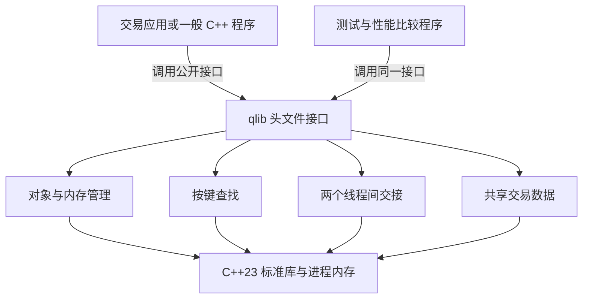
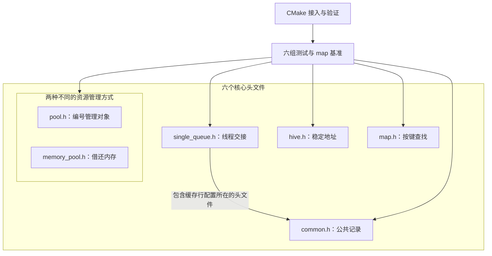
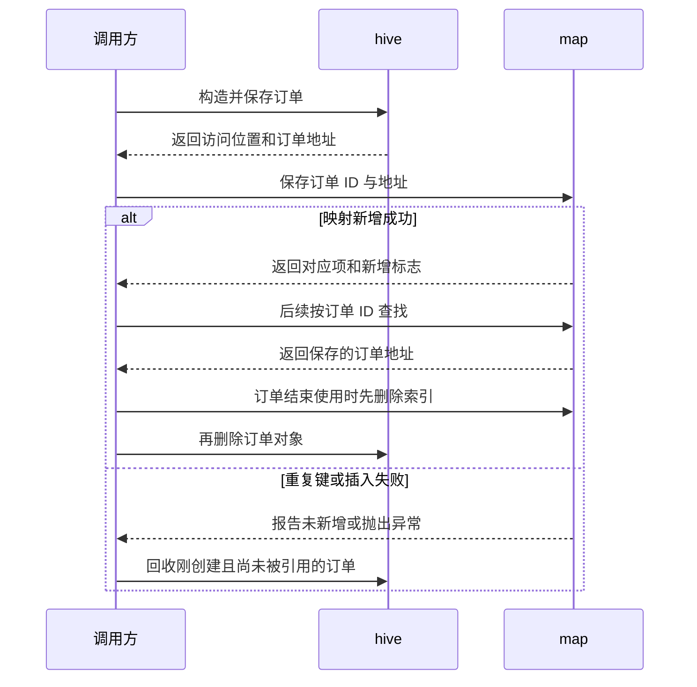
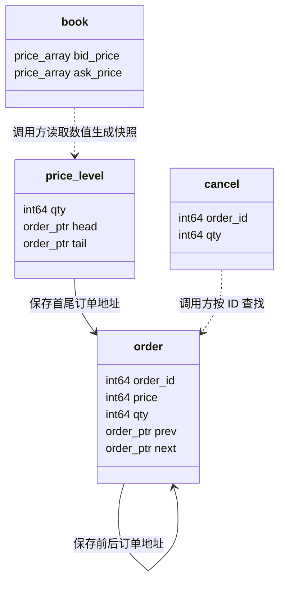

# Spec（技术规格文档）

**项目：** qlib  
**文档版本：** 0.3  
**日期：** 2026-10-15  
**依据：** [requirement.md](requirement.md) v0.1、用户提供的 qlib v0.5.1 参考源码，以及新增“全文写作要求”的 specs 模板  
**状态：** 供从零开发使用的设计文档；0.3 版统一使用 `qlib`/`QLIB` 名称，保留既定设计和使用限制

本文说明 qlib 要怎样设计，以及为什么这样设计。具体先写哪个文件、怎样逐步编码，放在 Implementation Plan；各版本做哪些任务，放在 Sprint Backlog。这里的“调用方”是使用 qlib 的 C++ 程序，例如 nqbook，也可以是测试程序。

文中区分三类信息：“参考行为”指所提供源码已有的做法；“本次拟定约束”指为了可靠使用而要求调用方遵守的条件，参考代码未必已自动检查；尚未确定的选择列在第 7 章。这样可以避免把设计目标、参考代码的现状和已经完成的开发混为一谈。第 4 章按模块重复模板栏目，使用唯一编号，方便其他文档引用。

## 1. 项目概述

### 1.1 项目解决什么问题

qlib 是给其他 C++ 程序使用的一组基础工具。例如，nqbook 收到一笔订单后，需要有统一的数据格式来表示它，需要找地方保存它，还需要根据订单 ID 找回它。如果接收行情和处理行情由两个线程负责，还需要把数据从一个线程交给另一个线程。qlib 提供这些可重复使用的基础能力。

不同工具解决不同问题：`common.h` 规定数据长什么样；`hive` 保存地址不能随意变化的对象；`map` 按键查找值；`single_queue` 在两个线程间按顺序交接数据；`pool` 用编号管理对象；`memory_pool` 反复借出、收回固定大小的内存块。qlib 被编译进调用程序，不会自己启动一个交易服务。

### 1.2 使用者与使用场景

| 使用者或调用程序 | 它怎样使用 qlib | 对应需求 |
| --- | --- | --- |
| nqbook 等行情应用 | 把收到的行情填进统一记录，保存订单，用订单 ID 查找对象，再把待处理事件交给另一个线程。 | FR-01—FR-13。 |
| 一般 C++ 调用程序 | 用容器保存自己的任务、连接信息等对象，或者重复使用预先准备的内存；对象不必是交易数据。 | FR-05—FR-13。 |
| 库开发者和测试程序 | 编译小程序检查接口能否使用，运行测试检查结果，再用相同数据比较映射表性能。 | FR-14—FR-16、NFR-01—NFR-08。 |

`FR` 是 requirement.md 中的功能需求编号，`NFR` 是正确性、性能、可维护性等质量要求编号；`BR` 表示业务规则，`AC` 表示验收条目。本文保留这些编号，让读者能查到每项设计解决的是哪一个要求。

### 1.3 本次实现范围

完整项目包含六个公共头文件：`common.h`、`hive.h`、`map.h`、`single_queue.h`、`pool.h`、`memory_pool.h`。五个主要组件的准确名称为 `hive<T>`、`map<Key, T, Hash, KeyEqual>`、`single_queue<T>`、`pool<T>`、`memory_pool`；其中 `T` 表示调用方希望保存的类型，`Key` 表示查找所用的键，其他模板参数在对应模块中解释。

项目还提供 CMake 接入配置、各组件的自动化测试，以及单独比较映射表速度的 `map_bench`。库采用 C++23，公开名称放在 `qlib` 命名空间中，例如 `qlib::hive`。它是“纯头文件库”：调用方包含头文件后，编译器就能看到需要的实现，不必另外部署 qlib 服务；程序运行时只依赖 C++ 标准库。

这是完整项目的目标范围。每次开发仍按 Sprint Backlog 和对应 Implementation Plan 选定一部分，不要求第一轮完成全部内容。

### 1.4 本次不实现的内容

业务程序负责接收交易所数据、更新订单簿、撮合订单、执行策略和风控，以及写文件、采集监控数据。qlib 可以保存这些工作需要的数据，但不会自动完成这些业务。例如，把 `cancel` 记录放进队列，不会使某个订单自动减少数量。

当前也不提供通用线程池、多个生产者和多个消费者共用的队列、跨平台数据编码协议，或检查句柄是否属于旧对象的代际机制。它不打算补齐所有 C++ 标准容器接口。安装包发布、持续集成（CI，即自动构建和检查代码的流程）、更多平台和更多性能测试，只有在明确纳入范围后才增加。

### 1.5 术语与概念

| 术语 | 在 qlib 中怎样理解 |
| --- | --- |
| 模块 | 一组围绕同一问题组织的代码。例如共享数据模块包含多个结构体和常量，不必做成一个类。 |
| 数据记录 | 用字段保存一件事的信息。例如 `cancel` 保存“撤哪笔订单、撤多少”，具体撤单由调用方执行。 |
| 容器 | 负责保存、查找或删除一批值的组件。例如 `hive<order>` 保存多个订单；`order` 自身只是其中一条数据。 |
| 所有权与生命周期 | 所有权回答“谁负责管理和销毁对象”；生命周期是对象从构造完成到被销毁的这段时间。保存一个地址，并不一定意味着负责销毁地址指向的对象。 |
| 地址稳定 | 在允许的操作后，某个仍存活对象留在原来的内存位置。插入其他订单不会让旧订单指针失效；删除该订单后，旧指针仍然失效。 |
| 句柄稳定 | 调用方拿到一个编号，以后用编号重新访问对象。只要没有释放该对象，容器增长后编号仍有效，但上次取得的对象地址可能已变化。 |
| 槽位 | 容器为一个元素预留的位置。槽位可以已放入对象，也可以暂时空着；空位置不能当成已存在的对象读取或析构。 |
| 迭代器 | 容器提供的访问位置。调用方用 `*it` 访问当前位置，用 `++it` 前进；`end()` 是结束标记，不能当成元素读取。 |
| skipfield | `hive` 给空槽段记录的跳过信息。连续多个位置都空着时，遍历可一次跨过这一段。 |
| tombstone（墓碑） | `map` 表示“这里曾放过元素、后来被删除”的标记。查找看到它还要继续，不能像遇到从未使用的空位那样停止。 |
| SPSC | Single Producer Single Consumer，只有一个线程负责放入，一个线程负责取出；不允许两个线程同时扮演同一侧。 |
| FIFO | 先进先出。先成功放入队列的元素，先被取出。 |
| 发布与回收 | 生产者通知消费者“这个元素已写好”，消费者通知生产者“这个位置已用完，可以重用”；通知必须配合正确的内存同步。 |
| 原始内存 | 一段可用字节空间，其中未必已构造 C++ 对象。拿到这段空间与创建一个对象是两件事。 |
| 前置条件、后置条件、不变量 | 分别是调用前必须满足的条件、调用成功后保证的结果，以及每次公开操作完成、状态可被调用方观察时必须满足的规则。比如归还的内存块必须来自本池。 |

## 2. 系统整体技术设计

### 2.1 系统技术架构图



读图时从上往下看：应用和测试都调用 qlib 的公开接口，再使用其中的数据定义或容器。所有工作都发生在调用程序自己的进程中。图中的“头文件接口”表示调用程序编译时能看到哪些声明，不是一个运行时接收消息、再转发给其他组件的对象。

例如，应用创建两个线程后，可以让它们共用一个 `single_queue`。qlib 负责队列中的数据交接，线程的创建、退出和工作内容仍由应用决定。

### 2.2 技术模块图



测试箭头表示“测试程序检查这些组件”。核心头文件之间，只有 `single_queue.h` 直接包含 `common.h`，主要是取得 `QLIB_CACHE_LINE` 配置。处理器按一小块一小块的内存管理缓存，这样的一块称为缓存行；该配置用于把经常被不同线程修改的数据隔开，具体设计见 §4.4。其余组件各自包含所需标准库头文件。

图中把两个池放在一起，是为了方便比较它们的用途，不表示一个继承另一个。`hive` 和 `map` 也不会自动调用 `memory_pool` 来分配自己的存储。

### 2.3 各模块的职责、边界与划分依据

| 技术模块 | 它接收什么、完成什么 | 为什么单独划分 | 对应需求与责任边界 |
| --- | --- | --- | --- |
| 共享数据模块 | 提供订单、成交等结构体，让调用方按一致的字段和单位交换信息。 | 数据格式可被多个程序使用，不应绑在某个订单簿算法上。 | FR-01—FR-04；不自动填写时间、更新订单簿或编码网络消息。 |
| 地址稳定存储模块 | `hive` 接收对象构造参数，保存对象，并让其他结构能长期引用仍存活对象的地址。 | 是否能保留地址，是独立于查找方式的一项要求。 | FR-05；不按订单 ID 查找，也不保证插入顺序。 |
| 键值索引模块 | `map` 接收键和值，让调用方凭键找到对应值，例如 ID → 订单地址。 | 查找表怎样增长，不应决定外部订单由谁销毁。 | FR-08—FR-10；若值是指针，只管理指针值，不自动删除指向的对象。 |
| 线程间数据传递模块 | `single_queue` 接收一个线程放入的值，让另一个线程按先后顺序取出。 | 交接数据需要专门的线程同步规则。 | FR-11—FR-13；不创建线程，不替应用等待、重试或处理积压。 |
| 句柄对象管理模块 | `pool` 创建对象并返回编号，调用方用编号访问和释放对象。 | 编号保持有效与地址保持不变是不同要求。 | FR-06；不保证地址稳定，也不识别所有过期编号。 |
| 原始内存管理模块 | `memory_pool` 把预先准备的固定大小内存块借给调用方，之后收回重用。 | 管理一段空间与管理其中的 C++ 对象是不同责任。 | FR-07；不构造、析构用户对象，也不自动增加块数。 |
| 接入与验证模块 | 提供构建目标、测试入口和性能比较程序。 | 维护者需要验证库，业务程序使用库时不必带上测试框架。 | FR-14—FR-16；不提供在线业务或监控进程。 |

### 2.4 模块之间的依赖、协作关系及设计理由

调用方可以让 `hive<order>` 保存订单，再把订单地址放进 `map<std::int64_t, order*>`，用订单 ID 查找。此时 `hive` 负责订单的构造和销毁，`map` 只保存“这个 ID 对应这个地址”。这就是“对象所有权与索引分离”：管理查找关系的组件，不一定负责管理被找到对象的生死。

这些操作需要调用方协调。例如，订单已经存进 `hive`，但随后建立 ID 映射失败，调用方应删除这个尚未被其他结构使用的新订单；qlib 不会把两个容器的调用自动合成“要么全部成功、要么全部撤销”的事务。删除订单时也要先移除索引和其他引用，再销毁订单，以免留下指向已失效对象的地址。

另一种组合是让 `map` 保存 `pool<T>` 返回的编号，使用时再凭编号取得对象。队列则可以直接传递 `feed_event` 值。若队列中放的是裸指针，它传递的只是地址，不会让地址指向的对象自动延长寿命。组件分开设计，调用方才能按实际需要选择这些组合。

### 2.5 关键数据流与执行流程



图展示“保存订单 → 建立索引 → 后续查找 → 安全删除”。例如，ID 42 已经存在时，`map` 不覆盖旧映射。调用方需要处理新建却没有被索引的对象，不能把它遗留在 `hive` 中当成一次成功新增。

线程交接还有另一条顺序：生产者先在空位置构造完整对象，再公布写入进度；消费者看到这个进度后取走对象并销毁原位置中的对象，再公布取出进度；生产者看到位置已经腾空，才重新使用它。这里“公布进度”需要让另一线程同时看到相关内存变化，具体同步方式在 §4.4 解释。

### 2.6 技术模块的划分方案与理由

需求中的“存对象、管理生命周期”被拆成 `hive`、`pool`、`memory_pool`，因为调用方需要的保证不同。要让旧指针继续指向原对象，用 `hive`；可以每次按编号重新查地址，用 `pool`；只想反复借用固定空间，并愿意自己构造和销毁对象，用 `memory_pool`。只叫它们“池”会掩盖这些区别。

共享数据已经能通过结构体、常量和类型别名表达，不需要额外的 `DataManager`。构建和测试也由 CMake 目标与测试程序完成，不需要增加管理类。模块是按责任划分的代码集合，并不要求每个模块都对应一个类。

把所有功能塞进一个大头文件，最初看起来文件少，但只想使用一个组件的程序也会读入其他代码，且不容易看清谁负责销毁对象。另一种做法是每个操作都增加抽象接口、工厂或虚函数；本项目没有运行中替换整套实现的要求，因此不增加这些间接调用和维护成本。

### 2.7 整体架构的技术选型、替代方案与设计取舍

下表中的哈希，是把一个键计算成数值，再据此选择查找起点的方法。不同键可能得到相同起点，这叫哈希冲突；map 需要继续寻找可用位置，而不能把它们当成同一个键。

| 决策与需求依据 | 采用什么，为什么 | 可替代方案 | 采用后要承担什么 |
| --- | --- | --- | --- |
| D-01 库形式；FR-14、NFR-06 | 用 C++23 纯头文件和 CMake `INTERFACE` 目标。该目标把包含路径、语言标准传给使用它的程序，不生成独立库文件。 | 二进制库可以隐藏实现，但模板仍需要在使用具体类型时生成代码，还要维护额外的发布文件；独立服务不符合当前调用方式。 | 实现会参与调用方编译，修改头文件通常需要重编译相关程序。 |
| D-02 数据与操作分离；FR-01—FR-04 | 记录只说明“发生了什么”，由调用方决定怎样更新订单簿。多个程序可以共用数据格式。 | 在记录类中直接执行订单簿操作。 | 调用方必须初始化、检查字段，并维护订单数量等业务规则。 |
| D-03 稳定地址；FR-05 | `hive` 分块保存对象，增加空间时保留旧块，满足旧指针继续可用的要求。 | `vector` 连续存放但增长时可能搬家；`list` 逐节点存放通常需要更多分配和连接指针。 | 需要记录空槽、跳过信息和区块关系，算法更复杂，且遍历顺序不是插入顺序。 |
| D-04 键值索引；FR-08—FR-10 | `map` 把元素放在同一组槽位中，发生哈希冲突时继续寻找位置，减少逐个节点分配。具体查找规则见 §4.3。 | `std::unordered_map` 是可用的标准库方案和性能对照，引用稳定性等规则与本表不同。 | 扩表重排元素会使旧引用失效；冲突、删除标记和异常恢复都需要明确规则。 |
| D-05 线程交接；FR-11—FR-13、NFR-03 | 固定容量 SPSC 环形队列，只协调一个写入者和一个取出者。满或空时及时返回。 | 互斥锁队列更通用，但会改变不靠阻塞锁完成交接的目标；MPMC 支持多生产者、多消费者，但需要额外协调。 | 调用方必须保证两侧各只有一个线程，并决定满时重试、降速或其他处理方式。 |
| D-06 两种资源池；FR-06、FR-07 | 对象池管理对象和编号，原始内存池只管理固定内存块，分别说明责任。 | 只提供通用内存分配器。 | 通用分配器不会自动提供稳定编号；对象池可能搬迁对象，原始内存池又不替用户析构对象，必须按需求选择。 |
| D-07 验证；FR-15、FR-16 | GoogleTest 组织断言，CTest 发现并运行测试，`map_bench` 单独测量映射表操作。 | 只运行手工示例，或一开始为所有组件搭建大型压测平台。 | 前者覆盖不足，后者超出当前范围；当前方案第一次运行测试仍需获取依赖，性能结果仍需说明测量环境。 |

## 3. 数据模型与数据设计

### 3.1 数据含义与用途

公共数据定义让程序各部分对同一条消息有相同理解。例如，接收程序填写 `cancel.qty`，订单簿程序就知道这是“本次要撤掉多少”，不能把它读成“撤单后还剩多少”。

| 数据类型 | 它表示什么 | 一个具体例子 |
| --- | --- | --- |
| `order` | 新增订单或修改订单的信息。 | 新增 ID 42、买入价格 100、数量 2 的订单；修改时通过 `new_qty` 表达修改后的数量。 |
| `cancel` | 从指定订单撤掉一定数量。 | ID 42 还有 2 单位，本次撤掉 1 单位；具体扣减由订单簿执行。 |
| `trade` | 一笔已经发生的成交。 | 保存成交价、成交量及关联的买卖订单 ID。 |
| `level` | 某个买卖方向、某个价格上的总数量，也叫 L2 聚合行情。 | 买方价格 100 的总量现在是 8；这是新的总量，不是“再加 8”。 |
| `book` | 调用方算好的订单簿快照，即某一时刻买卖价量的数值副本。 | 保存当时最高买价及数量、最低卖价及数量；当前每侧只保存一档。 |
| `metrics` | 调用方收集的一次运行情况样本。 | 截至采样时收到多少消息，以及当前还有多少挂单。 |
| `price_level` | 程序内部某个价位的数量与首尾订单地址。 | 把同侧、同价的订单连在一起，由调用方维护总量。 |

容器为了管理存储而记录的空槽、索引、删除标记和线程进度，不属于上述交易记录。例如，队列的写入计数说明“写入了多少位置”，不是交易所的行情序号。

### 3.2 数据类型及其选择理由

| 类型或表示方式 | 在本项目中保存什么、为什么选它 | 使用时要注意什么 |
| --- | --- | --- |
| `std::int64_t` | 64 位有符号整数，用于价格、数量、序号、订单 ID 和纳秒时间，让字段宽度明确。 | 整数有上下界；能存下某个数，不代表这个数在业务上一定有效。 |
| `std::uint32_t` | 32 位无符号整数，用于 `instrument_id`，标识某个交易品种。 | 编号由调用方分配；库不决定哪个编号代表哪只股票或合约。 |
| `std::uint8_t` | 8 位无符号整数，用于枚举底层类型和行情类别标签。 | 单字段宽度固定，不等于整个结构体在所有平台上占用相同字节数。 |
| 定点整数 | 把价格乘 `price_scale=10^10`、数量乘 `qty_scale=10^8` 后保存成整数，双方使用相同单位。 | 例如价格 1.25 保存为 12,500,000,000；舍入和越界检查由接入代码完成，库不自动转换小数。 |
| `order*` | 保存本进程中某个订单的地址，便于直接找到前后订单。 | 这些指针不负责销毁目标；目标被删除前要解除引用，也不能把本进程地址拿到另一进程直接使用。 |
| `std::variant` | 一个变量一次保存若干指定类型中的一种，并记住当前是哪一种。 | 程序能按实际类型处理，但需要容纳最大的一种记录并保存类型信息；内部字节不能直接当通用网络格式。 |
| `std::size_t` | 容量、位置编号和内存大小使用的无符号整数类型。 | 宽度随平台变化，不把它当成固定宽度的网络字段。 |

时间字段采用 Unix epoch 纳秒，也就是从约定的 Unix 起点开始累计的纳秒数。`event_ns` 是事件发生时间，`recv_ns` 是本地接收时间，`metrics.ts_ns` 是采样时间，均由调用方填写；库不把缺失时间自动替换成当前时间。

### 3.3 数据结构及其选择理由

下面的声明保留参考接口的字段类型和排列顺序。结构体相当于把属于同一件事的字段放在一起，没有自动执行的订单簿操作。普通记录没有给各字段声明业务默认值；调用方应先用 `{}` 值初始化，再填写实际含义，不能读取尚未初始化的成员。

```cpp
namespace qlib {

inline constexpr std::int64_t price_scale = 10'000'000'000;
inline constexpr std::int64_t qty_scale = 100'000'000;
inline constexpr std::uint8_t order_tag = 0;
inline constexpr std::uint8_t trade_tag = 1;
inline constexpr std::uint8_t level_tag = 2;
inline constexpr std::uint8_t cancel_tag = 3;
inline constexpr std::uint8_t snapshot_depth = 1;

enum class side : std::uint8_t { buy, sell };
enum class order_type : std::uint8_t { limit, market };
enum class order_action : std::uint8_t { add, modify };

struct order {
  std::int64_t seq;
  std::int64_t order_id;
  std::int64_t price;
  std::int64_t qty;
  std::int64_t new_qty;
  order* prev;
  order* next;
  std::uint32_t instrument_id;
  qlib::side side;
  order_type type;
  order_action action;
  std::int64_t event_ns;
  std::int64_t recv_ns;
};

struct cancel {
  std::int64_t seq;
  std::int64_t order_id;
  std::int64_t qty;
  std::uint32_t instrument_id;
  qlib::side side;
  std::int64_t event_ns;
  std::int64_t recv_ns;
};

struct trade {
  std::int64_t seq;
  std::int64_t buy_order_id;
  std::int64_t sell_order_id;
  std::int64_t price;
  std::int64_t qty;
  std::int64_t event_ns;
  std::uint32_t instrument_id;
  qlib::side side;
  std::int64_t recv_ns;
};

struct level {
  std::int64_t seq;
  std::int64_t price;
  std::int64_t qty;
  std::int64_t event_ns;
  std::uint32_t instrument_id;
  qlib::side side;
  std::int64_t recv_ns;
};

struct book {
  std::int64_t event_ns;
  std::int64_t bid_price[snapshot_depth];
  std::int64_t bid_qty[snapshot_depth];
  std::int64_t ask_price[snapshot_depth];
  std::int64_t ask_qty[snapshot_depth];
  std::uint32_t instrument_id;
  std::int64_t recv_ns;
};

struct metrics {
  std::int64_t ts_ns;
  std::uint64_t feed_messages;
  std::uint64_t feed_bytes;
  std::uint64_t feed_orders;
  std::uint64_t feed_trades;
  std::uint64_t feed_levels;
  std::uint64_t feed_dropped;
  std::uint64_t book_events;
  std::uint64_t book_apply_ns;
  std::uint64_t book_samples;
  std::uint64_t book_instruments;
  std::uint64_t book_resting_orders;
  std::uint64_t book_memory_bytes;
  std::uint64_t writer_orders;
  std::uint64_t writer_trades;
  std::uint64_t writer_levels;
  std::uint64_t writer_books;
};

struct price_level {
  std::int64_t qty = 0;
  order* head = nullptr;
  order* tail = nullptr;
};

}  // namespace qlib
```

`side` 说明买或卖；`order_type` 说明限价单或市价单；`order_action` 说明新增或修改。撤单有独立的 `cancel` 类型，因此不再给 `order_action` 添加撤单值。`seq` 保存来源给出的序号，库不负责生成它或修补断号。

阅读各记录时，可按下面的关系理解字段：

| 字段或字段组 | 用途及使用约定 |
| --- | --- |
| `order_id`、`buy_order_id`、`sell_order_id` | 标识相关订单；成交可以记录买卖两侧的 ID。缺少一侧 ID 时如何表达，由行情适配协议决定，不凭空生成订单。 |
| `instrument_id`、`side`、`price` | 说明哪一个品种、买还是卖、哪个价格。容器不凭这些字段自动归类订单。 |
| `order.qty` 与 `order.new_qty` | 新增时读取 `qty`；修改时读取 `new_qty`。相同整数类型不代表二者可以混用。 |
| `cancel.qty` | 本次从订单中撤掉的数量。全撤时使用当前剩余量，记录本身不查找订单或扣减数量。 |
| `level.qty` | 该侧该价位的新绝对总量；按需求，`qty <= 0` 表达移除该价位，由调用方执行。 |
| `prev`、`next` | 前一个和后一个订单的地址，用于本地订单链接。写入一个指针不会自动替相邻订单更新反向指针。 |
| `bid_price[i]`、`bid_qty[i]` | 第 i 个买方价位及其数量，数组位置必须一一对应。 |
| `ask_price[i]`、`ask_qty[i]` | 第 i 个卖方价位及其数量；当前 `snapshot_depth=1`，因此每侧只有位置 0。买方从最高价开始，卖方从最低价开始。 |
| `price_level.qty/head/tail` | 当前价位的总量及首尾订单地址；默认总量为 0、两地址为 nullptr，表示尚未挂接订单。 |

`metrics` 只保存采样结果，不会自己计数或计时。它的字段分组如下：

| 字段 | 表示什么 |
| --- | --- |
| `ts_ns` | 本次样本的采样时间。 |
| `feed_messages`、`feed_bytes` | 累计收到的消息数和字节数。 |
| `feed_orders`、`feed_trades`、`feed_levels`、`feed_dropped` | 累计订单记录、成交记录、价位记录和丢弃数量。当前布局没有专用撤单计数字段。 |
| `book_events`、`book_apply_ns`、`book_samples` | 累计处理事件数、采样得到的处理耗时总纳秒数、采样次数。总耗时不能直接当成平均耗时。 |
| `book_instruments`、`book_resting_orders`、`book_memory_bytes` | 采样时当前品种数、挂单数和内存字节数。这三项是当前值，不是从启动以来不断累加的数量。 |
| `writer_orders`、`writer_trades`、`writer_levels`、`writer_books` | 调用方累计写出的各类记录数量；qlib 不负责执行写文件操作。 |

普通结构体没有虚函数和自行管理的动态成员，符合当前固定字段的数据表达需要。六种记录保留两类编译期断言：`std::is_trivially_copyable_v` 检查可平凡复制，即在 C++ 规定的条件下可以直接复制对象表示，不需要执行自定义复制逻辑；`std::is_standard_layout_v` 检查标准布局，即成员和继承的组织方式满足 C++ 规定的一组布局限制。这些规则有助于约束对象表示，但不替调用方完成业务检查，也不保证不同编译器和平台的结构体 `sizeof`、填充字节或指针表示相同。

### 3.4 事件与快照模型及其设计理由

应用想用同一条队列传递订单、成交、价位更新和撤单，就需要一个能够保存这些类型的统一变量。`feed_event` 用 `std::variant` 表达这个选择：它一次持有其中一种完整记录。记录输出还可能包含应用生成的快照，因此 `record` 在这四种类型后加入 `book`。

```cpp
namespace qlib {
using feed_event = std::variant<order, trade, level, cancel>;
using record = std::variant<order, trade, level, cancel, book>;

template <typename... Ts>
struct overloaded : Ts... {
  using Ts::operator()...;
};
}  // namespace qlib
```

`overloaded` 把几个可调用对象的 `operator()` 放到同一个重载集合里，常用于组合几个 lambda。lambda 是就地定义的小函数；配合 `std::visit`，程序可对 `order` 调用订单分支，对 `cancel` 调用撤单分支。`std::visit` 负责根据 variant 当前保存的类型选择分支，`overloaded` 本身不保存待处理事件，也不执行业务分发服务。

`metrics` 是运行情况样本，`price_level` 是带本地订单地址的内部状态，因此都不放进上述事件集合。快照 `book` 保存当时的价格和数量副本，之后订单簿内部如何变化，不会通过指针自动改掉已经生成的快照。

另一种设计是让所有事件继承同一个带虚函数的基类。当前采用 variant，是为了在编译时明确允许哪些事件，并直接保存值，避免为每条事件额外申请一个独立对象。代价是新增类型时要检查所有处理分支，且 variant 所需空间至少要能放下最大的一种记录。

`order_tag/trade_tag/level_tag/cancel_tag` 的 0/1/2/3 是独立的行情类别标签。已有调用约定可以用“一字节标签 + 对应记录的本机布局”区分消息，但收发、长度检查和配置一致性由调用方负责。variant 的内部类型标记及对象字节不是这份传输协议，也不保证跨平台可直接互读。

### 3.5 数据之间的关系



图中的实线是本地地址关系，虚线是调用方按业务建立的关系；图只列出理解关系所需字段，完整声明见 §3.3。例如，同一买方价位有两笔订单，调用方把第一笔的 `next` 指向第二笔，把第二笔的 `prev` 指回第一笔，再设置价位首尾地址和总量。结构体不会自动完成这些动作。

如果接收的是 L2 聚合行情，数据已经说明整个价位的数量，就不需要在该价位挂接逐笔订单。`cancel` 也不会通过字段直接关联 C++ 对象，它只携带标识，由调用方查找。快照则由调用方读取价位数值生成，不接管这些价位或订单。

### 3.6 数据约束、状态变化与不变量

以下规则说明“无论做多少次插入、删除或复用，什么事情必须一直成立”。这里列出的容器内部规则由对应容器维护；业务字段的含义和有效使用方式由调用方维护。

| 对象或状态 | 必须保持的规则 | 谁负责 |
| --- | --- | --- |
| 行情记录 | 先初始化再读取；新增读 `qty`，修改读 `new_qty`，撤单读 `cancel.qty`；L2 数量是整个价位的总量。 | 调用方正确填写和处理；公共定义规定一致含义。 |
| 快照与指标 | 同一数组位置的价格、数量成对；累计数量与当前数量不混用；空档位和缺失值必须按明确协议解释。 | 生成快照、采集样本的程序。 |
| `hive` 槽位 | 有对象的槽位只保存一个存活 T；空槽不按对象析构；插删其他元素不搬走仍存活的 T。 | `hive`。 |
| `map` 槽位 | “有元素、从未使用、删除后留标记”三种状态与实际对象一致；同一个键至多保留一项。 | `map` 维护位置状态；调用方不能直接修改已入表的键，否则原来的查找路径可能失效。 |
| 队列槽位 | 对象写好后消费者才能读；消费者用完并销毁原对象后生产者才能重用位置；未消费数量不超过容量。 | 队列的同步机制；调用方保证两侧各只有一个线程。 |
| `pool` 槽位 | 使用中的位置有一个对象；空位置保存供下次复用的信息；释放后旧编号不能再当成有效凭据。 | `pool` 维护状态；调用方停止使用已释放句柄。 |
| 原始内存块 | 同一块不能同时借给两次申请；只能归还本池中尚未归还的块；借出数量介于 0 和总容量之间。 | `memory_pool` 和遵守借还约定的调用方。 |

### 3.7 数据来源、流向与生命周期

行情来源先由应用读取，应用把它转换成 `order` 等公共记录，再决定直接处理、存入容器，还是通过队列交给另一个线程。qlib 不创建行情源或工作线程，也不决定何时把数据写到磁盘。

`hive`、`map`、`pool` 和 `single_queue` 负责构造、保存和销毁各自内部的值。如果这个值是裸指针，销毁的是指针值本身，不是它指向的外部对象。`memory_pool` 负责底层字节缓冲区；调用方在块中构造了对象，就仍要负责先析构该对象。

一个订单被多个位置引用时，应先从 ID 索引和订单链接中解除引用，再删除订单。队列销毁前，调用方应 `join` 工作线程，或以等效方式确认所有访问已经结束；`join` 的作用是等待对应线程退出。落盘保存和程序重启后的恢复由库外程序完成。

### 3.8 共享数据组织方案的选择与取舍

`common.h` 集中放置双方需要共同理解的交易类型、单位和事件集合。容器自己的成员变量和算法放在各自头文件中。例如，订单价格属于公共数据，`map` 的删除标记属于索引实现，不应都塞进“公共数据”文件。

集中定义便于调用方保持一致，代价是修改公共头可能使很多文件重新编译；`single_queue` 也因为使用缓存行宏而包含它。可以把缓存配置、交易记录和事件集合拆成多个头文件，但当前先保留参考项目的结构，避免在这个规模下增加额外文件关系。

## 4. 各技术模块的详细规格

本章先说明每个模块要解决什么问题，再说明类怎样保存状态、各接口怎样使用。函数声明保持参考源码的准确写法；`const` 表示只读访问，`noexcept` 表示该函数承诺不让异常向调用者传播，`= delete` 表示禁止对应操作。各类会说明哪些复制或移动操作可用。

性能说明中的 O(1) 表示容器管理步骤不随元素数量增长，O(n) 表示最坏需要处理与 n 成比例的工作；它们不等于固定的纳秒数。除非另有说明，这些估计不包含调用方类型自身构造、移动、计算哈希或比较的任意成本。要求有效迭代器、句柄或指针的接口，也不自动保证能识别所有错误输入。

### 4.1 共享数据模块

#### 4.1.1 模块设计

##### 4.1.1.1 模块需求与设计目标

这个模块规定“大家传递的数据长什么样”。例如，行情接收程序和订单簿都把 `cancel.qty` 理解为本次撤走的数量，就不需要各自定义一套撤单格式。本模块覆盖 FR-01—FR-04、NFR-05，统一交易记录、类别标签和允许传递的记录类型。

这里还要区分两类数据：`trade` 等记录用来保存一条事实；`price_level` 则用指针连接本进程里的订单，帮助应用维护一个价位。后者不能直接当作发给另一台机器的消息。

##### 4.1.1.2 模块职责、边界及其理由

本模块只提供类型、常量、类别标签，以及按记录类型选择处理函数的小工具。它不会自己运行，也没有管理器、后台线程或读写服务。

调用方负责检查交易数据是否合法、收到记录后做什么，以及如何计算订单簿快照。例如，创建 `cancel{}` 只会得到一份撤单数据；要真正减少某个订单的数量，仍需要调用应用自己的订单簿接口。把这两件事分开后，相同记录也能用于测试、排队传递或保存文件。

##### 4.1.1.3 模块核心设计思路

记录使用固定宽度整数保存价格、数量和标识等字段。固定宽度表示 `std::int64_t` 这样的类型明确占 64 位，调用方不用猜整数有多宽。六种记录保持“可平凡复制”和“标准布局”：前者表示复制对象不需要自定义复制逻辑，后者表示类型满足 C++ 对简单对象布局的约束。这两项性质都不保证不同机器上的完整内存布局相同。

枚举和数字标签用来说明类别；`std::variant` 用来装下一组已知类型中的某一种记录，并记住当前装的是哪一种。指针只连接当前进程中的对象，指向对象的生存期由调用方管理；复制或销毁记录都不会替调用方管理这些对象。

##### 4.1.1.4 内部类与组件的划分及其理由

`order`、`cancel`、`trade`、`level`、`book`、`metrics` 六种记录各自保存一种含义的数据，`price_level` 保存某个价位的数量及订单首尾指针。它们没有需要共同维护的运行状态，因此不设置共同基类。各记录的完整字段见 §3，这里集中说明它们共同遵守的使用规则。

`overloaded<Ts...>` 用来把几个处理函数组合起来，供 `std::visit` 选择。这样的处理函数也叫 visitor，即“根据当前记录类型执行动作的访问者”。例如，可以分别提供处理 `order` 和处理 `cancel` 的函数，由 `std::visit` 选择与当前类型对应的一个。

##### 4.1.1.5 模块对外接口

调用方包含 `<qlib/common.h>` 后，就可以使用 §3 列出的类型和常量。这个头文件还提供 `QLIB_CACHE_LINE` 宏，默认值为 `64`，供需要按缓存行对齐的组件使用。缓存行是处理器一次管理的一小块缓存数据；这里的宏是配置值，并不自动检测机器。

调用方可以在包含头文件前，或在构建配置中统一设置这个宏。同一程序中分别编译的各个源文件必须使用相同值，所选数值也必须满足目标平台及相关类型的对齐要求。不能让程序的一部分按 `64` 编译、另一部分按别的值编译后混用对象。

##### 4.1.1.6 模块与其他模块的关系

qlib 的五种容器都可以存放符合各自要求的类型，不限定必须存放这些交易记录。`single_queue` 会直接包含本模块的头文件，以使用 `QLIB_CACHE_LINE`。

应用可以按需要组合它们。例如，`nqbook` 可以用 `hive<order>` 保存订单，用 `map<id, order*>` 按订单编号找到订单，再用 `single_queue<feed_event>` 在线程之间传递行情记录。这是应用的组合方式，公共记录本身不会自动创建这些容器。

#### 4.1.2 类设计：共享值类型与访问辅助

##### 4.1.2.1 类的用途与职责

`order`、`cancel`、`trade`、`level`、`book`、`metrics` 都是用来装数据的结构体。应用填写它们的字段，再把整份值交给其他代码。`price_level` 用来关联一个本地价位上的订单；`overloaded` 用来组合处理函数。`overloaded` 的组合关系由编译器确定，它不是持续接收消息或执行交易的工作对象。

##### 4.1.2.2 为什么需要这个类？

不同类型让同名字段的含义有明确的上下文。例如，`cancel.qty` 是撤走的数量，`trade.qty` 是成交数量，`level.qty` 是价位总量。调用方可以根据类型选择处理方式，不必从一段没有类型的字节中猜“这个数量究竟是什么意思”。这些需求用普通结构体就能表达，不需要增加业务处理成员函数。

##### 4.1.2.3 类与其他类的关系及其设计理由

各记录之间没有继承关系。`feed_event` 或 `record` 通过 `std::variant` 保存其中一种记录值：它们不是同时保存所有类型，也不是保存一个指向公共基类的指针。

`order.prev`、`order.next` 以及 `price_level.head`、`price_level.tail` 只记住订单地址，不负责创建或删除订单。这叫非拥有关系：应用必须保证指针使用期间，目标订单仍然存在，而且地址没有改变。

`overloaded` 则继承传入的可调用对象，例如几个 lambda，并通过 `using Ts::operator()...` 把各对象的调用操作一起公开。调用时由 C++ 选择参数类型匹配的操作；这个辅助类型里面没有隐藏的消息队列。

##### 4.1.2.4 类的内部数据与状态

完整成员见 §3.3。记录里只有公开字段，不会额外记住“这条数据已经验证”或“这条撤单已经应用”。这些判断由应用保存和维护。

`std::variant` 自己记住当前保存的记录类型，调用方通过它的接口访问对应记录。`price_level` 默认是空价位：数量为 `0`，首尾指针为空。其他普通记录需要调用方初始化，不能认为写下 `order value;` 就已经得到全部可读的字段。

##### 4.1.2.5 成员变量及其设计理由

价格和数量采用定点整数，即先乘以约定比例，再用整数保存，避免各调用方自行选择小数精度。两个时间字段分别保留交易所给出的事件时间与本机接收时间，使应用能区分“何时发生”和“何时收到”。标识字段则让应用建立“编号到对象”的查询关系。

`prev`、`next` 直接放在订单里，使应用可以把订单连成链表，不必另建一个只保存链接的节点。代价是应用必须保证订单地址稳定，并在删除订单前正确处理这些链接。

`book` 用固定长度数组保存各档价格和数量，不需要为每份快照另行管理动态数组。代价是档位数不能在每个对象里随意改变；修改 `snapshot_depth` 会改变记录布局，相关代码必须统一更新。

##### 4.1.2.6 数据容器、索引的技术选型与取舍

这些记录不内嵌 `std::string`、动态容器或负责释放对象的智能指针。快照使用固定数组；几种消息的共同入口使用 `std::variant`。因此，记录的字段和类型范围清楚，复制记录也不会偷偷接管另一份对象。

如果以后需要不定长快照、字符串形式的品种名称，或者在不同机器之间发送消息，应另行定义外部数据格式。不能直接把本机结构体扩大后，就认为它自然成了可通用交换的网络格式。

##### 4.1.2.7 成员函数及其设计理由

记录没有自定义业务成员函数。初始化、赋值和复制使用 C++ 自动提供的操作；处理行情的函数由应用提供，再交给 `std::visit` 调用。这样，字段含义保持稳定时，应用可以独立调整处理逻辑。

##### 4.1.2.8 成员函数详细规格

本模块没有自定义的记录操作成员函数。下面按模板说明调用方实际使用的四种操作；其中初始化、复制属于 C++ 语言操作，`std::visit` 属于标准库接口，都不是新增的 qlib 成员函数。唯一辅助类型的声明为：

```cpp
template <typename... Ts>
struct overloaded : Ts... {
  using Ts::operator()...;
};
```

**记录值初始化 `T value{}`**

| 规格项 | 说明 |
| --- | --- |
| 函数声明 | 使用形式为 `T value{}`，这是语言提供的初始化写法，没有另行声明的 qlib 函数。 |
| 功能说明 | 创建一个记录，并初始化其字段，供调用方继续填写。 |
| 参数与合法输入 | `T` 是相应记录类型；这里使用空的初始化列表。 |
| 返回值 | 不返回函数结果；创建的对象通过变量 `value` 使用。 |
| 前置条件与后置条件 | 创建后数值字段得到零值、指针得到空值等初始化结果；这些值不自动代表一条业务合法记录。 |
| 内部状态变化 | 建立这个记录的字段值，不更新订单簿或其他外部对象。 |
| 边界情况 | 例如 `cancel{}` 的数量为零，调用方仍须按撤单要求填写数量、标识和时间。 |
| 错误处理与异常 | 记录不执行自定义分配，也不检查字段是否合法；字段校验由调用方负责。 |
| 性能与线程安全要求 | 只初始化记录自身的固定字段；之后若多个线程读写同一对象，由对象的拥有者安排同步。 |

**普通赋值与复制**

| 规格项 | 说明 |
| --- | --- |
| 函数声明 | 使用形式如 `T copied = source;` 或 `target = source;`，使用语言生成的复制操作。 |
| 功能说明 | 把一份记录的字段值复制到另一份同类型记录。 |
| 参数与合法输入 | 源和目标采用同一记录类型；源字段应已初始化，所访问对象必须仍然存在。 |
| 返回值 | 复制初始化创建新对象；赋值表达式按 C++ 规则表示赋值后的目标对象。 |
| 前置条件与后置条件 | 复制后目标保存相应字段值；指针只复制地址，不复制地址指向的订单，也不转移所有权。 |
| 内部状态变化 | 改变目标记录的字段，不改变源记录和指针指向的对象。 |
| 边界情况 | 两份记录可能保存同一个订单地址；销毁其中一份不会释放该订单，也不会替另一份延长订单寿命。 |
| 错误处理与异常 | 六种记录保持可平凡复制，不加入自定义复制分配或业务校验；无效指针不会因复制而变有效。 |
| 性能与线程安全要求 | 只复制固定字段，不深度复制其他对象；多个线程并发改写同一记录仍需同步。 |

**组合处理函数 `overloaded{callable...}`**

| 规格项 | 说明 |
| --- | --- |
| 函数声明 | 使用上方 `overloaded<Ts...>` 声明，以 `overloaded{callable...}` 创建对象；这是聚合初始化，即直接用给出的值初始化对象的组成部分。 |
| 功能说明 | 把多个可调用对象组合起来，并公开它们各自的 `operator()`，供调用时选择匹配的参数类型。 |
| 参数与合法输入 | 传入的可调用对象必须能作为基类保存；使用时相应调用应有效。lambda 捕获的外部对象必须在使用期间仍然存在。 |
| 返回值 | 创建一个组合后的可调用对象；它自身不执行行情处理。 |
| 前置条件与后置条件 | 创建成功后，可以通过该对象使用传入对象的调用操作。 |
| 内部状态变化 | 保存可调用对象及其携带的捕获状态，不创建队列或业务状态机。 |
| 边界情况 | 不合适的参数类型或相互冲突的重载可能使调用无法通过编译；捕获引用不会延长外部对象寿命。 |
| 错误处理与异常 | 可调用对象在构造、复制或移动时抛出的异常按它自身的规则传播；辅助类型不额外承诺无异常。 |
| 性能与线程安全要求 | 不增加消息调度步骤；实际开销取决于保存的可调用对象。若它们共同修改外部状态，同步由调用方负责。 |

**按类型处理记录 `std::visit(visitor, event)`**

| 规格项 | 说明 |
| --- | --- |
| 函数声明 | 使用形式为 `std::visit(visitor, event)`，采用标准库提供的函数声明。 |
| 功能说明 | 检查 `event` 当前保存哪种记录，调用 `visitor` 中能处理该类型的操作。 |
| 参数与合法输入 | `event` 是相应 variant 对象；`visitor` 必须能处理集合内所有可能类型，并满足标准库对调用及返回类型的要求。 |
| 返回值 | 按 `std::visit` 的标准库规则返回所选处理操作的结果。 |
| 前置条件与后置条件 | 调用时记录和处理函数所需对象必须有效；调用完成后得到该处理操作规定的结果。 |
| 内部状态变化 | qlib 不增加自定义状态；处理函数可以按自己的约定读取记录、修改记录或改变外部状态。 |
| 边界情况 | 直接改写记录字段不等于已经更新订单簿。例如修改 `cancel.qty` 只改变这份撤单数据。 |
| 错误处理与异常 | 采用 `std::visit` 的标准库异常规则；处理函数抛出的异常不会被 qlib 自动恢复或转换。 |
| 性能与线程安全要求 | 开销包括选择对应处理操作及执行该操作；实际线程安全取决于处理函数访问了哪些共享对象。 |

普通字段读写也不带 qlib 自动范围检查。外部传入一个未知的数字标签时，接收方不能未经验证，就把随后字节当成某种记录使用。

##### 4.1.2.9 类的关键算法与行为流程

应用先填写一种明确类型的记录，再把它放进 `feed_event` 或 `record`，最后通过 `std::visit` 执行对应处理。例如，一份 `cancel` 放入 `feed_event` 后，会进入处理 `cancel` 的函数，而不是处理 `trade` 的函数。

从网络收到消息时，接入程序还要完成消息分帧，也就是判断一条消息从哪里开始、包含多少字节，再检查标签和长度、读取数值字段。需要本地订单指针时，应用应根据本地存储重新建立连接，不能沿用另一进程的地址。`std::variant` 的内存也不能直接作为网络消息发送。

##### 4.1.2.10 类的技术选型、替代方案与设计取舍

一种替代办法是让所有消息继承公共基类，再通过基类指针处理。这里选择 `std::variant`，是因为当前允许出现的类型已经明确，调用方可以直接传递记录值。另一种办法是把所有消息可能用到的字段都放进一个大结构体；分成不同记录则能更清楚地区分“撤走数量”“成交数量”等含义。

代价是新增一种记录时，需要同步修改类型集合，以及需要逐种处理记录的访问者。字段变化也可能要求调用方调整。还有一个限制：即使记录可平凡复制，里面的指针仍只对原来的进程有意义，不能因此认为整份记录都适合跨进程直接使用。

##### 4.1.2.11 创建、初始化与销毁

调用方可以先用 `T{}` 初始化记录，再按字段含义填写数据。普通记录销毁时只结束记录本身的寿命，不释放指针指向的订单。未初始化字段不能进入校验、日志或对外字节交换过程。

即使字段都已初始化，结构体也可能包含 padding，也就是编译器为对齐而插入、并不代表业务字段的空隙字节。因此，不能把整个对象的字节当成稳定且可移植的序列化结果；序列化应明确规定如何把各个字段写成外部格式。

#### 4.1.3 模块整体协作

##### 4.1.3.1 类之间的调用与协作流程

应用创建公共记录，把它作为值放入事件集合，再用访问者选择处理函数。处理函数可以继续调用应用自己的订单簿、存储或队列。qlib 提供数据格式和按类型访问的方法，具体先处理哪件事、处理后保存什么，由应用安排。

##### 4.1.3.2 模块完整使用示例

下面创建一份订单编号为 `42` 的撤单记录，并把它装入 `feed_event`。`std::visit` 选择处理 `cancel` 的 lambda；该 lambda 检查订单编号和撤单数量，然后把结果记在 `seen` 中。其余类型的处理函数留空，只为覆盖这个事件集合中的其他可能类型。

```cpp
#include <qlib/common.h>
#include <cassert>
#include <variant>

int main() {
  qlib::cancel value{};
  value.order_id = 42;
  value.instrument_id = 1;
  value.side = qlib::side::buy;
  value.qty = qlib::qty_scale;
  qlib::feed_event event = value;
  bool seen = false;
  std::visit(qlib::overloaded{
      [&](const qlib::order&) {},
      [&](const qlib::trade&) {},
      [&](const qlib::level&) {},
      [&](const qlib::cancel& c) {
        seen = (c.order_id == 42 && c.qty == qlib::qty_scale);
      }}, event);
  assert(seen);
}
```

这个例子只演示“记录进入正确的处理函数”，没有真正执行撤单。示例没有填写时间等字段，也不表示真实行情可以用零代替缺失值。`assert` 用于展示这里的预期结果，正式测试应按 §4.7 使用测试框架验证。

##### 4.1.3.3 模块级设计约束、不变量与风险

所有使用方必须对比例、标签、类型集合和字段含义作相同理解。固定宽度整数不等于完整 ABI 一致；ABI 指编译后的代码如何安排对象布局、对齐等细节，不同平台或编译配置仍可能不同。

修改 `snapshot_depth` 或缓存行宏时，相关源文件必须采用统一配置。空快照档位如何表示、缺失值怎么表达、指标何时清零，仍要由调用方协议确认，记录类型不会自行补出这些业务规则。

### 4.2 地址稳定存储模块

#### 4.2.1 模块设计

##### 4.2.1.1 模块需求与设计目标

这个模块负责保存对象，并保证：只要某个对象还没有被删除，添加或删除其他对象就不会改变它的地址。这就是本模块所说的“地址稳定”。例如，订单索引保存了订单 A 的 `order*`；之后即使新增很多订单、删除订单 B，原来的指针仍能找到订单 A。

模块对应 FR-05、BR-07、BR-10、BR-12。它还要负责对象的创建和销毁，支持向前、向后遍历，根据有效对象的地址找回迭代器，以及查询对象数量和容量。这里的“迭代器”是表示容器中某个位置的对象，可以用 `*it` 访问元素，用 `++it` 或 `--it` 移动位置。

地址稳定只适用于仍然存活的对象。订单 A 一旦被删除，原来保存的指针和迭代器就不能继续用来访问它；容器不会为了保留指针而延长订单 A 的生命周期。

##### 4.2.1.2 模块职责、边界及其理由

容器保存 `T` 对象，分配它们使用的内存，在需要时调用构造函数和析构函数，并回收不再使用的内存。容器也会记住删除对象后留下的空位置，供后续插入复用。

调用方负责对象的业务含义和对象之间的关系。例如，`hive<order>` 保存订单本体，外部索引负责“订单 ID → 订单地址”，订单簿负责同价位订单之间的前后关系。hive 不识别订单 ID，不排序订单，也不会主动清除外部索引里的指针。多个线程要修改同一个容器时，同步也由调用方负责。

这样划分后，hive 既能保存订单，也能保存价位或调用方自己的类型，不需要为每种业务重新写一套存储和销毁逻辑。

##### 4.2.1.3 模块核心设计思路

容器一次申请一组可以放对象的位置，而不是每增加一个对象就单独申请一份内存。这一组存储叫作一个 **block（存储块）**；块内每个可容纳一个对象的位置叫作 **slot（槽位）**。每个块还保存自己的管理信息，例如前后块的地址、已经使用到哪里、当前有多少对象。

对象放进某个槽位后就留在那里。删除对象时，容器不把后面的对象挪过来填空，而是留下可复用的空槽。相邻空槽组成一个“洞段”。每个块还有一张名为 `skipfield` 的数字表，在洞段首尾记录这段有多长，使迭代器能够一次跨过整段空槽。例如连续删除 3 个相邻订单后，正向遍历只需读出段长 3，就能跳到后面的存活订单。

插入时，容器先使用删除留下的空槽；没有空槽时，再使用尾块中从未放过对象的位置；尾块也满了才申请新块。这个顺序同时照顾地址稳定、已有空间复用和同一块内的集中存储。

##### 4.2.1.4 内部类与组件的划分及其理由

| 组件 | 保存什么、负责什么，以及为什么单独划分 |
|---|---|
| `hive<T>` | 对外代表整个容器，持有全部存储块，记录总数量，并统一负责对象和块的创建、销毁。调用方只通过它管理元素。 |
| `block_type` | 记录一个块的槽位位置、跳跃表、存活数量，以及它与其他块的连接关系。把对象按块管理，可以减少逐对象申请内存的次数。 |
| `slot_type`、`free_node` | `slot_type` 表示一份可放对象的空间；对象存活时保存 `T`，成为洞段的第一个空槽后，可以改存 `free_node`。`free_node` 记录前后洞段的位置，让容器找到可复用的空间，不必再为这些管理节点申请内存。 |
| `iterator_impl<Const>` | 记录当前在哪个块、哪个槽位，负责访问元素和跨过洞段。模板参数 `Const` 决定能否通过迭代器修改对象，同一套位置逻辑可供可写和只读遍历使用。 |

##### 4.2.1.5 模块对外接口

调用方包含 `<qlib/hive.h>` 后，使用 `qlib::hive<T>` 创建容器，例如 `qlib::hive<order>`。模块还提供 `qlib::swap(hive<T>&, hive<T>&)`，用于交换两个容器持有的内容。完整公开声明见 4.2.2.8。

这个容器不提供随机下标、`reserve`、复制构造、按值查找或排序接口。因此不能用 `values[3]` 取得“第 4 个对象”，也不能要求它按订单 ID 查找；需要这种查找时，应由外部索引完成。

##### 4.2.1.6 模块与其他模块的关系

`hive.h` 只依赖 C++ 标准库，不依赖 `common.h` 或 `map.h`。调用方可以把它们组合起来：用 hive 保存对象，用 `map<ID, T*>` 保存 ID 和对象地址的对应关系。

这种组合由调用方维护。删除订单时，应先从索引及其他对象的关系中解除对它的引用，再让 hive 销毁订单。hive 不会把“删除索引”和“销毁对象”自动打包成一次共同成功或共同撤销的操作。

#### 4.2.2 类设计：qlib::hive<T>

##### 4.2.2.1 类的用途与职责

`hive<T>` 是实际保存并拥有 `T` 对象的容器。“拥有”意味着对象销毁的责任归容器：调用方执行 `erase`、`clear`，或者销毁容器时，相应对象会被析构。

它适合经常增删对象，而且其他数据结构需要长期保存对象地址的场景。它不规定遍历顺序，所以不能把遍历结果理解为插入顺序或业务优先级。`insert` 接收右值对象；`emplace` 接收构造参数，直接在槽位里构造对象。容器本身不能复制，但可以移动，把整批对象的管理权交给另一个容器。

##### 4.2.2.2 为什么需要这个类？

FR-05 要求：新增、删除其他对象后，外部保存的对象地址仍然有效。例如订单簿保存了某笔订单的指针，不能因为后来又来了很多订单就被迫重新查找它。

`std::vector<T>` 在容量不足时通常会搬迁已有对象，原地址随之失效。`std::list<T>` 可以让节点地址保持稳定，但通常需要给每个节点单独分配内存，还要为每个节点保存链接。hive 选择按块分配，让多个对象共用一次内存申请，又通过保留空槽避免搬动其他对象。

##### 4.2.2.3 类与其他类的关系及其设计理由

一个 `hive<T>` 独自拥有多个 `block_type`。每个块管理自己的槽位和 `skipfield`，但最终释放这些内存的责任仍然在 hive，不会出现几个容器共同负责同一对象的情况。

`iterator_impl` 只记录位置，不拥有块或对象。复制迭代器不会复制元素，也不会让元素多活一段时间。`std::reverse_iterator` 则包装已有的双向迭代器，把向前、向后的移动方向转换成反向遍历，避免另外维护一套反向存储。

`T` 可以是 `order` 等共享数据类型，也可以是调用方自己的类。hive 通过模板保存这些对象，不需要继承订单类，也不要求对象包含订单 ID 等业务字段。

##### 4.2.2.4 类的内部数据与状态

每个槽位有三种情况：现在存着对象、以前存过但已经删除、从未构造过对象。块内的 `high_water` 记录“已经使用过的前缀到哪里结束”。例如 `high_water == 5` 表示槽位 0～4 用过，槽位 5 及其后面还没有用过；前 5 个槽位中可能已有对象被删除。

| 位置或状态 | 保存内容与含义 |
|---|---|
| `[0, high_water)` 内的存活槽 | 保存一个 `T` 对象，其 `skipfield` 值为零。 |
| `[0, high_water)` 内的删除槽 | 不再保存可访问的 `T` 对象，相邻删除槽组成洞段。洞段首尾记录真实长度，中间位置的数字可能保留旧值。 |
| `[high_water, capacity)` | 还没有构造过对象的尾部空间，不参与遍历。 |
| 容器 `size_ == 0` | 容器当前没有存活对象。正常清空后，所有块链指针为空，`capacity_` 也为零。 |

必须区分“存活槽的值为零”和“值为零就一定存活”。后一个判断对任意槽位并不成立，因为洞段中间可能保留零值。正常迭代只读取洞段首尾，所以能正确跳过；根据任意旧地址判断对象是否还在时，则可能遇到 4.2.3.3 所述的限制。

##### 4.2.2.5 成员变量及其设计理由

下表中的“链”是把若干项用前后地址或下标连接起来，以便找到下一项和上一项。链接只负责查找，不代表另一份对象所有权。

| 层次 / 成员 | 类型与保存内容 | 为什么需要 |
|---|---|---|
| `head_`、`tail_` | `block_type*`，指向全部块中的第一个和最后一个。 | 遍历需要找到起点和终点；新增块接到尾部，移除某块也不必搬迁其他块。 |
| `erased_head_` | `block_type*`，指向“有删除空槽的块”这条链的第一个块。 | 插入可以直接找到可复用空间，不必从头检查每个块。 |
| `size_`、`capacity_` | `size_type`，分别保存存活对象总数和已分配槽位总数。 | 数量查询不需要现数一遍。容量包括存活槽、删除空槽和从未使用的槽。 |
| 块的 `next`、`prev` | 指向全部块链中的后一个和前一个块。 | 支持跨块双向遍历；块变空时可以直接解除前后连接，不必寻找它的前驱。 |
| 块的 `next_erased`、`prev_erased` | 指向有洞块链中的后一个和前一个块。 | 一个块第一次出现空洞或最后一个空洞被用完时，可以用固定数量的连接修改加入或移出这条链。 |
| 块的 `slots`、`skipfield` | `slot_type*` 指向槽位数组；`skip_t*` 指向记录洞段长度的数字表。 | 把对象存储和遍历所需的管理数字分开，迭代器可以据段长直接跳过空槽。 |
| 块的 `free_head` | `skip_t`，保存本块第一个可复用洞段的起始下标。 | 插入直接找到一个可用槽；`npos` 表示本块没有洞段。 |
| 块的 `capacity`、`high_water`、`active` | `std::size_t`，分别记录总槽数、使用过的前缀长度、当前存活对象数。 | 三个数分别回答“能放多少”“用到哪里”“还剩多少对象”，不能互相替代。 |
| `free_node::prev/next` | 两个 `skip_t`，保存前后洞段头的下标。 | 把本块的可用洞段连成空闲链，英文称 free list；节点借用空槽存放，不再单独申请内存。 |
| 迭代器 `owner_`、`blk_`、`idx_` | 容器指针、块指针、槽位下标。 | 块和下标确定对象位置；`owner_` 让 `--end()` 能找到所属容器当前的尾块。 |

`skip_t` 使用 `std::uint16_t`，`npos = 0xFFFF` 是专门表示“没有位置”的值。一个块最多 8192 个槽，小于 `npos`，所以正常槽位下标不会与这个特殊值混淆。

`slot_type` 是 `T` 与 `free_node` 的联合体：同一份空间在不同时间保存对象或空闲链节点。槽位需要容纳两者中更大的内容，还要满足对齐要求，也就是对象的起始地址必须符合该类型规定的字节边界。因此实际内存不仅是 `capacity() * sizeof(T)`，还包括槽位可能增加的宽度、块头、`skipfield` 和为对齐留下的空隙。

##### 4.2.2.6 数据容器、索引的技术选型与取舍

容器用三层连接寻找存储位置：全部块链负责遍历所有对象，有洞块链只列出可复用空槽的块，块内洞段链进一步指出本块哪些空槽可以使用。它们连接的是同一批存储，不是三份对象副本。

容器记录连续空槽组成的洞段，而不要求遍历时逐个检查空槽。例如一段 10 个相邻订单都被删除后，迭代器可以一次跨过 10 个位置。代价是每次删除都要检查左右是否已有洞段，并维护合并后的首尾长度。洞段中间数字不要求更新，所以不能拿任意位置的 `skipfield` 值单独判断对象是否存活。

##### 4.2.2.7 成员函数及其设计理由

公开函数分为五类：管理所有权、取得遍历位置、查询数量、增删对象，以及根据地址找回位置。

`erase` 返回删除位置之后的迭代器，调用方可以用 `it = values.erase(it)` 继续遍历，而不用再访问已删除位置。`get_iterator` 则连接外部地址索引与容器操作：索引先找到某个仍存活对象的 `T*`，再由 hive 找回可传给 `erase` 的位置。

`clear` 会销毁全部对象并释放全部块。它不保留容量，不能把它理解为“只把元素数量改成零，留着内存下次直接使用”。

##### 4.2.2.8 成员函数详细规格

以下声明保留参考源码的公开接口，省略函数体，没有新增重载。`iterator` 可以修改所指对象，`const_iterator` 只能读取；`reverse_iterator` 和 `const_reverse_iterator` 用于反向遍历。

```cpp
using value_type = T;
using size_type = std::size_t;
using difference_type = std::ptrdiff_t;
using reference = T&;
using const_reference = const T&;
using pointer = T*;
using const_pointer = const T*;
using iterator = iterator_impl<false>;
using const_iterator = iterator_impl<true>;
using reverse_iterator = std::reverse_iterator<iterator>;
using const_reverse_iterator = std::reverse_iterator<const_iterator>;

hive() noexcept = default;
hive(const hive&) = delete;
hive& operator=(const hive&) = delete;
hive(hive&& other) noexcept;
hive& operator=(hive&& other) noexcept;
~hive();
iterator begin() noexcept;
const_iterator begin() const noexcept;
const_iterator cbegin() const noexcept;
iterator end() noexcept;
const_iterator end() const noexcept;
const_iterator cend() const noexcept;
reverse_iterator rbegin() noexcept;
const_reverse_iterator rbegin() const noexcept;
reverse_iterator rend() noexcept;
const_reverse_iterator rend() const noexcept;
[[nodiscard]] bool empty() const noexcept;
size_type size() const noexcept;
size_type capacity() const noexcept;
size_type max_size() const noexcept;
iterator insert(T&& value);
template <typename... Args>
iterator emplace(Args&&... args);
iterator erase(const_iterator pos);
iterator erase(const_iterator first, const_iterator last);
void clear() noexcept;
void swap(hive& other) noexcept;
iterator get_iterator(const_pointer p) noexcept;
const_iterator get_iterator(const_pointer p) const noexcept;

// 命名空间级函数，不是成员函数
template <typename T>
void swap(hive<T>& a, hive<T>& b) noexcept;
```

下面按用途合并说明相关函数，但各组都明确输入、结果、状态变化和限制。复杂度中的 `n` 是存活对象数，`B` 是存储块数，`C` 是本次新块的槽数，`k` 是本次删除的对象数。`O(1)` 表示容器自身完成该动作所需的工作量不随对象总数增长，不包括对象自己的构造、析构或内存分配耗时。

**A. 所有权函数：创建、移动、析构和交换。**

| 规格项 | 具体约定 |
|---|---|
| 函数声明 | 上述 `hive()`、`hive(hive&&)`、`operator=(hive&&)`、`~hive()`、成员 `swap(hive&)` 及命名空间级 `swap(hive<T>&, hive<T>&)`。复制构造和复制赋值已用 `= delete` 禁止。 |
| 功能说明 | 默认构造一个空容器；移动把一批对象及其存储交给另一个容器；交换互换两批存储的归属；析构销毁仍存活的对象并释放存储。 |
| 参数与合法输入 | 移动和交换的参与者都必须是有效容器，操作期间不能被其他线程同时访问。`T` 的析构函数不得抛出异常。 |
| 返回值 | 移动赋值返回目标容器的 `*this`；构造、析构和两种交换函数没有返回值。 |
| 前置条件与后置条件 | 移动后目标接管源的全部块，源变为空且容量为零。移动赋值会先销毁目标原有对象；移动构造没有这一步。交换后两边持有对方原来的内容。 |
| 内部状态变化 | 移动转交块链指针、存活数量和容量；交换互换 `head_`、`tail_`、`erased_head_`、`size_`、`capacity_` 这五个成员。析构通过清空逻辑逐个销毁对象并释放块。 |
| 边界情况 | 空容器可以移动或交换；自移动赋值不做操作，自交换不改变结果。转交和交换不搬动存活对象，原地址仍指向同一个对象，但管理它的容器可能改变。移动或交换后必须重新取得迭代器，原因见 4.2.3.3。 |
| 错误处理与异常 | 复制会在编译时失败。默认构造、移动和交换声明 `noexcept`，即这些函数不向调用方抛异常。析构会调用 `clear()`；若 `T` 析构抛异常，程序会终止，没有恢复保证。 |
| 性能与线程安全要求 | 默认构造、移动构造、交换为 `O(1)`；移动赋值为 `O(目标原元素数 + 目标原块数)`；析构为 `O(n+B)`。这些操作都需要独占访问容器。 |

**B. 遍历入口：取得首尾位置或反向位置。**

`end()` 代表“最后一个元素之后的位置”，不是一个元素。非空容器可以通过 `--end()` 找到最后一个元素，但不能对 `end()` 解引用。

| 规格项 | 具体约定 |
|---|---|
| 函数声明 | 上述 `begin()`、`end()` 的可写和只读重载，`cbegin()`、`cend()`，以及 `rbegin()`、`rend()` 的可写和只读重载。完整返回类型和 `noexcept` 见声明区。 |
| 功能说明 | `begin/end` 划出正向遍历范围；`cbegin/cend` 明确取得只读位置；`rbegin/rend` 划出反向遍历范围。遍历顺序没有业务含义，不能据此认定先插入的对象排在前面。 |
| 参数与合法输入 | 均无参数，要求容器有效。取得位置后，只有指向存活对象的位置才能解引用。 |
| 返回值 | 返回对应的可写或只读、正向或反向迭代器。空容器的 `begin()==end()`，同时 `rbegin()==rend()`。 |
| 前置条件与后置条件 | 合法的完整遍历恰好访问每个存活对象一次。取得首尾位置不改变对象；后续遍历必须遵守下表的迭代器操作要求。 |
| 内部状态变化 | 只读取块的位置和跳跃信息，不修改容器。反向迭代器包装正向位置，不另建一份元素集合。 |
| 边界情况 | 正常插入不使现有正向元素迭代器失效；删除只使被删元素的正向位置失效。反向迭代器保存的 `base()` 是所观察元素后面的正向位置，因此插入或删除可能改变它实际观察的对象，删除其 base 所指元素也会使它失效；容器修改后应重新取得反向位置。 |
| 错误处理与异常 | 本组操作均声明 `noexcept`。这不表示非法位置会被检查后安全返回；错误地使用尾后位置或失效位置不转换成异常。 |
| 性能与线程安全要求 | 没有异常遗留的空尾块时，取得首尾位置和单步移动为 `O(1)`，正常完整遍历为 `O(n)`；构造失败遗留空尾块时，遍历仍会跳过该块。允许多个线程只读，但不能同时存在未经同步的写入。 |

**C. 迭代器本身：访问元素和移动位置。**

```cpp
iterator_impl() noexcept = default;
template <bool C>
  requires(Const && !C)
iterator_impl(const iterator_impl<C>& other) noexcept;
reference operator*() const noexcept;
pointer operator->() const noexcept;
iterator_impl& operator++() noexcept;
iterator_impl operator++(int) noexcept;
iterator_impl& operator--() noexcept;
iterator_impl operator--(int) noexcept;
bool operator==(const iterator_impl& other) const noexcept;
```

| 规格项 | 具体约定 |
|---|---|
| 函数声明 | 如上，覆盖默认构造、从可写位置转为只读位置、解引用、前后置增减和相等比较。 |
| 功能说明 | `*it`、`it->` 访问对象；`++it`、`--it` 移到下一个或上一个存活对象。迭代器类别为 `std::bidirectional_iterator_tag`，表示支持前后移动，不提供随机跳到第若干个对象的能力。 |
| 参数与合法输入 | 可写的 `iterator_impl<false>` 可以隐式转为只读的 `iterator_impl<true>`，反向转换不允许。解引用要求位置指向存活对象；增减要求移动后仍是合法位置或合法的尾后位置。比较只纳入同一容器的有效位置。 |
| 返回值 | 前置增减返回自身引用；后置增减返回移动前的位置副本；`operator*` 返回元素引用，`operator->` 返回元素指针；比较返回是否为同一块和同一下标。 |
| 前置条件与后置条件 | `++` 跳过删除槽并找到后继，必要时到 `end()`；合法 `--` 找到前驱。非空容器允许 `--end()`。`value_type=T`，`difference_type=std::ptrdiff_t`，`pointer/reference` 根据 `Const` 选择能否修改对象。 |
| 内部状态变化 | 移动只改变迭代器记录的块和下标，不改变容器中的对象或计数。转换为只读位置时保留同一容器、块和下标。 |
| 边界情况 | `++end()`、`--begin()`、空容器的 `--end()`、解引用默认构造的迭代器均不合法。跨容器比较不受支持，不能因为两个 `end()` 的内部位置恰好一样就认为它们属于同一容器。 |
| 错误处理与异常 | 上述迭代器操作都声明 `noexcept`；调用方负责位置有效性，非法使用不保证安全失败。元素被删除或容器所有权变化后的限制分别见 B 组和 4.2.3.3。 |
| 性能与线程安全要求 | 访问、比较和正常单步移动为 `O(1)`；跳过空槽时读取洞段长度，不逐个访问被删对象。只读遍历可并发，不能与未同步的增删、移动、交换或销毁同时进行；经可写迭代器修改对象也需要调用方协调访问。 |

**D. 容量查询：分别看有多少对象、分配了多少位置。**

| 规格项 | 具体约定 |
|---|---|
| 函数声明 | `bool empty() const noexcept`、`size_type size() const noexcept`、`size_type capacity() const noexcept`、`size_type max_size() const noexcept`；`empty()` 带 `[[nodiscard]]`。 |
| 功能说明 | 分别回答容器是否为空、当前有多少存活对象、已有多少槽位，以及按类型大小估算的理论数量上限。 |
| 参数与合法输入 | 均无参数，只读取有效容器。 |
| 返回值 | `empty()` 返回是否零元素；`size()` 返回存活数；`capacity()` 返回已分配槽数；`max_size()` 返回 `static_cast<size_type>(-1) / sizeof(T)`。 |
| 前置条件与后置条件 | 查询前后元素、容量和迭代器均不改变；正常 `clear()` 之后，`size()` 和 `capacity()` 都为零。 |
| 内部状态变化 | 不修改状态，直接读取现有计数或计算类型对应的理论值。 |
| 边界情况 | 构造对象失败可能已经增加了容量，但没有增加存活对象数。`max_size()` 只是粗略理论值，不保证机器真的能分配这么多对象，也不表示源码已经加入完整溢出检查。 |
| 错误处理与异常 | 本组均不抛异常；查询不会替调用方验证后续分配是否一定成功。 |
| 性能与线程安全要求 | 均为 `O(1)`。可并发只读，但不能与未同步修改相关计数的操作同时进行。 |

**E. 插入：移动一个对象进来，或直接在容器中构造。**

| 规格项 | 具体约定 |
|---|---|
| 函数声明 | `iterator insert(T&& value)`；`template <typename... Args> iterator emplace(Args&&... args)`。 |
| 功能说明 | `insert` 把接到的右值交给 `emplace`；`emplace` 把调用方的参数按原本的引用和移动方式传给 `T` 的构造函数，即“完美转发”，并直接在选定槽位构造对象。 |
| 参数与合法输入 | `T` 必须能由传入参数构造，且析构不得抛异常。容量相关运算必须在类型可表示范围内。没有 `insert(const T&)` 重载；直接使用 `emplace` 不要求 `T` 一定可移动。 |
| 返回值 | 成功时返回新对象的迭代器。 |
| 前置条件与后置条件 | 成功后 `size()` 增一，其他存活对象不搬迁，其地址和正向迭代器保持有效。若传入参数引用了已有对象，或用户构造函数主动修改了其他对象，hive 不承诺撤销这些副作用。 |
| 内部状态变化 | 先选已有洞段的首槽，再选尾块未用槽，必要时创建新块；成功后更新洞段信息、空闲链、块的 `active/high_water` 和容器计数。并非每条插入路径都会修改所有这些字段。 |
| 边界情况 | 首次需要存储时申请 8 个槽的块；已有删除空槽时优先复用。新对象可能与已删除对象地址相同，但旧对象没有“复活”，不能据此继续使用原本已失效的指针或迭代器作为旧对象的访问凭据。 |
| 错误处理与异常 | 内存分配或 `T` 构造抛出的异常向外传播。复用洞段时若构造失败，恢复被覆盖的空闲链节点；在未用槽构造失败，不增加 `high_water`、`active` 或 `size_`。若新块已经接入后构造失败，可能留下空尾块及新增容量，所以不保证所有状态完全回到调用前。 |
| 性能与线程安全要求 | 不申请新块时，容器管理工作为 `O(1)`，另加 `T` 构造成本；申请新块时，要分配内存并清零 `C` 个跳跃记录，这部分为 `O(C)`。把增长成本分摊到多次插入后，每次管理工作为摊销 `O(1)`。写入需要外部同步。 |

**F. 删除与清空：销毁对象，并回收可释放的块。**

| 规格项 | 具体约定 |
|---|---|
| 函数声明 | `iterator erase(const_iterator pos)`、`iterator erase(const_iterator first, const_iterator last)`、`void clear() noexcept`。 |
| 功能说明 | 单项删除销毁一个对象；范围删除销毁 `[first,last)` 中的对象，即包含起点、不包含终点；清空销毁全部对象并释放全部块。 |
| 参数与合法输入 | `pos` 必须指向本容器的存活对象；范围必须属于本容器，且沿正向能从 `first` 走到 `last`。`T` 的析构函数不得抛出异常。`clear` 无参数。 |
| 返回值 | 单项删除返回原来的后继位置；范围删除返回 `last` 对应的位置；`clear` 没有返回值。 |
| 前置条件与后置条件 | 每个目标对象恰好析构一次，存活数量相应减少；其他对象地址不变。清空结束后 `size()==capacity()==0`。 |
| 内部状态变化 | 单项删除先找到后继，再析构对象并减少计数。块里已无对象时，解除块的链接并释放它；否则根据左右空槽新建、延长或合并洞段。`clear` 跳过洞段，只析构存活对象，再释放所有块。 |
| 边界情况 | `end()` 不能作为单项删除对象；允许空范围。删除某块最后一个对象时，这个块可以立即释放，容量因此下降。空容器可以重复 `clear()`。 |
| 错误处理与异常 | 不检查传入位置是否来自其他容器、是否已被删除或是否是尾后位置，违反条件不保证可恢复结果。`erase` 没有声明 `noexcept`，但本规格仍不支持会抛异常的元素析构。`clear()` 声明 `noexcept`，析构抛异常会导致程序终止。 |
| 性能与线程安全要求 | 单项删除的管理工作为 `O(1)`，另加析构和可能的块释放成本；删除 `k` 项为 `O(k)` 加相应成本；清空为 `O(n+B)`。必须外部同步，不能一边删除一边让其他线程遍历。 |

**G. 地址定位：由有效对象指针找回迭代器。**

| 规格项 | 具体约定 |
|---|---|
| 函数声明 | `iterator get_iterator(const_pointer p) noexcept`；`const_iterator get_iterator(const_pointer p) const noexcept`。 |
| 功能说明 | 调用方已经持有对象地址时，容器查找它所在的块和槽位，返回对应迭代器。例如 ID 索引找到订单指针后，可据此得到删除该订单需要的位置。 |
| 参数与合法输入 | 正常输入是本容器当前存活对象的准确地址，不能传对象内部某个字节的地址、假造地址或把已删除对象的地址当成仍有效的输入。 |
| 返回值 | 对受支持的存活对象地址返回相应位置；只读容器的重载返回只读迭代器。地址不在任何块已经使用过的范围内时返回 `end()`，空容器也返回 `end()`。 |
| 前置条件与后置条件 | 调用期间对象和容器必须保持有效；成功找到的位置表示原来那个存活对象。函数不创建、删除或转移对象。 |
| 内部状态变化 | 按块检查地址范围并计算槽位，不修改容器。 |
| 边界情况 | 槽位复用后，单靠地址无法区分旧对象与新对象。参考注释声称任意非存活地址都返回 `end()`，但实现不能可靠保证这一点，具体限制见 4.2.3.3。 |
| 错误处理与异常 | 函数声明 `noexcept`，却没有对任意内部地址检查对齐和来源。因此不能把它当作通用指针有效性检查器，也不承诺非法指针一定安全地返回 `end()`。 |
| 性能与线程安全要求 | 查询需要查看最多 `B` 个块，时间 `O(B)`，额外空间 `O(1)`。允许并发只读；不能与未同步的增删、移动、交换或销毁同时进行。 |

##### 4.2.2.9 类的关键算法与行为流程

以下说明容器应表现出的存储规则，不规定具体编码任务顺序。

1. **按块增长。** 首块有 8 个槽。后续新块以当前总容量为参考，并限制在 8～8192 槽之间；没有删除时，各块容量依次为 8、8、16、32……，达到上限后每次增加 8192 槽。每个块的管理信息、槽位数组和 `skipfield` 共用一次按对齐要求申请的内存，跳跃表预先清零。
2. **复用删除空槽。** 插入选择某个洞段的首槽，先保留其中的空闲链信息，再尝试构造 `T`。成功后，这个槽改为存活；洞段还有剩余时，把首位置和链接移到后一个槽，长度减一。洞段用尽就从块内空闲链移除；块不再有任何洞时，也从有洞块链移除。
3. **合并相邻删除区域。** 删除一个对象后，容器检查左右是否已有洞段。左右都没有，就建立长度 1 的新洞段；只有左边有，就把它延长；只有右边有，就把右段起点向左移；两边都有，就合成一个段，并移除右段原来的空闲链节点。例如 A、B、C 三个相邻订单中，A 和 C 已删除，再删除 B 时应形成一个长度 3 的洞段，而不是留下三个互不关联的空槽记录。容器只更新段头、段尾和必要链接，不要求重写段内每个数字。
4. **跳过整段空槽。** 正向移动先来到相邻槽，若它是洞段头，就加上段长跳过；反向移动遇到段尾，就按段长向前跳。到达块边界时，改去下一块第一个或上一块最后一个存活对象。从未使用的尾部空间不属于遍历范围。

##### 4.2.2.10 类的技术选型、替代方案与设计取舍

| 方案 | 是否符合 FR-05 的地址要求 | 选择它会得到什么、付出什么 |
|---|---|---|
| 当前分块存储加 `skipfield` | 添加、删除其他对象时，存活对象的地址不变。 | 多个对象共用块分配，删除空间可复用，遍历可整段跳过空槽；代价是需要较多管理字段和洞段合并规则，全部对象不在一整段连续数组内，也不保证遍历顺序。 |
| `std::vector<T>` | 常规扩容会搬迁对象，不能直接满足该要求。 | 连续存储使遍历简单；若另行规定容量上限并预先准备空间，或调用方根本不保存外部地址，可考虑它，但这与当前契约不同。 |
| `std::list<T>` | 节点地址可以保持稳定。 | 能依赖标准容器实现，自己维护的内部规则更少；代价通常是每个节点单独分配并保存链接，相邻访问的对象也未必放在附近内存。 |
| `std::vector<std::unique_ptr<T>>` | 向量中的指针可以移动，被指向的对象地址保持稳定。 | 对象所有权容易表达；代价是多次独立对象分配和通过指针间接访问。向量自身的迭代器仍可能因扩容失效，不能与对象地址稳定混为一谈。 |

参考实现借鉴 hive 的思路，但并没有提供标准 `std::hive` 的完整接口和保证，不能仅凭同名宣称标准兼容。选择当前方案，是因为项目同时需要稳定地址和频繁增删；它不等于已经证明某项操作能在固定的几纳秒内完成，实际耗时仍要测量。

##### 4.2.2.11 创建、初始化与销毁

默认创建 hive 时只把链接设为空、数量设为零，不申请对象存储。第一次尝试插入时才可能申请首块；即使随后对象构造失败，申请到的空尾块也可能保留。

对象一旦成功进入容器，就由 hive 负责析构。一个块内的对象全部删除后，容器立即释放这个块；`clear` 和容器析构释放其余全部块。移动后的源容器为空，可以重新插入使用。

调用方应在容器销毁前停止所有访问，并按业务需要先清理外部索引和关联。例如先移除订单 ID 到 `order*` 的对应，再让 hive 销毁订单；销毁后不能继续沿旧指针读取订单字段。

#### 4.2.3 模块整体协作

##### 4.2.3.1 类之间的调用与协作流程

调用方通过 `emplace` 创建对象并取得迭代器，再通过 `std::addressof(*it)` 保存准确地址。以后新增或删除其他对象时，hive 自己维护块链和空闲链，调用方不需要更新仍存活对象的地址。

要删除某个对象时，调用方先解除外部索引及其他对象对它的引用，再向 hive 提交有效位置。hive 先找到后继，以免释放当前块后失去继续遍历的位置，然后销毁对象、更新洞段或释放空块，并把后继返回给调用方。

反向遍历使用同一套块和对象。`std::reverse_iterator` 借助基础迭代器的后退操作访问对象，不会另外复制元素或创建反向链。它的失效规则必须按 4.2.2.8 的 B 组处理，不能直接套用正向元素迭代器的稳定性保证。

##### 4.2.3.2 模块完整使用示例

下面用整数代表被保存的业务对象，集中展示稳定地址和生命周期。程序先保存值为 7 的对象地址，随后大量插入并删除另一个对象；原地址仍指向 7。反向遍历只检查是否访问了所有对象，不假设先后顺序。最后清空容器，此后不再使用此前保存的地址。

这是仅依赖公开头文件的完整示例，文中的 `assert` 用来表达应成立的结果，不表示本次已运行并通过验证。

```cpp
#include <qlib/hive.h>
#include <cassert>
#include <memory>

int main() {
  qlib::hive<int> values;
  auto keep = values.emplace(7);
  int* address = std::addressof(*keep);
  auto remove = values.emplace(9);
  for (int i = 0; i < 100; ++i) values.emplace(100 + i);
  values.erase(remove);
  assert(*address == 7);
  assert(values.get_iterator(address) == keep);
  std::size_t count = 0;
  for (auto it = values.rbegin(); it != values.rend(); ++it) ++count;
  assert(count == values.size());
  values.clear();
  assert(values.empty() && values.capacity() == 0);
}
```

##### 4.2.3.3 模块级设计约束、不变量与风险

下表既说明实现必须一直保持的关系，也说明参考源码现有的限制。限制不是本次已经修复的事项，调用方不能依赖超出本规格的行为。

| 约束 / 风险 | 具体要求和对调用方的含义 |
|---|---|
| 存活数量与所有权 | `size_` 必须等于各块 `active` 的总和；每个存活对象只归一个 hive 负责销毁。正常操作后不保留空块；但新块中的对象构造抛异常后，允许尾部暂留一个 `active=0` 的块。 |
| 洞段记录必须一致 | 每个洞段首尾保存段长，段头在本块空闲链中只出现一次；有洞的块在全局有洞链中也只出现一次。洞段中间数字没有独立的存活判断含义，不能逐槽把零值都视为对象。 |
| 地址稳定有生命周期边界 | 添加、删除其他元素不改变存活对象地址。删除对象、清空容器，或用移动赋值覆盖目标容器原内容后，指向相应旧对象的指针和迭代器不再可用。新对象占用同一地址，也不表示旧对象恢复存在。 |
| 旧地址定位存在限制 | 参考 `locate()` 用 `skipfield[idx]==0` 判断位置是否存活。若删除一个位于左右洞段之间的对象，合并时可能只改两端，刚删除的中间槽仍保留零值，因而被误认为存活。FR-05 只要求根据有效元素地址找回位置，本规格因此只保证这一输入；若以后要求可靠检查任意已删除槽地址，必须修改判定并补充测试，不能宣称现状已支持或已修复。 |
| 移动、交换后要重新取迭代器 | 迭代器内部仍保存原容器的 `owner_`。对象管理权转移后，这个指针不会自动改成新容器；旧位置走到 `end()` 再后退时，可能去读取错误容器的尾块。因此移动或交换后，需要从当前所有者重新取得正向和反向迭代器。对象地址没有变化，不代表旧迭代器的所有行为仍然正确。 |
| 异常与资源上限 | `T` 的析构不能抛异常；构造失败不增加存活数量，但容量可能增加。参考源码没有完整检查总容量运算溢出，超出类型可表示范围的请求不在支持范围内；若要求主动拒绝这类输入，应作为后续增强，不能写成已有能力。 |
| 后续验证范围 | 参考测试包含基本增删、地址稳定、遍历、清空、移动和数量检查。验收还需要检查四种洞段合并情况、跨块反向遍历、构造抛异常，以及上述旧地址和所有权转移边界。已有测试文件不等于本项目已经运行并全部通过。 |

### 4.3 键值索引模块

#### 4.3.1 模块设计

##### 4.3.1.1 模块需求与设计目标

这个模块解决“知道一个编号，怎样找到对应数据”的问题。例如，应用收到订单 ID 为 101 的撤单消息，需要先找到 101 对应的订单，才能继续处理。调用方把“编号 → 数据”交给 `map` 保存，之后用编号查询；同一个编号不能保存两份，重复插入也不能悄悄覆盖原值。

本模块对应 FR-08—FR-10、BR-06、BR-07、BR-10、BR-12，以及 NFR-01、NFR-02、NFR-04。除了插入和查询，还必须支持删除、遍历和提前准备容量；删除一个键后，其他键仍然必须找得到。目标是在明确的元素类型限制和访问规则下，让索引占用较紧凑的空间。这里只允许一个修改者独占操作，不保证每次哈希查找的耗时完全相同，也不保证一定快于所有标准库容器。

##### 4.3.1.2 模块职责、边界及其理由

`map` 保存键值对，检查键是否重复，并负责创建、查找和销毁这些键值对。值可以是数据本身，也可以是指向外部对象的指针或句柄。

这里要区分“删除指针值”和“删除指针指向的对象”。例如，`map<Id, Order*>` 删除 ID 为 101 的条目，只会移除这条索引，不会替调用方销毁外部的 `Order`。如果值是拥有对象的智能指针，删除条目时则会按该智能指针自己的规则释放对象。`map` 不负责订单的业务生命周期，不按价格排序，也不加锁；这些工作由组合它的应用完成。因此，同一个容器可以用于订单索引、配置表或普通编号查询。

##### 4.3.1.3 模块核心设计思路

`map` 先把键交给 `Hash`，得到一个用于安排位置的数，这就是“哈希值”。它根据这个数选一个起始位置，再去数组里寻找键值对。数组中的一个位置称为“槽位”；有时也会把哈希计算选中的起始位置称为“桶”。本实现没有供调用方操作的公开桶接口。

本模块采用**开放寻址**：所有键值对直接放在一片连续的槽位中，不为每个冲突键另挂一条链。两个键算到同一位置时，容器就检查下一个槽位，再检查下一个，走到末尾后绕回开头；这个逐个检查的过程叫**线性探测**。例如，两个键都从槽位 3 开始，先来的占用 3，后来的可以放到 4；查询第二个键时，也必须从 3 继续看到 4。

每个槽位另配一个控制字节，记录它是“从未占用的空槽”“删除后留下的位置”还是“有活元素”。删除后留下的标记叫**墓碑**：这里已经没有对象，但查找不能在这里停下，否则可能漏掉后面因冲突而移位的键。槽位数组、控制字节和一个用于停止遍历的末尾标记，一起放在同一块内存中。

槽位数取 2 的幂，便于从数组末尾绕回开头；活元素与墓碑合计不能超过槽位数的 3/4，从而保证查找最终能遇到空槽。元素较多或墓碑积累较多时，容器会重新安排所有活元素的位置，这叫**重哈希（rehash）**。重哈希可能扩大数组，也可能只在相同容量下清理墓碑。连续存放减少了逐项分配和沿指针跳转的次数；代价是整理时要移动元素，因此这里的元素地址不像 `hive` 那样稳定。

##### 4.3.1.4 内部类与组件的划分及其理由

只有 `map<Key,T,Hash,KeyEqual>` 拥有槽位和元素。它的内部类 `iterator_impl<Const>` 是“记住当前遍历到哪里”的工具，同时记住控制字节位置和对应的元素位置。`Const` 决定调用方得到的是可修改值的迭代器，还是只读迭代器；迭代器不拥有容器，也不延长元素寿命。

计算哈希、寻找槽位、分配内存和重新安排元素都由 `map` 的私有函数完成。这些动作都在维护同一张表，没有必要再拆成额外的管理器类。

##### 4.3.1.5 模块对外接口

调用方通过 `#include <qlib/map.h>` 使用 `qlib::map`。公开接口包括类型别名、移动容器、插入、按键查询、按键或位置删除、遍历、清空、预留容量，以及命名空间级的 `swap`；完整声明见 4.3.2.8。

名字中的 `map` 不代表它具有 `std::map` 的排序能力：这里不能按键的大小顺序遍历，也不能进行有序范围查询。它也没有实现 `std::unordered_map` 的全部接口：没有公开桶操作、公开 `rehash`、复制操作、分配器参数，或者接收已配置哈希策略对象的构造函数。调用方需要提前调整容量时，使用的是 `reserve`。

##### 4.3.1.6 模块与其他模块的关系

`map.h` 只依赖 C++ 标准库。应用可以让 `hive<Order>` 保存订单，再让 `map<Id,Order*>` 保存“订单 ID → 订单地址”；也可以让对象池保存对象，让 `map<Id,Handle>` 保存句柄。`map` 不知道这些值指向哪类业务对象，也不会自动配合另一个容器删除对象。

因此，应用必须安排“先改索引还是先删对象”，并处理两步之间的失败与线程访问。测试和基准也通过同一组公开接口使用 `map`，无需依赖其私有槽位布局。

#### 4.3.2 类设计：qlib::map

##### 4.3.2.1 类的用途与职责

`map` 是同时拥有键值对和底层内存的容器类。`Key` 是查询用的键，`T` 是查到的值；`Hash` 负责计算起始位置所需的哈希值，`KeyEqual` 负责判断两个键是否代表同一个键。后两者必须配合：凡是 `KeyEqual` 判定相同的键，`Hash` 必须算出相同的值，否则查重和查询可能得到错误结果。容器保存这些键期间，两种判断规则也不能发生变化。

每个等价键最多保存一项。调用方可以修改键值对的 `second`，即值；不能通过可变迭代器修改 `first`，即键。例如，把存放在键 101 所对应查找路径上的键直接改成 202，并不会让容器重新安排位置，之后查询就可能找不到它。键是否有效由键类型及其哈希、比较规则决定；本实现用控制字节表示空槽，**没有把整数键 0 保留为空标记**。

##### 4.3.2.2 为什么需要这个类？

插入、删除、计数和槽位标记必须一起更新，才能始终保证查询正确。例如，删除槽位 3 的元素时，如果应用直接把它标为空，而槽位 4 还保存着一个从 3 开始查找的冲突键，那么下一次查询会在 3 提前停止。

`map` 把这些配套动作收在一个类中：调用方只说“删除这个键”，容器负责选择空槽或墓碑、销毁元素和更新计数。容器销毁时还会释放全部自有内存。这正是 FR-08—FR-10 中唯一键、删除后仍可查询以及资源管理要求的共同边界。

##### 4.3.2.3 类与其他类的关系及其设计理由

`map` 内部直接保存 `Hash`、`KeyEqual` 和 `std::pair<Key,T>` 对象，不继承标准库容器。每个 `pair` 把一个键和它对应的值放在一起。

内部迭代器属于**前向迭代器**：可以读当前位置，再不断向后找下一项，但不能向前退，也不能直接跳到“第几项”。它提供默认构造、`*`、`->`、前后置 `++` 和相等比较；可变 `iterator` 能转换为只读 `const_iterator`，反向转换不允许。`++` 会跳过空槽和墓碑，所以遍历顺序由当前槽位分布决定，不是插入顺序或键的排序。

迭代器只在所属存储仍存在、且相关操作没有使它失效时可用。`end()` 表示已经走到容量边界，不代表某个元素，不能解引用，也不能继续递增。

##### 4.3.2.4 类的内部数据与状态

刚创建的 `map` 还没有申请槽位：`slots_` 和 `ctrl_` 都是 `nullptr`，容量、活元素数和已使用位置数都为 0。一旦申请空间，槽位数至少为 8，且为 2 的幂。

每个实际槽位由控制字节区分以下三种状态：

| 控制字节 | 这个位置现在代表什么 | 查询和销毁时怎样处理 |
| --- | --- | --- |
| `0x80` | 空槽，没有活对象，也没有需要延续的查找路径 | 查找走到这里可以判定缺键；不析构此槽。 |
| `0x81` | 墓碑，原对象已销毁，但后面可能还有冲突键 | 查询必须继续；可以在插入时复用；不再析构旧对象。 |
| `0x00..0x7F` | 有活对象，字节保存其哈希值的 7 位片段 | 片段相同才进一步比较完整键；删除时要析构这个对象。 |

“哈希片段”只是一个快速筛选标签，不能证明两个键相同。片段不同可以跳过比较；片段相同仍要调用 `KeyEqual`。

计数随操作一起变化：成功新增一项，`size_` 加一；如果占的是原空槽，`used_` 也加一，如果复用墓碑则不增加 `used_`。删除让 `size_` 减一；右邻槽为空时，可以把当前位置也变为空槽并减少 `used_`，否则留下墓碑。重哈希将所有活元素重新放好，旧墓碑全部消失，于是 `used_ = size_`。

##### 4.3.2.5 成员变量及其设计理由

| 成员 | 类型与保存的内容 | 为什么需要它、使用时有什么约束 |
| --- | --- | --- |
| `slots_` | `value_type*`，指向键值对槽位数组的开头 | 用于定位实际对象。只有控制字节表示“有活对象”的槽位才能析构，不能把未构造的空间当对象使用。 |
| `ctrl_` | `std::uint8_t*`，指向控制字节区 | 先用一个小字节判断状态和哈希片段，再决定是否访问完整键。它与 `slots_` 来自同一次分配，不是另一块独立内存。 |
| `capacity_` | `size_type`，总槽位数 | 为 0 或至少为 8 的 2 次幂。索引与 `capacity_-1` 做按位与，可以从末尾绕回开头。 |
| `size_` | `size_type`，当前活键值对的数量 | `size()` 返回它；删除过的位置不能继续算作活元素。 |
| `used_` | `size_type`，活元素数加墓碑数 | 墓碑虽无对象，查询仍要经过它。整理空间时必须计入这些位置，不能因为活元素少就认为查找路径一定很短。 |
| `hash_`、`eq_` | `Hash`、`KeyEqual` 对象，带 `[[no_unique_address]]` | 允许用模板参数更换计算和比较规则。这个属性允许不带数据的策略少占额外空间，但不保证任意类型组合的实际大小。 |

控制区末尾还有 `ctrl_[capacity_]`，值为 0，叫作**哨兵**。它让迭代器扫描到数组末尾时停下来，但后面没有对应的活键值对；因此不能计入 `size_`，也不能拿来参与键查找。内部常量还包括 `ctrl_empty`、`ctrl_deleted`、`min_capacity=8` 和用来表示“没有找到”的 `npos=size_type(-1)`。

##### 4.3.2.6 数据容器、索引的技术选型与取舍

容器一次申请 `capacity_*sizeof(value_type)+capacity_+1` 字节：前面放键值对槽位，后面放每槽一个控制字节，再放一个末尾哨兵。起始地址按 `alignof(value_type)` 对齐，即满足键值对类型对内存地址的要求。本模块不再另外建立一张 ID 索引，也不借助 `hive` 保存自己的映射元素。

逐槽向后查找有利于连续访问，但多个键集中落在附近时，会挤成一段较长的占用区域；这叫**聚簇**。查询不得不经过更多槽位，最坏情况仍然要检查与容量同一数量级的位置。7 位哈希片段能减少完整键比较次数，不能消除冲突。

`value_type` 选择 `pair<Key,T>`，而不是 `pair<const Key,T>`，是为了重哈希时能够移动键。代价是 C++ 类型本身仍允许写 `first`，所以必须由接口约定明确禁止。以后若要提供一种只让调用方改值、不让改键的代理引用，需要单独评估与现有接口的兼容性。

##### 4.3.2.7 成员函数及其设计理由

几个插入函数适合不同的输入方式：已经有键值对时用 `insert`；想直接传构造参数时用 `emplace`；想先查重、确定要新增之后才构造值时用 `try_emplace`。`operator[]` 适合“没有就先放一个默认值，再修改它”的用法。它们不是四种不同的查找结构，而是进入同一张表的不同入口。

缺键是正常结果时用 `find` 或 `contains`；缺键应作为错误报告时用 `at`。`erase(pos)` 删除当前项后返回下一项的位置，方便边遍历边删。`reserve` 让调用方提前支付空间调整的成本。`clear` 会把整块内存也释放掉，不能按某些标准容器“清空后保留容量”的行为来理解。

私有函数承担具体的内部动作：`mix` 和 `fragment` 整理哈希值、提取片段；`locate`、`find_index` 和 `free_slot` 寻找键或空位置；`insert_key` 统一插入流程；`allocate` 和 `rehash_to` 分配并重排；`steal` 在移动容器时接管存储。这些名字用于说明设计，调用方不能直接调用它们。

##### 4.3.2.8 成员函数详细规格

下面保留准确的公共声明，方便对照代码。类型别名中的 `key_type` 是键类型，`mapped_type` 是值类型，`value_type` 是完整键值对；`iterator_impl` 是前面介绍的内部迭代器。此处仅摘录接口，不是可单独编译的完整头文件。

```cpp
template <typename Key, typename T, typename Hash = std::hash<Key>,
          typename KeyEqual = std::equal_to<Key>>
class map {
 public:
  using key_type = Key;
  using mapped_type = T;
  using value_type = std::pair<Key, T>;
  using size_type = std::size_t;
  using difference_type = std::ptrdiff_t;
  using hasher = Hash;
  using key_equal = KeyEqual;
  using reference = value_type&;
  using const_reference = const value_type&;
  using pointer = value_type*;
  using const_pointer = const value_type*;
  using iterator = iterator_impl<false>;
  using const_iterator = iterator_impl<true>;
  map() noexcept = default;
  map(const map&) = delete;
  map& operator=(const map&) = delete;
  map(map&& other) noexcept;
  map& operator=(map&& other) noexcept;
  ~map();
  iterator begin() noexcept;
  const_iterator begin() const noexcept;
  const_iterator cbegin() const noexcept;
  iterator end() noexcept;
  const_iterator end() const noexcept;
  const_iterator cend() const noexcept;
  [[nodiscard]] bool empty() const noexcept;
  size_type size() const noexcept;
  size_type capacity() const noexcept;
  size_type max_size() const noexcept;
  void reserve(size_type n);
  iterator find(const Key& key) noexcept;
  const_iterator find(const Key& key) const noexcept;
  bool contains(const Key& key) const noexcept;
  T& at(const Key& key);
  const T& at(const Key& key) const;
  std::pair<iterator, bool> insert(value_type&& value);
  template <typename... Args>
  std::pair<iterator, bool> emplace(Args&&... args);
  template <typename... Args>
  std::pair<iterator, bool> try_emplace(Key&& key, Args&&... args);
  T& operator[](Key&& key);
  iterator erase(const_iterator pos) noexcept;
  size_type erase(const Key& key) noexcept;
  void clear() noexcept;
  void swap(map& other) noexcept;
};
template <typename Key, typename T, typename Hash, typename KeyEqual>
void swap(map<Key, T, Hash, KeyEqual>& a,
          map<Key, T, Hash, KeyEqual>& b) noexcept;
```

下面的 `C` 表示已分配槽位数，`N` 表示活元素数。`O(C)` 表示工作量可能随槽位数一起增长，`O(N²)` 表示极端情况下工作量可能按元素数的平方增长。“平均摊销 O(1)”指把多次普通操作和偶尔发生的扩容放在一起计算，平均每次的容器管理工作量为常数量级，**不表示每次调用都同样快**。这些成本不包括调用方提供的哈希、比较、构造、析构自身的内部开销；平均结果要求哈希分布合理。

所有修改、移动、交换和销毁都需要调用方保证独占访问，即操作期间没有其他线程访问相关容器。并发只读还要求 `Hash`、`KeyEqual` 自己能被安全地同时调用。函数声明中的 `noexcept` 表示异常不能从函数传出；若内部操作仍抛异常，结果是程序终止，并不是容器自动恢复。下面将构造、查询和更新分别说明。

**默认构造与禁止复制**

| 规格项 | 说明 |
| --- | --- |
| 函数声明 | `map() noexcept = default;`；`map(const map&) = delete;`；`map& operator=(const map&) = delete;` |
| 功能说明 | 建立一张没有元素、也没有申请槽位内存的表；禁止通过复制制造第二张表。 |
| 参数与合法输入 | 默认构造无参数；`Hash` 和 `KeyEqual` 必须可默认构造。 |
| 返回值 | 构造函数没有返回值；产生一个有效的空容器。 |
| 前置条件与后置条件 | 创建完成后可以查询、预留容量或插入；不能调用被删除的复制操作。 |
| 内部状态变化 | 两个存储指针为空，三个计数为 0；策略对象完成默认构造。 |
| 边界情况 | 不插入也不预留时，不申请槽位。尝试复制会在编译时失败。 |
| 错误处理与异常 | 声明为 `noexcept`；策略默认构造若抛出异常，程序终止。 |
| 性能与线程安全要求 | 容器管理成本 O(1)；应在把对象交给其他线程前完成初始化。 |

**移动构造**

| 规格项 | 说明 |
| --- | --- |
| 函数声明 | `map(map&& other) noexcept;` |
| 功能说明 | 新容器接管 `other` 的整块存储，不逐个复制或移动槽位里的元素。 |
| 参数与合法输入 | `other` 是有效的同型容器；使用到的策略默认构造和移动赋值须满足不抛异常限制。 |
| 返回值 | 没有返回值；产生接管了原内容的新容器。 |
| 前置条件与后置条件 | 操作前源对象有效；成功后新容器拥有原内容，源容器成为未分配槽位的空表。 |
| 内部状态变化 | 转移槽位指针、控制区指针、三个计数与策略；源指针和计数归零。 |
| 边界情况 | 源表为空时也可移动。涉及旧位置时，要按移动后的存储所有者重新判断其归属。 |
| 错误处理与异常 | 声明为 `noexcept`；相关策略操作抛异常会终止程序。 |
| 性能与线程安全要求 | 容器管理成本 O(1)；两个对象都不得被其他线程同时访问。 |

**移动赋值**

| 规格项 | 说明 |
| --- | --- |
| 函数声明 | `map& operator=(map&& other) noexcept;` |
| 功能说明 | 先释放目标容器的旧内容，再让目标接管源容器的存储。 |
| 参数与合法输入 | `other` 为有效同型容器；相关策略操作与元素析构须不抛异常。 |
| 返回值 | 目标容器自身的引用 `*this`。 |
| 前置条件与后置条件 | 非自移动时，目标得到源的内容，源变为空表；目标原有元素及其位置不再有效。 |
| 内部状态变化 | 目标先执行 `clear()`，再转移源的指针、计数和策略；源指针及计数归零。 |
| 边界情况 | 自移动受到检查，不清空自己。源表或目标表可以为空。 |
| 错误处理与异常 | 声明为 `noexcept`；清理或策略操作抛异常会终止程序。 |
| 性能与线程安全要求 | O(目标旧 C)，主要成本是清理目标原有空间；两个对象都需要独占访问。 |

**成员与自由交换函数**

| 规格项 | 说明 |
| --- | --- |
| 函数声明 | `void swap(map& other) noexcept;`；命名空间级 `swap(map<Key,T,Hash,KeyEqual>& a, map<Key,T,Hash,KeyEqual>& b) noexcept`。 |
| 功能说明 | 两张同型表交换各自的存储和策略，不逐项搬动元素。 |
| 参数与合法输入 | 有效的同型容器；策略类型的交换操作必须满足不抛异常限制。 |
| 返回值 | `void`。 |
| 前置条件与后置条件 | 交换后，原来属于一方的内容归另一方管理。 |
| 内部状态变化 | 交换两个存储指针、三个计数及两种策略。 |
| 边界情况 | 支持空表和自交换；自交换不改变逻辑内容。旧位置随后属于新的存储所有者，调用方宜重新取得迭代器。 |
| 错误处理与异常 | 声明为 `noexcept`；策略交换抛异常会终止程序。 |
| 性能与线程安全要求 | 容器管理成本 O(1)；两张表都需要独占访问。 |

**容量与数量查询**

| 规格项 | 说明 |
| --- | --- |
| 函数声明 | `bool empty() const noexcept;`、`size_type size() const noexcept;`、`size_type capacity() const noexcept;`、`size_type max_size() const noexcept;`；`empty` 带 `[[nodiscard]]`。 |
| 功能说明 | 分别询问“是否为空”“有多少活元素”“申请了多少槽位”“计算出来的元素数量参考上界”。 |
| 参数与合法输入 | 无参数；容器必须有效。 |
| 返回值 | `empty` 返回布尔值，其余返回 `size_type` 数量。 |
| 前置条件与后置条件 | 只读取已有计数或计算上界，不插入和删除。 |
| 内部状态变化 | 无。 |
| 边界情况 | `capacity()` 不是能够插满的元素数；`max_size()` 目前仅为 `size_type(-1)/sizeof(value_type)`，未扣除控制字节，不能保证实际分配成功，也不是容量输入的安全上界。 |
| 错误处理与异常 | 均声明为 `noexcept`，查询本身不申请内存。 |
| 性能与线程安全要求 | O(1)；遵守并发只读规则，不得同时修改容器。 |

**预留容量**

| 规格项 | 说明 |
| --- | --- |
| 函数声明 | `void reserve(size_type n);` |
| 功能说明 | 提前准备能容纳总计 `n` 个元素的空间，把必要的空间整理放到正式插入之前。 |
| 参数与合法输入 | `n` 是希望容纳的总数，不是额外新增数；相关算术和分配大小必须能安全表示。 |
| 返回值 | `void`。 |
| 前置条件与后置条件 | 成功后，可以连续成功插入到总量 `n`，而不因容量不足重哈希；保证不包括中间另外删除以制造新墓碑、清空等操作。 |
| 内部状态变化 | 先取 `n=max(n,size_)`。若 `n+(used_-size_)<=max_load()`，保持原样；否则按 `capacity_for(n)` 选择容量并重哈希。 |
| 边界情况 | 空表 `reserve(0)` 不分配。调用可能清理墓碑，不能从“预留”这个名字推断容量或元素地址一定保持不变。 |
| 错误处理与异常 | 分配可能抛 `std::bad_alloc`；重哈希的异常限制见本节末尾。源码未检查容量算术溢出，越界值不属于合法输入。 |
| 性能与线程安全要求 | 平均 O(旧 C+新 C+N)；极端冲突下搬迁可达 O(N²)。需要独占访问。 |

**按键查找位置**

| 规格项 | 说明 |
| --- | --- |
| 函数声明 | `iterator find(const Key& key) noexcept;`；`const_iterator find(const Key& key) const noexcept;` |
| 功能说明 | 找到一个键对应的键值对位置，供调用方读取，或在可变容器中修改它的值。 |
| 参数与合法输入 | 有效键引用；键须符合所选哈希和相等比较规则。 |
| 返回值 | 找到时返回唯一对应项的迭代器；找不到返回本容器的 `end()`。 |
| 前置条件与后置条件 | 查询不创建缺失键；解引用结果前必须先确认它不等于 `end()`。 |
| 内部状态变化 | 不改变槽位、元素和计数。 |
| 边界情况 | 空表直接返回未命中。可变迭代器允许修改 `second`，禁止修改 `first`。 |
| 错误处理与异常 | 声明为 `noexcept`；内部哈希或比较抛异常会终止程序。 |
| 性能与线程安全要求 | 平均 O(1)，最坏 O(C)；遵守只读规则。之后通过结果写值，是另一次修改操作，需要相应的独占保护。 |

**判断键是否存在**

| 规格项 | 说明 |
| --- | --- |
| 函数声明 | `bool contains(const Key& key) const noexcept;` |
| 功能说明 | 只回答表中有没有这个键，不返回元素位置。 |
| 参数与合法输入 | 有效键引用，满足稳定且一致的哈希与相等比较规则。 |
| 返回值 | 存在为 `true`，不存在为 `false`。 |
| 前置条件与后置条件 | 结果与同一状态下 `find(key) != end()` 一致；不因缺键插入新项。 |
| 内部状态变化 | 无。 |
| 边界情况 | 空表返回 `false`。 |
| 错误处理与异常 | 声明为 `noexcept`；哈希或比较抛异常会终止程序。 |
| 性能与线程安全要求 | 平均 O(1)，最坏 O(C)；遵守并发只读及策略自身可并发的条件。 |

**要求键存在并读取值**

| 规格项 | 说明 |
| --- | --- |
| 函数声明 | `T& at(const Key& key);`；`const T& at(const Key& key) const;` |
| 功能说明 | 查到键后直接返回它的值；缺键时用异常报告。 |
| 参数与合法输入 | 有效键引用，满足哈希和相等比较要求。 |
| 返回值 | 可变容器返回 `T&`，只读容器返回 `const T&`。 |
| 前置条件与后置条件 | 命中时不改变表；缺键不创建默认值。可变引用只能修改值，不能修改键。 |
| 内部状态变化 | 查找本身不改变槽位或计数。 |
| 边界情况 | 空表或缺失键都会抛 `std::out_of_range`。 |
| 错误处理与异常 | 缺键异常可由调用方捕获；但内部 `find_index` 是 `noexcept`，哈希或比较抛异常仍会终止程序，不能因为 `at` 自身没标 `noexcept` 就认为能捕获这些策略异常。 |
| 性能与线程安全要求 | 平均 O(1)，最坏 O(C)。查找遵守只读规则；拿到 `T&` 后写入，仍属于需要保护的修改操作。 |

**插入已有键值对**

| 规格项 | 说明 |
| --- | --- |
| 函数声明 | `std::pair<iterator, bool> insert(value_type&& value);` |
| 功能说明 | 把一个可移动的键值对加入表中，已有相同键时保留原值。 |
| 参数与合法输入 | `value` 为可移动键值对；构造参数不能依赖本次重哈希可能搬走的表内对象地址。 |
| 返回值 | `{位置, 是否新插入}`；重复时返回原项位置和 `false`。 |
| 前置条件与后置条件 | 缺键才移动输入键值对；成功新增一项。重复时原值不覆盖，输入键值对也不被移动。 |
| 内部状态变化 | 成功时 `size_` 只加一，控制字节与 `used_` 按目标槽位更新；必要时先重哈希。 |
| 边界情况 | 空表先申请容量；重复插入不增加元素数。按 FR-10 的保守规则，插入调用后重新取得已有项的位置，不依赖旧迭代器或引用。 |
| 错误处理与异常 | 分配和新对象构造可能抛异常；策略和重哈希的限制见本节末尾，不能统一承诺失败后所有地址保持原样。 |
| 性能与线程安全要求 | 平均摊销 O(1)；一次重哈希平均 O(C)，极端冲突搬迁可 O(N²)。需要独占访问。 |

**用参数构造后插入**

| 规格项 | 说明 |
| --- | --- |
| 函数声明 | `template <typename... Args> std::pair<iterator, bool> emplace(Args&&... args);` |
| 功能说明 | 先用参数构造一个临时键值对，再把这个临时对象交给 `insert`。 |
| 参数与合法输入 | 参数必须能构造 `value_type`；遵守与插入相同的类型和地址依赖限制。 |
| 返回值 | 与 `insert` 相同，返回元素位置和是否新增。 |
| 前置条件与后置条件 | 缺键则插入；重复键保留原值，但临时对象在查重前已经构造。 |
| 内部状态变化 | 表的变化遵循 `insert`；临时键值对最终会被销毁。 |
| 边界情况 | 重复键也可能先移动实参、构造临时对象再销毁，不能承诺“没有插入就完全没动输入”。 |
| 错误处理与异常 | 临时对象构造也可能抛异常；之后的分配、插入和重哈希限制与 `insert` 相同。 |
| 性能与线程安全要求 | 容器管理成本与 `insert` 相同，另加临时对象的构造和销毁成本；需要独占访问。 |

**先查重，再构造值**

| 规格项 | 说明 |
| --- | --- |
| 函数声明 | `template <typename... Args> std::pair<iterator, bool> try_emplace(Key&& key, Args&&... args);` |
| 功能说明 | 先判断键是否已存在，只有确实新增时，才移动键并用参数构造 `T`。 |
| 参数与合法输入 | 键必须能绑定 `Key&&`；`T` 必须能由给定参数构造，且遵守插入时的地址依赖限制。 |
| 返回值 | 元素位置与是否新增；重复时返回原项和 `false`。 |
| 前置条件与后置条件 | 新增时增加一项；重复时不覆盖原值，也不会由这个函数移动键或转发值的构造参数。 |
| 内部状态变化 | 缺键路径按需要重哈希、构造元素并更新计数；重复路径不改表。 |
| 边界情况 | 调用表达式中的参数求值仍会发生，例如 `make_value()` 不会因为键重复就不执行。没有 `const Key&` 重载；左值键需要显式复制成临时键，或由调用方决定移动。 |
| 错误处理与异常 | 分配、新值构造及重哈希的异常边界与 `insert` 相同。 |
| 性能与线程安全要求 | 容器管理成本与 `insert` 相同；需要独占访问。它避免的是重复时的值构造，不是保证调用完全无成本。 |

**取得值，缺键时先插入默认值**

| 规格项 | 说明 |
| --- | --- |
| 函数声明 | `T& operator[](Key&& key);` |
| 功能说明 | 让调用方使用 `m[key]` 取得值；如果没有这个键，先插入一个值初始化的 `T`。 |
| 参数与合法输入 | 接受右值键；缺键路径要求 `T` 可以值初始化，相关类型还须满足插入的限制。 |
| 返回值 | 表中对应值的引用 `T&`。 |
| 前置条件与后置条件 | 已有键返回原值；缺键则新增一项。例如整型值初始化为 0，随后才执行调用方写出的赋值。 |
| 内部状态变化 | 内部调用 `try_emplace`，缺键时可能重哈希并增加计数。 |
| 边界情况 | `m[k]=v` 包含两个动作：取得或创建值，再执行 `T` 的赋值。不能把整条表达式当作一个自动回滚的操作。 |
| 错误处理与异常 | 容器阶段与 `try_emplace` 相同；后续赋值若抛异常，新键可能已经插入，不能声称表完全没有改变。 |
| 性能与线程安全要求 | 容器阶段与 `try_emplace` 相同，另加值赋值成本；调用和通过返回引用修改值都需要相应的独占访问。 |

**按迭代器位置删除**

| 规格项 | 说明 |
| --- | --- |
| 函数声明 | `iterator erase(const_iterator pos) noexcept;` |
| 功能说明 | 删除当前位置的键值对，并返回可继续遍历的下一项位置。 |
| 参数与合法输入 | `pos` 必须属于本表、没有失效且指向活元素；不能是 `end()` 或其他表的迭代器。 |
| 返回值 | 被删除位置之后的下一项迭代器；没有下一项则返回 `end()`。 |
| 前置条件与后置条件 | 恰好删除一项，不搬动其他活元素；只有被删除项的迭代器和引用因此失效。 |
| 内部状态变化 | 析构该项，`size_` 减一；右邻为空时清空此槽并减少 `used_`，否则留下墓碑。 |
| 边界情况 | 删除最后一个元素后表可以仍保留容量。返回后继要跳过空槽和墓碑，不能解引用返回的 `end()`。 |
| 错误处理与异常 | 声明为 `noexcept`；析构须不抛异常。传入非法位置没有检查或恢复保证。 |
| 性能与线程安全要求 | 寻找后继最坏 O(C)，不能统一说成严格 O(1)；需要独占访问。 |

**按键删除**

| 规格项 | 说明 |
| --- | --- |
| 函数声明 | `size_type erase(const Key& key) noexcept;` |
| 功能说明 | 先寻找键，找到后删除；允许调用方删除一个本来就不存在的键。 |
| 参数与合法输入 | 有效键引用，满足哈希和相等比较规则。 |
| 返回值 | 找不到为 0，删除成功为 1。 |
| 前置条件与后置条件 | 缺键时不改表；命中时只删除唯一对应项，不搬动其他元素。 |
| 内部状态变化 | 命中后复用按位置删除的动作，更新对象寿命、控制字节和计数。 |
| 边界情况 | 空表返回 0。即使调用方只要删除数，内部位置删除仍会扫描后继槽位。 |
| 错误处理与异常 | 声明为 `noexcept`；用户哈希、比较或元素析构抛异常可能导致程序终止。 |
| 性能与线程安全要求 | 查找平均 O(1)，还要加上后继扫描；整体最坏 O(C)，不保证在任意稀疏程度下平均 O(1)。需要独占访问。 |

**清空并释放空间**

| 规格项 | 说明 |
| --- | --- |
| 函数声明 | `void clear() noexcept;` |
| 功能说明 | 销毁所有活键值对，再释放整块槽位和控制字节内存。 |
| 参数与合法输入 | 无参数；容器有效，元素析构必须不抛异常。 |
| 返回值 | `void`。 |
| 前置条件与后置条件 | 调用后容器仍可使用，`size()` 和 `capacity()` 都为 0；所有旧迭代器和元素引用失效。 |
| 内部状态变化 | 逐槽找到并析构活对象，释放内存，两个指针及三个计数归零。 |
| 边界情况 | 空表可以反复清空，之后还可以重新插入。裸指针指向的外部对象不会随条目自动销毁。 |
| 错误处理与异常 | 声明为 `noexcept`；元素析构若抛异常，程序终止。 |
| 性能与线程安全要求 | O(C)，因为要检查各槽位，而不只是当前 N 个活对象；需要独占访问。 |

**销毁容器**

| 规格项 | 说明 |
| --- | --- |
| 函数声明 | `~map();` |
| 功能说明 | 容器寿命结束时自动执行 `clear()`，释放自己管理的对象和空间。 |
| 参数与合法输入 | 对一个仍存活的有效容器进行正常销毁。 |
| 返回值 | 无。 |
| 前置条件与后置条件 | 所有活键值对各销毁一次；容器销毁后，不能再使用容器或它提供的旧位置。 |
| 内部状态变化 | 通过 `clear()` 清理元素和内存。 |
| 边界情况 | 未分配空间的空表也可销毁；裸指针所指的外部对象仍由其所有者负责。 |
| 错误处理与异常 | 遵守清理路径的不抛异常要求，不能依赖析构阶段恢复用户析构异常。 |
| 性能与线程安全要求 | O(C)；不得与任何容器访问并发。 |

**取得遍历起点**

| 规格项 | 说明 |
| --- | --- |
| 函数声明 | `iterator begin() noexcept;`、`const_iterator begin() const noexcept;`、`const_iterator cbegin() const noexcept;`。 |
| 功能说明 | 从槽位数组开头寻找第一个活元素，作为遍历起点。 |
| 参数与合法输入 | 无参数；容器和存储有效。 |
| 返回值 | 第一个活元素的迭代器；`cbegin` 始终提供只读迭代器。 |
| 前置条件与后置条件 | 不改变容器；空表时结果等于 `end()`。 |
| 内部状态变化 | 只构造迭代器，必要时跳过前面的空槽和墓碑。 |
| 边界情况 | 有很大容量但仅有少量元素时，寻找第一个元素仍可能经过许多空位置。 |
| 错误处理与异常 | 声明为 `noexcept`；返回尾位置时不能解引用。 |
| 性能与线程安全要求 | 单次最坏 O(C)；遵守只读扫描规则，不与写操作并发。 |

**取得遍历终点**

| 规格项 | 说明 |
| --- | --- |
| 函数声明 | `iterator end() noexcept;`、`const_iterator end() const noexcept;`、`const_iterator cend() const noexcept;`。 |
| 功能说明 | 提供一个“已走完槽位数组”的位置，供循环比较是否结束。 |
| 参数与合法输入 | 无参数；容器有效。 |
| 返回值 | 容量边界处的迭代器；`cend` 返回只读版本。 |
| 前置条件与后置条件 | 只取得结束标记，不代表能读取的键值对。 |
| 内部状态变化 | 无。 |
| 边界情况 | 空表的起点等于终点；终点不能解引用，也不能继续递增。 |
| 错误处理与异常 | 声明为 `noexcept`；不为错误使用尾位置提供恢复。 |
| 性能与线程安全要求 | O(1)；容器不得在取得或使用位置时被并发修改。 |

**迭代器操作**

| 规格项 | 说明 |
| --- | --- |
| 函数声明 | 内部 `iterator_impl<Const>` 提供默认构造、从可变到只读的转换、`operator*`、`operator->`、前后置 `operator++` 和 `operator==`，均声明为 `noexcept`。 |
| 功能说明 | 读取当前键值对、访问其字段、向后寻找下一项，或比较遍历位置。 |
| 参数与合法输入 | 解引用要求当前位置是活元素；递增要求不是尾位置；使用的位置必须属于有效存储且尚未失效。 |
| 返回值 | `*` 返回键值对引用，`->` 返回其指针；前置 `++` 返回递增后自身的引用，后置 `++` 返回递增前的位置；`==` 返回是否相等。 |
| 前置条件与后置条件 | 递增跳过非活槽，完整遍历访问每个活元素一次；可变迭代器也不允许写键 `first`。 |
| 内部状态变化 | `++` 同时前移控制字节和槽位位置；其他操作不改变表。 |
| 边界情况 | 默认构造的迭代器不代表一个可解引用元素；只支持向前递增，不能递减或随机跳转。扫描范围是整片槽位，而不只是 N 个活元素。 |
| 错误处理与异常 | 不检查失效位置、容器归属或错误解引用；调用方必须满足前置条件。 |
| 性能与线程安全要求 | 单次递增最坏 O(C)，完整遍历 O(C)；解引用与比较为 O(1)。不可与容器写操作并发。 |

**已有位置什么时候需要重新取得。** 按 FR-10，本规格采用保守规则：插入调用或重哈希后，调用方重新查询已有项，不继续依赖旧迭代器或引用。参考源码在没有重哈希时实际保留地址，`ReserveKeepsReferencesStable` 测试覆盖了这一条路径，但不能据此把所有插入都宣传为地址稳定。按位置删除只使被删项失效；清空和销毁使全部旧位置失效。移动、交换后还须注意存储归属已改变。

**失败后能保住什么。** 新项只有构造成功之后，容器才写入“有活元素”的控制字节并增加计数。因此，新项构造失败不会被当作插入成功。但是，构造新项之前可能已经完成一次重哈希；这时即使新项最终没插入，容量和既有元素地址也可能已经改变。

申请新内存本身失败时，旧表尚未替换。更危险的情况发生在申请成功之后：参考 `rehash_to` 会先把成员指针切换到新块，再逐个移动旧元素。如果中途的哈希或元素移动抛异常，当前源码没有把状态退回原样、也没有完整清理旧块的保护。因此既不能保证“失败后完全没变化”，也不能保证“至少仍是可用状态且不泄漏资源”。此外，在 `locate`、`find_index` 等 `noexcept` 函数里抛策略异常，会直接终止进程。

本版因此明确限制可靠使用范围：键值对在重哈希中的移动和析构、哈希和相等比较、实际用到的策略构造/移动/交换都必须不抛异常；并发只读的策略还必须避免数据竞争；容量计算不能溢出。参考源码没有在编译时全面检查这些条件，复刻时可用类型断言和不抛异常的测试策略说明适用范围。若要支持任意可能抛异常的移动类型，或实现失败时能回退的重哈希，需要先解决 OI-02；它们不是本版已经具备的能力，也不是当前范围中未写明的附加任务。

##### 4.3.2.9 类的关键算法与行为流程

1. **查询从哪里开始。** 容器先计算 `Hash(key)`，再用 64 位 Murmur3 finalizer 对这个数进行混合，目的是把原哈希值的各位打散，使取低位定位时不容易集中在少数槽位。低位与 `capacity_-1` 做按位与，得到起始位置；高 7 位作为控制字节的筛选片段。查询逐槽向后走：片段相同才比较键，墓碑继续跳过，遇到空槽才判定不存在。索引达到末尾后绕回开头。

2. **插入为什么看见墓碑还要继续找。** 容器记住路径上的第一个墓碑，但仍继续查到命中键或空槽。假设一个键原来因冲突放在槽位 5，槽位 3 后来被删成墓碑；若插入同一个键时直接占用 3，就会制造重复键。正确行为是先查到 5 并返回原项；只有确定缺键，才优先复用前面记住的墓碑。

3. **什么时候整理，什么时候扩大。** 插入目标如果是原空槽，且 `used_+1` 超过 3/4 上限，就需要重哈希。首次分配用 8 槽；已有表的活元素数达到容量一半时，容量翻倍，否则维持容量、只清理墓碑。例如容量 8、活元素 2、墓碑 4 时，已经有 6 个被占用过的位置；若新键必须进入一个原空槽，就用相同容量重排，清掉墓碑即可。若同样 6 个位置中有 5 个活元素，则会扩大容量。`reserve` 使用另一条容量选择规则：按足够容纳目标总数 `n` 的 2 次幂决定新容量。

4. **重哈希实际搬什么。** 容器申请新内存、把新控制区标为空，然后逐个处理旧表里的活键：重新计算位置，在新槽位移动构造键值对，写入其哈希片段，再析构旧对象。全部完成后释放旧块，墓碑不迁移。新增单个元素也遵守“先构造对象，再发布控制字节和计数”的顺序。这里的顺序解释正常路径，不改变前面说明的异常恢复限制。

5. **删除为什么有时留墓碑。** 找到要删的项后，先析构它。如果右邻槽为空，说明没有查找路径需要穿过当前位置继续向右，可以把当前位置也设为空；否则留下墓碑，不移动后面的活元素。例如槽位 3 和 4 保存两个从 3 开始的冲突键，删掉 3 后要保留墓碑，才能让查询继续找到 4。

本实现**没有固定的“最多探测几步”参数**。探测距离就是从起点向后检查了多少个槽位；即使保留至少约 1/4 的空位置，某一段也可能聚集很多冲突键。因此约束保证查找最终遇到空槽，不等于保证每次只走很少几步；最坏复杂度仍为 O(C)。

##### 4.3.2.10 类的技术选型、替代方案与设计取舍

| 决策及需求依据 | 其他方案怎样工作 | 当前选择理由与代价 |
| --- | --- | --- |
| 根据唯一键快速定位，FR-08—FR-10 | 普通数组可以逐项比较；`std::unordered_map` 通常把元素放在分散的节点中，再按哈希组织；有序树按键的大小组织查找。 | 连续槽位减少逐元素分配和指针跳转。代价是重哈希会移动元素，失去节点型哈希表在重哈希时保持元素地址的特点；也没有树的有序遍历。 |
| 冲突与删除处理，FR-09—FR-10 | 拉链法把同一桶的冲突元素连起来；后移删除（backshift）删掉一项后，把后面的合适元素向前搬来填洞；Robin Hood 探测在插入时比较各项离起点的距离，让已经走得更远的项优先占位，并把另一项继续向后移。 | 线性探测加墓碑较直接，删除不会搬动其他活元素，便于保留其他项的位置。代价是要定期清理墓碑，连续冲突会让少数查询明显更慢。Robin Hood 和后移删除仅是备选方案，本模块没有实现它们。 |
| 先筛选，再比较完整键，NFR-04 | 每经过一槽都比较完整键，或者用 SIMD 指令一次比较一组控制字节；SIMD 在这里指一条机器指令同时处理多个小数据。 | 每槽一个 7 位片段，先排除明显不匹配的键，再进行完整比较。当前仍逐槽扫描，没有实现以成组控制字节处理为特点的 SwissTable 方案，也不宣称具有 SIMD 加速。 |
| 容量与使用率，FR-10、NFR-04 | 可以让表接近填满，节省空位；也可以用素数作为容量，通过取余安排位置。 | 采用 2 次幂容量和 3/4 上限，容易用掩码绕回，也能保证存在终止查找的空槽。代价是至少约 1/4 槽位不用于活元素或墓碑，要用更多内存换取查找空间。 |
| 异常与支持的类型，NFR-02 | 可以增加完整的失败清理和回退，支持可能抛异常的元素移动；也可以先限制使用不抛异常的类型和策略。 | 当前结构简单，但泛型异常恢复并不完整。本版先明确可靠使用限制；若扩大类型支持范围，就要承担更复杂的资源管理、验证与性能评估，不能把缺少恢复代码当作已经异常安全。 |

以删除为例，后移删除可以减少墓碑，但可能把仍存活的键从槽位 4 移到 3，调用方原来记住的地址就不再指向原元素。当前方案选择留下墓碑，是为了让删除不影响其他活元素的位置；以后通过重哈希统一支付整理成本。这是内存整理时机和位置稳定性之间的具体取舍。

##### 4.3.2.11 创建、初始化与销毁

默认构造只创建空容器和默认策略，不立刻申请槽位。第一次插入或非零 `reserve` 才准备存储。现有接口让策略类型默认构造，不能把一个已经带有特定配置的策略实例作为构造参数传入。

申请到的槽位最初只是原始空间，并没有为每槽构造一个键值对。插入时使用 placement-new，即在选定的已有内存地址上构造对象；删除和清空时显式结束活对象的寿命。申请内存时使用了对齐分配，释放时必须使用匹配的对齐删除形式。

移动容器转移整块内存的所有权，避免逐项复制。`clear()` 后容器仍可重新插入；容器析构后，所有旧迭代器、引用和访问该容器的凭据都不再可用。

#### 4.3.3 模块整体协作

##### 4.3.3.1 类之间的调用与协作流程

调用方先选好键和值的类型，可以用 `reserve` 准备预计容量，再调用 `try_emplace` 建立映射。`map` 请 `Hash` 计算位置，请 `KeyEqual` 判断是否重复；确定缺键后，才构造并保存键值对。以后调用方通过查询结果更新值，或者取出指针、句柄去访问外部对象。删除时由 `map` 销毁键值对，返回的迭代器帮助调用方继续遍历。整个过程在当前调用线程中完成，没有后台线程，也不写持久化文件。

与外部对象存储组合时，应用要确保索引不会暴露已经销毁的对象。例如订单 101 存在于 `hive`、其地址存在于 `map`：常用顺序是先删除索引，再销毁订单。如果应用采用其他顺序，就必须保证两步之间的中间状态不会被其他访问者看到。`map` 不会自动帮应用完成这两步。

##### 4.3.3.2 模块完整使用示例

这个示例用订单编号查询字符串名称：先插入 101，再演示重复插入保留原值；随后更新名称、插入其他键、查询和删除，最后清空并重新使用容器。整数键以字面量传入，满足现有接口的右值键要求。

下面仅使用公开接口，可保存为独立 `main.cpp` 编译。`assert` 用于说明示例预期，不代表本文已经编译或执行了它；正式验收仍按测试计划完成。

```cpp
#include <qlib/map.h>
#include <cassert>
#include <string>

int main() {
  qlib::map<int, std::string> names;
  names.reserve(16);

  const bool created = names.try_emplace(101, "order-A").second;
  assert(created);
  const bool duplicate = names.try_emplace(101, "replacement").second;
  assert(!duplicate);
  assert(names.at(101) == "order-A");

  names.at(101) = "order-A-updated";
  names[102] = "order-B";
  names.emplace(103, "order-C");

  // 插入完成后重新查询，不继续使用插入前取得的位置。
  const auto found = names.find(101);
  assert(found != names.end());
  assert(found->second == "order-A-updated");

  const auto absent_count = names.erase(999);
  const auto erased_count = names.erase(102);
  assert(absent_count == 0);
  assert(erased_count == 1);

  const auto& readonly = names;
  std::size_t count = 0;
  for (const auto& entry : readonly) {
    assert(entry.first == 101 || entry.first == 103);
    ++count;
  }
  assert(count == names.size());

  for (auto it = names.begin(); it != names.end();) {
    it = names.erase(it);  // 使用返回的有效后继，继续删除下一项。
  }
  assert(names.empty());

  names.clear();
  assert(names.capacity() == 0);
  const bool reused = names.try_emplace(104, "order-D").second;
  assert(reused);
}
```

删除 102 后，遍历会访问 101 和 103，但示例没有要求谁先谁后。最后的循环也没有在删除后递增旧迭代器，而是使用 `erase` 返回的有效后继；这正是该返回值的用途。

##### 4.3.3.3 模块级设计约束、不变量与风险

- **计数必须与真实槽位一致。** 已分配表始终满足 `size_<=used_<=capacity_-capacity_/4`；活槽数量等于 `size_`，墓碑数量等于 `used_-size_`。因此至少存在一个空槽，查找能结束。末尾哨兵不参与计数。
- **不能破坏其他键的查找路径。** 等价键最多一项；从某个活键的起点走到它实际位置之前，不能被错误地插入一个空槽标记。遍历应返回全部活元素，不承诺插入顺序或排序。
- **容量计算有适用范围。** 参考源码中的 `4*n+2`、预留数加墓碑数、容量翻倍和分配字节数都没有检查整数溢出。调用方不能把 `max_size()` 直接当作安全输入上限；增加受检计算并规定超限时如何失败属于 OI-03 的待落实改进。
- **非法位置不会被自动识别。** 修改键、使用失效迭代器、传入另一张表的迭代器或执行 `erase(end())` 都违反前置条件。当前没有记录“所属容器”和“失效代次”的检测信息；若增加这种检测，会影响对象大小和频繁操作的成本，需要单独决定。
- **测试证据与本次执行状态分开。** 参考测试已包含重复插入不移动、缺键异常、多次增长、遍历、复用、移动/交换、对象寿命，以及 100000 步与 `std::unordered_map` 的随机结果对照。仍须按所选异常策略补足容量边界和极端冲突验收；存在这些测试，不等于本次复刻已经运行并通过。

### 4.4 线程间数据传递模块

这个模块让一个线程把数据按顺序交给另一个线程。例如，行情接收线程不断收到事件，订单簿线程逐个处理事件；两者速度不完全一致时，队列先替接收线程保存一小段待处理数据。本节对应 FR-11—FR-13、BR-09、BR-10 及队列相关质量要求。

本节根据 `include/qlib/single_queue.h` 与 `tests/single_queue_test.cpp` 描述参考实现。下文的“拟定限制”表示本次实现为了可靠运行所要求的使用条件；参考源码不一定已经检查这些条件，本文也不把尚未处理的风险写成已经解决的问题。

#### 4.4.1 模块设计

##### 4.4.1.1 模块需求与设计目标

- FR-11：调用方创建队列时确定容量。队列放满后，新一次入队返回失败，不能覆盖旧数据，也不能因为这次满失败而移动走调用方的值。
- FR-12：消费者按照成功入队的先后顺序取得元素。这就是 FIFO，也就是“先进先出”。消费者取走元素后，队列允许生产者再次使用腾出的空间。
- FR-13：调用方可以查询容量和当前观察到的状态。所有线程停止访问后，队列负责销毁剩余元素并释放自己的存储。
- 队列只负责交接数据。调用方负责创建线程，并决定满时是否重试、空时是否等待、何时退出；队列不会替调用方安排这些行为。
- 队列创建后不再扩大容量，也不再为槽位申请内存。“槽位”就是队列为一个元素预留的位置；元素自身的构造、移动和析构仍可能产生额外成本。

##### 4.4.1.2 模块职责、边界及其理由

本模块采用 SPSC，即“一个生产者、一个消费者”：最多一个线程调用入队接口，最多另一个线程调用出队接口。这两个线程可以同时工作，但不能让两个生产者同时写入，也不能让两个消费者同时取出。

这个限制让写入位置始终由生产者推进，读出位置始终由消费者推进。两人各管一侧，不需要通过 CAS 循环争抢同一个位置。CAS 是“先核对旧值，再尝试改成新值”的原子操作，常用来处理多个线程争抢状态；这里没有这样的同侧争抢需求。

队列只在同一进程中传递元素，不检查行情是否合法，也不提供跨进程通信。调用方还要协调线程退出、异常上报和队列销毁，不能在一个线程仍然使用队列时让另一个线程销毁它。

##### 4.4.1.3 模块核心设计思路

队列先申请一整段存储，然后像绕圈使用一排座位一样反复使用它。存储分配完成时，各个位置还没有 `T` 对象；生产者真正入队时才在空位置构造对象，消费者取走数据时再销毁原位置的对象。

`tail_` 记录下一次写入的编号，`head_` 记录下一次读出的编号。它们持续递增，而不是到数组末尾就改回零；真正的数组下标由 `编号 & mask_` 算出，其中 `&` 是按位与。例如容量是 4，`mask_` 就是 3，编号 0、1、2、3、4 对应下标 0、1、2、3、0。编号 4 虽然回到下标 0，生产者仍须先确认消费者已经腾出了该位置。

两侧还必须告诉对方“现在可以使用了”。生产者先构造好元素，再以 release 方式更新 `tail_`；消费者以 acquire 方式读到这个更新后，才能读取完整元素。release/acquire 是 C++ 原子操作的一组配合规则：一侧在通知前完成的相关操作，在另一侧取得该通知后可见。消费者销毁旧对象后，也用同样的方式更新 `head_`，通知生产者可以重用空间。这两次交接分别防止读取尚未完成的对象和覆盖尚未用完的对象。

##### 4.4.1.4 内部类与组件的划分及其理由

模块只有一个重要类 `qlib::single_queue<T>`。它同时保存整段存储和两侧的计数，没有额外的节点类、锁类或线程类。

生产者保存自己的写入计数，以及上次看到的读出计数；消费者保存自己的读出计数，以及上次看到的写入计数。后两者称为“对侧计数的缓存”，只是各自留存的一份数字，不是另一个队列。把这些状态放在同一个类中，便于一起维护“哪里有对象、哪里已可重用”的规则，不必为两个角色分别申请管理对象。

##### 4.4.1.5 模块对外接口

公开类型 `value_type = T` 表示元素类型，`size_type = std::size_t` 表示容量和数量所用的类型。

调用方通过构造函数创建队列，通过 `try_emplace` 或 `try_push` 入队，通过 `try_pop` 出队；`capacity`、`size`、`empty` 用来观察队列，析构函数负责最后清理。名字中的 `try` 表示“尝试一次”：满或空时直接返回结果，不等到条件满足再返回。

本类没有阻塞式 `push/pop`、`close`、`clear`、扩容或线程管理接口。全部函数声明和使用约定见 4.4.2.8。

##### 4.4.1.6 模块与其他模块的关系

队列包含 `qlib/common.h`，是为了使用控制内存对齐的 `QLIB_CACHE_LINE`。它并不要求元素必须是行情记录：`T` 可以是 `feed_event`、普通数值，也可以是能够移动的资源拥有者，例如 `std::unique_ptr`。消费者取得元素后，再由应用程序解释和处理其业务含义。

本模块不依赖 `hive`、`map`、`pool` 或 `memory_pool`。应用程序可以单独使用队列，无须同时创建其他容器。

#### 4.4.2 类设计：`qlib::single_queue<T>`

##### 4.4.2.1 类的用途与职责

这个类拥有一组固定位置，替生产者暂存尚未被消费者取走的 `T` 对象。入队成功才会在位置中构造对象；出队成功时，队列先把值移动到返回结果，再销毁原位置中的对象，并让该位置可以重用。队列销毁时还会清理所有未取走的对象。

入队用 `bool` 告诉调用方是否放入成功。出队用 `std::optional<T>` 表示“有一个值”或“没有值”：它有值时自己拥有一个 `T`，不是指向队列内部的借用指针。满和空都是正常状态，不通过异常报告。

##### 4.4.2.2 为什么需要这个类？

假设接收线程短时间收到 100 条事件，而处理线程只来得及处理 80 条，队列可以暂存剩下的 20 条。容量上限又避免了处理速度长期落后时内存无限增长；如果队列已经放满，应用程序必须明确决定接下来怎么办。

直接让两个线程共同修改一个普通容器，会要求调用方在每处操作中考虑先后顺序、同步和对象何时销毁。本类把这些交接规则集中管理，调用方则负责遵守“一边一个线程”的限制，并处理成功、满或空的结果。

##### 4.4.2.3 类与其他类的关系及其设计理由

队列把 `T` 作为自己拥有的元素，不继承 `T`。`try_pop` 返回的 `std::optional<T>` 又成为取出值的拥有者，因此生产者重用原槽位时，不会覆盖这个已经返回的对象。

同步计数使用 `std::atomic`，也就是可以按照指定规则被线程共同访问的原子变量。这只保护队列交接所需的状态。如果 `T` 内含一个指向其他共享对象的指针，那个共享对象仍需由调用方管理；队列不会自动保护指针指向的数据。

参考源码明确删除了复制构造和复制赋值。由于它也声明了析构函数和这些复制操作，编译器不会再为它自动生成移动操作，因此队列本身既不能复制，也不能移动。这样，线程访问的队列对象及其地址不会因为一次复制或移动而换成另一个对象。

##### 4.4.2.4 类的内部数据与状态

用 `C = mask_ + 1` 表示实际容量，创建后保持不变。写入计数与读出计数的差表示逻辑上尚未取走的数量：没有待取元素时为空，待取数量达到 `C` 时为满。队列可以使用全部 `C` 个位置，不需要特意空出一个位置来区分满和空。

只有“已经发布、尚未取走”的位置中存在活着的 `T` 对象。其他位置虽然已经分配了内存，但其中没有可读取的 `T`。这就是本类需要管理的对象生命周期：何时构造、何时可以读取、何时销毁、何时可再次构造。

**共同类型与线程条件：** 一名生产者调用 `try_emplace/try_push`，一名消费者调用 `try_pop`，同一侧不能同时有两个操作。参考契约允许这两个参与线程调用 `size/empty`，但查询结果只是观察值，不能把它们当作提供给第三个监控线程的精确快照。队列必须先创建再交给工作线程使用，所有访问结束后才能销毁。

**拟定限制：** 为保证取出元素时不会移动到一半失败，本次可靠使用范围要求 `T` 能从 `T&&` 构造，并且相应移动构造和析构都不抛异常。可以分别用 `std::is_nothrow_move_constructible_v<T>` 和 `std::is_nothrow_destructible_v<T>` 表达这些条件。参考源码没有通过 `requires` 或 `static_assert` 强制检查它们，是否在复刻时增加编译期检查仍需与全局类型约束一起确定。从其他参数原地构造 `T` 则仍允许抛异常，其处理见函数说明。

##### 4.4.2.5 成员变量及其设计理由

| 真实成员声明 | 谁使用、保存什么、为什么需要 |
| --- | --- |
| `const std::uint64_t mask_;` | 构造时设为 `C - 1`，之后不变。两侧用 `计数 & mask_` 找到本次要访问的数组位置。 |
| `T* const slots_;` | 指向构造时申请的整段对齐存储，指针之后不变。队列在这些位置逐个构造和销毁元素。 |
| `alignas(QLIB_CACHE_LINE) std::atomic<std::uint64_t> head_{0};` | 初值为 0，只有消费者推进。它表示下一次读出的编号，生产者读取它来确认哪些空间已经归还。 |
| `std::uint64_t cached_tail_ = 0;` | 只有消费者读写，初值为 0。它记住上次看到的写入进度；在这份进度以内，消费者已知道有哪些元素可以取。 |
| `alignas(QLIB_CACHE_LINE) std::atomic<std::uint64_t> tail_{0};` | 初值为 0，只有生产者推进。它表示下一次写入的编号，消费者读取它来确认哪些元素已经构造完成。 |
| `std::uint64_t cached_head_ = 0;` | 只有生产者读写，初值为 0。它记住上次看到的读出进度；只要这份进度表明还有空间，生产者就可以继续写入。 |

处理器通常以一小块内存为单位保存和交换缓存，这一小块称为“缓存行”。如果两个线程频繁修改的不同变量恰好落在同一缓存行中，也可能反复影响对方的缓存，这种额外干扰叫“伪共享”。

`QLIB_CACHE_LINE` 的参考默认值是 64。两组计数分别用 `alignas(QLIB_CACHE_LINE)` 要求从合适的边界开始，编译器会补足所需间隔；源码没有额外声明 `char padding[64]`。在常见的 64 字节缓存行平台上，这有助于把两侧频繁写入的状态分开。宏值仍必须符合目标平台的布局和对齐要求，并在所有参与编译的源文件中一致。这样的排列无法消除读取对侧计数时必需的通信，也不能保证元素数组完全没有缓存行竞争。

##### 4.4.2.6 数据容器、索引的技术选型与取舍

本类一次申请能容纳 `C` 个 `T` 的原始内存，而不使用会立即构造 `C` 个元素的 `std::vector<T>(C)`。因此，入队之前不用创建暂时无用的对象，`T` 也不必支持无参数的默认构造；代价是队列自己要正确处理对齐、逐项构造和逐项析构。

实际容量通过 `std::bit_ceil(max(min_capacity, 1))` 得到，也就是至少取 1，再向上取最近的二的幂。例如请求 5 个位置，实际分配 8 个位置。这样可以用按位与计算绕回后的下标，但会多预留一些空间；调用方应通过 `capacity()` 获取实际容量。

**拟定输入域：** 向上取整后的容量必须能放入 `size_type` 和计数类型，`C * sizeof(T)` 也不能超过 `size_type` 可表示的范围；申请规模还要能被实际分配。参考构造函数没有检查这些溢出条件，不能假设极端输入总会安全地变成一次分配失败。对于无效容量究竟抛异常、使用断言，还是只规定调用方不得传入，仍是待确认项。

##### 4.4.2.7 成员函数及其设计理由

- `try_emplace` 先确认有空间，再用参数构造元素。`try_push` 复用这条路径，所以队列已满时不会先移动走调用方的值。
- `try_pop` 返回 `std::optional<T>`，让调用方明确区分“取到了一个自己拥有的值”和“这次没有取到”。它不返回指向即将被重用位置的引用。
- `size/empty` 供调用方观察进度。查询并不取得元素，调用方最终仍须检查 `try_pop` 的返回结果。
- 构造函数统一申请空间，析构函数统一清理。类不增加 `clear/reset`，避免引入“另一侧还在用对象，这一侧却把它清掉”的新操作。

##### 4.4.2.8 成员函数详细规格

以下按每项接口的声明、用途、输入输出、状态变化和使用条件说明。共同的类型与线程条件见 4.4.2.4。

**A. 构造、复制限制与析构**

| 项目 | 规格 |
| --- | --- |
| 函数声明 | `explicit single_queue(size_type min_capacity);`；`single_queue(const single_queue&) = delete;`；`single_queue& operator=(const single_queue&) = delete;`；`~single_queue();`。没有公开移动操作。 |
| 功能说明 | 创建一个空队列；禁止复制队列；销毁时清理尚未取走的对象，再释放整段存储。 |
| 参数与合法输入 | `min_capacity` 是调用方希望至少容纳的元素数，必须满足 4.4.2.6 的容量计算和分配条件。 |
| 返回值 | 构造和析构不返回值；尝试复制队列会在编译时报错。 |
| 前置条件与后置条件 | 构造时其他线程还不能访问此对象；析构前所有访问必须结束，元素析构须满足拟定的不抛异常条件。构造成功后队列为空，且 `capacity() >= 1`；析构后不能再访问队列及其内部资源。 |
| 内部状态变化 | 构造时确定容量、申请存储，并把两个计数及两个缓存置为 0。析构时从 `head` 到 `tail` 逐个销毁剩余对象，再释放存储。 |
| 边界情况 | 请求 0 得到容量 1；空队列销毁时没有元素需要析构；满队列销毁时需要析构全部剩余元素。 |
| 错误处理与异常 | 存储分配失败可以抛出 `std::bad_alloc`。参考源码没有把容量溢出处理成可恢复的错误；不支持元素析构抛异常。 |
| 性能与线程安全要求 | 构造只申请一次存储，不预先构造每个 `T`。析构所做的逐项清理随剩余元素数增加。构造和析构都不能与成员函数调用同时进行。 |

**B. 原地入队**

| 项目 | 规格 |
| --- | --- |
| 函数声明 | `template <typename... Args> bool try_emplace(Args&&... args);` |
| 功能说明 | 如果有空位，就直接在该位置用参数构造一个 `T`，构造完成后再告诉消费者可以读取；如果已满，就返回失败。 |
| 参数与合法输入 | `args...` 必须能够构造 `T`；构造过程中会访问的参数对象和外部资源必须仍然有效。 |
| 返回值 | 元素完成构造并发布后返回 `true`；确认队列已满时返回 `false`。 |
| 前置条件与后置条件 | 只能由唯一生产者调用，队列必须存活，参数对象的访问不能与调用方的其他线程发生冲突。成功后，新元素排在已有元素后面；满失败后没有构造新元素，也没有因为本函数而移动参数。 |
| 内部状态变化 | 必要时重新读取消费者的进度，更新 `cached_head_`。有空间时构造 `slots_[tail & mask_]`，再以 release 方式将 `tail_` 增加 1。 |
| 边界情况 | 满时既不覆盖旧值，也不扩容。容量为 1 也可以反复入队和出队。调用前已经发生的参数表达式求值，不会因队列满而被撤销。 |
| 错误处理与异常 | 如果 `T` 的构造抛异常，异常向调用方传播，`tail_` 不会推进，消费者不会看到这次未完成的元素。但缓存可能已刷新，用户编写的构造函数也可能已经修改参数，所以不能承诺所有状态和参数一起恢复原样。 |
| 性能与线程安全要求 | 队列自己的管理步骤为常数成本，必要时读取一次对侧计数，不循环等待空位。如果 `T` 的构造会申请内存、等待锁或执行耗时工作，这些成本仍然存在，不由队列的管理方式消除。 |

**C. 移动入队**

| 项目 | 规格 |
| --- | --- |
| 函数声明 | `bool try_push(T&& value);` |
| 功能说明 | 通过 `try_emplace(std::move(value))` 尝试把现有值移入队列，沿用相同的空间检查和发布规则。 |
| 参数与合法输入 | `value` 是有效 `T` 对象的右值引用；如果要传入一个有名字的现有对象，调用方需要显式使用 `std::move`。 |
| 返回值 | 成功返回 `true`，队列满返回 `false`。 |
| 前置条件与后置条件 | 只能由唯一生产者调用，其他线程不能同时修改传入对象。成功后，原对象处于 `T` 的移动操作所规定的状态；因队列满而返回失败时，原对象保留原值。 |
| 内部状态变化 | 与 `try_emplace` 相同。`std::move` 本身只是把对象转换成可供移动操作使用的引用，不会在容量检查之前搬走对象的内容。 |
| 边界情况 | 可以传递 `std::unique_ptr`。如果队列已满，原智能指针仍然拥有资源，调用方可以用它再次尝试。 |
| 错误处理与异常 | 参考函数没有声明 `noexcept`，也没有拒绝会抛异常的移动构造。本次可靠使用范围采用 4.4.2.4 中的“不抛移动构造”限制。 |
| 性能与线程安全要求 | 队列管理为常数成本，成功时还要在槽位内构造一个 `T`；线程条件与原地入队相同。 |

**D. 出队**

| 项目 | 规格 |
| --- | --- |
| 函数声明 | `std::optional<T> try_pop();` |
| 功能说明 | 尝试取得最早入队的元素，把值移到返回结果中，并腾出原槽位；如果没有可取元素，就返回空结果。 |
| 参数与合法输入 | 无参数。 |
| 返回值 | 成功时返回包含一个 `T` 的 `std::optional<T>`；队列为空时返回 `std::nullopt`。 |
| 前置条件与后置条件 | 只能由唯一消费者调用，元素类型必须满足 4.4.2.4 的拟定条件。成功后槽位里的旧对象已销毁，返回结果自己拥有取出的值，不引用原槽位；返回空时不移除任何元素。 |
| 内部状态变化 | 必要时以 acquire 方式重新读取生产者进度，更新 `cached_tail_`。随后移动构造返回对象、销毁槽位中的旧对象，再以 release 方式将 `head_` 增加 1。 |
| 边界情况 | 一次最多取一个元素，数组位置绕回不改变先入先出的顺序。调用方之后还要销毁返回结果；这与队列已经销毁原槽位对象，是两个不同对象的清理。 |
| 错误处理与异常 | 如果移动构造会抛异常，它可能先改变队首对象，再失败。返回局部 `optional` 时，如果编译器没有消除额外移动，甚至可能在原槽位已经腾出后发生异常。源码没有通用恢复机制，不能承诺失败时数据不变或自动回滚。 |
| 性能与线程安全要求 | 队列管理为常数成本，不等待生产者写入。调用还包含 `T` 的移动和析构，并可能包含返回值移动，因此不能承诺固定指令数。 |

**E. 容量与状态查询**

| 项目 | 规格 |
| --- | --- |
| 函数声明 | `size_type capacity() const noexcept;`；`size_type size() const noexcept;`；`[[nodiscard]] bool empty() const noexcept;` |
| 功能说明 | 分别查询实际容量、此次观察到的元素数量，以及此次是否观察为空。 |
| 参数与合法输入 | 无参数。 |
| 返回值 | `capacity` 返回 `mask_ + 1`；`size` 返回两次读取所得的写入计数减去读出计数，按无符号数计算；`empty` 判断该差是否为 0。 |
| 前置条件与后置条件 | 队列必须存活。`size/empty` 由生产者或消费者调用，或者在全部修改结束且线程间已完成同步后调用。查询不改变元素和计数；停止并发操作后结果准确，并发时结果可能很快过时。 |
| 内部状态变化 | 不修改状态。`size` 先以 acquire 方式读取 `head_`，再以 acquire 方式读取 `tail_`；`empty` 调用 `size`。 |
| 边界情况 | 两次读取之间，另一线程仍可能工作，因此这不是把整个队列在同一瞬间拍下来的快照。不能用“刚查到非空或未满”代替检查后续操作的结果，也不能把它当成独立第三线程的精确积压统计接口。 |
| 错误处理与异常 | 三个查询均声明 `noexcept`。访问已销毁对象或违反调用时序，不会被转换为一个可安全处理的错误返回值。 |
| 性能与线程安全要求 | 均为常数成本。容量查询只读取不变值，状态查询需要读取原子计数；不会额外加锁或申请内存。 |

##### 4.4.2.9 类的关键算法与行为流程

**生产者如何放入一项。** 生产者先用 relaxed 方式读取自己的 `tail_`。relaxed 表示这次读取不负责建立跨线程的先后关系；这里只有生产者自己推进 `tail_`，所以通知对方的任务留给后面的 release 写入。若 `tail - cached_head_ > mask_`，上次记录的读出进度表明队列可能满了，生产者才以 acquire 方式重读 `head_`。重读后仍满则返回 `false`；否则先构造元素，再执行 `tail_.store(tail + 1, release)` 发布它。

**消费者如何取出一项。** 消费者同样先用 relaxed 方式读取自己管理的 `head_`。若 `head == cached_tail_`，上次记录的写入进度表明已经取完，消费者才以 acquire 方式重读 `tail_`。重读后仍相等则返回 `std::nullopt`；否则移动取出值、销毁原对象，再执行 `head_.store(head + 1, release)` 归还空间。

缓存保存的是已经确认可用的一段范围。例如消费者已经读到 `tail_ == 8`，当前 `head_ == 5`，就知道编号 5、6、7 的元素已经发布，不必每取一个都重新询问生产者。等到 `head_` 也到 8，才重新读取对侧进度。生产者对已腾出的空间采用同样做法。缓存可能落后于实际进度，所以看到“用完了”时要重读确认；但它不会凭空把尚未发布的元素或尚未腾出的空间当成可用。

| 交接方向 | 两侧必须保证的先后顺序 | 解决什么问题 |
| --- | --- | --- |
| 生产者交出元素 | 先构造对象，再 release 更新 `tail_`；消费者 acquire 读到相应或更后面的发布值后，才访问该对象。 | 消费者看到的是已经完成构造的对象，不会读到生产者写到一半的数据。 |
| 消费者归还空间 | 先取出值并销毁旧对象，再 release 更新 `head_`；生产者 acquire 读到相应或更后面的回收值后，才在该位置重新构造。 | 生产者不会覆盖消费者仍在读取或销毁的对象。 |
| 各自使用缓存 | 一次 acquire 已经确认的一段范围，可以在该线程的后续操作中继续使用。 | 不必为每个元素都重新读取对侧计数，减少两侧交换进度信息的次数。 |

这些有保证的先后关系在 C++ 中称为 happens-before。两个缓存不是原子变量，因为每个缓存都只有所属线程读写。两条交接关系都必须成立：只确保“写好再读”，却没有确保“用完再覆盖”，仍然会破坏元素。

计数使用无符号运算，数组下标使用掩码绕回。数组很快就会重复使用下标 0，但这不等于 64 位计数已经达到上限并溢出。因此，普通的数组绕回测试不能当作已经充分验证 `2^64` 计数溢出的证据。

##### 4.4.2.10 类的技术选型、替代方案与设计取舍

| 当前选择 | 可以选择的其他方案 | 为什么这样选，付出什么代价 |
| --- | --- | --- |
| 一个生产者和一个消费者各自推进计数 | 用互斥锁保护普通队列 | 当前场景每侧只有一个线程，队列交接无需等待另一侧释放互斥锁；代价是应用程序不能直接增加同侧线程。 |
| 固定容量的一整段原始存储 | 自动扩容队列或每项一个链表节点 | 队列占用的槽位空间有明确上限，也不必每次入队都申请节点；代价是满时应用程序必须作出处理决定。 |
| 二的幂容量和按位与下标 | 严格按请求容量分配，再用取模计算下标 | 绕回计算简单；代价是实际容量可能大于请求值，占用更多空间。 |
| 缓存对侧进度，并分开两侧频繁写入的状态 | 每次都读对侧计数，把状态紧密排放 | 可以减少一部分跨核进度通信和伪共享；代价是增加管理状态和对象占用，实际收益仍需在目标硬件上测量。 |
| 用 `std::optional<T>` 返回取出的值 | 由调用方传入输出参数，或暂借内部指针给调用方处理 | 返回值明确表达空或有值，并独立拥有取出的对象；代价是需要移动能力，不能直接借阅内部槽位来免除移动。 |

本类使用 `std::atomic<std::uint64_t>`，但这不代表任何平台都用完全不依赖锁的指令实现它。源码没有用 `is_always_lock_free` 强制检查这一点，因此“无锁”的适用范围还要结合目标平台确认；这里的无锁是指队列管理不依赖互斥锁，不代表任意 `T` 的整个操作都无锁。

例如 `T` 的构造函数自己可能申请内存或等待一个锁，队列不会让这些行为消失。本文也不承诺任意 `T` 都具有 wait-free 性质，即每次调用总能在有界步骤内完成，更不提供未经测量的生产环境延迟数值。

##### 4.4.2.11 创建、初始化与销毁

调用方应先创建队列，再启动会访问它的线程。构造只申请空间和初始化计数，没有预先构造 `C` 个 `T`；容量和存储指针之后保持不变。

关闭时，调用方先让生产者和消费者结束，再通过 `join` 等方式确认它们已停止访问，最后销毁队列。析构会销毁剩余值，但“资源已经清理”和“业务已经处理”是两回事。如果应用程序要求每个成功入队的事件都被处理，就必须在自己的退出流程中保证消费完成，不能把队列析构当作业务处理。

#### 4.4.3 模块整体协作

##### 4.4.3.1 类之间的调用与协作流程

生产者取得输入值，尝试入队，并根据满失败决定是否重试或采用其他处理策略。消费者尝试出队，取得自己拥有的结果后，再执行应用程序的业务逻辑。队列只管理元素的交接，业务处理是否完成、线程何时退出，都由应用程序另行安排。

如果元素包含裸指针，队列只传递指针值，不会自动接管被指向的对象。例如事件里保存一个外部对象地址，调用方必须保证消费者使用这个地址时，对象仍然存在。

##### 4.4.3.2 模块完整使用示例

下面的 C++23 示例让生产者依次交出 0 到 999，消费者检查收到的顺序。队列满或空时，应用程序主动调用 `yield()`，表示愿意让其他线程先运行；这是示例选择的重试方式，不是队列内部的行为。

每侧最多尝试固定次数。如果线程调度不利，示例会报告未完成，而不会无限重试。`produced` 和 `consumed` 分别只有所属线程修改，主线程等两个线程都 `join` 后才读取它们，并检查最终状态。队列也直到此后才销毁。

```cpp
#include <qlib/single_queue.h>
#include <cstddef>
#include <cstdint>
#include <iostream>
#include <thread>

int main() {
  constexpr std::uint64_t count = 1000;
  constexpr std::size_t attempt_limit = 1000000;
  qlib::single_queue<std::uint64_t> queue(64);
  std::uint64_t produced = 0;
  std::uint64_t consumed = 0;
  bool order_error = false;

  std::jthread producer([&] {
    for (std::size_t attempt = 0;
         attempt < attempt_limit && produced < count; ++attempt) {
      if (queue.try_emplace(produced)) ++produced;
      else std::this_thread::yield();
    }
  });
  std::jthread consumer([&] {
    for (std::size_t attempt = 0;
         attempt < attempt_limit && consumed < count; ++attempt) {
      if (auto value = queue.try_pop()) {
        if (*value != consumed) { order_error = true; break; }
        ++consumed;
      } else {
        std::this_thread::yield();
      }
    }
  });
  producer.join();
  consumer.join();
  const bool complete = !order_error && produced == count &&
                        consumed == count && queue.empty();
  std::cout << "produced=" << produced << ", consumed=" << consumed
            << ", complete=" << complete << '\n';
  return complete ? 0 : 1;
}
```

将示例保存为调用项目的 `queue_example.cpp` 后，可以在包含 `include/` 的库根目录执行 `c++ -std=c++23 -O2 -pthread -Iinclude queue_example.cpp -o queue_example` 构建。

这个例子说明怎样遵守接口约定，不替代压力测试。参考测试覆盖容量 0、容量 1、非二的幂容量、先入先出、满失败后保留 `unique_ptr`、数组位置绕回、对象构造与析构，以及双线程交接；它们没有证明全部异常路径都安全，也没有证明所有平台的原子操作都无锁。

##### 4.4.3.3 模块级设计约束、不变量与风险

- 生产者必须先完成构造再让消费者看见元素；消费者必须先完成销毁再让生产者重用位置。只改动 `head_` 和 `tail_`，却不正确构造和销毁对象，并不满足队列约定。
- 所有并发修改停止并完成同步后，实际存活的槽位对象数应等于 `size()`，且不超过容量。并发期间的查询只是观察，入队和出队是否成功仍以各自返回结果为准。
- “满失败不移动实参”只保证因容量检查而返回 `false` 的情形。调用前参数表达式已经产生的改变，以及用户构造函数抛异常前产生的改变，都不由队列撤销。
- 参考源码尚未检查极端容量溢出，也没有在编译期拒绝会抛移动异常的类型，更没有实现出队失败后整体恢复原状。因此，本节的拟定限制和待确认事项必须保留。
- 需要核实目标平台的 `QLIB_CACHE_LINE` 设置和原子操作能力。不能仅凭 `alignas(64)`，或源码中没有 `mutex`，就宣称所有平台的调用都无锁。
- 验收应分别检查数组位置绕回、计数溢出问题、并发时的观察结果，以及线程停止后的准确状态。某次双线程测试成功，只能说明这次运行条件下的行为符合预期。

### 4.5 句柄对象管理模块

#### 4.5.1 模块设计

##### 4.5.1.1 模块需求与设计目标

`pool<T>` 保存一批会反复创建和删除的对象。调用方创建对象后拿到一个数字，以后用这个数字重新找到对象。这个数字叫作**句柄**；在本模块中，它就是对象所在槽位的下标。槽位是池中预留给一个对象的位置。

依据 FR-06、BR-07、BR-10、BR-12，池需要能够增长、统计当前对象数量、销毁对象，并优先使用最近释放的位置。例如，调用方用句柄 `3` 找到一个工作对象；池增长后，这个对象可能搬到了另一个内存地址，但句柄 `3` 仍能找到它。**句柄不变，不代表对象地址不变。**

##### 4.5.1.2 模块职责、边界及其理由

`pool<T>` 负责给对象安排槽位、在槽位中构造对象、按句柄返回对象，以及在释放时调用对象的析构函数。调用方负责记住哪些句柄仍然有效、删除外部索引，并安排多个访问者的同步。

池只认识槽位下标，不认识订单 ID 等业务编号。它不会为句柄增加世代号，也就是“这个位置已经被重新使用了几次”的标记；因此，它不能识别一个已经过期、却恰好再次被使用的数字。当前接口也不提供遍历、`clear`、缩容或“达到初始容量便拒绝创建”的功能。

##### 4.5.1.3 模块核心设计思路

池用 `std::vector<slot_type>` 连续保存所有槽位。一个槽位正在使用时，它保存一个 `T` 对象；槽位空闲时，它改为保存下一个空闲槽位的下标。这样，池可以把空闲位置串成一条链，而不必每次扫描全部槽位。

`release` 把刚释放的位置放到链头，`emplace` 优先从链头取位置。这叫作 LIFO，即最后释放的位置最先复用。例如先释放槽位 `2`，再释放槽位 `5`，下一次创建会先使用 `5`。没有空闲位置时，池才在 vector 尾部增加槽位。vector 搬迁存储时保留元素的下标，所以原有有效句柄仍然可用。

##### 4.5.1.4 内部类与组件的划分及其理由

| 组件 | 它保存或处理什么，为什么单独承担这项工作 |
| --- | --- |
| `pool<T>` | 接收调用方的创建、访问和释放请求，管理对象数量及空闲位置。调用方只需要使用这一套公开接口。 |
| 私有 `slot_type` | 保存一个对象或一个空闲链下标，并记录当前是哪种状态。vector 搬动、销毁槽位时，由它判断是否需要操作 `T`。 |
| `std::vector<slot_type>` | 为槽位申请连续存储，并在空间不足时扩大容量，避免池重新实现动态数组。 |

`slot_type` 只在池内部使用，不是第二个可供用户直接操作的对象池。本模块也不增加独立的 allocator 类，即不再提供一套单独负责申请存储的公开对象。

##### 4.5.1.5 模块对外接口

调用方包含 `<qlib/pool.h>`，使用 `qlib::pool<T>`。构造函数接受初始预留容量；`emplace` 创建对象并返回句柄；两个 `operator[]` 分别用于可修改和只读访问；`release` 销毁对象；`empty`、`size`、`capacity` 报告池的使用情况。完整声明和使用限制见 4.5.2.8。

##### 4.5.1.6 模块与其他模块的关系

`pool.h` 只依赖标准库，并不调用 `hive` 或 `memory_pool`。调用方可以用 `map` 保存“业务 ID → 池句柄”的关系，但创建或删除对象时，需要自己同步修改 map；池不会替它更新索引。

如果外部代码需要长期保存对象指针，并要求增加对象时已有地址不变，应考虑 `hive`。如果只需要借用一块字节空间，并准备自己构造和销毁其中的对象，应考虑 `memory_pool`。

#### 4.5.2 类设计：`pool<T>`

##### 4.5.2.1 类的用途与职责

一个 `pool<T>` 实例拥有其中所有存活的 `T` 对象，也就是已经构造、还没有被销毁的对象。调用方通过句柄取得对象引用；调用 `release` 后，该对象的生命周期结束。池销毁时，还没有释放的对象也会被销毁。

句柄只在产生它的池中有意义。例如两个池都可能返回句柄 `0`，但这两个数字指向各自池中的对象，不能互换使用。

##### 4.5.2.2 为什么需要这个类？

直接保存 vector 元素的引用，会遇到增长后引用失效的问题；直接删除 vector 中间的元素，又可能让后续元素整体前移。本类保留空出来的位置，并让调用方保存下标。调用方每次使用时重新按下标找对象，就不必依赖它当前的内存地址。

例如池释放了位置 `3`，位置 `4` 的对象仍保留句柄 `4`；下次创建可以复用位置 `3`。这与 `hive` 的目标不同：`hive` 重点保留对象地址，本类重点保留有效对象的数字句柄。

##### 4.5.2.3 类与其他类的关系及其设计理由

池拥有 vector，vector 拥有槽位，存活槽位拥有一个 `T`。外部 map 即使保存了句柄，也只记录“如何找到对象”，不负责销毁对象。

池本身不能复制，也不能移动，当前接口因此不必解释“把池搬给另一个实例后，旧句柄属于谁”。这里禁止移动的是整个 `pool<T>`；池扩容时仍会移动内部对象，两者不能混为一谈。

##### 4.5.2.4 类的内部数据与状态

每个槽位有一个 `live` 标记。`live == true` 表示槽位中是可访问的 `T`；`live == false` 表示槽位中保存空闲链下标。两种内容放在同一个 union 中；union 让不同成员共用一块存储，同一时刻只能按当前有效的成员解释内容。

`slots_.size()` 统计池已经建立了多少个槽位，`size_` 只统计仍然存活的对象。例如建立 5 个槽位后释放 2 个对象，这两个数分别是 5 和 3。正常操作完成后，每个空闲槽位都在空闲链中出现一次，每个存活槽位都不在链中；`size_` 必须等于存活槽位的数量。构造过程的中间状态不能被其他访问者同时观察。

##### 4.5.2.5 成员变量及其设计理由

| 成员 | 类型 | 它保存什么，为什么需要它 |
| --- | --- | --- |
| `slots_` | `std::vector<slot_type>` | 保存全部已建立的槽位。池直接把句柄当作下标交给它，不需要搜索对象。 |
| `free_head_` | `size_type` | 保存空闲链头的下标。创建对象时，池立即知道最近释放的位置。 |
| `size_` | `size_type` | 保存存活对象数量，查询时无需逐个检查 `live`。 |
| `npos` | `static constexpr size_type` | 值为 `static_cast<size_type>(-1)`，供内部表示“没有空闲槽位”，不是成功创建后返回的句柄。 |
| `slot_type::next_free/value` | `union { std::size_t next_free; T value; }` | 空闲时保存下一个空闲下标，使用时保存对象。两者共用存储，避免每个槽位始终额外保存一个下标。 |
| `slot_type::live` | `bool` | 告诉槽位的移动和析构操作，当前应该处理对象还是空闲链接。 |

这些数量和标记是管理数据，也常叫作元数据：它们帮助池管理对象，本身不是用户要保存的业务对象。

##### 4.5.2.6 数据容器、索引的技术选型与取舍

FR-06 要求句柄在对象未释放期间保持有效，允许对象地址改变，所以选择 vector 加下标。按下标访问、从空闲链领取位置都只需要固定数量的管理步骤，即 O(1)，不会随着对象数量增加而逐个搜索。

代价是 vector 扩容时要搬动已有槽位，一次创建可能比平时明显更慢；释放对象也不会把预留存储还给系统。分块存储可以减少对象搬迁，但需要额外管理多块存储；下标加世代号可以识别部分旧句柄，但需要更多管理数据和不同的句柄类型。当前接口均不采用这些方案。

##### 4.5.2.7 成员函数及其设计理由

`emplace` 接收构造 `T` 所需的参数，只有对象成功构造后才返回句柄。`release` 一次完成对象析构和位置回收，调用方不必分别调用“销毁”和“回收”两个方法。

`operator[]` 直接访问槽位，不检查句柄是否越界、是否属于本池或是否已经释放。因此，调用方省去了检查成本，也承担了保证句柄有效的责任。`size` 报告正在使用的对象数，`capacity` 报告 vector 当前预留的槽位容量，两者回答的是不同问题。

##### 4.5.2.8 成员函数详细规格

公开声明保持参考接口。池的析构函数由编译器隐式生成，通过成员的析构完成清理；这里不新增 `clear` 或其他显式清理接口。

```cpp
template <typename T>
class pool {
 public:
  using value_type = T;
  using size_type = std::size_t;
  explicit pool(size_type capacity);
  pool(const pool&) = delete;
  pool& operator=(const pool&) = delete;
  T& operator[](size_type handle) noexcept;
  const T& operator[](size_type handle) const noexcept;
  [[nodiscard]] bool empty() const noexcept;
  size_type size() const noexcept;
  size_type capacity() const noexcept;
  template <typename... Args>
  size_type emplace(Args&&... args);
  void release(size_type handle) noexcept;
};
```

本规格要求 `T` 的移动构造和析构都不抛异常，才保证这里描述的可靠增长行为。参考实现没有通过 `static_assert` 自动检查这些条件。如果 vector 扩容搬动已有对象时，`T` 的移动构造抛出异常，标准库可能不保证 vector 最后的具体状态；因此本稿不能承诺池仍可正常使用，也不能承诺原对象值保持不变。这类类型不在当前可靠使用范围内，若要支持，需要先补充设计与验证。

| 规格项 | 构造 `pool(capacity)` 与隐式析构 |
| --- | --- |
| 函数声明 | `explicit pool(size_type capacity);`，析构函数隐式生成；类没有默认构造函数，也不能复制或移动。 |
| 功能说明 | 构造函数先为槽位预留空间，不创建 `T`；池销毁时，槽位销毁仍存活的对象，vector 释放存储。 |
| 参数与合法输入 | `capacity` 是初始预留槽位数量，允许 0，但必须是底层 vector 可以表示和分配的数量。 |
| 返回值 | 构造和析构都不返回值。 |
| 前置条件与后置条件 | 创建前，`T` 满足前述移动和析构条件；创建成功后 `size()==0`、`capacity()>=capacity`。销毁前，调用方停止全部访问；销毁后，所有句柄和引用都失效。 |
| 内部状态变化 | 创建时 `free_head_=npos`、`size_=0`，vector 尚未建立槽位；销毁时只对存活槽位中的 `T` 执行析构。 |
| 边界情况 | 初始容量不是对象数的硬上限。即使传入 0，后续 `emplace` 也能申请空间并创建对象。 |
| 错误处理与异常 | 预留请求过大或分配失败时，标准库异常会传给调用方；对象析构不能抛异常。 |
| 性能与线程安全要求 | 构造只预留空间，不预先构造对象；销毁需要检查已建立的 S 个槽位，管理成本为 O(S)。创建、销毁不能与其他访问同时进行。 |

| 规格项 | `emplace(Args&&... args)` |
| --- | --- |
| 函数声明 | `template <typename... Args> size_type emplace(Args&&... args);` |
| 功能说明 | 池用给定参数在槽位中直接构造 `T`，成功后返回槽位下标；有空闲槽位时，先使用最近释放的位置。 |
| 参数与合法输入 | 参数必须能够构造 `T`。如果本次调用可能扩容，参数不能引用池内可能被搬动的对象或其成员，否则搬迁后参数可能已失效。 |
| 返回值 | 成功返回本池中的有效句柄；失败抛出异常，不返回一个特殊的失败下标。 |
| 前置条件与后置条件 | 调用方独占修改池，增长数量可以表示，`T` 满足类型条件。成功后存活对象数增加 1，原有有效句柄仍能找到原来的逻辑对象。 |
| 内部状态变化 | 复用时，池在空槽构造对象，成功后把槽位标为存活并从空闲链移除；追加时，池先建立末尾槽位再构造对象。两条路径都只在成功后增加 `size_`。 |
| 边界情况 | 空池从尾部追加；有空槽时无需扩容；没有空槽且预留空间用完时才增长。增长可能让所有旧引用失效，即使旧句柄仍有效。 |
| 错误处理与异常 | 复用空槽时，若新对象构造失败，池恢复该槽位原来的空闲链接。追加时，若新对象构造失败，池移除新建末槽且不增加存活数，但不保证容量和旧地址恢复。已有对象搬迁时抛异常不在可靠使用范围内。 |
| 性能与线程安全要求 | 不增长时，池的管理成本为 O(1)；增长时可能搬动 S 个已建立槽位，成本为 O(S)，还要加上 `T` 自身的构造、移动成本。池不自行加锁，调用方负责同步。 |

| 规格项 | 下标访问、释放及状态查询 |
| --- | --- |
| 函数声明 | 两个 `operator[]`、`release`、`empty`、`size`、`capacity` 的声明见上方代码。 |
| 功能说明 | 下标操作返回对象引用；`release` 销毁对象并回收槽位；三个查询函数分别报告是否没有对象、存活对象数、预留槽位容量。 |
| 参数与合法输入 | `handle` 必须来自本池，并且对应当前存活对象。三个查询函数不接收参数。 |
| 返回值 | 下标返回 `T&` 或 `const T&`；释放返回 `void`；`empty` 返回 `size_==0`；`size` 和 `capacity` 返回各自的数量。 |
| 前置条件与后置条件 | 调用方不能访问过期句柄，也不能重复释放；查询不能与池修改同时进行。访问和查询不改变池结构；释放后对象已析构、旧句柄失效，存活数减少 1。 |
| 内部状态变化 | `release` 把槽位标为空闲，让它记录原空闲链头，再把它设为新链头；它不缩小 vector 的容量。 |
| 边界情况 | 释放最后一个对象后 `empty()==true`，容量仍可大于 0。以后即使同一个下标再次返回，它代表的也是新对象。 |
| 错误处理与异常 | 这些函数都声明 `noexcept`。池不会把无效句柄转化为可恢复的错误结果；调用方也不能使用会抛异常的对象析构函数。 |
| 性能与线程安全要求 | 池的管理成本均为 O(1)，释放还要执行 `T` 的析构。没有写入时可并发只读；通过引用修改对象仍需调用方安排同步。 |

##### 4.5.2.9 类的关键算法与行为流程

池按以下规则处理对象；每次操作完成后，槽位内容、空闲链和存活数量必须一致。

1. **复用空槽创建对象。** 池先记住链头槽位及其后继，再在槽位中构造 `T`。这里的 placement new 是“在已经有的内存上构造对象”，不会另行申请这块对象存储。构造成功后，池标记槽位存活、更新链头并增加数量；失败时，池恢复原来的空闲链接并向调用方继续抛出异常。
2. **追加槽位创建对象。** vector 先增加一个默认空槽，池再构造末尾的 `T`。成功后池标记并计数；失败时池移除末槽。
3. **搬迁槽位。** vector 增长时，存活槽位移动构造其 `T`，空闲槽位复制其链接。旧槽位销毁时，只析构其中确实存活的对象。
4. **释放对象。** 池先析构 `T`，再把槽位标为空闲、接到空闲链头，最后减少存活数。

例如，调用方先取得 `T& ref = objects[h]`，再执行一次可能增长的 `emplace`，就不能继续假定 `ref` 有效。简单的使用规则是：每次 `emplace` 后，重新用句柄取得引用。池也无法自动修复 `T` 内部保存的“指向自身成员的指针”；如果 `T` 有这样的指针，其移动构造必须正确处理。

##### 4.5.2.10 类的技术选型、替代方案与设计取舍

| 方案 | 它怎样解决问题 | 本次取舍 |
| --- | --- | --- |
| vector 槽位 + 下标 + 槽内空闲链 | 池用下标定位对象，用已释放位置保存空闲链接，空间不足时扩大 vector。 | 采用。它支持增长和快速复用，但扩容会搬动对象，池也无法识别过期句柄。 |
| `vector<unique_ptr<T>>` | vector 保存指针，每个对象单独申请存储，因此 vector 搬迁不必搬动对象。 | 不采用。它引入逐对象分配，访问对象也多经过一层指针。 |
| 分块地址稳定容器 | 容器增加存储块，让已有对象继续留在原地址。 | 需要这个保证时使用 `hive`，本模块不重复承担这项职责。 |
| 下标加世代号 | 句柄同时记录位置和复用次数，用于区分同一位置上的旧、新对象。 | 不采用。它需要额外字段并改变现有句柄约定。 |

##### 4.5.2.11 创建、初始化与销毁

创建池只会 reserve，即预留槽位空间，并不会预先构造容量个 `T`。真正建立一个 `slot_type` 时，它先保存 `next_free=0`、`live=false`；移动和析构时，再根据 `live` 选择要处理的内容。

调用方主动 `release` 后，不能继续访问原对象。没有主动释放的对象会在池销毁时，由槽位析构自动处理。整个池不能移动；内部对象的搬迁和增长限制仍按前文执行。

#### 4.5.3 模块整体协作

##### 4.5.3.1 类之间的调用与协作流程

调用方先调用 `emplace` 得到句柄，再把句柄放入业务索引；以后每次使用都通过句柄获取对象。删除时，调用方先解除外部引用或移除索引，再调用 `release`。

例如创建对象已经成功，但把“订单 ID → 句柄”写入 map 时失败，调用方需要释放刚创建的对象。池与 map 不会自动共同回退这两步操作，也就是不提供跨容器事务。

##### 4.5.3.2 模块完整使用示例

下例可以作为单独的 C++ 源文件使用。池从初始容量 1 增长后，代码重新用句柄找到第一个字符串；释放后再次创建，代码确认同一个数字已被用于另一个对象。示例没有把池内引用作为可能触发扩容的构造参数。

```cpp
#include <qlib/pool.h>
#include <cassert>
#include <string>

int main() {
  qlib::pool<std::string> objects(1);
  const auto first = objects.emplace("first");
  const auto second = objects.emplace("second");
  assert(objects[first] == "first");  // 增长后重新通过句柄访问
  assert(objects.size() == 2);
  objects.release(first);
  const auto reused = objects.emplace("replacement");
  assert(reused == first);            // 数值相同，对象已经不同
  assert(objects[reused] == "replacement");
  objects.release(reused);
  objects.release(second);
  assert(objects.empty());
}
```

##### 4.5.3.3 模块级设计约束、不变量与风险

- 池始终满足 `0 <= size_ <= slots_.size() <= slots_.capacity()`。正常完成操作后，空闲链没有重复位置、不会绕回之前的位置，也不包含存活对象所在的槽位。
- 池没有句柄有效性查询。某个旧句柄被释放后，即使它的数字再次出现，也不能继续拿旧句柄代表原对象。这种“数字看起来还是 A，所指对象却已经换过”的问题常被称为 ABA；当前池没有世代号来识别它。跨池使用句柄同样不合法。
- 只有满足前述不抛异常的移动等类型条件，才保证可靠增长。新对象构造失败时不增加存活数，并不等于所有失败路径都能恢复到调用前的容量、地址和对象值。
- 参考测试覆盖增长、只能移动而不能复制的类型、最近释放位置优先复用、计数、析构，以及新对象构造失败。它们没有证明“搬迁已有对象时抛异常”或“扩容时传入池内引用”安全。
- 如果需要识别过期句柄或支持更复杂的异常恢复，应先修改接口约定和测试，再修改实现；不能把当前接口当作已经具备这些能力。

### 4.6 原始内存管理模块

#### 4.6.1 模块设计

##### 4.6.1.1 模块需求与设计目标

`memory_pool` 提前准备若干个一样大小的内存块，让调用方反复借出、归还。它返回的是**原始内存**，也就是一段可存放内容的字节空间；拿到空间，不等于已经创建了某个 C++ 对象。

依据 FR-07、BR-08、BR-10 和 NFR-04，调用方需要提前确定每块大小和最多块数。池创建完成后，借还块不再为池自身向系统申请存储；全部借出时返回 `nullptr`；有块归还后，优先再次借出最近归还的块。

##### 4.6.1.2 模块职责、边界及其理由

池负责申请整段字节空间、安排各块地址、保证约定的对齐，并记录当前借出了多少块。对齐是地址必须满足的边界要求，例如按 16 字节对齐时，每个块的起始地址都必须是 16 的倍数。

池不知道调用方准备放入什么类型，所以不会调用用户对象的构造或析构函数。调用方负责检查块大小和对齐是否适合对象，在使用结束时先处理对象，再归还块。池不会自动扩容、按请求提供不同大小的块、接受另一个池的指针，也不提供容量调整或线程同步。

##### 4.6.1.3 模块核心设计思路

池一次申请 `capacity × block_size_` 字节，并把它分成等大的块。内部实际块大小可能大于请求值：池需要把它提高到至少能放下一个指针，再向有效对齐的倍数取整。例如实际对齐为 16，调用方请求每块 20 字节，则块步长是 32 字节，后一个块也能从合适的地址开始。

没有归还块时，池从缓冲区尚未使用的尾部顺序取块。块归还后，池把“下一个空闲块的地址”写在这个块的开头，将空闲块串成链。之后先从链头借出，链为空时才取尚未使用的新块。最近归还的块最先复用，这就是 LIFO。

##### 4.6.1.4 内部类与组件的划分及其理由

| 组件 | 它保存或处理什么，为什么这样划分 |
| --- | --- |
| `memory_pool` | 唯一公开类，拥有整段存储，接收借还请求并维护数量。 |
| 缓冲区 `data_` | 保存所有等大块，让池一次完成存储申请，无需为每个块分别申请。 |
| 空闲块中的链接 | 保存下一个空闲块的地址，复用已经归还的字节，不另设公开节点类或逐块管理数组。 |
| 私有 `round_up` | 把块大小向对齐的倍数取整，供池内部计算使用，不作为通用对齐工具对外提供。 |

##### 4.6.1.5 模块对外接口

调用方包含 `<qlib/memory_pool.h>`，创建 `qlib::memory_pool` 时指定请求块大小、块数，以及可选的对齐。`allocate` 借出一块，`deallocate` 归还一块；`block_size` 和 `alignment` 报告实际采用的布局；`empty`、`size`、`capacity` 报告借出数量和总块数。完整声明见 4.6.2.8。

##### 4.6.1.6 模块与其他模块的关系

`memory_pool` 只依赖标准库。参考实现中的 `pool`、`hive`、`map` 和 `single_queue` 都没有用它管理自己的存储。调用方可以按需要组合这些类，但不能因为名称相似，就认为 `pool<T>` 内部使用了 `memory_pool`。

#### 4.6.2 类设计：`memory_pool`

##### 4.6.2.1 类的用途与职责

一个池拥有固定数量的内存块，并把每块的临时使用权交给调用方。整段缓冲区始终属于池；`allocate` 返回的指针只表示“现在可以使用这块空间”。它不表示 `T` 已经构造，也不允许调用方对这个指针执行普通 `delete`。

例如借到一块能放下 `std::string` 的内存后，调用方还需要构造字符串；只拿到地址就把它当作已经存在的字符串使用，不符合这个接口的约定。

##### 4.6.2.2 为什么需要这个类？

如果程序反复申请和释放相同大小的工作空间，每次都调用通用内存分配器会增加运行期工作。固定池把存储申请放到初始化阶段，让日常借还只修改少量地址和计数；空间用完时，调用方可以明确处理失败。

池仍然把“在里面构造什么、什么时候销毁”留给调用方。因此它与 `pool<T>` 分开：后者知道 `T` 并管理对象生命周期，本类只管理存放对象的空间。

##### 4.6.2.3 类与其他类的关系及其设计理由

池通过带对齐参数的 `operator new` 申请缓冲区，并用对应的 `operator delete` 释放它。调用方可以使用 placement new，也就是在已有地址上构造对象的方式，或使用 `std::construct_at` 完成构造；这些对象操作都不是池自动执行的。

类不能复制，也不能移动，当前接口因此不必定义“已有借出指针随着池转交给另一个实例”的规则。

##### 4.6.2.4 类的内部数据与状态

每块内存有三种使用情况：从未借出、正在借出、已经归还。`used_` 记录池曾经从尾部发出过多少块，只会增加；`size_` 记录现在仍在外面的块数，借出时增加，归还时减少。空闲链只串起已归还块，从未借出的块无需预先写入管理信息。

例如容量为 5，先借 3 块再还 1 块，则 `used_==3`、`size_==2`，空闲链中有 1 块，另有 2 块从未借出。如果空闲链中有 F 块，必须满足 `size_ + F == used_ <= capacity_`。

`empty()` 检查的是 `size_==0`：它表示当前没有块借在外面，**不是**“没有空间可借”。容量非零且全部借出时，`empty()` 反而为 `false`。

##### 4.6.2.5 成员变量及其设计理由

| 成员 | 类型 | 它保存什么，为什么需要它 |
| --- | --- | --- |
| `align_` | `const size_type` | 保存 `max(alignment, alignof(void*))`，让块既满足请求对齐，也能满足内部保存指针的对齐需要。 |
| `block_size_` | `const size_type` | 保存实际块步长：先保证不小于请求值和 `sizeof(void*)`，再向 `align_` 的倍数取整。 |
| `capacity_` | `const size_type` | 保存固定总块数，池运行期间不能增加这个上限。 |
| `data_` | `std::byte* const` | 保存整段缓冲区的起点，池借还块时不会更换它。 |
| `free_head_` | `void*` | 保存最近归还块的地址；没有归还块时为 `nullptr`。 |
| `used_` | `size_type` | 记录已经从尾部发出的块数，用来找到下一块从未借出的内存。 |
| `size_` | `size_type` | 记录当前借出数，让查询无需逐块检查。 |

这些地址、计数及空闲链接属于管理数据，也叫元数据；池用它们安排存储，不把它们当成调用方的业务内容。

##### 4.6.2.6 数据容器、索引的技术选型与取舍

池使用一段原始缓冲区，而不用 `vector<T>`，因为它不知道用户类型，也不负责构造 `T`。空闲链把地址保存在已归还块中，省去了单独的逐块管理数组，也减少初始化工作。

代价是 `deallocate` 会立刻覆盖块开头的部分内容，调用方归还后不能继续读取原数据。池也没有为每个块保存“是否已借出”的标记，所以不会检查重复归还或错误指针。

##### 4.6.2.7 成员函数及其设计理由

`allocate` 返回地址或 `nullptr`，由调用方决定耗尽后等待、放弃任务还是使用其他存储；池不替业务选择策略。`deallocate` 只归还空间，不销毁里面的用户对象。

`block_size` 和 `alignment` 公开实际大小和对齐，调用方可以判断对象能否放入。`capacity` 和 `size` 都以块为单位，分别表示总块数和借出块数；它们不是字节总量。

##### 4.6.2.8 成员函数详细规格

公开声明保持参考接口。本类不新增分配器模板参数、对象构造方法或“剩余块数”查询接口。

```cpp
class memory_pool {
 public:
  using size_type = std::size_t;
  memory_pool(size_type block_size, size_type capacity,
              size_type alignment = alignof(std::max_align_t));
  memory_pool(const memory_pool&) = delete;
  memory_pool& operator=(const memory_pool&) = delete;
  ~memory_pool();
  size_type block_size() const noexcept;
  size_type alignment() const noexcept;
  [[nodiscard]] bool empty() const noexcept;
  size_type size() const noexcept;
  size_type capacity() const noexcept;
  void* allocate() noexcept;
  void deallocate(void* p) noexcept;
};
```

调用方必须给出合法配置，保证对齐和字节总量的计算不会超过整数范围。这里的溢出是计算结果超过 `size_type` 能表示的最大值，导致实际计算值不再等于预期字节数。设：

- `a = max(alignment, alignof(void*))`，即有效对齐；
- `n = max(block_size, sizeof(void*))`，即取整前的最小块大小；
- `M = std::numeric_limits<size_type>::max()`，即可表示的最大数值。

输入 `alignment` 必须是非零的二次幂，例如 8、16、32；`a` 还必须是平台对齐分配支持的值。调用方必须保证 `n <= M-(a-1)`，使取整时的加法不溢出。计算实际步长 `b=((n+a-1)/a)*a` 后，还必须保证 `capacity <= M/b`，使总字节数不溢出，并保证运行时分配器能够表示这个请求。

`block_size==0` 合法，池会按最小块大小处理；`capacity==0` 也合法。**参考源码没有检查上述对齐和溢出条件**，因此这些条件由调用方保证；本规格不声称非法配置会被池识别并报错。

| 规格项 | 构造、析构 |
| --- | --- |
| 函数声明 | 三参数构造函数和 `~memory_pool()` 见上方代码；类没有默认构造函数，也不能复制或移动。 |
| 功能说明 | 构造函数按前述规则确定实际大小和对齐，再一次申请缓冲区；析构函数释放整段缓冲区。 |
| 参数与合法输入 | 请求块大小、块数和对齐必须满足前述合法配置范围。 |
| 返回值 | 构造和析构没有返回值；构造成功后，调用方可以查询配置或借还块。 |
| 前置条件与后置条件 | 创建前配置合法；创建后 `size()==0`，`capacity()` 等于请求块数。销毁前，调用方停止访问，并处理块内需要析构的对象；销毁后所有借出地址失效。 |
| 内部状态变化 | 构造函数保存固定配置、分配 `data_`，并令 `free_head_=nullptr`、`used_=0`、`size_=0`；析构函数只释放缓冲区。 |
| 边界情况 | 容量为 0 时不能借出任何块，但构造函数仍会调用对齐分配。池销毁前可以不逐块调用 `deallocate`，但不能遗漏用户对象自身的清理责任。 |
| 错误处理与异常 | 合法配置下，如果分配失败，异常会传给调用方。池不保证检查非法对齐或整数溢出；池析构不会调用块内用户对象的析构函数。 |
| 性能与线程安全要求 | 初始化调用一次系统分配，不逐块初始化内容；系统分配本身的耗时没有固定上限保证。销毁不能与其他访问同时进行。 |

| 规格项 | `allocate()`、`deallocate(void* p)` |
| --- | --- |
| 函数声明 | `void* allocate() noexcept;`；`void deallocate(void* p) noexcept;` |
| 功能说明 | `allocate` 借出一块未初始化的字节空间；`deallocate` 接收归还地址，把该块放到空闲链头。 |
| 参数与合法输入 | 分配没有参数。归还指针必须来自本实例的一次成功分配，必须指向块的起点，并且尚未归还；不能传入 `nullptr`。 |
| 返回值 | 借出成功返回满足有效对齐的地址，耗尽返回 `nullptr`；归还没有返回值。 |
| 前置条件与后置条件 | 池仍存活，调用方已安排访问同步；归还前停止访问该块，并结束其中需要结束的对象生命周期。成功借出后 `size_` 加 1；借出失败时状态不变；归还后 `size_` 减 1，该块可再次借出。 |
| 内部状态变化 | 分配先取空闲链头；链为空时，发出 `data_+used_*block_size_` 并增加 `used_`。归还时，池把原链头地址写入块开头，再把该块设为新链头。 |
| 边界情况 | 零容量和全部借出时都返回空指针。满池归还一块后可以继续借出；归还多块时，最近归还的块优先使用。 |
| 错误处理与异常 | 两个操作均为 `noexcept`。它们不清零块内容、不构造或析构对象，也不检查非法指针、跨池指针或重复归还。 |
| 性能与线程安全要求 | 两个操作只做固定数量的管理步骤，即 O(1)，不会为池另行申请存储。池不自行同步，调用方必须协调会修改状态的访问。 |

| 规格项 | `block_size`、`alignment`、`empty`、`size`、`capacity` |
| --- | --- |
| 函数声明 | 五个 const 查询函数的声明见上方代码，全部标记为 `noexcept`。 |
| 功能说明 | 调用方读取池实际采用的布局，以及当前借出情况。 |
| 参数与合法输入 | 五个函数都不接收参数。 |
| 返回值 | 依次返回实际块字节数、有效对齐字节数、借出数是否为 0、借出块数、固定总块数。 |
| 前置条件与后置条件 | 池仍有效，查询不能与修改或析构同时进行；函数返回调用时的相应值，不改变池或块内容。 |
| 内部状态变化 | 查询函数只读取成员，不修改计数、链接或缓冲区。 |
| 边界情况 | 容量非零且全部借出时，`empty()==false`；全部归还时，`empty()==true`。零容量既没有借出块，也没有可借块。 |
| 错误处理与异常 | 查询不抛异常，也不返回独立的错误结果。 |
| 性能与线程安全要求 | 查询成本为 O(1)。没有写入或销毁时，多个访问者可以同时调用 const 查询。 |

##### 4.6.2.9 类的关键算法与行为流程

1. **初始化。** 池先确定至少满足指针对齐的有效对齐，再把块大小提高到至少能容纳指针并向上取整，最后申请整段对齐存储。
2. **借出。** 有归还块时，池从链头块中读出下一个空闲地址，再把当前块交给调用方；没有归还块时，池检查 `used_==capacity_`。若已用尽，就返回空指针；否则发出下一块从未使用的空间。只有成功借出才增加 `size_`。
3. **归还。** 池把原空闲链头地址写入归还块的开头，然后更新链头，最后减少 `size_`。
4. **销毁。** 池使用与申请时对应的对齐 `operator delete` 释放缓冲区，不逐块调用任何用户对象操作。

池用 `memcpy` 按字节复制空闲链接中的指针，而不直接把原始块当成一个已经构造好的指针对象来读写。这一做法服务于池内部的链接管理，不代表调用方可以在归还后继续使用原对象。

##### 4.6.2.10 类的技术选型、替代方案与设计取舍

| 方案 | 它怎样工作，有什么代价 | 本次选择 |
| --- | --- | --- |
| 固定缓冲区 + 块内空闲链 | 初始化确定存储预算，借还只改少量链接和计数；全部借出后会耗尽。 | 采用，符合 FR-07 的固定容量要求。 |
| 每次使用全局 `new/delete` | 调用方按需申请和释放，数量更灵活，但每次都要经过通用分配过程。 | 不采用，不能实现池创建后借还不再申请池存储的目标。 |
| 位图 + 空闲搜索 | 用每块对应的位记录使用状态，再查找空闲位置；需要额外管理数据和搜索策略。 | 当前不提供逐块有效性检查，暂不增加这套结构。 |
| 可增长分块池 | 用尽后再申请新的存储块，减少耗尽情况，但总存储预算会继续增长。 | 不符合本模块固定上限的要求，不纳入范围。 |
| `std::pmr` 内存资源 | 通过标准内存资源接口处理更通用的字节请求，并供支持分配器的组件使用。 | 能力和接口更广；本次只需要固定大小块的简单借还。 |

##### 4.6.2.11 创建、初始化与销毁

调用方创建池时，要保证实际块大小能够容纳 `sizeof(T)`，实际对齐能够满足 `alignof(T)`。借到地址后先检查是否为空，再构造对象；不能把“空间申请成功”当成“对象构造一定成功”。

如果 `T` 构造抛异常，调用方应把这块还没有形成完整对象的存储归还。正常使用结束时，调用方先析构对象，再归还块。对 `std::string` 这类需要清理自身资源的类型，直接销毁池只会释放它所在的字节空间，不能代替字符串析构对其内部资源的清理。

#### 4.6.3 模块整体协作

##### 4.6.3.1 类之间的调用与协作流程

调用方先根据工作对象确定大小和对齐，再创建池。每次使用时，调用方借出块、检查是否耗尽、构造并使用对象，然后先析构对象再归还。所有访问结束后，调用方销毁池。

池不要求销毁前逐块归还，因为它最终会释放整段缓冲区；但是，对于仍然活着、并且需要释放自身资源的用户对象，调用方仍须先完成相应清理。

##### 4.6.3.2 模块完整使用示例

下例在一块内存中构造字符串。代码分别处理“池没有空间”和“字符串构造失败”，并显式调用字符串析构，再归还空间；最后验证这块空间可以再次借出。

```cpp
#include <qlib/memory_pool.h>
#include <cassert>
#include <memory>
#include <string>

int main() {
  qlib::memory_pool storage(sizeof(std::string), 1,
                            alignof(std::string));
  void* raw = storage.allocate();
  if (raw == nullptr) return 1;
  std::string* value = nullptr;
  try {
    value = std::construct_at(static_cast<std::string*>(raw), "hello");
  } catch (...) {
    storage.deallocate(raw);  // 构造失败，归还尚未包含完整对象的存储
    throw;
  }
  assert(*value == "hello");
  assert(storage.allocate() == nullptr);
  std::destroy_at(value);     // 池不会替调用方析构字符串
  storage.deallocate(raw);
  assert(storage.empty());
  void* reused = storage.allocate();
  assert(reused == raw);
  storage.deallocate(reused);
}
```

##### 4.6.3.3 模块级设计约束、不变量与风险

- 池始终满足 `0 <= size_ <= used_ <= capacity_`。空闲链中的块只出现一次，不包含当前正在借出的块；每个块的范围都必须落在本缓冲区中。
- 块地址对齐、块大小取整和总字节数计算都依赖合法配置。参考实现不防止非法对齐和整数溢出，调用方不能把未经检查的外部输入直接当作合法配置。
- 归还会覆盖块开头。重复归还可能让空闲链绕回已经访问的位置，并破坏计数；把另一个池的指针传进来可能改坏无关内存。这些行为违反调用前的约定，不是池会正常报告并恢复的失败。
- 分配成功不代表用户对象构造成功；复用块也不保证内容为零。调用方遗漏用户对象的资源清理，池析构不能自动补救。
- 参考测试覆盖大小取整、地址对齐、块范围互不重叠、最近归还优先复用、耗尽、交错借还和零容量。它们没有证明非法输入能被识别，也没有证明并发修改安全。

### 4.7 接入与验证模块

#### 4.7.1 模块设计

##### 4.7.1.1 模块需求与设计目标

这个模块帮助两类人使用 qlib：应用开发者把库接入自己的项目，库维护者检查修改后的功能和性能。它覆盖 FR-14—FR-16、NFR-06—NFR-08，要求调用方可以按需接入，维护者可以单独构建测试，并能在记录清楚的环境中重复运行性能对比。

##### 4.7.1.2 模块职责、边界及其理由

CMake 告诉编译器采用什么语言标准、到哪里找头文件、需要构建哪些目标，以及这些目标依赖什么。测试程序调用公开接口，检查结果是否符合预期。基准程序则计时，回答“相同输入下各实现耗时多少”。

这些工作都发生在构建或验证时，不参与应用日常处理行情的过程。维护者也不需要启动 `nqbook` 或连接交易所，才能确认一个容器是否正确。

##### 4.7.1.3 模块核心设计思路

qlib 的库目标采用 CMake 的 `INTERFACE` 类型。它只向使用方传递编译要求；真正使用某个模板的应用负责把头文件内容编译进自己的程序，因此不需要先生成一个独立的 qlib 静态库。

单独打开 qlib 项目开发时，默认开启测试；把 qlib 作为另一个项目的子目录时，默认关闭测试，避免使用方仅为引用库就构建整套测试。每个公共头文件有对应测试程序，再由 CTest 统一执行和汇总结果。性能基准另外手动运行，耗时快慢不直接决定普通功能测试是否通过。

##### 4.7.1.4 内部类与组件的划分及其理由

本模块由构建文件和验证程序组成，各自承担下面的工作。

| 组件 | 谁使用它、它负责什么 |
| --- | --- |
| 根目录 `CMakeLists.txt` | CMake 读取它，建立库目标、传递公共编译要求，并决定是否进入测试目录。 |
| `tests/CMakeLists.txt` | 开启测试时由 CMake 读取，准备测试依赖、创建测试和基准目标。 |
| `common_test` | 检查公共记录、标签和事件类型等共同约定。 |
| `hive_test`、`map_test`、`single_queue_test`、`pool_test`、`memory_pool_test` | 分别调用对应公共组件，检查该组件承诺的行为。连同 `common_test`，共六个测试程序。 |
| `map_bench` | 在相同输入条件下对比 qlib 映射与标准库映射，输出计时结果。 |

测试里可以定义计数对象、构造时会抛异常的对象，或故意制造哈希冲突的哈希器。这些是测试夹具，也就是为某个验证场景准备的辅助对象；它们留在测试文件中，不成为应用运行时需要依赖的公共类。

##### 4.7.1.5 模块对外接口

| 接口或要求 | 对使用方意味着什么 |
| --- | --- |
| CMake 至少 `3.28` | 使用方需要这个版本或更新版本来处理构建描述。 |
| `qlib::qlib` | 这是库目标 `qlib` 的别名。应用在 `target_link_libraries` 中引用它，便可获得 qlib 的公共编译要求。 |
| `cxx_std_23` | 库目标向使用方声明需要 C++23，不要求调用方靠猜测另设语言版本。 |
| `include/` | 库目标提供这个头文件搜索目录，使用方可写 `<qlib/map.h>` 等包含语句。 |
| `QLIB_BUILD_TESTS` | 控制是否构建验证程序；默认取 `PROJECT_IS_TOP_LEVEL`，即独立构建库时默认开启、作为子目录接入时默认关闭。 |
| GoogleTest `v1.17.0` | 测试使用的框架版本；开启测试后由 CMake 的 FetchContent 获取。FetchContent 是构建时取得并接入依赖源码的机制。 |

在库根目录的 Bash 环境中，可使用下面的命令构建和验证。第一条生成 Release 构建配置并开启测试；第二条编译；第三条运行已注册的功能测试；最后一条单独运行映射性能基准。

```bash
cmake -S . -B build -DCMAKE_BUILD_TYPE=Release -DQLIB_BUILD_TESTS=ON
cmake --build build --parallel
ctest --test-dir build --output-on-failure
./build/tests/map_bench
```

CTest 不会替使用者执行最后一条基准命令。首次配置需要能取得 GoogleTest；若使用离线缓存，应按实际环境设置路径，不能在记录中假定依赖已经安装。报告结果时要区分“构建失败”“没有发现测试”和“没有运行基准”，这些情况不能写成验证通过。

##### 4.7.1.6 模块与其他模块的关系

验证程序包含公共头文件，像普通使用方一样调用公开接口。依赖方向是“测试使用库”，核心库不包含测试头，也不依赖 GoogleTest。

为了检查某些性质，测试可以使用专门的检查工具；但不能把只为测试服务的状态加进公共对象，令应用每次执行常用操作时都付出额外开销。

#### 4.7.2 类设计（无运行时公共类）

本模块没有需要展开设计的业务类。CMake 目标描述“怎样编译”，测试程序提供“从哪里开始验证”，它们都不需要在应用运行时充当管理对象。因此，不为填满模板而添加 `BuildManager` 或 `TestManager`。

测试辅助对象只在相关测试文件内定义。它们应帮助形成独立预期，例如记录对象实际析构了多少次，再与应有次数比较；不应把被测组件的内部算法复制一遍当作判断依据，否则两处同样写错时，测试仍可能通过。

#### 4.7.3 模块整体协作

##### 4.7.3.1 类之间的调用与协作流程

CMake 先建立 `qlib::qlib` 对应的接口目标。开启测试后，它取得 GoogleTest，为各测试源文件建立可执行目标，并连接 `qlib::qlib` 和 `GTest::gtest_main`。后者提供测试程序的入口，测试文件无需各写一份 `main()`。

`gtest_discover_tests` 把 GoogleTest 中的测试登记给 CTest，CTest 再逐项执行并汇总结果。`map_bench` 只引用库目标，不使用 GoogleTest；它给 qlib 和标准库映射相同输入，输出便于后续读取和比较的结果。

##### 4.7.3.2 模块完整使用示例

假设调用项目已经包含一个 `qlib/` 子目录，下面两个文件放在调用项目根目录。这个例子说明应用怎样使用库，不要求 qlib 仓库新增这个应用。

`CMakeLists.txt` 先把 qlib 加入构建，再让应用目标引用 `qlib::qlib`。这样，应用就能获得头文件路径和 C++23 要求。

```cmake
cmake_minimum_required(VERSION 3.28)
project(qlib_consumer LANGUAGES CXX)
set(QLIB_BUILD_TESTS OFF CACHE BOOL "Build qlib tests")
add_subdirectory(qlib)
add_executable(qlib_example main.cpp)
target_link_libraries(qlib_example PRIVATE qlib::qlib)
```

`main.cpp` 创建一个整数映射，把编号 `42` 对应到值 `7`，再查询一次。只有插入和查询都符合预期时，程序才返回 `0`；否则返回 `1`。

```cpp
#include <qlib/map.h>

int main() {
  qlib::map<int, int> index;
  const bool inserted = index.try_emplace(42, 7).second;
  const auto it = index.find(42);
  return inserted && it != index.end() && it->second == 7 ? 0 : 1;
}
```

在调用项目根目录执行：

```bash
cmake -S . -B build -DQLIB_BUILD_TESTS=OFF
cmake --build build --parallel
./build/qlib_example
```

这次关闭了 qlib 测试，编译的是调用项目自己的示例程序；示例实际包含公共头文件并使用映射，可以检查调用方是否正确取得了库的编译要求。

##### 4.7.3.3 模块级设计约束、不变量与风险

关闭测试后，不应获取 GoogleTest。`INTERFACE` 库目标本身没有可运行的程序，也不会独立产生静态库；是否接入成功，应通过真正包含头文件并调用库的使用方程序判断。

构建描述里的 `INSTALL_INTERFACE` 只是说明“安装后的头文件路径应如何表达”，不等于已经提供完整安装命令及供其他项目查找的 package 导出机制。功能测试和性能基准继续分开记录；仓库里的参考 SVG 图片只是已有展示材料，不能当作本次运行得出的性能结果。

## 5. 全局行为与质量设计

### 5.1 错误处理与异常安全

接口会区分两件事：一种是正常运行中经常出现的状态，例如队列暂时没有数据；另一种是操作无法完成，例如分配内存失败。前者通常用返回值表达，调用方可以继续处理；后者可能抛出异常。所谓“异常安全”，就是要说明异常发生后哪些对象还有效、哪些状态可能已经变化，而不是简单说“支持异常”。

| 情况 | 调用方会看到什么、能依赖什么 | 为什么这样处理，限制在哪里 |
| --- | --- | --- |
| 常见的缺失或资源状态 | 缺键查找返回未命中，缺键删除返回 0；队列满返回 false，空返回 nullopt；固定内存池没有可借块时返回 nullptr。 | 这些是正常分支。例如消费者发现队列空了，可以由应用决定稍后再试，不必每次抛异常。 |
| 要求存在的键却不存在 | `map::at` 抛出 `std::out_of_range`。 | 调用者选择了“这个键应当存在”的访问方式；若允许不存在，应使用查找接口。 |
| 申请内存失败 | 允许抛异常的分配路径可传播 `std::bad_alloc`，不能返回一个看似成功的无效对象。 | “没有可借块”与“向系统申请内存失败”不是同一件事，不能悄悄混为一个结果。 |
| 新对象构造失败 | 容器不能把未构造完成的对象算作存活元素；但已经增加的容量或已经完成的映射表重排可能保留。 | “新对象没有插入”不等于“所有内部状态都恢复原样”。例如 map 先扩表，再构造新值失败，表可能仍保留新容量。 |
| `map` 重排期间移动或哈希抛异常 | 参考实现不能保证任意这种异常发生后都完整恢复。本规格的可靠使用条件排除这些情况。 | 要支持它们，需要额外保存旧状态并设计失败恢复流程，不能把当前实现描述成已具备这种能力。 |
| 队列出队时移动抛异常 | 原槽位中的对象可能已被修改，或槽位已被公布为可复用，不能承诺数据原样保留。 | 因此本稿要求可靠交接所用类型的移动和析构不抛异常。 |
| 无效迭代器、外池指针或重复释放 | 调用方违反使用条件，库不承诺返回错误码或自动恢复。 | 当前不为每次操作扫描全部存储，也不增加识别旧编号的跟踪机制。 |
| 容量取整或大小计算溢出 | 合法输入要求所有取整、乘法和增长计算都能在对应整数类型中表示；参考代码没有完整自动防护。 | `max_size()` 返回一个上界，不等于所有低于该值的配置都已逐项检查安全。要增加哪些检查、抛什么异常，见 §7。 |

本规格对可可靠使用的类型作以下约定。所有存储组件中的元素析构都应不抛异常。`hive` 不要求已有元素可以被搬迁，但插入时使用的构造方式必须有效。`pool`、`map` 和 `single_queue` 会移动元素，因此在本文承诺的使用范围内，这些移动应不抛异常。`map` 的哈希、相等比较，以及实际使用到的策略对象初始化、移动、赋值和交换，也应不抛异常。

这里的“应不抛异常”是对实际行为的要求，不能简单等同于“类型声明中必须写了 noexcept”。例如，有些可调用对象实际不会抛异常，却没有这样的声明。是否用 `requires` 或 `static_assert` 在编译时拒绝不符合条件的类型，仍需统一决定；这些机制分别用于限制模板可接受类型、或在编译时检查条件，参考头文件不一定已经使用它们强制全部要求。

允许测试“用构造参数创建新对象时失败”的已承诺路径，不代表自动支持“搬迁整批旧对象时任意位置都可能失败”。如果以后改变 `noexcept`、增加错误返回值或扩大恢复保证，就改变了调用方可依赖的接口规则，需要同步需求、规格和测试。

### 5.2 并发模型、同步方式与线程安全

“线程安全”要具体到谁能在什么时候调用什么接口。两个线程各读自己的对象，与两个线程同时修改同一个容器，是不同情况。qlib 只在 `single_queue` 中专门处理一个生产者和一个消费者的并发交接；其他组件的共同访问需要调用方协调。

| 组件或操作 | 调用方应遵守的规则 |
| --- | --- |
| 共享记录 | 结构体字段没有自带锁。多个线程访问同一记录时，拥有者要避免一个线程改写、另一个线程无同步读取。 |
| `hive/map/pool/memory_pool` | 没有线程写入时可以共同只读；写入、清空、移动、交换或销毁需在外部同步。元素自身及哈希、比较等策略对象也要满足它们自己的线程规则。 |
| `single_queue` | 一个生产者放入、一个消费者取出，可以同时进行。release/acquire 同步让对方看到已完成的对象写入或销毁；具体步骤见 §4.4。 |
| 队列状态查询 | `capacity()` 在运行中不变。参与线程看到的 `size()/empty()` 可能已经过时，不能据此认为之后的入队或出队必然成功；所有操作结束并同步后，才检查精确最终状态。 |
| 销毁任何组件 | 先结束并同步所有访问者，再销毁。析构容器不会自动通知工作线程停止。 |

`atomic` 原子操作提供规定的并发访问语义，但标准并不保证每个平台的每一种原子类型都不借助锁。要声称当前队列的交接管理无锁，需要检查目标平台的 `std::atomic<std::uint64_t>`，还要区分元素构造、移动、析构是否会自行等待或加锁。

库不决定线程跑在哪个 CPU 核心，也不设置调度优先级。如果性能实验使用 CPU 亲和（把线程限制在指定核心）或 NUMA 绑定（控制线程和内存所属的处理器区域），由实验程序设置并记录，不能把这些环境条件当成 qlib 自动提供的功能。

### 5.3 性能目标、资源使用与设计取舍

这里关心两类问题：一次操作大概要做多少管理工作，以及它是否可能临时申请更多内存。例如，队列初始化后有固定位置可以循环使用，但队列里保存的 `std::string` 仍可能在构造时分配字符串空间；容器没有再扩容，不代表用户对象没有任何分配。

| 组件 | 它怎样花费时间和内存 | 不能据此作出的保证 |
| --- | --- | --- |
| `hive` | 已有位置够用时，常规插入和单项删除的管理步骤为常数；新增区块还要分配和初始化。遍历跳过空洞，按存活元素与区块结构前进；由外部地址找位置需要检查区块。 | 不能保证每次插入固定耗时；按地址定位也不是一次哈希查找。 |
| `map` | 哈希分布正常时，查找和没有扩表的插入平均只检查少量位置；冲突严重时可能检查大量槽位。扩表要搬迁元素，删除为了返回后继还可能扫描空位置。 | 不保证任意数据都比标准库快，也不保证非常稀疏的表中每次删除仍是平均常数成本。 |
| `single_queue` | 创建时一次申请槽位存储；之后入出队的管理步骤不随积压数量增加，也不在内部循环等待另一侧前进。 | 元素自己的构造、移动或析构仍可能花很多时间，队列无法替它消除成本。 |
| `pool` | 复用空槽只需少量管理步骤；尾部追加时若底层 vector 扩容，会搬迁已有槽位。 | 编号仍有效，不代表没有扩容暂停，也不代表旧对象地址仍有效。 |
| `memory_pool` | 创建时一次申请固定缓冲区，之后借还块不增加容量，管理步骤为常数。 | `empty()` 表示没有块正被借出，不表示“没有空闲块可借”；借出上限仍由容量决定。 |

热路径是程序高频反复执行的操作，例如每条行情的入队和按 ID 查找。当前不在这些路径上增加无需求依据的日志、网络读写、全容器扫描或隐藏分配。必要的初始化检查和容量边界检查仍可在契约明确后加入，不能为了速度允许非法内存访问。

本项目还没有确定具体纳秒数或每秒处理数量的验收门槛。需要先固定硬件、构建方式和有代表性的数据，再判断这些数值，而不是从“低延迟”三个字推导一个目标。

### 5.4 平台、语言版本与兼容性

首要目标为 Linux x86-64，开发环境可采用 WSL2 Ubuntu 24.04。语言标准为 C++23，CMake 要求至少 3.28。实际验收时记录编译器版本；一台机器通过测试，只能证明该环境下的结果，其他平台先标为未验证。

同一程序中相关代码使用的 `QLIB_CACHE_LINE` 和 `snapshot_depth` 应保持一致：前者影响线程相关成员的间隔或对齐，后者决定快照数组长度。修改配置可能改变对象布局，相关调用方需要一起评估并重编译。

ABI 是编译器和平台对二进制层面的约定，包括对象如何排布等。本项目公共记录采用本机布局，即当前编译环境实际使用的内存形式。即使每个整数宽度相同，不同环境仍可能有不同的填充字节、对齐、指针大小和字节序（多字节整数在内存中的排列顺序）。因此字段变化、配置变化或平台变化都要检查已有调用方和原始字节文件的兼容性，不能假定直接复制结构体字节就能跨平台使用。

### 5.5 其他质量设计及其依据

每个公共头文件应直接包含自己需要的依赖。调用方只使用 `hive` 时，不应先碰巧包含另一个头文件才能编译。类注释应说明谁负责销毁对象、哪些操作会使旧访问位置失效、可能出现什么异常，以及允许哪些线程使用。新增解释性注释采用中文，标识符使用英文，代码风格遵守 [AGENTS.md](AGENTS.md)。

测试要有独立预期。例如，把相同键值交给 qlib::map 和标准库映射，再比较查找结果；用带构造、析构计数的类型检查是否漏掉或重复销毁；让队列传递不同序号，核对成功入队的数据是否按顺序取出。如果把待测算法再复制一遍来计算预期，两边可能犯同一个错误。

ASan 可以帮助发现越界和释放后访问，UBSan 可以帮助发现部分未定义行为，TSan 可以帮助发现数据竞争。它们是附加检查工具；没有报告问题，不等于已经证明所有输入正确或线程同步一定无误。工具不可用或未运行时，应如实记录，而不是写成通过。

实现和测试按组件职责集中维护，文档保持需求到规格再到验证的对应关系。后续小任务可以更新现有文档，不需要每次复制一套相同文件。

### 5.6 跨模块技术决策、限制与风险

| 需要特别注意的地方 | 具体影响与处理方式 |
| --- | --- |
| 对象与索引分开管理 | map 中的裸指针不负责销毁目标。先创建对象、后建索引失败时，由应用删除尚未使用的新对象；两个容器不会自动共同回滚。 |
| `hive` 移动或交换后的旧迭代器 | 对象地址可能保持不变，但迭代器内部还记着所属容器 `owner_`。移动或交换后应重新取得迭代器，不能只凭地址没变继续使用旧位置。 |
| `hive` 旧反向位置 | `std::reverse_iterator` 通过一个基础位置 `base` 表示它前面的元素。容器修改后，同一个基础位置前面的对象可能变了，因此修改后重新获取反向位置。 |
| 已删除地址和旧句柄 | 数值仍在，不表示原对象仍活着。`get_iterator` 只承诺定位当前存活对象的有效地址；对象池也不保证识别已经释放又被复用的编号。 |
| 用容器内部对象作为构造参数 | pool 或 map 可能先扩容，搬走参数原先引用的对象。调用前应在容器外暂存需要的值，避免之后继续读取已失效引用。 |
| 任意类型的异常恢复 | 当前只在 §5.1 说明的类型条件下承诺可靠使用。少量测试没有失败，不能证明所有会抛异常的类型都能恢复。 |
| 容量计算 | `bit_ceil` 向上取到二的幂，乘法计算总字节数，对齐取整增加间隔；这些操作都可能超出整数范围。合法输入要求计算可表示，额外自动检查仍需明确定义。 |
| 参考性能图 | `map_bench.svg` 记录参考项目的测量，不是新实现当前的成绩。要评价本次实现，必须在记录过的环境重新测量。 |

## 6. 验收标准

### 6.1 正常功能的验收场景

验收不是确认“文件已经写出来”，而是让调用程序执行具体操作，并比较结果是否符合约定。下面的 `AC` 编号对应 requirement.md 中的验收条目；每次迭代只验收其纳入范围，完整交付再覆盖全部承诺内容。

| 需求与验收编号 | 对应设计 | 怎样判断符合要求 |
| --- | --- | --- |
| FR-01—FR-04；AC-01—AC-04 | §3、§4.1 | 创建各类记录并读回字段，核对比例、标签和 variant 类型集合；检查六种记录的类型属性，以及 price_level 的默认空状态；记录赋值不自动触发业务动作。 |
| FR-05；AC-05 | §4.2 | 插入对象，记住地址，再插删其他对象，原存活对象地址仍有效；检查单项/范围删除、正反遍历、有效地址定位、清空和析构次数。 |
| FR-06；AC-06 | §4.5 | 取得句柄，再增加对象使存储增长，旧句柄仍能访问原对象；释放后检查后释放的空槽先被复用，存活数量准确。 |
| FR-07；AC-07 | §4.6 | 检查块地址满足对齐、实际块大小符合取整规则；达到容量后不能再借出，归还后能复用；零容量及借出计数正确。 |
| FR-08—FR-10；AC-08—AC-10 | §4.3 | 同键只保留一项，重复插入不覆盖；检查存在与缺失查询、扩表与删除后查找、删除数量和遍历集合。 |
| FR-11—FR-13；AC-11—AC-13 | §4.4 | 满时失败且不移走实参，空时没有返回元素；成功交接的值先入先出，多轮绕回无丢失、重复或乱序；结束后状态和剩余对象清理正确。 |
| FR-14—FR-16；AC-14—AC-16 | §4.7 | 每个头文件可单独使用，调用工程能通过 CMake 接入；测试真正被注册和执行；性能基准另行运行并保存结果。 |

### 6.2 边界与错误场景

正常样例之外，还要覆盖最容易破坏状态的转换。例如，一个位置从有对象变为空洞后，后面的元素仍应被找到；队列从满变成有空位后，也不能覆盖尚未取出的数据。

| 场景 | 具体检查与使用边界 |
| --- | --- |
| `hive` 连续删除 | 分别删除两侧都无空洞、仅左侧有空洞、仅右侧有空洞，以及两侧都有空洞的位置；检查合并后仍能正确遍历。不能拿空洞内部残留信息当作识别非法指针的保证。 |
| 新对象构造失败 | 检查存活数量或已发布元素数量没有增加；已说明允许保留的新增容量、重排和迭代器变化仍可发生，不要求未承诺的全部回滚。 |
| `hive` 移动和交换 | 检查对象所属容器和地址符合约定；继续访问时重新取得迭代器，不断言修改前保存的反向位置仍指向原对象。 |
| 哈希冲突和删除历史 | 使用总是给出相同哈希结果的函数制造冲突，再检查从数组末尾绕回开头、删除后继续查找和重新插入，防止漏查或误认。 |
| 稀疏 map 删除 | 先预留较大容量、只保存少量元素，再删除，检查结果正确；计时应包含查找后继所需扫描，不能用错误的常数成本假设判定通过。 |
| 队列容量为 0、1 或非二的幂 | 请求 0、1 时实际最小容量为 1；请求其他值按规则向上取到二的幂。例如请求 3，实际容量为 4，应按 4 检查满状态。 |
| 满队列接收 unique_ptr | `unique_ptr` 独占管理所指对象。入队返回 false 后，调用方仍持有该指针，队列原内容没有被覆盖。 |
| 队列结束与状态查询 | 运行中不把 size/empty 当成两线程同时状态的准确快照；两线程退出并 join 后，再核对最终准确数量。 |
| 池的归还和复用 | 只归还当前有效的句柄或本池尚未归还的块，检查复用和计数。重复释放、外池指针和失效句柄不作为合法调用去要求某个返回值。 |
| 数量和地址边界 | 对正式支持的最大配置检查取整、乘法、增长和对齐。尚未确定的非法输入处理方式，不能由测试随意写死。 |

有些前置条件违约会导致 C++ 未定义行为，也就是程序不再有可依赖的结果。不能为了“测试防护”主动解引用已失效地址，然后要求库返回 false。若以后决定增加检测，应先规定新的错误处理方式，再写对应测试。

### 6.3 多模块协作场景

下面的独立程序把四种能力连起来：`hive` 保存订单，`map` 保存 ID 到订单地址的对应关系，`single_queue` 传递撤单事件，`common.h` 提供订单和撤单的数据类型。

程序先保存 ID 42 的订单。如果索引未建立成功，就删除刚创建的对象。之后把撤单放入队列并取出，按 ID 找到订单；最后由应用判断这是全撤，先删除索引，再删除订单。示例使用单线程，便于看清组件关系；真正两个线程如何交接，见 §4.4 的独立示例。

```cpp
#include <qlib/common.h>
#include <qlib/hive.h>
#include <qlib/map.h>
#include <qlib/single_queue.h>
#include <cassert>
#include <cstdint>
#include <memory>
#include <variant>

int main() {
  qlib::hive<qlib::order> orders;
  qlib::map<std::int64_t, qlib::order*> by_id;
  qlib::single_queue<qlib::feed_event> events(2);

  qlib::order input{};
  input.order_id = 42;
  input.instrument_id = 1;
  input.side = qlib::side::buy;
  input.type = qlib::order_type::limit;
  input.action = qlib::order_action::add;
  input.price = 100 * qlib::price_scale;
  input.qty = 2 * qlib::qty_scale;
  auto position = orders.emplace(input);
  try {
    const bool inserted = by_id.try_emplace(
        std::int64_t{input.order_id}, std::addressof(*position)).second;
    if (!inserted) {
      orders.erase(position);
      return 1;
    }
  } catch (...) {
    orders.erase(position);
    throw;
  }

  qlib::cancel cancel{};
  cancel.order_id = 42;
  cancel.instrument_id = 1;
  cancel.side = qlib::side::buy;
  cancel.qty = input.qty;
  const bool pushed = events.try_push(qlib::feed_event{cancel});
  assert(pushed);
  auto event = events.try_pop();
  assert(event.has_value());
  const auto& received = std::get<qlib::cancel>(*event);
  const auto found = by_id.find(received.order_id);
  assert(found != by_id.end());
  qlib::order* resting = found->second;
  assert(resting->qty == received.qty);

  // 全撤的业务判断及移除顺序由本调用方决定。
  by_id.erase(found);
  orders.erase(orders.get_iterator(resting));
  assert(by_id.empty() && orders.empty() && events.empty());
}
```

示例中的 `assert` 用来让读者看见预期结果；某些 Release 构建会关闭它，不能仅凭该程序在 Release 下退出就代替正式测试。实际验收仍要用有效断言检查索引建立失败时的对象回收、重复键处理、组合使用后的资源释放，以及公共定义修改后调用项目是否同步重编译。这个例子只演示组件协作，不是完整 nqbook 订单簿。

### 6.4 性能验收条件与测量环境

性能测量必须让别人知道“在哪台机器上，用什么程序和输入，计时包含哪些工作”。因此记录 CPU 型号、操作系统及是否 WSL、编译器和标准库版本、编译选项、代码版本、数据规模、随机种子和计时方法。比较 qlib::map 与标准库时，两者使用相同环境和输入。

参考 `map_bench` 使用一百万个打乱顺序的整数键，随机种子为 42，让每次生成相同顺序。它分别测量插入、查询存在键、查询不存在键和删除；每项重复三次，取最小值。相应操作的计时不包含准备输入和最终析构，但插入过程中实际发生的扩表属于插入成本，不能移到计时外隐藏。

三次中的最小值适合与参考方法对照，却不能说明大多数操作或最慢一部分操作的耗时。若要测 p99（99% 的测量值不超过这个耗时）、尾延迟或真实业务负载，需要另行确定采样方式、环境控制和验收阈值。尚无固定阈值时，如实报告结果，不写成“所有情况都比标准库快”。

基准输出为没有表头的数据行 `container,workload,ns/op`，依次表示容器名、操作类型和每次操作的纳秒数。它还把 `sink` 值写到标准错误输出；这个值让计算结果确实被使用，防止编译器把被测工作当作无用计算删除。读取结果的程序应按这个实际格式解析。

队列和固定内存池初始化后，不再为自己的存储扩大分配；支持范围内的管理步骤有界，队列交接还要满足 NFR-03 规定的进展条件：满或空时及时返回，不在内部一直等待对方推进。这些是已有质量要求，具体纳秒数和吞吐量目标仍待确认。

### 6.5 完成条件

某个版本只有在它承诺的行为得到实际证据后，才能标记完成：

- 本版本纳入的 FR、NFR 和 AC 都能对应到实现和验证；未实现、未执行的项目单独列出。
- 公开声明、类注释、本规格和 README 对输入、返回、异常、失效及线程条件的说明一致。
- 相关构建和已注册测试真实通过，覆盖正常路径、关键边界、对象创建销毁及必要的组件组合；未执行的附加工具明确说明。
- 无锁和兼容性结论只适用于实际检查的平台与配置；性能结果带环境和方法，不用参考图替代本次测量。
- 交付头文件、构建配置、测试、已承诺的基准及文档，不把构建缓存和下载的依赖当作项目源码提交。
- 会影响本版本可靠使用的待确认问题，已落实为明确限制或实现选择；尚未解决的问题不写成已有保证。

0.1 版曾对参考源码运行文中的完整 C++ 使用示例，结果保留在 §8，属于历史验证记录。本次 0.2 更新检查了模板、接口和说明的一致性，没有重新执行构建、测试或性能基准；文档改写不代表从零实现的项目已经完成验收。

## 7. 待确认问题

下表说明哪些选择还需要在实际开发或集成时明确。它们不会自动增加当前范围；也不意味着已经明确的部分必须全部停下来等待。`OI` 是 requirement.md 的待确认问题编号，`SPEC-OI` 是本规格对它的进一步说明。

| 编号 | 关联问题 | 当前按什么规则使用，还有什么未决定 | 什么时候需要落实 |
| --- | --- | --- | --- |
| SPEC-OI-01 | OI-01 接口兼容程度 | 以本文列出的参考公共接口为基线。尚未决定是否要求每个特殊成员函数、重载和精确内存布局都与参考完全相同；参考未承诺的行为也不自动变成保证。 | 在确定最终公开接口前明确，避免调用方迁移时才发现差异。 |
| SPEC-OI-02 | OI-02 异常与元素条件 | 先按 §5.1 使用移动等行为不抛异常的受限类型。是否编译时强制检查，以及是否支持会抛异常的移动并在重排失败后恢复旧表，仍需决定。 | 在实现受影响组件的类型和异常策略前落实，不默认增加整套恢复机制。 |
| SPEC-OI-03 | OI-03 非法输入与容量 | 调用方提供有效位置、句柄、指针和可表示容量。构造、reserve 和增长要增加哪些数值检查、失败时抛什么异常，尚待明确。 | 在确定容量边界时处理；不把参考源码没有检查写成已防护，也不默认增加全容器扫描。 |
| SPEC-OI-04 | OI-04 性能目标 | 先按参考方法测量 map；生产负载、固定硬件、绝对耗时或相对回归阈值尚未确定。 | 在性能验收和宣称优化效果前确定。 |
| SPEC-OI-05 | OI-05 平台范围 | 先验证 Linux x86-64 / WSL2；其他平台是否支持、原子操作是否无锁，分别检查。 | 扩大支持平台之前确定。 |
| SPEC-OI-06 | OI-06 数据互操作 | 保留公共字段和本机布局。空快照位置、缺失时间、未知 ID 及计数何时重置，需要调用方协议，不能只看见 0 就猜测含义。 | 业务集成验收前明确。 |
| SPEC-OI-07 | OI-07 发布与验证扩展 | 当前交付 CMake 子项目接入、组件测试和单独 map 基准。package/install 安装发布、CI 和更多性能套件未默认纳入。 | 核心交付后有明确需要时再扩展。 |
| SPEC-OI-08 | 参考 hive 的迭代器与定位风险 | 移动/交换后重新取得迭代器，修改后重新取得反向位置；只用当前存活对象的有效指针做定位。是否修改源码来扩大这些保证另行决定。 | 当前先遵守限制；不能把记录风险写成已经修复。 |

后续有依据地改变设计时，应同时更新相关需求、类接口说明和验收。比如新增容量异常，就需要说明什么输入会抛异常、调用方如何处理，以及测试怎样确认结果。

## 8. 变更记录

| 文档版本 | 日期 | 修改内容 | 依据与验证 |
| --- | --- | --- | --- |
| 0.1 | 2026-10-14 | 按用户模板建立总体设计、数据设计、七个技术模块、五个容器类详细规格、全局契约与验收；解释技术选择及代价，明确参考实现的可靠使用范围。 | 历史记录：基于 requirement.md v0.1 与 qlib v0.5.1 参考源码；公开接口、数据字段、范围与追溯关系已核对。8 个完整 C++ 示例通过 GCC 13.3.0 / C++23 编译与运行，其中队列示例成功交接 1000 项。CMake 示例已与参考构建配置核对，但本次环境无 cmake 命令，配置、构建流程未实际跑通。未运行原项目完整 GoogleTest、Sanitizer 或性能基准。 |
| 0.2 | 2026-10-14 | 根据新版模板的全文写作要求改写各章、图表说明与接口说明；先解释用途和参与者，再说明机制、例子、理由与代价。保留原设计范围、公开接口、数据字段、必要约束和待确认问题。 | 对照 0.1 版、新模板与相关参考源码核对内容；检查目录、接口声明、字段表、代码围栏和追溯关系。本次未重新运行 C++ 示例、构建、GoogleTest、Sanitizer 或性能基准，未修改项目实现。 |
| 0.3 | 2026-10-15 | 将项目名称、头文件路径、命名空间、CMake 目标和配置宏统一为 `qlib`/`QLIB`。 | Release 构建与 17 项测试通过；独立调用程序通过 `qlib::qlib` 编译并运行成功。 |
